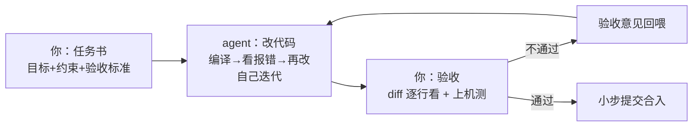

# AI 辅助开发

AI 写代码已经不是新鲜事，但**用网页聊天框辅助开发是明显的低效方式**：你复制代码过去、它改完你贴回来、报错再复制过去——来回搬运的是你，跑编译的是你，累的是你的手。本站推荐的方式是**用 agent 干活**：终端里的编码 agent（ZCode、Claude Code 这类）直接工作在你的项目目录里，**自己读代码、自己改文件、自己跑编译、自己看报错再迭代**——你只负责把目标说清楚、验收结果。

嵌入式是 AI 辅助的重灾区兼高价值区：芯片型号庞杂、API 方言林立，agent 恰好最擅长"替你读文档、替你试错"；但它也最爱在这里**一本正经地编造不存在的寄存器和 API**，所以验收比提问更重要。这个专栏教你在嵌入式场景里把 agent 用对。

:::tip[读者假设]
你已经（或正在）跟完本站[快速上手](../quickstart/)或[完整教程](../course/)。agent 不能替代"你知道点灯是怎么回事"——它替代的是"你背不下 HAL 库的函数签名"和"你在编译报错里来回挣扎"。
:::

## 1. 先立三条原则

整个专栏的方法都从这三条推出来：

1. **agent 是执行者，你是验收者。** 目标、约束、验收标准由你定；读代码、改文件、跑编译、盯报错这些体力活全部下放给 agent。判断"做没做对"永远不外包
2. **编译器和数据手册是唯一的真相。** agent 说"应该可以了"，让它拿编译输出和测试结果说话；电气参数、寄存器值，翻手册核对。agent 甚至可以替你翻——但你得抽查
3. **任务书质量决定产出质量。** agent 会自己收集上下文，但"目标是什么、不能动什么、怎样算完成"必须你写清楚。模糊的任务书 = agent 自由发挥 = 返工



注意和网页端方式的本质区别：**中间那个自我迭代的循环由 agent 自己转**，你只在入口和出口出现。这正是"减少人的工作量"的来源。

## 2. 为什么是 agent，不是网页端

| | 网页端聊天 | **终端 agent（本站推荐）** |
| --- | --- | --- |
| 上下文 | 你手动复制粘贴，贴漏了就答错 | **自己读仓库**，需要什么翻什么 |
| 改代码 | 你复制回来贴进编辑器 | **直接改文件**，git diff 可见 |
| 验证反馈 | 你跑编译→复制报错→贴回去 | **自己跑编译/测试**，报错自己看，改到自己通过 |
| 人的工作量 | 高：搬运工 + 编译工 + 人肉 diff | 低：写任务书 + 验收 |
| 适合场景 | 概念提问、学习讨论、一次性小片段 | 一切动代码的活 |

两者不是二选一：**理解概念、费曼检验、方案对比这类"对话"仍然适合网页端**；一切"动仓库里的代码"的活，交给 agent。本站教程里所有"改代码、查报错、写测试"的练习，都可以用 agent 模式完成。

## 3. harness 推荐：主推 dsh 与 opencode

"agent"是运行在 **harness**（承载它的终端工具）里的。这类工具很多，本站主推两个：

| | **dsh**（DeepSeek Harness） | **opencode** |
| --- | --- | --- |
| 背景 | DeepSeek 官方 agent harness | 开源（MIT）社区项目，终端 AI 编码 agent 的代表 |
| 形态 | **TUI / Web / headless 三种 profile** | 终端 TUI 为主，另有桌面端与 IDE 插件 |
| 特色 | **profile 分层体系**：插件包按层叠加出专属工作台；`dsh headless "任务"` 单任务模式，适合脚本化和自动化流水线 | **厂商中立**：75+ 推理商（Claude/GPT/Gemini/本地模型）自带 key 随便换；LSP 感知（跳转定义、读诊断）；遵循 AGENTS.md 约定 |
| 模型 | 围绕 DeepSeek 模型生态 | 任意模型 |
| 适合 | 已有 DeepSeek API、想要开箱即用、喜欢 Web 界面或要把 agent 嵌进脚本 | 想自由换模型、多语言大项目、开源党 |

安装（都是一条命令，npm 全局包）：

```bash
npm i -g @deepseek-ai/dsh      # dsh，装完 dsh web 或 dsh tui 启动
npm i -g opencode-ai           # opencode，项目目录里直接 opencode 启动
```

**本站建议**：两个都装，各司其职——日常任务书跑 **dsh**（DeepSeek 便宜直连，`headless` 模式把"跑测试、修报错"这类闭环直接挂进脚本）；需要换模型对比效果、或在多语言大项目里要 LSP 加持时用 **opencode**。两者都遵循 AGENTS.md 约定——**[工作流页](./workflow)里那份记忆文件两边通用**。

:::tip[harness 只是壳，方法才是本体]
换 harness 换的是"手感"，不是方法论：任务书五件套、小步提交、三层验证闭环、AGENTS.md 纪律——本专栏讲的所有方法在 dsh 和 opencode 上一字不改地通用。**别陷入"哪个工具更强"的比较，把任务书写好比把工具选对重要十倍**。
:::

## 4. 本专栏结构

| 页 | 内容 | 什么时候读 |
| --- | --- | --- |
| [提示词工程](./prompting) | 任务书五件套、好坏对照、角色/few-shot/输出格式/分步引导/负面清单五个技巧包 | 第一次给 agent 下任务前 |
| [agent 开发工作流](./workflow) | 项目全流程的人机分工：任务书→执行→验收，仓库记忆文件、小步提交 | 想把 agent 织进日常流程 |
| [验证与快速排错](./pitfalls) | 十秒核对清单、三层验证闸门、卡住了怎么排错 | 验收 agent 产出时对照 |

## 5. 嵌入式场景下 agent 的擅长与失灵

| 任务 | agent 表现 | 原因 |
| --- | --- | --- |
| 起草驱动/脚手架 + 自己改到编译通过 | ✅ 很强 | 能闭环验证的活，agent 的主场 |
| 报错诊断（自己跑编译读完整输出） | ✅ 强 | 不用你搬运报错，上下文全 |
| 跨文件重构、方言翻译（Arduino→IDF） | ✅ 强 | 自己能读全仓库，改完自己编译验证 |
| 写测试、写文档、批量机械修改 | ✅ 强 | 广而浅，最适合下放 |
| 冷门芯片（CH32V003、国产平替）的具体 API | ⚠️ 常编造 | 语料少，开始"合理猜测"，且**编译能过**（见下） |
| 时序敏感代码（中断纳秒级时序、DMA 边界） | ⚠️ 要逐行审 | 它没有你的硬件，上机验证仍是你 |
| "帮我决定这个项目用什么架构" | ❌ 别问 | 它会顺着你说，给你自信的错误答案 |

:::tip[agent 时代的一条要点：编译通过 ≠ 正确]
agent 偶尔会为"让编译通过"做错误但合法的改写（注释失败测试、绕过校验）。验收 diff 时对照[验证页的核对清单](./pitfalls)过一遍即可，不必焦虑。
:::

## 6. 和本站教程的关系

- **学习期**：卡在概念时网页端问"换种方式解释 + 出三道自测题"；**动手练习则让 agent 在你的练习仓库里陪你做**——你写思路，它补语法，diff 就是你的错题本
- **实战期**：照[工作流页](./workflow)的分工：你写任务书和验收，agent 执行闭环
- **排错期**：直接让 agent 跑编译、读 panic backtrace（原理见 [L2](../course/l2-programming-model/logging-backtrace)），你只判断它的验收证据够不够

## 下一步

- [提示词工程](./prompting)——任务书写法 + 五个技巧包
- [验证与快速排错](./pitfalls)——验收时对照核对清单
