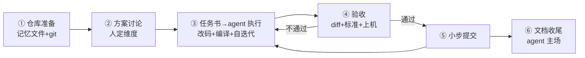

# agent 开发工作流

[任务书方法](./prompting)解决了"单次派活怎么派"，这一页解决"整个项目怎么跑"：把嵌入式项目从立项到交付拆成环节，说明每个环节人做什么、agent 做什么、怎么验收。**总原则只有一句：你出现在任务的入口（任务书）和出口（验收），中间的执行循环让 agent 自己转。**



## 0. 前置：把仓库收拾成 agent 能干活的样子

agent 的工作目录就是你的项目目录。三件十分钟的准备，回报贯穿整个项目：

1. **git 干净起步**：agent 每轮改动都靠 `git diff` 验收、靠 `git revert` 兜底。练习项目也 `git init`，无版本控制的项目不要让 agent 动手
2. **写项目记忆文件**：在仓库根放一个 `AGENTS.md`（或 agent 对应的约定文件），把"每次任务都要重复交代的事"固化进去，agent 每次开工自动读取：

```markdown
# AGENTS.md（示例：ESP32-S3 练习项目）
- 硬件：ESP32-S3-WROOM-1-N16R8；GPIO35/36/37 被 Flash/PSRAM 占用，禁止使用
- 框架：arduino-esp32 3.3.x；示例代码波特率统一 9600
- 构建验收：`pio run` 零错误零新增警告才算完成
- 改动纪律：每次任务 git diff 只允许出现任务书声明的文件
- 禁止：注释掉测试来"修复"失败；编造寄存器值（手册在 docs/datasheets/）
```

3. **收拢资料**：把常用数据手册 PDF、参考代码放进仓库（如 `docs/`），agent 能自己翻——**"让 agent 自己查手册"比"你复制给它"更准**，还省你的手

## 1. 环节①②：方案讨论——人定维度，agent 跑腿

立项讨论的正确用法（和网页端一致，但 agent 可以顺手做调研）：

> "为'电池温湿度记录仪'列 ESP32-C3 / STM32L0 / CH32V003 三方案对比表，维度我定：功耗、90 天数据存储够不够、单板成本、开发周期。查 docs/ 下的手册补数字，查不到的标'待实测'。最后指出对比里哪个结论最不可靠。"

**维度是你定的，agent 负责填表和标注不确定**——注意"查不到的标'待实测'"这句约束：它防住了 agent 用语料印象冒充手册数字（见[幻觉页](./pitfalls)）。

**投入度**：agent 30%，你 70%（维度、裁决、实测）。

## 2. 环节③④：任务书 → 执行 → 验收（核心循环）

这是项目 80% 的时间所在，也是和网页端方式差距最大的地方：

| 步骤 | 谁干 | 干什么 |
| --- | --- | --- |
| 写任务书 | **你** | 五件套 + 验收标准（[任务书页](./prompting)） |
| 执行循环 | **agent** | 读相关文件 → 改代码 → 自己跑编译/测试 → 看报错自己改 → 循环到自验通过 |
| 验收 | **你** | ① 逐行看 `git diff` ② 逐条核对验收标准 ③ 上机（波形/电流/真机） |
| 提交 | **你**（或让 agent 提） | 验收通过才 commit，信息写清是哪个任务 |

**执行循环里人的工作量是零**——这就是"减少人的工作量"的兑现处。网页端方式里这个循环的每一圈都是你手动转的；agent 方式里你只等"它自验通过"的通知。

**验收不通过的返工**：引用具体验收条目回喂（"第 2 条不满足：拔传感器卡死"），agent 修一轮你再验。三个返工话术和"三轮不收敛喊停"规则见[任务书页](./prompting)。

**投入度**：任务书和验收是你的活，执行循环由 agent 承担 80%（见下面第 4 节总表）——**而按工时算，人实际耗在入口和出口各几分钟**。

## 3. 小步提交：agent 的安全网

agent 一晚上能改 30 个文件。没有节奏约束，一次走偏就是大坑。两条纪律：

**① 每个任务一个提交点**。任务书 → agent 干 → 你验 → commit。这样任何一轮走偏都可以 `git revert` / `git reset` 回到"最后一个验收过的状态"，返工成本从"灾难"降到"十分钟"。

**② 大活拆小活**。"实现完整的 MQTT 上云"拆成：

```text
任务 1：WiFi 连接 + 断线自动重连（验收：日志可见连接/重连事件）
任务 2：MQTT 连接 broker + 心跳（验收：broker 端看到订阅）
任务 3：传感器采集 → JSON 发布（验收：broker 收到合法 JSON）
任务 4：深睡眠定时唤醒 + 快速重连（验收：平均工作电流 < 20mA，我上机量）
```

每片都是"任务书→执行→验收→提交"一个完整循环。agent 每片都可能走偏，但**走偏的爆炸半径被限制在一片内**。

## 4. 各环节投入度总表

| 环节 | agent 投入度 | 你干什么 | 验证方式 |
| --- | --- | --- | --- |
| 仓库准备 | 20% | 写记忆文件、收资料、git 起步 | ——（一次性） |
| 方案讨论 | 30% | 定维度、裁决 | 数字查手册/实测 |
| 执行循环 | **80%** | 写任务书、等结果 | ——（agent 自验 + 你抽查） |
| 验收 | 0%（**不许代劳**） | diff 逐行 + 标准打勾 + 上机 | 三层闸门见[幻觉页](./pitfalls) |
| 提交与集成 | 50% | 验收后 commit | diff 即事实 |
| 文档收尾 | 90% | 事实核对（引脚/参数名） | 对照代码 |

**规律**：除了"验收"这一格，其他环节 agent 都该吃到饱和——**人的不可外包项只有一个：验收**。

## 5. 危险操作边界：agent 不是什么都能"自己跑"

执行循环里有一条硬边界——**动真实世界的命令必须人批准**：

| 操作 | 放手吗 | 理由 |
| --- | --- | --- |
| 编译、单元测试、lint | ✅ 放手 | 可重复、无副作用 |
| 改仓库内文件 | ✅ 放手 | git 兜底 |
| `git push` / 改 git 历史 | ⚠️ 确认后 | 影响远端与他人 |
| **烧录到开发板**（idf.py flash / pio run -t upload） | ⚠️ 确认后 | 板子可能接着电机/电源等真实负载 |
| 删除文件/目录、批量 sed | ⚠️ 确认后 | git 能兜底但恶心；先让它列清单 |
| 安装全局依赖、改系统配置 | ❌ 逐次批准 | 影响超出项目范围 |

主流 agent 都支持权限模式（自动批准 / 每次确认 / 只读），**练手期建议"编译测试自动、烧录删除确认"的中间档**。把这条边界也写进 `AGENTS.md`，agent 会主动来问你。

## 常见坑

| 坑 | 解法 |
| --- | --- |
| 没写 AGENTS.md，每轮任务重复交代 | 三件套准备做一次，终身受益 |
| agent 大改一通才验收 | 小步提交：一任务一验收一提交 |
| 让 agent 自己验收自己 | 验收格投入度恒为 0%，diff 逐行 |
| 任务切太大，走偏难回滚 | 四片式拆解模板 |
| agent 说"测试我注释掉了因为环境问题" | 这是红线行为，回滚 + 在 AGENTS.md 里明令禁止 |
| 烧录/删除被 agent 悄悄执行 | 权限模式设中间档 + 记忆文件声明边界 |

## 下一步

- [幻觉与验证](./pitfalls)——最后一道闸门的完整展开
- [L7 工程化](../course/l7-engineering/)——项目模板与测试的原理版
