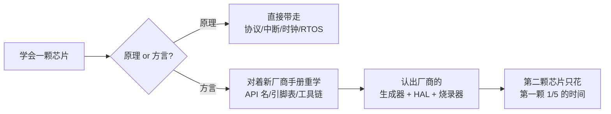

# 其他芯片

本站主线是 ESP32-S3，但嵌入式世界远不止一家。这个专栏回答两个问题：

1. **换到 STM32 或其他主流芯片时，学过的东西哪些直接带走、哪些要重学？**——答案是大部分直接带走，重学的集中在"工具链和芯片厂商的方言"
2. **手上的项目该选哪颗芯片？**——一张选型地图 + 每家的脾气

:::tip[先给结论，安心往下看]
你在[完整教程](../course/)学的 **C 语言、FreeRTOS、GPIO/UART/I2C/SPI/PWM/ADC 的原理、总线协议、中断模型、时钟概念、调试思路——全部 100% 通用**。换芯片重学的是三样东西：厂商的工具链（CubeMX 之于 ST，就像 IDF 之于乐鑫）、引脚复用的规则表、以及烧录调试的姿势。原理层一行都不用重学。
:::

## 1. 本专栏结构

| 专栏 | 深度 | 适合谁 |
| --- | --- | --- |
| [STM32 系列](./stm32/) | **6 页深讲**，从第一个工程到 RTOS/DMA/低功耗 | 想正经学第二颗芯片的人（强烈推荐：STM32 是国内就业/比赛覆盖面最大的 32 位 MCU 体系） |
| [其他主流芯片](./others/) | 3 页广讲，每家一段话 + 选型建议 | 想知道"还有什么、什么时候选它"的人 |

建议阅读顺序：先把 [STM32 导读](./stm32/)和[生态一页](./stm32/ecosystem)看完建立框架 → 拿一块开发板跟[第一个工程](./stm32/first-project)走一遍 → 再按需翻外设和进阶页。

## 2. 选型地图：一张表看懂主流阵营

| 阵营 | 代表芯片 | 内核 | 一句话定位 | 本站页 |
| --- | --- | --- | --- | --- |
| **乐鑫** | ESP32-S3（本站主线）/ C3 / C6 | Xtensa / RISC-V | 无线自带、生态极简，IoT/联网项目首选 | [完整教程](../course/) |
| **ST** | STM32F1/F4/H7/G4/L4 | Arm Cortex-M | 通用 32 位 MCU 事实标准，资料最多、工业最广 | [STM32 系列](./stm32/) |
| **8051 系** | STC89C52 / STC8H | 8 位 8051 | 教科书级入门，寄存器直写，理解"bare metal"的最佳教材 | [经典入门款](./others/classic-mcu) |
| **AVR** | ATmega328P（Arduino UNO） | 8 位 AVR | Arduino 的心脏，创客生态鼻祖 | [经典入门款](./others/classic-mcu) |
| **树莓派** | RP2040 / RP2350 | Cortex-M0+/M33 | 几块钱双核，PIO 外设独一份，创客新宠 | [国产与特色选手](./others/domestic-special) |
| **国产平替** | GD32 / CH32 / AT32 | Arm / RISC-V | 引脚级兼容 STM32，便宜货多，CH32V003 低到几毛钱 | [国产与特色选手](./others/domestic-special) |
| **Nordic** | nRF52 / nRF54 | Cortex-M4/M33 | 低功耗蓝牙（BLE）王者，耳机/手环/传感器标签常客 | [国产与特色选手](./others/domestic-special) |
| **TI** | MSP430 / MSPM0 | 16 位 / M0+ | 超低功耗标杆，电池供电仪表的经典选择 | [国产与特色选手](./others/domestic-special) |

（还有 Renesas RA、NXP i.MX RT、Infineon XMC 等大厂，思路与 STM32 高度同构——学会 STM32 后看它们的手册会觉得似曾相识。）

## 3. 学习迁移方法论：三问分清"通用的"和"方言的"

换任何芯片前，先问自己三个问题，就能把陌生感拆干净：

**第一问：这是原理还是方言？**——"上拉电阻为什么是 10k 不是 1Ω"是原理，换芯片照样成立；"`__HAL_RCC_GPIOC_CLK_ENABLE()` 这个函数名"是方言，换芯片就换写法。原理可以带走的标志是：**你能不看资料给别人讲明白它为什么**。

**第二问：厂商用什么工具替我干了什么？**——米思齐替你包了 Arduino，Arduino 替你包了 IDF，IDF 替你写了引脚矩阵配置。换到 STM32，CubeMX 扮演同样的角色：图形化配置引脚/时钟/外设，生成初始化代码。**认出"这家厂商的米思齐/Arduino 是谁"，你就掌握了这家生态的入口。**

**第三问：这块芯片的"资源预算"是多少？**——ESP32-S3 是 512KB RAM + 8MB PSRAM 的"富家子弟"，STM32F103C8T6 是 20KB RAM 的"精打细算"，51 只有 512 字节 RAM。**换芯片第一件事是背下它的 RAM/Flash/主频**，因为"能不能跑 FreeRTOS""要不要注意栈溢出""数组敢开多大"全部由它决定。

## 4. 从哪颗开始？

- **毕业去向是嵌入式开发岗**：学 **STM32**，国内招聘 JD 出现率最高，本站 STM32 六页就是为此准备
- **比赛想快速出活**：留在 ESP32（无线自带，方案最短），除非赛题指定
- **想真正理解"没有操作系统、没有库"的裸机**：玩一块 **51 或 STM32 寄存器版**，写一次"自己配时钟自己点灯"
- **预算敏感 + 玩票**：RP2040 或 CH32V003，几块钱包邮

## 下一步

- [STM32 导读](./stm32/)——家族地图与选型
- [其他主流芯片地图](./others/)——每家一段话
- 回 [完整教程](../course/)——原理层的主线
