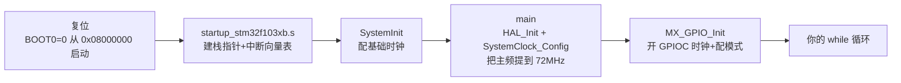

# 第一个工程：蓝板点灯全流程

这一页以最常见的 **STM32F103C8T6 蓝板（Blue Pill）+ ST-Link** 为例，走通"装工具 → CubeMX 配置 → 生成工程 → 写代码 → 烧录 → 验证"全流程。点灯本身一分钟，重点是**每一极背后发生了什么**——和 ESP32 一对照，你会对"MCU 上电到 main() 之间发生了什么"理解深一个层次。

## 0. 准备清单

| 东西 | 说明 |
| --- | --- |
| 蓝板（F103C8T6） | 10~15 元；如果板载 LED 在 PC13（绝大多数蓝板都是） |
| ST-Link V2（克隆版可） | SWD 烧录调试，10~20 元 |
| USB 转串口模块（可选） | 备胎烧录 + 看串口输出 |
| STM32CubeMX + STM32CubeIDE | 官网免费下载（需注册 ST 账号）；国内可从 ST 中文社区找镜像 |

蓝板的板载 LED 接在 **PC13**，且是**灌电流接法**（LED 阳极接 3.3V，阴极经电阻接 PC13）——所以**引脚输出低电平灯才亮**，和 ESP32 DevKitC 的 RGB 灯逻辑相反，先记住这点免得怀疑代码错了。

## 1. CubeMX：创建工程

1. **New Project → MCU 选择器**搜 `STM32F103C8`，选 `STM32F103C8Tx`
2. **SYS**：Debug 选 `Serial Wire`（⚠️ 不选的话烧一次后 SWD 被禁用，板子"锁死"，见常见坑）
3. **RCC**：HSE 选 `Crystal/Ceramic Resonator`（蓝板有 8MHz 外部晶振）
4. **时钟树页**：HSE 8MHz → PLL 倍频 ×9 → SYSCLK **72MHz** → APB1 分频 /2（36MHz，F1 的 APB1 上限）、APB2 /1（72MHz）
5. **引脚图上点 PC13** → 选 `GPIO_Output`，右键 User Label 命名 `LED`
6. **Project Manager**：Toolchain 选 `STM32CubeIDE`；Code Generator 页勾上"Generate peripheral initialization as a pair of .c/.h files"（外设初始化分文件，工程整洁）
7. **GENERATE CODE**

:::tip[时钟树这一步，是 ESP32 上你从没做过的]
ESP32 的 240MHz 是固件里一行 `menuconfig` 配置（甚至默认就是），STM32 的主频是**上电后由你的代码现场把晶振倍频出来的**——第 6 节的启动流程会讲它在哪一步发生。新手期跟着上面数值配即可，**HSE 必须填 8MHz**（蓝板实际晶振），填错 25MHz 会让串口波特率全错。
:::

## 2. 写代码

CubeIDE 里生成的 `main.c`，在用户区加点灯循环：

```c
/* USER CODE BEGIN WHILE */
while (1)
{
  HAL_GPIO_WritePin(GPIOC, LED_Pin, GPIO_PIN_RESET);  // 低电平 → 灯亮（灌电流）
  HAL_Delay(500);
  HAL_GPIO_WritePin(GPIOC, LED_Pin, GPIO_PIN_SET);    // 高电平 → 灯灭
  HAL_Delay(500);
  /* USER CODE END WHILE */
}
```

编译（锤子图标），确认 0 Error。`HAL_Delay` 基于 SysTick（一个硬件倒计时器，每 1ms 中断一次减计数）——**和 ESP32 的 `vTaskDelay` 不同，它是死等**，不是让出 CPU。单任务点灯无所谓，跑 RTOS 后要换成 `osDelay`（见[进阶页](./rtos-dma-power)）。

## 3. 烧录与验证

1. ST-Link 接蓝板四根线：`SWDIO→DIO`、`SWCLK→CLK`、`GND→GND`、`3.3V→3.3`
2. CubeIDE 里 Run → Debug（小虫子图标），首次会弹 ST-Link 固件升级提示（克隆版**跳过**，别升级）
3. 成功停在 `main` 入口断点 → 按 F8（Resume）全速运行

**成功标志**：蓝板上 LED 每秒一闪，且 IDE 能暂停/继续/看到源码级执行位置——后者就是 SWD 调试在生效，比 ESP32 的"串口 printf 盲猜"先进一档。

## 4. 从复位到 main()：启动流程逐帧分解

点灯成功后值得回看一遍"上电那零点几秒发生了什么"——这是 STM32 教学里最重要的一张认知地图，ESP32 把它藏在 ROM bootloader 里，STM32 让你看得见：



逐层说：

1. **硬件复位**，BOOT0 引脚为低（蓝板上有跳线帽固定），芯片从 **Flash 地址 0x08000000** 开始执行——ESP32 的对应物是 ROM bootloader 读分区表；STM32 没有分区表，**程序直接从 Flash 首地址原地执行**（这也是 STM32 片内 Flash"零等待"的直观体现）
2. **启动文件**（`startup_stm32f103xb.s`，汇编）：设置栈指针、把中断向量表放好、然后跳进 C 世界
3. **SystemInit**（system_stm32f1xx.c）：配一个保底时钟（内部 8MHz HSI），让芯片先能跑
4. **main 开头的 `SystemClock_Config`**：CubeMX 生成的那段函数——开 HSE、等它稳定、PLL 倍频 ×9、切换 SYSCLK 到 72MHz。**你画时钟树时拖的那些滑块，最终就是这一段代码**
5. **`MX_GPIO_Init`**：注意 STM32 的 GPIO 挂在 APB2 总线上，**先要"开时钟"（`__HAL_RCC_GPIOC_CLK_ENABLE`）再操作**——ST 为了省电默认把不用的外设时钟关掉，这是 ESP32 上不存在的概念（ESP32 外设时钟默认开、按需门控由驱动管）

:::caution[新手最常见的"代码没错但不跑"：忘了开外设时钟]
手动在 HAL 之外摸寄存器时，忘了 `__HAL_RCC_XXX_CLK_ENABLE()` 是头号翻车点，症状是"写了寄存器毫无反应"。CubeMX 生成的代码已替你开好，但理解这个机制会让你日后看懂 80% 的"外设不工作"问题。
:::

## 5. 没有调试器时：串口 ISP 备胎方案

BOOT0 拉高（蓝板 BOOT 跳线挪到 1）→ 复位 → 芯片进入 **ROM 里的串口 bootloader**，通过 USART1（PA9/PA10，115200）用 STM32CubeProgrammer 或 `stm32flash` 工具烧录 → BOOT0 拉回 0 复位，正常运行。

注意：**串口 ISP 只能烧录，不能调试**；且蓝板的串口芯片 CH340 只接了 PA9/PA10，正好够用。这条路径和 ESP32 的 esptool 体验最接近。

## 常见坑

| 症状 | 病根 |
| --- | --- |
| 烧录一次后 ST-Link 再也连不上 | CubeMX 里 SYS Debug 没选 `Serial Wire`，固件把 PA13/14 复用成了 GPIO。**救援**：BOOT0 拉高用串口 ISP 烧回一个选了 SWD 的程序 |
| 灯不闪，代码看着没错 | 蓝板 LED 是灌电流，试试先写"常亮"验证极性；或 PC13 没被初始化（确认 CubeMX 里点了输出） |
| 串口乱码 | 时钟树 HSE 填了默认 25MHz（蓝板是 8MHz），波特率算错 |
| `Error: ST-LINK error` | SWDIO/SWCLK 接反；或板子供电不足（USB 供电口要插） |
| 克隆芯片识别成 CS32/CKS32 | 正常，兼容片，学习无碍；个别工具链对它有兼容开关 |
| 断点后板子"卡死"正常吗 | 正常， halted 状态就是停住了；Resume 继续 |

## 下一步

- [常用外设实战](./peripherals)——UART/ADC/TIM/I2C 一个个上
- [ESP32↔STM32 迁移对照](./from-esp32)——把两边知识正式对齐
