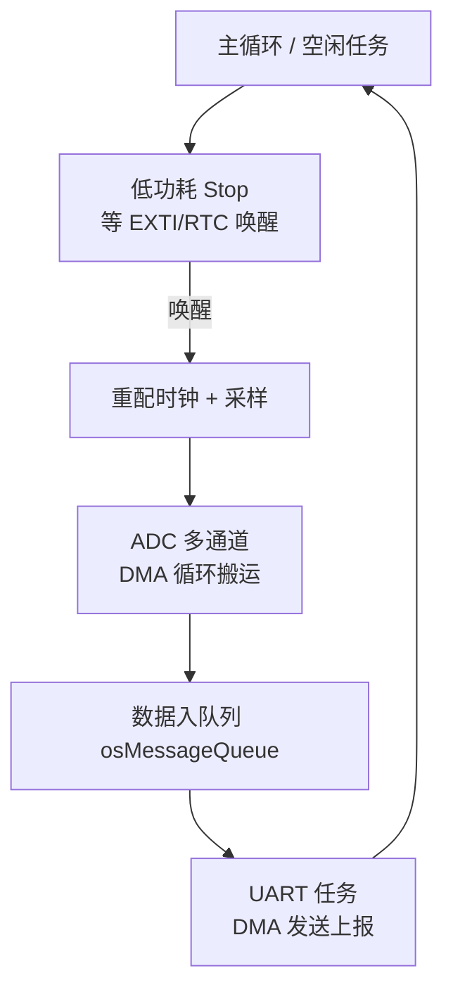

# STM32 进阶：DMA、FreeRTOS 与低功耗

项目一复杂就会撞上三堵墙：串口/ADC 数据流大，CPU 光搬砖没空干活（**DMA**）；逻辑分好几路要并发（**FreeRTOS**）；电池供电撑不过三天（**低功耗模式**）。这三大件在 ESP32 上你已被动享受过（IDF 驱动内部全是 DMA，FreeRTOS 默认开着），STM32 上它们是**显式配置出来的**——配过一遍，才算真正理解它们是什么。

## 1. DMA：让搬运工替 CPU 干活

### 本质回顾

外设和内存之间的每个字节都要人搬。没有 DMA 时 CPU 亲自搬（轮询或中断，每字节一次打断）；DMA（Direct Memory Access，直接内存访问）是一个**独立于 CPU 的搬运控制器**：你告诉它"从 A 搬到 B，搬 N 个，搬完叫我"，它用总线自己搬，CPU 该干嘛干嘛。原理在[本站存储一节](../../course/l6-system/storage)提过，STM32 上它显式可见。

### STM32 的 DMA 通道模型

F1 的 DMA1 有 **7 个通道**，每个通道固定"服务"一组外设（DMA 请求映射表写死在手册里）——这是和 ESP32 最大的方言差异：**ESP32 的 GDMA 是通用的，外设随便挑；F1 的 DMA 通道是"专线"**，USART1_RX 只能走 DMA1 通道 5。CubeMX 里选外设 DMA 设置时下拉框只给你合法选项，就是这张映射表在起作用。

### 实战：UART 接收用 DMA + 空闲中断

串口收不定长数据包的经典方案，值得完整理解（I2S/ADC/DAC 同思路）：

```c
// CubeMX：USART1 → DMA Settings → Add USART1_RX（Circular 模式）
// 并使能 USART1 的 IDLE（空闲线）中断
HAL_UART_Receive_DMA(&huart1, rxBuf, sizeof(rxBuf));  // DMA 在后台持续收

void USART1_IRQHandler(UART_HandleTypeDef *huart) {
  if (__HAL_UART_GET_FLAG(huart, UART_FLAG_IDLE)) {   // 总线空闲 = 一包结束
    __HAL_UART_CLEAR_IDLEFLAG(huart);
    size_t pos = sizeof(rxBuf) - __HAL_DMA_GET_COUNTER(huart->hdmarx);
    packet_done(rxBuf, pos);                          // 本次包长 = 缓冲 - 剩余计数
  }
}
```

思路：DMA 循环收字节进缓冲，**"一包发完了"由 IDLE 中断判断**（线上超过一个字节时间没新数据）——CPU 只在包结束时被叫醒一次处理整包，而不是每字节打断一次。这就是"事件驱动数据流"的标准范式。

**占空比对照**：ESP32 里 `uart_driver_install` 内部就是这套（DMA + 事件队列），你拿到的是现成抽象；STM32 上亲手配一遍后，回头看 IDF 驱动参数会突然全懂。

## 2. FreeRTOS：第二次装 RTOS

### CubeMX 一键移植

ESP32 出厂就带 FreeRTOS（[L2 讲过](../../course/l2-programming-model/freertos)任务/队列/信号量），**概念完全复用，一行不用重学**。STM32 侧在 CubeMX 勾 Middleware → FREERTOS（选 CMSIS-RTOS v2 接口）→ 生成后：

```c
osThreadId_t t1;
void StartTask1(void *argument) {          // 任务函数，签名与 IDF 略异、逻辑全同
  for (;;) {
    HAL_GPIO_TogglePin(GPIOC, LED_Pin);
    osDelay(500);                          // ★ 带阻塞延时，等价 vTaskDelay
  }
}
int main(void) { /* CubeMX 生成的初始化之后 */ 
  t1 = osThreadNew(StartTask1, NULL, &attr1);
  osKernelStart();                          // 注意：main 不会往下走了
  for (;;) {}
}
```

### 两生态 API 对照（核心五个）

| 概念 | FreeRTOS 原生（IDF 直接用） | CMSIS-RTOS v2（CubeMX 默认） |
| --- | --- | --- |
| 任务 | `xTaskCreate` | `osThreadNew` |
| 延时让出 | `vTaskDelay` | `osDelay` |
| 队列 | `xQueueSend/Receive` | `osMessageQueuePut/Get` |
| 信号量 | `xSemaphoreTake/Give` | `osSemaphoreAcquire/Release` |
| 互斥量 | `xSemaphoreCreateMutex` | `osMutexNew/Acquire` |

CMSIS-RTOS v2 是 FreeRTOS 上面的一层薄封装（Arm 定的统一接口）。**底层内核参数（优先级含义、抢占规则、临界区）一模一样**。

### 三个 F1 特有的坑（ESP32 上不存在）

1. **RAM 预算按字节抠**：F103C8 只有 **20KB SRAM**，RTOS 每个任务栈至少几百字节、FreeRTOS 堆默认还要吃几 KB。20KB 里跑 5 个任务已经很挤——任务栈用 `osThreadAttr_t.stack_size` 精确给，别学 ESP32 的"开 8KB 无所谓"
2. **中断优先级分组与 `configMAX_SYSCALL_INTERRUPT_PRIORITY`**：FreeRTOS 要求"会调用 FromISR API 的中断"优先级必须落在一个区间内，设错了（尤其默认优先级分组的坑）触发 `configASSERT` 卡死。ESP32 也管这个但脚手架全替你搭好了；CubeMX 生成的工程已配对默认值，**手动改 NVIC 优先级时先回来读这条**
3. **`HAL_Delay` 在 RTOS 下不能用**：它基于 SysTick 死等且 SysTick 被 RTOS 接管——任务里一律 `osDelay`，否则等于忙等占满 CPU

## 3. 低功耗：三级模式与"谁叫得醒"

ESP32 的深睡眠模型（RTC 域守着定时器/触摸唤醒，见 [L6 功耗一节](../../course/l6-system/power)）到 STM32 换成一套更简单的三级体系：

| 模式 | 关了什么 | 电流典型值（F103） | 唤醒源 | RAM/寄存器 |
| --- | --- | --- | --- | --- |
| **Sleep** | 只停 CPU 内核 | ~几 mA | 任意中断 | 全保留 |
| **Stop** | 停 1.8V 域所有时钟（HSI/HSE/PLL 全关） | ~十几 μA | **EXTI 线**（引脚）、RTC | SRAM 保留，时钟配置重配 |
| **Standby** | 连 SRAM 供电都断 | ~几 μA | WKUP 引脚(PA0)、RTC 闹钟、IWDG 复位 | **SRAM 不保留**，唤醒=复位重启 |

```c
// Stop 模式示例：进睡前配好 EXTI 唤醒
HAL_SuspendTick();                          // SysTick 停了，HAL 计时失效
HAL_PWR_EnterSTOPMode(PWR_LOWPOWERREGULATOR_ON, PWR_STOPENTRY_WFI);
// ---- 唤醒后从这里继续，但此时主频回落到 8MHz HSI ----
SystemClock_Config();                       // ★ 必须重新配时钟树！
HAL_ResumeTick();
```

**最容易翻车的点**：从 Stop 唤醒后系统时钟**自动回落到内部 8MHz**（PLL 关了），不重配时钟树的话程序还在跑，但主频只有原来的 1/9——串口乱码、定时全错。这对应 ESP32 深睡眠唤醒后"一切重新初始化"的经验，只是 STM32 的 Stop 模式是**从断点继续执行**而非重启，一半状态活着，容易让人忘记时钟已死。

**设计口诀**：需要毫秒级响应 → Sleep；秒级/事件触发 → Stop；一天只醒几次上报 → Standby（配合 RTC 闹钟）。再往上抠功耗就是关外设时钟（`__HAL_RCC_XXX_CLK_DISABLE`）、GPIO 配成模拟输入防漏电——思路与 ESP32 的"睡眠前把外设逐个收拾干净"完全一致。

## 4. 三大件组合拳：一个典型框架



电池传感器节点（Stop 打盹 → 定时唤醒 → DMA 采一批数据 → DMA 发出去 → 继续睡）把三大件全用上了——这也是 STM32 面试的经典综合题。

## 常见坑

| 症状 | 病根 |
| --- | --- |
| DMA 配置下拉框里找不到目标外设 | F1 通道专线映射，该外设只能走指定通道 |
| 硬fault 进 HardFault_Handler 死循环 | 任务栈开太小 / 中断里调用了非 FromISR API / 数组越界——SWD 断在 HardFault 看调用栈 |
| 进 Stop 后唤醒串口乱码 | 唤醒后没重配时钟树，主频回落 8MHz |
| RTOS 下偶发死机且难复现 | 中断优先级越过 `configMAX_SYSCALL_INTERRUPT_PRIORITY` 红线 |
| 20KB RAM 编译能过运行 OOM | FreeRTOS 堆 + 任务栈 + HAL 缓冲挤爆 SRAM；用 `xPortGetFreeHeapSize` 查 |
| Standby 醒来代码"从 main 重跑" | 这是 Standby 的定义（SRAM 断电=复位级唤醒），需要保存的状态提前写 Backup SRAM/RTC 寄存器 |

## 下一步

- [ESP32↔STM32 迁移对照](./from-esp32)——把两边体系正式对账
- [L7 工程化](../../course/l7-engineering/)——测试、剖析、项目模板（大部分方法直接通用）
