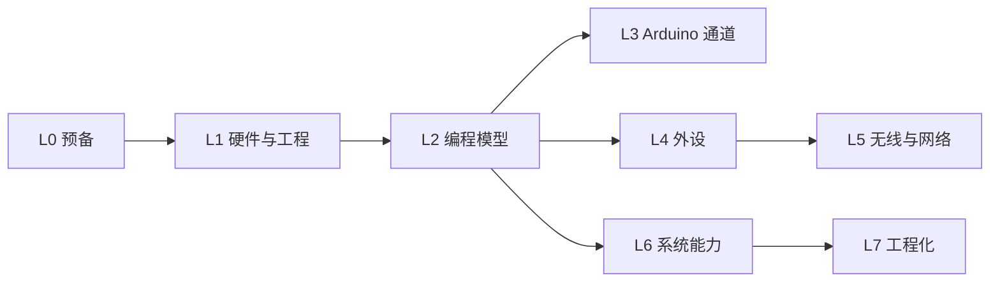

# 完整教程

这是一条**串行主线**：按顺序学，每一阶段都建立在前一阶段之上。目标是能独立开发、调试并交付一个完整的 ESP32-S3 项目。

:::tip[零基础读者请从这里开始]
L0 的前两页（[程序和计算机到底是什么](./l0-basics/what-is-computing)、[C 语言核心](./l0-basics/c-language)）假设你**从没写过代码**——所有术语第一次出现都会先解释，配生活比喻。有编程基础的人可以快速划过 L0，直接从 L2 起步。
:::

## 为什么是串行

并行铺开看似快，但 ESP32 的概念有强依赖关系：



- 没懂 [FreeRTOS](./l2-programming-model/freertos) 就学不动事件循环、任务间通信、低功耗
- 没懂 [外设寄存器原理](./l4-peripherals/) 就只能抄例程，出错不会调
- 没懂 [组件模型与 CMake](./l2-programming-model/component-cmake) 就用不动官方组件

## 阶段总览

| 阶段 | 内容 | 核心产出 | 时长 |
| --- | --- | --- | --- |
| [L0 预备知识](./l0-basics/) | 计算机是什么、C 语言从零讲起、嵌入式心智模型、学习方法 | 能读懂带指针的代码，建立自己的错误笔记 | 2～3 周 |
| [L1 硬件与最小系统](./l1-hardware/) | 芯片选型、原理图、工程搭建 | 一个自己的 IDF 工程 | 1 周 |
| [L2 编程模型](./l2-programming-model/) | FreeRTOS、组件、分区、日志 | 多任务 + 队列 + 优雅崩溃 | 2～3 周 |
| [L3 Arduino 快速通道](./l3-arduino/) | Arduino 框架本质与边界 | 知道什么时候该用它 | 0.5 周 |
| [L4 外设深度](./l4-peripherals/) | GPIO/ADC/PWM/总线/音频/摄像头 | 每个外设都能从零调通 | 3～4 周 |
| [L5 无线与网络](./l5-wireless/) | WiFi、BLE、lwIP、OTA | 一个可靠的联网设备 | 2～3 周 |
| [L6 系统能力](./l6-system/) | 存储、功耗、安全、USB、GUI、AI | 能做产品化的功能 | 2～3 周 |
| [L7 工程化](./l7-engineering/) | 项目模板、测试、性能、毕业项目 | 可交付的工程 | 1～2 周 |

全程约 14～20 周。如果时间紧，配合[快速上手](../quickstart/)走双通道：先用快速上手出成果，再回来逐阶段补原理。

## 版本基线

| 项 | 版本 |
| --- | --- |
| ESP-IDF | v5.5.x（本教程锁定此基线；6.x 已发布，尚未迁移） |
| arduino-esp32 | 3.3.x（基于 IDF 5.5.x） |
| 硬件 | ESP32-S3-WROOM-1-N16R8 + DevKitC-1 |
| 工具链 | xtensa-esp32s3-elf GCC |

:::tip[我们用的板子到底是哪块（长名字拆开读）]
教程全程基于一块开发板：**ESP32-S3-WROOM-1-N16R8 模组 + ESP32-S3-DevKitC-1 开发板**。这一长串名字是三层，逐层拆开：

```text
ESP32-S3-WROOM-1-N16R8
└─ 芯片：ESP32-S3（双核 240MHz，教程主角）
   └─ 模组：WROOM-1（金属屏蔽罩那一块 = 芯片 + 16MB Flash + 8MB PSRAM + 天线）
      └─ 开发板：DevKitC-1（把模组焊上底板，引出排针、加 USB 口和按键）

N16R8 的意思：N16 = 16MB Flash，R8 = 8MB PSRAM
```

确认你手上的板子：看金属屏蔽罩丝印写着 `ESP32-S3-WROOM-1` 即是（后缀只代表容量）。**任何带 S3 模组的开发板都能跟完全部教程**；买成 C3 等其他型号的先读[跨型号移植指南](../reference/porting)。选 S3 的原因：家族里外设最全（双核、PSRAM、触摸、原生 USB），教程里每个实验都不用打折。

:::

:::tip[换一块 ESP32 会怎样]
教程固定用 S3，但家族内型号差异不小（引脚约束、ADC/DAC/触摸、LEDC 通道数……）。**通用套路占九成，特供部分集中在引脚和外设数量**——移植前读一遍[跨型号移植指南](../reference/porting)。
:::

:::tip[换一家芯片会怎样（STM32 等）]
本教程的原理层（C 语言、FreeRTOS、外设协议、中断、时钟）是全行业通用的；换厂商重学的只有工具链和引脚规则。想往 STM32 及其他主流芯片走，去[其他芯片专栏](../chips/)——那里有 STM32 六页深讲和各家的选型地图。
:::

每个页面涉及版本差异时都会单独标注。版本清单见[库与版本对照](../reference/libraries)。

## 学习方法

1. **每章先跑通官方示例，再自己写。** 官方示例是对 API 的唯一权威解释——原因和查资料的优先级，见 [L0 的"怎么学"一节](./l0-basics/how-to-learn)
2. **所有示例都要改成自己的需求。** 抄一遍没有意义，改一遍才有
3. **主动制造故障。** 拔掉传感器看程序怎么反应，注释掉 WiFi 看重连逻辑，这个练习的收益极高
4. **随手记错误码。** 建一个自己的错误笔记，每解决一个报错记三行（日期、现象、解法）。收集到 [错误码速查](../reference/error-codes) 里的东西，是全站复用率最高的页面
5. **每学完一节，用自己的话复述一遍。** 讲不顺的地方就是没真懂的地方

## 下一步

[L0 预备知识](./l0-basics/) —— 或者时间紧就直接去[快速上手](../quickstart/)出成果。
