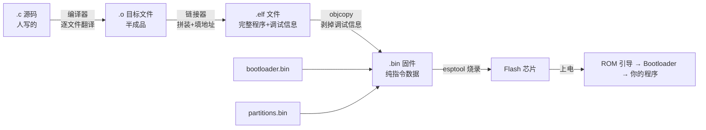
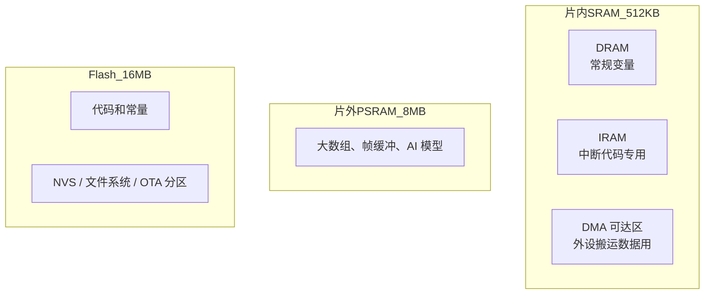
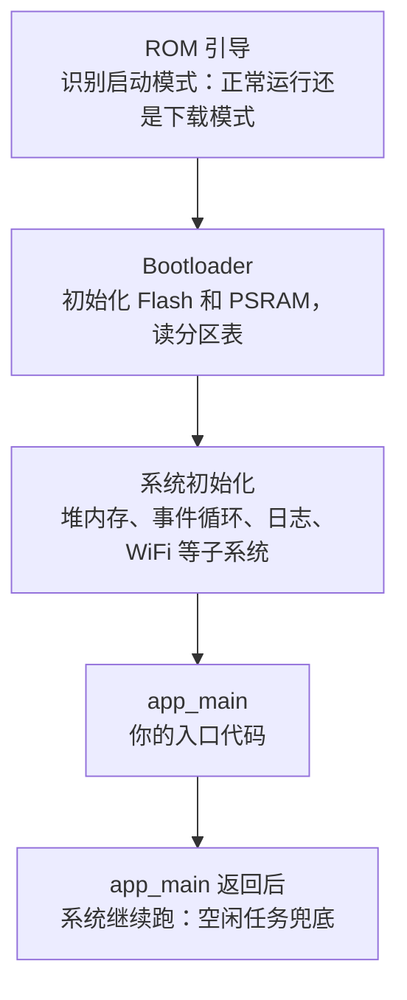

# 嵌入式心智模型

前两页你学会了"操作单"（程序）怎么写。这一页回答几个更根本的问题：

- 程序从你的电脑到芯片内部，经历了什么？
- 程序跑起来之后，住在哪里、用什么、极限在哪？
- "按键触发""WiFi 收到数据"这些事，芯片是怎么"知道"的？

写嵌入式代码和写电脑程序最大的区别：你的程序**不是跑在 Windows 或安卓之上**，而是几乎直接跑在硬件上——老外管这叫**裸金属（Bare-metal）**，意思是"光着脚站在金属上"，没有操作系统替你兜底。内存要自己省、故障要自己扛、每个字节的去处都要心里有数。这一页就是建立这套"资源有限"的心智模型。

## 1. 从代码到上电运行：一次完整的旅行

你在电脑上敲的 `.c` 文件，芯片根本看不懂。它要经历四步加工才能"住进"芯片：



### 每一步都在干什么

| 步骤 | 干什么 | 比喻 |
| --- | --- | --- |
| **编译（Compile）** | 每个 `.c` 文件**单独**翻译成机器指令（`.o` 目标文件） | 每个译者各翻各的章节 |
| **链接（Link）** | 把所有 `.o` 拼在一起，把"调用某个函数"落到它的真实地址上 | 把各章节装订成书，补上全部页码引用 |
| **生成 .bin** | 剥掉调试信息（函数名、行号表），得到纯指令镜像 | 去掉译者的草稿批注，只留正文 |
| **烧录（Flash）** | 用 USB 线把镜像写进芯片外挂的 Flash | 把成书搬进档案柜 |

**为什么要分"编译"和"链接"两步？** 因为大项目里 `main.c` 调用了 `sensor.c` 的函数，编译 main.c 时编译器只看到"声明"（头文件里说有这么个函数），不知道它的指令在哪——先把"这里要跳转到某函数"记成一张欠条（叫**符号引用**）。链接器收齐所有 `.o` 后，**兑现全部欠条**：每个函数名找到真实地址，填回去。

### 链接阶段报错：新手最常撞的墙

链接兑现欠条时如果发现"欠条上的名字全工程里没人有"，就报：

```text
undefined reference to `sensor_init'
```

意思是"**你喊了 `sensor_init`，但整本书里没有这个函数**"。十有八九是两种原因：

1. 忘了告诉构建系统去哪个组件找——CMakeLists 里漏了 `REQUIRES`（见 [组件模型](../l2-programming-model/component-cmake)）
2. 函数名拼错——头文件里的名字是 `sensor_init`，你写成了 `sensor_Init`（**C 区分大小写**）

它的兄弟报错是 `fatal error: xxx.h: No such file or directory`——"找不到你 include 的头文件"，同样是没声明依赖。**这两种报错占了新手编译失败的八成**，见到就知道是"欠条"出了问题，去查 REQUIRES 和拼写。

### elf 和 bin 的分工

编译产物里你会看到两种文件，各有用途：

| 文件 | 内容 | 用途 |
| --- | --- | --- |
| `.elf` | 机器指令 + **符号表**（函数名、变量名、行号和地址的对应关系） | 给调试工具用——addr2line、GDB 靠它把地址翻译成人话。**留着，别删** |
| `.bin` | 纯机器指令 | 烧进 Flash 的东西 |

后面学崩溃定位时会用 `addr2line -e build/xxx.elf 0x400d1234` 把崩溃地址翻译成"sensor.c 第 58 行"——**翻译能力全来自 elf 里的符号表**，这就是为什么编译产物要分两个文件。

### 上电后发生了什么

芯片上电的第一秒，执行的不是你的程序，而是一串"接管流程"：

1. **ROM 引导**：芯片出厂时固化在芯片**内部**的一小段代码（不在 Flash 里，永远在），决定"从哪启动"（正常启动还是进下载模式）
2. **Bootloader（二级引导程序）**：初始化 Flash、PSRAM，读分区表，找到要运行的应用，把它加载/映射好
3. **系统初始化**：搭好堆内存、日志、事件循环等基础设施
4. **`app_main`**：**你的代码**从这里开始跑

所以启动日志开头那一大串看似乱码的信息，其实是这四步的"自述"——本页第 6 节带你逐行读懂它。

### 烧录到哪：Flash 的地址地图

Flash 不是一个文件，是按地址划分的连续空间。S3 默认布局里每个部件住在固定地址：

| 文件 | 烧录偏移 | 内容 |
| --- | --- | --- |
| `bootloader.bin` | `0x0` | 二级引导程序 |
| `partitions.bin` | `0x8000` | 分区表（Flash 怎么切分） |
| `firmware.bin`（app） | `0x10000` | 你的程序 |
| `ota_data` | 运行时写入 | OTA 升级状态 |

"偏移（Offset）"就是"距离 Flash 开头多少字节"。`0x8000` = 32768 = 32KB——bootloader 之后的空当留给分区表。**你不需要背这些数，但看到报错里的 `0x10000`、`0x8000` 要知道它们在说哪一部分。**

### map 文件：程序的家底清单

编译完成后，`build/` 目录下有一个 `.map` 文件——它是链接器的"施工记录"，**逐条列出每个函数、每个变量被放到了哪个地址、占了多少字节、来自哪个文件**。长这样（示意）：

```text
.text.app_main
    0x00000000420342b8       0x5c  main/app_main.o
.text.sensor_init
    0x0000000042034314       0x30  components/app_driver/app_driver.o
```

读法：`app_main` 函数被放在地址 0x420342b8、占 0x5c（92）字节、来自 main/app_main.o 这个文件。平时不用看，但它能回答几个关键问题：

- 我的程序为什么这么大？（在 map 里按大小排序找大户——通常是 WiFi / TLS / BLE）
- 某个函数真的被编译进去了吗？（搜函数名，搜不到 = 没编进去 = 链接时被裁了）
- RAM / Flash 各用了多少？

Flash 不够用时的第一手数据来自 `idf.py size`：

```text
Total sizes:
DRAM  0x3c004 (245764) = 245764      ← 用掉的内存
Flash 0x9c8c40 (10259520) = 10259520 ← 用掉的 Flash（约 9.8MB）
```

## 2. 内存布局：每一块内存各有脾气

[前一页](./what-is-computing)说了"内存是桌面"。现在把这张桌面拆开看——ESP32-S3 的内存不止一种，各有各的规矩：



### 各区域逐个认识

| 区域 | 特点 | 放什么 |
| --- | --- | --- |
| **DRAM**（常规内存） | 快，CPU 直接访问，约 512KB 的大头 | 普通变量、任务栈、堆 |
| **IRAM**（指令内存） | **Flash 缓存关闭时也能跑代码** | 中断服务函数（`IRAM_ATTR` 标记） |
| **PSRAM**（外挂大内存） | 8MB，但在芯片外面，访问要过缓存、慢几倍 | 大数组、图像帧、AI 模型 |
| **Flash** | 16MB；**代码就在这里"原地执行"** | 程序本体、常量、文件系统 |

**"代码在 Flash 原地执行"是什么意思？** 电脑上程序启动时整个搬进内存再跑；ESP32 不搬——指令留在 Flash 里，CPU 要执行哪条就**通过缓存**临时取哪条。好处是省内存（512KB 装不下 1MB 的程序也能跑），代价是**第一次执行的代码慢**（要现场从 Flash 读，"缓存未命中"）。由此产生本页最重要的硬件事实之一：**Flash 缓存可能被临时关闭（比如正在写 Flash 时），那段时间 Flash 里的代码取不出来**——所以有些代码必须放在"永远取得到"的 IRAM 里（第 4 节的中断就是）。

### 栈和堆：桌面上最重要的两块地

**栈（Stack）**：每个函数运行时的"临时工作台"。

```c
void calc(void) {
    int a = 1;              // 局部变量 a 住在栈上
    float buf[64];          // 这个数组也住在栈上
}                           // ← 函数返回，整个工作台瞬间清空
```

- 函数调用时在栈顶"划一块地"放局部变量，函数返回整块地自动回收——**全自动，无需你操心**
- 但栈**很小**（每个任务默认 4KB 左右）。放个大数组 `int big[10000];`（40KB）？**栈溢出**，表现为随机崩溃并打印 `Stack overflow`
- 函数层层调用（A 调 B 调 C）时每层的地**叠加**，递归太深、链式调用太长都会撑爆

**堆（Heap）**：程序运行中"现申请现用"的大仓库。

```c
#include <stdlib.h>

char *buf = malloc(8192);   // 跟仓库管理员要 8KB，返回房间号（指针）
if (buf != NULL) {
    // 用 buf ...
    free(buf);              // ★ 用完必须还！
    buf = NULL;             // 顺手把房卡作废，防止误用
}
```

- `malloc` 申请、`free` 归还，**只借不还（忘 free）就是内存泄漏**——在几个月不关机的设备上，泄漏迟早把内存吃光
- 还了之后再用（房卡作废了还去开门）是另一类惨案：**use-after-free**，读到的数据不归你了

**嵌入式用堆的纪律**：能不用就不用（优先用静态全局变量，启动时就分好）；必须用就"初始化时一次申请、永远不释放"；绝不在循环里反复 malloc/free（会把堆切成碎片，见下面的坑）。

### 分配的实战规则

| 数据 | 放哪 |
| --- | --- |
| 函数内的小临时变量 | 栈（自动，不用管） |
| 中等大小、整个程序都要用 | `static` 全局 |
| 大数组（大于 10KB）、帧缓冲、AI 权重 | PSRAM（`heap_caps_malloc(size, MALLOC_CAP_SPIRAM)`） |
| 中断里访问的数据 | DRAM + `IRAM_ATTR`，**绝不能放 PSRAM** |
| DMA 缓冲区 | 必须 DMA 可达内存（`MALLOC_CAP_DMA`） |

**DMA（Direct Memory Access，直接内存访问）**顺带认识：一个"不用惊动 CPU 的搬运工"硬件——摄像头来数据、音频进缓冲，让 DMA 自己搬，CPU 腾出手干别的。但它脾气大：只肯从特定区域的内存搬（所以要 `MALLOC_CAP_DMA`）。

:::danger[PSRAM 的两个坑]
1. **PSRAM 访问要过缓存**，DMA 和中断里直接访问 PSRAM 可能拿到脏数据
2. **PSRAM 默认不可用于 DMA**，需要开 `CONFIG_SPIRAM_USE_MALLOC` 并分配时指定能力标志
:::

:::caution[碎片化：总量够却借不到]
堆用久了，反复"借还不同大小的块"会把仓库切成一堆小格子。结果：**剩余总量还有 100KB，但最大连续块只剩 20KB**——想申请 50KB 就失败。对策：减少动态分配、用"内存池"（一次划一大块自己切）、固定大小的块反复用。

**嵌入式编程的一半功力，就是知道"这个数据该放哪"。** 512KB 和 8MB 听起来不小，但 WiFi 协议栈一开就吃掉一大块，你很快会体会到"内存焦虑"不是段子。
:::

## 3. 寄存器与外设的真相：控制硬件只有三件事

[铺垫页](./what-is-computing)说过，寄存器是"一排有编号、有专门用途的开关面板"。现在补全它的真相：**芯片上每一个硬件功能（点灯、串口、WiFi 射频……），最终都是通过读写某几个寄存器实现的。**

底层只有三种动作：

```c
// 1. 写寄存器（开时钟、配引脚、设波特率）
GPIO_OUT_REG |= (1 << 4);      // 把输出寄存器的第 4 位置 1 = 引脚 4 输出高电平

// 2. 读寄存器（读状态标志）
while (UART_STATUS_REG & (1 << 0)) { }    // 不停读状态位，直到条件不满足

// 3. 控制中断（注册服务函数、开关屏蔽位）
esp_intr_enable(irq_num);
```

你在应用层调用的所有 API——`gpio_set_level`、`uart_write_bytes`、`esp_wifi_connect`——**最终都翻译成这三种动作**。API 只是替你查好了"写哪个地址、写什么值"。

### 外设的"出厂流程"：为什么 API 都要先"init"

每个外设（UART、I2C、定时器……）默认是**断电睡觉**状态。启用它的标准流程：

1. **开时钟**：芯片为省电默认不给外设供时钟，先打开（相当于"给车间送电"）
2. **配参数**：波特率、引脚映射、工作模式——往一堆配置寄存器写值
3. **使能（Enable）**：写总开关，外设开始工作
4. （可选）**开中断**：登记"有事叫我"

这就是为什么每个驱动都有 `xxx_init()`、API 全是 `uart_param_config` / `i2c_new_master_bus` 这套"先配置后干活"的节奏。**你以后写的 `my_sensor_init()` 也应该遵守同样的纪律：参数配置一次做齐，之后的函数只管干活。**

**寄存器手册（技术参考手册，TRM）不是用来通读的，是用来查的。** 一千多页，只有遇到"外设为什么不工作"时才去查三样东西：

1. 复位/时钟使能位（是不是没开时钟——外设没电，当然不动）
2. 配置位（是不是没设对）
3. 状态/错误标志位（是不是出了错但你没读）

## 4. 中断机制：芯片的"门铃"

设想你在家煮汤，同时等快递。两种等法：

- **轮询（Polling）**：每 10 秒跑到门口看一眼。汤没人管，而且 99% 的查看都是白跑
- **门铃**：去干活，快递到了按门铃，你暂停煮汤去开门，开完回来继续

**中断（Interrupt）就是硬件世界的门铃。** 按键按下、串口来数据、定时器到点——硬件不等你查，直接"拍你肩膀"，CPU 暂停当前工作，跳去执行你预先登记的函数，执行完回来继续。


几个术语先落地：

- **ISR（Interrupt Service Routine，中断服务函数）**：门铃响了你要做的那件事——**一个你写、但硬件喊的函数**
- **保存/恢复现场**：CPU 暂停前把"执行到哪了、寄存器里有什么"全部记下，回来时恢复——保证你的主程序毫无察觉
- **中断嵌套/优先级**：多个门铃同时响怎么办？每个中断源有优先级，高的先响应

### 一个完整的按键中断（看懂结构即可，API 细节 L4 讲）

```c
#include "freertos/FreeRTOS.h"
#include "freertos/queue.h"

static QueueHandle_t button_events;       // 队列：ISR 和任务之间的"传送带"

void IRAM_ATTR button_isr(void *arg) {    // ① 门铃响了做的事
    int pin = (int)arg;
    xQueueSendFromISR(button_events, &pin, NULL);   // 只做一件事：往传送带放个消息
}

void button_task(void *arg) {             // ② 专门处理按键的任务
    int pin;
    while (1) {
        if (xQueueReceive(button_events, &pin, portMAX_DELAY) == pdTRUE) {
            handle_button(pin);           // 慢活全在这里干：消抖、判断长按短按……
        }
    }
}
```

中断服务函数（ISR）有四条铁律，逐条说清为什么：

1. **要短**。里面不放 `delay`、不打日志、不分配内存。门铃响的时候你把汤端下来写篇论文再开门？快递员早走了，汤也凉了。**耗时活登记个消息让任务去干**（上面例子就是这么分工的）
2. **代码要放 IRAM**。中断来的时候 Flash 缓存可能正好失效（甚至被关了），Flash 里的代码取不出来——用 `IRAM_ATTR` 标记把 ISR 强制放进随时可执行的 IRAM。**漏写 `IRAM_ATTR` 的典型症状：平时好好的，一写 Flash（存数据/OTA）就崩**
3. **共享数据要保护**。ISR 和主程序同时读写一个变量会打架——简单变量加 `volatile`（上一页讲过），复杂数据用临界区（`portENTER_CRITICAL()`，相当于"我数数的时候谁都别碰"）
4. **职责分清：中断只负责"记下事件发生了"，处理事件的活交给任务**——这就是经典的"上半身（ISR）/下半身（任务）"分工，嵌入式架构的万能模板

## 5. RTOS 存在的意义：一个 CPU 怎么"同时"干几件事

裸机上 `while(1){}` 只有一条执行流：煮汤就顾不了快递，盯快递就煮不了汤。但真实设备要**同时**采样、刷新屏幕、维持网络——CPU 只有一个（好吧，S3 有两个核），怎么做到的？

### 答案：高速轮换，制造"同时"的错觉

**时间片轮转**：CPU 高速地在几件事之间切换，每件做几毫秒就切走。因为切换速度太快（毫秒级），人看起来就像"同时"在做——和你一边听歌一边刷手机时 CPU 的把戏一模一样。

负责这个切换把戏的软件叫 **RTOS（Real-Time Operating System，实时操作系统）**。ESP32 用的是 **FreeRTOS**。它非常小（内核只占几十 KB），只干两件事：

1. **任务管理**：提供"任务（Task）"——一条有独立栈、有优先级的执行流，相当于"程序里的并行小工人"
2. **通信工具**：任务之间传数据（队列）、等事件（信号量）的成套零件

### 调度的三条规则（背下来，L2 全靠它）

1. **优先级高的先跑**：两个任务都想上 CPU，优先级（0～25，越大越急）高的先来
2. **任务在"等待"时不占 CPU**：任务说 `vTaskDelay(100ms)` 或"我等队列里有数据"，调度器就把它挂起，**CPU 转头去跑别的任务**——这就是"阻塞等待不消耗 CPU"

```text
轮询式等待（坏）：  while (!data_ready) { }        // CPU 满速空转，什么都不干就等
阻塞式等待（好）：  xQueueReceive(q, &d, 等待);     // 任务声明"我睡了，有数据叫我"
                                                    // CPU 转头去跑别的任务，功耗也低
```

3. **高优先级不许独占**：一个 `while(1){}` 里不阻塞的高优先级任务会让所有低优先级任务（甚至系统空闲任务）饿死——表现是"日志不出来了""看门狗复位"。**每个任务循环里必须有延时或阻塞等待**

**"阻塞等待不消耗 CPU"，这半句话是 L2 全部内容、也是低功耗设计的基础。** 深入内容见 [FreeRTOS 多任务](../l2-programming-model/freertos)。

## 6. 启动流程全图：看懂启动日志的关键

把前面几节串起来，芯片上电后完整的一生：



启动日志里那行 `rst:0xX (...)` 记录的是**上次复位的原因**——常见编码对答案表：

| 编码 | 含义 | 出现它意味着 |
| --- | --- | --- |
| `rst:0x1 (POWERON)` | 正常上电 | 没事 |
| `rst:0x3 (SW_CPU_RESET)` | 程序自己调用了重启（如 esp_restart） | 查是谁在重启 |
| `rst:0x8 (TG1WDT_SYS_RESET)` | 看门狗超时复位 | **你的程序卡死了**，查哪个任务 |
| `rst:0xc (SW_RST)` / PANIC 相关 | 崩溃后重启 | 配合 panic 日志定位 |

设备"莫名其妙重启"时，第一件事就是找这行日志对答案。

### 实战：一段真实启动日志的逐行解读

在串口监视器里，S3 上电后会打出这样一段（节选）：

```text
rst:0x1 (POWERON_RESET)                      ← 第 1 行
...
ESP-ROM:esp32s3-20210327                     ← 第 2 行
Build:Mar 27 2021
rst:0x1 (POWERON_RESET),boot:0x8 (SPI_FAST_FLASH_BOOT)
Saved PC:0x40046ba0
SPIWP:0xee
mode:DIO, clock div:1
load:0x3fce3808:len:0x444
...
entry 0x403c98d8                             ← 第 3 段
I (325) cpu_start: Pro cpu start user code   ← 第 4 段
I (325) cpu_start: cpu freq: 240000000 Hz
I (418) cpu_start: App start!
```

| 段 | 内容 | 出问题时意味着 |
| --- | --- | --- |
| 1. `rst:0x1 (POWERON_RESET)` | 上次复位原因（对照上表） | 反复出现 WDT/PANIC = 程序有问题，不是硬件 |
| 2. `boot:0x8 (SPI_FAST_FLASH_BOOT)` | Bootloader 决定的启动模式：从 Flash 正常启动。若显示 `DOWNLOAD_BOOT` = 进了下载模式（GPIO0 被拉低了？） | 该正常启动却进 DOWNLOAD = strapping 脚被外设干扰（L1 讲过） |
| 3. `load:0x...` / `entry 0x...` | Bootloader 从 Flash 把你的程序搬进内存并跳转执行 | 停在这里不动 = Flash 里的固件损坏，重新烧录 |
| 4. `I (325) cpu_start: ...` | 系统初始化阶段的日志。`I` = Info 级，`(325)` = 上电后第 325 毫秒，后面是模块名和消息 | 停在某个模块的日志 = 那个模块初始化卡住了 |

**读启动日志的通用方法**：找到**最后一行打印出来的日志**——程序死在哪，最后那行附近就是案发现场。这个技巧从今天起就要用，它贯穿后面所有章节。

## 7. 练习

这一页的练习需要装好 ESP-IDF（方法见 [L1 的工程搭建](../l1-hardware/project-setup)），每条都是刻意制造故障、观察反应——**主动弄坏东西是学嵌入式最快的方式**：

- [ ] 编译一个 hello_world 示例，打开 `build/*.map`，搜 `app_main`，找到它的地址和大小
- [ ] 写一个调用不存在函数的程序（如 `foo();`），体会 `undefined reference` 报错，然后删掉再编译
- [ ] 用 `idf.py size` 对比开/关蓝牙的 Flash 占用差距
- [ ] 在函数里放超大局部数组（如 `int big[100000];`），制造一次栈溢出，观察 `Stack overflow` 打印
- [ ] 在一个任务里写 `while(1){}` 不加延时，观察看门狗（Task WDT）怎么把你揪出来，再对照启动日志里的 rst 编码
- [ ] 在任务里 malloc 1MB 内存，观察返回值（是 NULL 吗？为什么？）

## 下一步

心智模型建立了。下一章动手把开发环境和第一个 IDF 工程跑起来：[L1 硬件与最小系统](../l1-hardware/)。