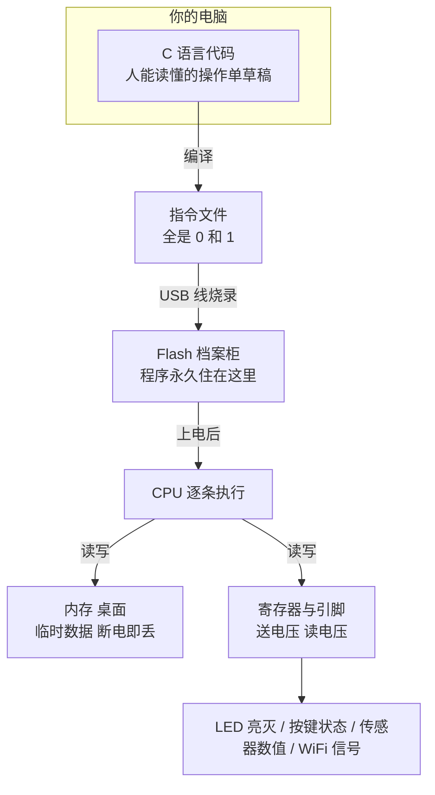

# 程序和计算机到底是什么

这一页不教你写代码，也不碰 ESP32。它只回答几个问题：**当我们说"给芯片写程序"的时候，到底在给什么东西写？写下去的是什么？它又是怎么"跑"起来的？芯片怎么"看见"世界、怎么"动手"做事？**

如果你已经知道这些，可以跳到下一页直接学 C 语言。如果下面的任何一个词让你心里发虚——CPU、内存、代码、程序、二进制——那就老老实实从这页开始。后面每一章都建立在这一页的比喻之上。

本页没有代码、没有作业，可以躺着读。但读完请做页尾的自测——答不上来的小节，翻回去重读。

## 1. 程序就是一份"操作说明书"

先不讲芯片，讲一个你熟悉的东西：自动饮料机。

饮料机里有一张操作单，上面写着：

```text
第 1 步：检查投币口，有硬币就收下
第 2 步：亮灯，等待顾客按下按钮
第 3 步：如果按的是 1 号键，掉一瓶可乐
        如果按的是 2 号键，掉一瓶雪碧
        如果什么都没按，回到第 2 步继续等
第 4 步：掉完饮料，回到第 1 步
```

这张操作单有三个特点，恰好就是"程序"的三个本质特点：

1. **它是提前写好的**。顾客还没来，操作单已经写完了，机器不会临场发挥
2. **它一步一步执行**。机器严格按顺序做，做完一步才做下一步，跳步、倒着做都不行
3. **它很"笨"**。它只会做单子上明确写了的事。你不在单子上写"怎么把瓶子推下来"，它就永远不会掉瓶子

**程序（Program）就是这样一张操作单**：一串提前写好的、按顺序执行的指令。而"编程"就是把你想让机器做的事，翻译成一张足够笨、足够详细的操作单，笨到机器都看得懂。

### 操作单上只允许三种"句型"

细看饮料机的操作单，其实只用了三种句型——**世界上所有程序（包括微信、王者荣耀、ChatGPT）也都是这三种句型拼出来的**：

| 句型 | 例子 | 干什么 |
| --- | --- | --- |
| **顺序** | "收下硬币""掉一瓶可乐" | 按顺序做一件事 |
| **分支（岔路）** | "如果按的是 1 号键……否则……" | 看情况决定走哪条路 |
| **循环（打转）** | "回到第 2 步继续等" | 重复做某件事，直到条件满足 |

就这么点语法。第 10 亿行的操作系统内核和 5 行的小脚本，语法上没有区别，区别只是句子的数量和组织的精巧程度。**你在 C 语言课里学的 `if` 就是分支、`for` 就是循环**——等学到那里，回头再想想饮料机。

### "笨"到什么程度

感受一下机器有多笨。让一个人"把这段文字里的名字都挑出来"，他秒懂；对机器，你得写成几千行的操作单：一个字一个字地读 → 判断是不是字母 → 记住连续的字母 → 遇到标点就断开 → 把断出来的片段和"名字库"比对……每一步都要精确到字符。

**编程 90% 的工作量，就是把模糊的人类意图翻译成这种精确到字符的笨步骤。** 这也是初学者最大的不适应：你脑子里的" obviously 这样做"，机器完全不知道，必须一步一步喂给它。

## 2. 谁来读这张操作单：CPU

操作单自己不会动，得有一个"读单子并照做"的角色。在计算机里，这个角色叫 **CPU（Central Processing Unit，中央处理器）**——芯片上那块真正"思考"的核心。

你可以把 CPU 想象成一个**手速快到离谱、但只会极少数动作的工人**。它整个职业生涯只会做这几件事：

- 把一个数从 A 处搬到 B 处
- 两个数做加减乘除、比大小
- 根据比较结果，跳到单子的另一行继续执行（这就是"分支"和"循环"的实现原理！）
- 往外面某个"开关"上打一个信号、或读一个信号

就这么点本事。但因为它一秒钟能执行几亿次，把这些简单动作串起来，就能拼出"连上 WiFi""播放音乐""识别人脸"这种复杂行为——就像再复杂的乐高作品也是由几种基础积木块拼出来的。

### "主频"是什么：工人的手速

你买电脑会看"主频 3.2GHz"。**主频就是 CPU 每秒能走多少个"基本节拍"**：3.2GHz = 每秒 32 亿个节拍。每个节拍里 CPU 干一小步（搬个数、算次加法）。ESP32-S3 主频 240MHz = 每秒 2.4 亿拍——只有电脑的十几分之一，但比 90 年代的超级计算机还快，足够干很多事了。

### 双核：两个工人

ESP32-S3 有**两个 CPU 核（Core）**——相当于两个工人可以同时各干各的。一个专门对付网络收发，另一个跑你的主逻辑，互不拖累。L2 讲 FreeRTOS 时会用到这个概念，现在记住"有两个工人"即可。

### 它为什么什么都会：因为什么都是算出来的

CPU 不认识"温度传感器""灯""手机"这些概念。它眼里只有数：把某个数的值搬到某个地方、对某个数加一、某个数是不是大于零。

那"智能"是怎么来的？**全是人把现实问题翻译成数字问题之后，靠这些数字运算堆出来的**。几个例子感受一下：

| 你看到的 | 芯片实际在算的 |
| --- | --- |
| 温度计显示 25.6℃ | ADC 采到一个数 3120，乘个系数加个偏移，得 25.6 |
| 手机关闭了误触的口袋亮屏 | 屏幕的"触摸点"数与"接近传感器"的数做了个组合判断 |
| 王者荣耀里人物移动 | 每秒 60 次：位置坐标 + 速度 → 算出新坐标 → 告诉屏幕画在哪 |
| ChatGPT 回答问题 | 数千亿次的"数字乘加"——每一次都简单得可笑，量变产生质变 |

:::tip[一个重要观念]
**芯片从头到尾只在搬运和计算数字。所有"智能"，都是人把现实问题翻译成数字问题之后堆出来的。** 理解了这句话，你就理解了整个数字世界的地基。
:::

## 3. 数怎么表示：从开关到二进制

CPU 只会处理数，而且它处理数的方式非常原始——**用电平的高低**。

一根电线上的电压，可以高也可以低。我们人为规定：

- 电压高（比如 3.3V）= 记作 `1`
- 电压低（比如 0V）= 记作 `0`

这就是**二进制（Binary）**：只用 0 和 1 两个符号来记数。就像灯泡只有"亮"和"灭"两种状态。

### 二进制怎么数数（亲自数一遍）

十进制"满十进一"，二进制"满二进一"。从 0 数到 7 试试：

| 十进制 | 二进制 | 为什么 |
| --- | --- | --- |
| 0 | 0000 | |
| 1 | 0001 | 个位满 1 了 |
| 2 | 0010 | 个位归零，向第二位进一（就像 9+1 的个位归零进十位） |
| 3 | 0011 | |
| 4 | 0100 | 又进一位 |
| 5 | 0101 | |
| 6 | 0110 | |
| 7 | 0111 | |

四位二进制每个位置的"价值"是 8、4、2、1（从左到右）——`0111` = 4+2+1 = 7，`1010` = 8+2 = 10。**转换口诀：把是 1 的位置的价值加起来**。亲手把 `1101` 换算成十进制（答案：13）。

为什么要学这个？**因为嵌入式开发里你会直接面对"第几号开关"的问题**——"把 GPIO4 拉高"在硬件眼里就是"把一个 32 位数的第 4 位写成 1"（写成十六进制是 `0x10`）。不懂位，就看不懂寄存器手册。

### 十六进制：二进制的缩写

二进制太长（一个字节 8 位），十六进制（0x 开头）是它的"压缩包"：**每 4 个二进制位折成 1 个十六进制位**，用 0～9 加 A～F 表示（A=10, B=11, ..., F=15）：

| 二进制 | 十六进制 | 十进制 |
| --- | --- | --- |
| 1010 | 0xA | 10 |
| 1011 | 0xB | 11 |
| 1111 | 0xF | 15 |
| 1010 1011 | 0xAB | 171 |

看十六进制想二进制：`0xAB` → A 就是 1010、B 就是 1011 → `1010 1011`。**一眼对上**，这就是嵌入式偏爱十六进制的原因。现在能看懂 `0x10`、`0xFF`（=1111 1111=255）就够了。

### 比特和字节：信息量的单位

一个 0 或 1 叫一个**比特（bit）**，它是计算机里信息的最小单位。一个比特只能表示两种状态，信息量太小，所以实际使用时把 8 个比特编成一组，叫一个**字节（Byte）**：

```text
1 0 1 1 0 0 1 0   ← 8 个比特 = 1 个字节 = 1 个 0~255 之间的数
```

8 个比特能表示 2 的 8 次方 = 256 种组合，从 0 编号到 255。往上还有一套单位换算，全部要熟：

| 单位 | 等于 | 换算 | 直观感受 |
| --- | --- | --- | --- |
| 1 B | 8 bit | — | 一个字符 |
| 1 KB | 1024 B | 约 500 个汉字 | 一段短信 |
| 1 MB | 1024 KB | — | 一分钟 MP3 |
| 1 GB | 1024 MB | — | 一部高清电影 |

**ESP32-S3 的内存是约 512KB**——对照上表感受一下：你的手机内存是它的三万倍。这就是嵌入式"抠内存"的背景。

### 那文字、图片、声音呢？全是编出来的号

计算机世界里的"一切皆数"不是比喻，是字面意思。所有东西都被编码成数：

**文字**：每个字符编个号，全世界约定同一张表。"A"=65、"B"=66、"a"=97、"0"=48（字符零！不是数字零）。汉字用更大编号，一个汉字占 2～3 个字节（所以"1KB 约 500 个汉字"）。这张编号表叫字符编码（ASCII / UTF-8），你以后 printf 打印字符时会亲眼见到这些编号。

**图片**：把画面切成几百万个小格子（**像素，Pixel**），每个格子记三个数——红、绿、蓝各多浓（0～255）。三原色不同浓度混合出所有颜色：

```text
(255, 0, 0)     = 纯红
(255, 255, 0)   = 红加绿 = 黄
(0, 0, 0)       = 黑（全无）
(255, 255, 255) = 白（全满）
```

一张 1920×1080 的照片 = 200 万个像素 × 3 字节 ≈ 6MB。**"图片变卡变模糊"的本质就是格子变少或每格的数变粗**。

**声音**：声波是空气压力的连续变化。把麦克风电压**每隔极短时间量一次**（每秒 44100 次就是 CD 音质），每次把量到的值记成一个数——声音就变成了一长串数字。播放时反过来：按顺序把这串数还原成电压。**"采样"（Sampling）这个词你会在 L4 的 ADC 和音频章节反复遇到**，它就是"定期量一次"。

:::tip[把这句话记牢]
**芯片世界里的文字、图片、声音、指令，全是编好号的数字。** 以后遇到"这个格式是什么"，本质问题永远是"它是怎么编码成数的"。
:::

## 4. 记忆分两种：内存和 Flash

人干活需要桌面（临时放正在处理的东西）和档案柜（长期存放资料），芯片也一样。这两样东西的分工，是嵌入式开发里最重要的常识。

### 内存（RAM）——桌面

- CPU 干活时把**正在处理的数据**放在这里：变量、算到一半的数、收到的网络包
- **断电就全丢**，像黑板——写满一黑板，擦掉就没了，为什么？因为 RAM 用微小的电容存电，有电=1、没电=0，断电电容全放光
- 容量小（ESP32-S3 片内约 512KB）、价格贵，但**读写飞快**，CPU 随取随用
- 运行中被反复读写百万次也不会坏

### Flash（闪存）——档案柜

- **程序本身**（那张操作单）就存在这里，还有字体、图片、配置
- **断电不丢**——Flash 用"电子被困在浮栅里"存数据，不供电也跑不掉。你的 U 盘、固态硬盘是同一种技术
- 容量大（ESP32-S3 常见配 16MB）
- **读写慢**，而且有个特殊脾气：**改一个字必须先擦掉一整块**（通常 4KB）——就像改档案柜里一页纸，得先抽掉整层。这就是为什么频繁改写的数据需要专门的"磨损均衡"技术（L6 讲）

:::caution[新手最常见的误解]
"我写的代码"存在 Flash 里，"代码算出来的数据"放在内存里。**程序在 Flash，数据在内存**——记住这句，后面学分区表、烧录、掉电数据丢失，全都建立在它上面。
:::

### 寄存器：CPU 手边的便签

除了内存和 Flash，芯片内部还有一种最快的"格子"，叫**寄存器（Register）**。它们直接长在 CPU 和各个硬件部件旁边——CPU 算数前先把数从内存搬到寄存器里算，算完再搬回去；而**每个硬件部件（点灯的、串口的、WiFi 的）也都有一排自己的寄存器，每个格子有固定编号和固定用途**，比如"3 号格子写 1 就是把 4 号引脚的灯点亮"。

**操控芯片硬件，本质上就是往这些格子里读写特定的数。** 你以后会反复看到"寄存器"这个词，现在只要知道：**它是一排有编号、有专门用途的开关面板**，就行了。

### 一个单位换算的陷阱（顺便防一下）

电脑行业有个历史遗留问题：`1KB` 到底是 1000 字节还是 1024 字节？答案是**两种都存在**——内存按 1024 算（2 的幂次，对硬件友好），硬盘/U 盘厂商按 1000 算（显得大）。所以"16GB U 盘插电脑显示 14.9GB"不是缩水，是口径不同。看到 KB/MB 先想一下是谁在说。

## 5. 单片机和你的电脑有什么不一样

你手机、电脑里也有 CPU，也能跑程序。那 ESP32 这类**单片机（Microcontroller，也叫 MCU）**特殊在哪？

| | 电脑 / 手机 | 单片机（ESP32-S3） |
| --- | --- | --- |
| 主频（每秒节拍数） | 几十亿次 | 2.4 亿次 |
| 内存 | 8～16 GB | 约 0.5 MB（差四五万倍） |
| 有没有操作系统 | Windows / 安卓，帮你管一切 | 只有一个很小的调度器（FreeRTOS），甚至没有 |
| 外设 | 键盘鼠标屏幕，系统驱动管 | **引脚直接裸露，你自己接、你自己管** |
| 断电 | 系统走关机流程 | **当场断，回来从头开始** |
| 价格 | 几千块 | 十几块 |

几个词现在就可以认识一下：

- **嵌入式（Embedded）**：把计算机"嵌"进某个设备里专门干一件事。电饭煲、蓝牙耳机、共享单车锁、汽车里的上百个控制器——全是嵌入式系统。它们不是通用电脑，是"只会干一件事的电脑"。**你手上的 ESP32 就是一台可以塞进任何设备里的迷你电脑**
- **固件（Firmware）**：烧录在 Flash 里、让这个设备干活的程序。为什么叫"固"？因为它是"焊死在里面"（firm 的本意）的程序——不像电脑软件随便装随便卸。你以后"刷固件"就是把新程序写进 Flash 覆盖旧的
- **开发板（DevKit）**：芯片太小没法手工接线，厂商把芯片焊在一块小板上、引出排针、加上 USB 口和稳压器——就是"开发板"。你手上的 DevKitC-1 是乐鑫官方开发板，中间金属屏蔽罩里是模组（芯片+Flash+天线的合体）

**为什么嵌入式编程有那么多"规矩"**（省内存、小心分配、不能乱用库）？答案就在对比表的第二行：**内存只有电脑的几万分之一，还没有操作系统兜底**。电脑程序乱来，最多少算几个 G 内存；单片机程序乱来，当场崩溃。这份"资源焦虑"是贯穿整套教程的底色。

### 但也别被吓到

S3 在单片机里属于**很强**的一档：双核 240MHz、带 WiFi 和蓝牙、8MB 外挂内存（PSRAM）、还能接摄像头和屏幕。2000 年的台式机性能也就这样。它跑得动语音识别、图像检测这些"看起来很 AI"的活——L4/L6 会带你做。

## 6. 芯片怎么"感知"和"动手"：引脚与电压

芯片四边伸出来的一排金属脚叫**引脚（Pin）**——开发板边缘那两排金属针脚就是从芯片引出来的。每个引脚都是一根可以通电、也可以检测通电的线。**芯片和外部世界的全部交流，就是通过这些引脚上的电压完成的。**

### 输出：动手

程序让某个引脚输出高电平（3.3V）或低电平（0V）。接在引脚上的东西会因此动作：

```text
程序写"引脚 4 输出高" → 引脚 4 变成 3.3V → LED 正极有电、负极接地 → 灯亮
```

点一个 LED 的完整电路其实长这样（认识一下，接线课会反复见）：

```text
引脚 4 ──[电阻 220Ω]──►|── GND
                LED（箭头是 LED 的符号）
```

中间那个电阻是**限流电阻**——LED 没有防身能力，直接怼 3.3V 会烧，电阻负责把电流压到安全值。**"GPIO 输出 + 限流电阻 + LED + 回到地"**是全世界嵌入式学习者的第一个电路。

### 输入：感知

反过来，外部也可以往引脚上送电压，程序去读这个引脚现在是高还是低：

```text
手指按下按键 → 按键把引脚 5 接到 3.3V → 程序读引脚 5，发现是"高" → 知道"有人按键了"
```

**"程序控制硬件"的全部真相——没有魔法，就是往引脚上送电压、读电压。**

### 只有高低两档够用吗

两个引脚状态只能表示"按没按"。世界还有连续的量：光线多强？旋钮转到哪？两个升级手段（先混个脸熟，L4 细讲）：

- **读连续变化的电压值**：引脚 1 上的电压是 1.2V 还是 2.8V，芯片能精确量出来——光线强弱、温度高低都这么测（这叫 **ADC**）
- **高速开关一个引脚**：每秒开关几千次，"亮的时间占 50%"眼睛看起来就是半亮——调光、调速、发声全靠它（这叫 **PWM**）

还有**通信**：两三个引脚按约定节奏高低变化，就能"说话"——把一字节的数据一位一位发给屏幕、传感器（I2C/SPI/UART 这些名字你会在 L4 遇到，本质都是"约定的电压舞蹈"）。

:::tip[把这句话记牢]
**"写程序控制硬件" = "在正确的时机，往正确的格子和引脚，写正确的数。"**
后面所有章节，讲的都是在不同场景下怎么做到这句话。
:::

### WiFi 也是"引脚"吗

不是——WiFi/蓝牙没有引脚，它们靠芯片内部的天线电路把数据变成 2.4GHz 的电磁波发出去。但对程序来说用法一样：往"WiFi 寄存器"写数据 = 发包，读"WiFi 寄存器" = 收包。**手法相同，只是"线"换成了电磁波**。

## 7. 那么程序是怎么"进去"的

最后一个流程问题。你在电脑上写好的程序（一张几百行的操作单），怎么跑到芯片的 Flash 里？

靠一根 USB 线和一个小工具：


其中两个词现在认识一下：

- **编译（Compile）**：人写的代码（C 语言，接近英文句子）CPU 看不懂，需要**编译器**把它整体翻译成芯片能懂的 0 和 1 指令。这个翻译过程叫编译，翻译出错就叫编译报错——**报错不代表你的板子坏了，是翻译环节发现你的"句子"写得不合语法**
- **烧录（Flash / Upload / 下载）**：把编译出来的指令文件通过 USB 线写进芯片 Flash 的过程。快速上手里点"上传"按钮，干的就是这件事

### 烧录时芯片在干嘛：下载模式

芯片怎么"乖乖让人往 Flash 里写"？芯片出厂时内部固化了一小段程序（叫 **ROM 引导**），上电瞬间它会**偷看一个指定引脚（GPIO0）的电平**：

- 高电平（正常情况）→ 从 Flash 启动你的程序
- 低电平（你按住 BOOT 键时）→ 进入**下载模式**：把自己变成一个"听 USB 指挥的搬运工"，电脑说要写 Flash 的哪块、写什么，它照办

**这就是"烧录时按住 BOOT"的原理**——不是仪式，是切换芯片的身份。S3 的 USB 烧录大多自动搞定这一步，但知道原理，出问题时你就知道往哪查。

烧完之后芯片一上电，就会从 Flash 里从头开始执行你的程序——除非你再烧一版新的把它覆盖掉。

## 8. 全页小结：一张图和一段话



一段话总结：**程序是一张提前写好、按顺序执行的笨操作单，编译后存进芯片的 Flash；芯片上电后由 CPU 逐条执行，干活时用内存当桌面，靠读写寄存器和引脚上的电压来感知世界、动手做事。**

后面十几章，无论话题多复杂——多任务、网络、音频、AI——你都可以回到底层问一句：这一步，是在往哪个格子写什么数？想通这一层，你就比很多"会调库"的人懂得多了。

## 自测（不用写代码，能答上来就过）

- [ ] 程序的三个本质特点是什么？操作单只有哪三种"句型"？
- [ ] 程序存在芯片的哪个部件里？算出来的数据放在哪？哪个断电会丢？
- [ ] "编译"和"烧录"分别是什么？编译报错说明什么？烧录时按住 BOOT 是在干什么？
- [ ] 一个字节是多少个比特？能表示多少种不同的值？`0xFF` 换成二进制和十进制是多少？
- [ ] 把 `1101` 换算成十进制；字符"A"在芯片里存的是什么？
- [ ] 芯片靠什么"知道"按键被按下了？靠什么把灯点亮？"只有高低两档"怎么应付连续变化的量？
- [ ] 单片机和你的电脑最大的三个区别是什么？为什么嵌入式编程规矩多？
- [ ] ESP32-S3 的内存大概多大？对照"1KB 约 500 汉字"感受一下这个数量级

## 下一步

概念铺垫完了，下一页开始正式学 C 语言——从"什么是变量"讲起，每个例子都带你亲手跑：[C 语言核心](./c-language)。