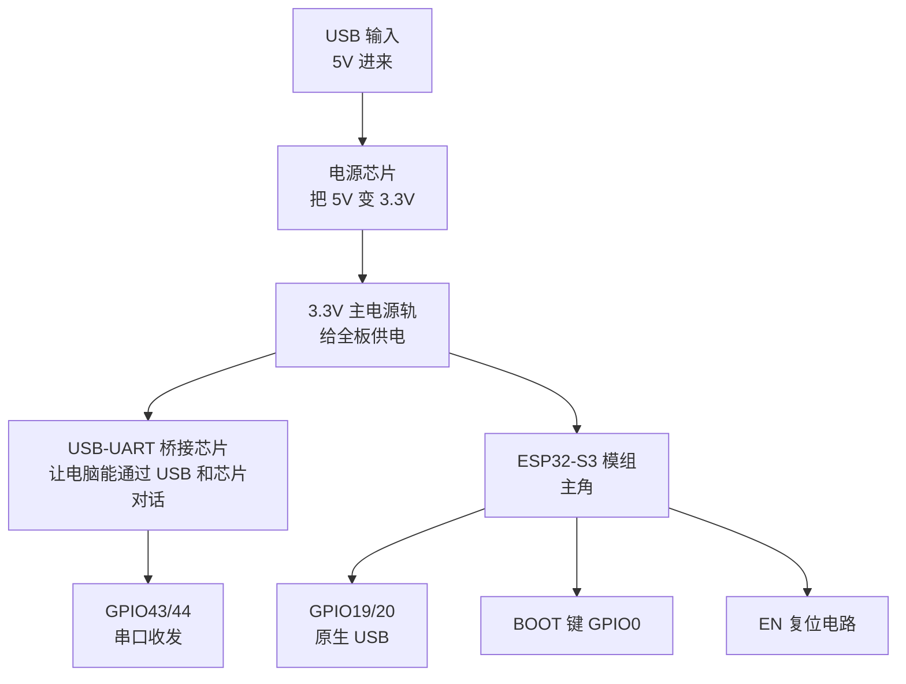

# 开发板与硬件原理

软件出错可以重烧，硬件接错可能烧板子。这一章教你看懂板子上到底有什么、电从哪来、哪些脚碰不得。

先解释两个贯穿全章的词：

- **原理图（Schematic）**：电路的"图纸"。它不画实物长什么样，只画"谁和谁相连"——每根线代表一次电气连接，每个小方框/小符号代表一个芯片或元件。学会读它，你就能不拆板子知道整块板的来龙去脉。开发板的原理图在乐鑫官网都能免费下载（搜 "ESP32-DevKitC-1 schematic"），本章就带着你读它
- **万用表（Multimeter）**：一个几十块钱的仪器，能测电压、测通断。它是硬件调试的"print 大法"——软件靠看日志，硬件靠量电压。本页第 7 节教你怎么用

为什么要费劲学硬件？因为**嵌入式一半的"程序 bug"其实是硬件问题**：供电不稳、接错脚、线太长、没共地。不会看硬件的人遇到这些会去错误地改代码改到天亮；会看的人拿万用表量两下就结案。

## 1. 一张原理图要看哪几块

第一次打开原理图，看到几百个符号和线，任何人都会晕。正确方法不是从头读，而是**先找主干线**：电从哪进、到哪去、主角在哪。

打开 DevKitC-1 原理图，按顺序找下面几个"地标"：



### 逐个地标认识（对照你手上的板子）

**USB 输入**：USB 口的 4 根线里，有一根是 5V 电源（VBUS）、一根是地（GND），另外两根（D+/D-）是数据线。所以 USB 既是"数据线"也是"电源线"——你的板子靠它供电。

**电源芯片**：USB 进来的是 5V，但 ESP32 要 3.3V。中间需要降压，图上那个标着"AMS1117"或"SGM2212"之类的小芯片就是**稳压器（Regulator）**——本页第 3 节细讲。

**USB-UART 桥接芯片**：一个"翻译官"芯片（板子上通常标着 CP2102、CH340 或 CH343）。电脑的 USB 说"USB 协议"，芯片的调试口说"串口协议"，翻译官把两边互相翻译。**没有它，电脑就"看不见"这块板子的串口**——这也是为什么 CH340 驱动没装时电脑找不到 COM 口。

**ESP32-S3 模组**：那块金属屏蔽罩。罩子里是真正的芯片 + 16MB Flash + 8MB PSRAM + PCB 天线，出厂时合体成一个模组（型号 ESP32-S3-WROOM-1）。原理图上它画成一个大方块，引出所有引脚。

顺带把模组型号命名拆开读——**以后买任何乐鑫模组都用同一套规则**：

```text
ESP32-S3-WROOM-1-N16R8
└─ 芯片型号：ESP32-S3
   └─ 模组系列：WROOM-1（含芯片 + Flash + PSRAM + 天线）
      └─ N16 = 16MB Flash，R8 = 8MB PSRAM
```

**BOOT 键和 EN 键**：BOOT 接 GPIO0（控制启动模式，第 4 节），EN（Enable）接芯片复位——按一下相当于断电重启。EN 引脚上还挂着一组电阻电容（RC 电路），作用是**上电时先让电源稳定一小会儿再放开复位**，防止芯片"没站稳就跑"。

### 看图三诀

1. **先找电源轨（Power Rail）**：图上凡是标着 3V3 的线都是同一条"3.3V 总水管"，标 GND 的都是"总地"。**看任何元件第一步问：它的电从哪来、地回哪去**
2. **顺着信号走**：想搞懂某根线，从它的起点顺着线走到底，看接到了谁的哪个脚
3. **不懂的符号先跳过**：电容（两条平行线）、电阻（锯齿或矩形）先当"背景"处理，只追芯片和连接关系

对照实物板把这几个地标都找一遍，这张图你就"读完"了 80%，剩下的引脚分配细节等用到再查。

## 2. 读工程图三件套：框图、原理图符号、时序图

硬件资料里会出现三种"图"，各有分工。这一节把它们一次讲清——后面 L4 的总线时序、数据手册都要用。

### 框图（Block Diagram）：先看"谁连谁"

框图是最高层的图：方框代表功能模块，箭头代表数据/电流流向。**数据手册的第一章几乎都是它**——比如 ESP32-S3 数据手册开头那张"CPU + WiFi + 外设 + GPIO"的大方块图。读硬件资料的正确顺序永远是：**框图（了解全貌）→ 原理图（了解连接）→ 时序图（了解信号细节）**，从粗到细。

### 原理图符号速查表

原理图上的符号就十几种，认识它们就能读懂绝大多数板图：

| 符号 | 名字 | 干什么 | 在板上长什么样 |
| --- | --- | --- | --- |
| 两短平行线 | 电容 | 存电荷、滤波 | 电源脚旁的小黄粒 |
| 锯齿/矩形 | 电阻 | 限流、分压 | 小黑粒或贴片 |
| 三角带竖线 | 二极管 | 单向导电 | 电源防反接 |
| 箭头+竖线 | LED | 发光 | 电源指示灯 |
| 三端元件 | 三极管 / MOS 管 | 电子开关 | 大电流驱动 |
| 三条递减横线 | 地（GND） | 公共参考点 | **全图所有"地"其实是连在一起的** |
| 箭头标 3V3/5V | 电源轨 | 供电 | 同名标号都连在一起 |

两个关键读图技巧：

- **网络标号（Net Label）**：原理图里两个相距很远的地方都标着 `3V3`——它们是连在一起的，只是画图的人不想拉一条横穿全图的线。**同名的标号 = 电气相连**
- **地永远先找**：分析任何元件，第一句问"它的电从哪来"，第二句问"它的地回哪去"

### 时序图（Timing Diagram）：信号的"时间表"

时序图回答的问题：**几根线上的电压，在时间轴上谁先谁后、谁高谁低**。多根信号线互相配合时（总线通信），全靠它规定"什么时刻该看哪根线"。

以 SPI 通信的 4 个时刻为例（每个格子是一个瞬间，从左到右时间流逝。真实的示波器/逻辑分析仪里它们显示为连续的矩形波——先看懂这张"时刻表"，再看波形就是同一回事）：

```text
时间 →                T0      T1      T2      T3      T4
                   ┌───────┬───────┬───────┬───────┬───────┐
CS   （片选）       │  高   │  低   │  低   │  低   │  高   │ ← 拉低 = 选中设备
SCLK （时钟）       │  低   │  ↑    │  ↑    │  ↑    │  低   │ ← 主机打出 3 个上升沿
MOSI （数据）       │  --   │  1    │  0    │  1    │  --   │ ← 每个上升沿前放好一位
                   └───────┴───────┴───────┴───────┴───────┘
                           ↑       ↑       ↑
                          采样    采样    采样    （每个上升沿采走 1 个比特）
```

读时序图的方法：**先找参考线（通常是时钟），再看其他线在参考线的"边沿时刻"上是什么状态**。上表读出的规则：SCLK 在 T1、T2、T3 各打出一个上升沿，每个上升沿那一刻 MOSI 上分别放着 1、0、1——这三个比特就是主机发出的数据；而"数据要在上升沿之前放好、之后保持一小会儿"，就是下面 Setup/Hold 两个参数的由来。这套"时钟打拍子、数据对齐采样"的关系，正是第 4 章 SPI mode 表里 CPOL/CPHA 说的事。

时序图里还会标**时间参数**（两个事件之间允许/要求的间隔）：

| 参数 | 含义 |
| --- | --- |
| 建立时间（Setup Time） | 采样沿**之前**，数据必须提前稳定多久 |
| 保持时间（Hold Time） | 采样沿**之后**，数据必须继续保持多久 |
| 脉宽（Pulse Width） | 一个高/低电平至少持续多久 |

数据手册的"Electrical Characteristics / Timing"章节全是这类表。**违反时序 = 通信偶发出错**——"偶尔收到坏数据"的疑难杂症，往往就是时序余量不够（线太长、频率太高）。

### 数据手册的结构（怎么翻）

| 章节 | 内容 | 什么时候看 |
| --- | --- | --- |
| Features | 一句话卖点列表 | 30 秒判断"是不是我要的" |
| Block Diagram | 框图 | 了解芯片全貌 |
| Pin Definition | 每个脚是什么、能用不能用 | **接线前必看** |
| Electrical Characteristics | 电压/电流范围、功耗 | 供电设计、查烧毁原因 |
| Timing | 时序图和参数 | 通信调不通时 |

## 3. 供电：最容易翻车的地方

"板子莫名其妙重启"的故障里，**一半以上是供电问题**。先把原理讲透，你以后看到现象就能秒判。

### WiFi 发射瞬间的电流风暴

芯片平时安安静静只吃几十毫安。但每次连 WiFi、每次发射信号，射频功率放大器瞬间要吃 **500mA 以上**——比平时高一个数量级，而且这个高峰每秒可能出现几十次。

如果电源"供不上这个峰值"会怎样？想象水管总闸就那么粗，突然要放洪水——**水压瞬间跌落**。对电路来说"水压"就是电压：3.3V 瞬间跌到 2.7V 以下，芯片的"欠压保护"触发，当场复位。

表现就是你最熟悉的那句话：**"一连 WiFi 就重启"**。L5 讲 WiFi 时还会再见到它，但根源在这里。

### 稳压器：降压的水闸

**LDO（Linear Regulator，线性稳压器）**是最常见的降压芯片。输入 5V、输出恒定 3.3V——多出来的 1.7V 去哪了？**变成热耗掉了**。所以 LDO 简单、便宜、噪声小，但效率低、发热。

| 稳压方案 | 原理 | 优点 | 缺点 |
| --- | --- | --- | --- |
| LDO（线性稳压） | 多余电压变热 | 便宜、噪声小 | 效率低（5V→3.3V 只有 66%） |
| DC-DC（开关稳压） | 高速开关+电感储能 | 效率 90%+ | 元件多、有开关噪声 |

板载的 AMS1117 之类是 LDO；模组**内部**还有一层 DC-DC 给芯片核心供电（1.8V/1.1V）——所以一块板子上其实有两级降压。自己画板子时，外围用 LDO 够了，电流大的场景（电机、WiFi 全开）要算好 LDO 的输出能力。

### 去耦电容：每个芯片身边的小水塔

去耦电容（Decoupling Capacitor，也叫旁路电容）是原理图上芯片电源脚旁边必挂的小电容（典型 0.1µF/100nF）。它解决一个物理问题：**电流再快，从电源"远道而来"也要时间**，芯片瞬时要大电流的瞬间，远水救不了近火。

解法：在芯片身边放一个小水塔（电容），平时存满电，芯片"抢水"的瞬间由它就近顶上。**"每个芯片电源脚旁边 0.1µF"是画板的铁律**，你以后看任何电路图都能验证这条。

大电容（10µF～470µF）则挂在电源入口处，负责压住"WiFi 发射"这种大浪涌。**"一连 WiFi 就重启"的手工解法之一，就是在 3.3V 上并一个大电容**——相当于给总水管加蓄水池。

### 电源指示与"看灯诊断"

板子上那颗常亮的 LED 是 3.3V 电源指示灯。它的诊断价值：

- **亮** = 供电基本正常（3.3V 轨有电）
- **不亮** = 从 USB 到 3.3V 之间的某一环断了——用万用表逐段量（第 7 节）
- **暗淡/闪烁** = 电源带不动负载，电压被拉垮——典型的大电流负载（电机、WiFi）拖垮了供电

### 共地：最容易漏掉的一条线

**共地（Common Ground）**：两套电源（板子的 3.3V 和电机的外接 12V）之间**必须把 GND 连在一起**。

为什么？电压是"相对值"——"3.3V"意思是"比 GND 高 3.3V"。两套系统如果不共地，它们的 GND 不是同一个参考点，A 说的"高电平"在 B 听来可能是任何值，**信号全是乱码**。

**电机不转、串口乱码、传感器读数跳，先查共地。** 这是新手接线率最高的一类错误。

## 4. strapping 启动配置引脚：上电那一瞬间被"偷看"的脚

芯片上电的那一瞬间，会**偷看**几个指定引脚上的电平，据此决定"这次启动以什么模式运行"。这个过程叫**采样（Sampling）**，这些引脚叫 **strapping 引脚**（strap 本意是"绑带"——老式电脑主板上用跳线帽设置启动模式，这里是芯片用引脚电平干同一件事）。

关键在于：**采样只发生在复位释放的那一瞬间**（毫秒级）。之后这些脚就恢复普通 GPIO 身份随便用了。

### S3 的 strapping 表

| ESP32-S3 | ESP32-C3 | 作用 |
| --- | --- | --- |
| GPIO0 | GPIO9 | 0 = 正常启动；1 = 下载模式 |
| GPIO3 | GPIO8 | JTAG 调试口来源选择 |
| GPIO45 | GPIO2 | Flash 供电电压选择（3.3V / 1.8V） |
| GPIO46 | — | 启动模式相关 |

**GPIO0 就是 BOOT 键接的那个脚**——按住 BOOT 上电，GPIO0 被按键拉到地（0），芯片进下载模式等电脑发固件。现在你能把"烧录时按住 BOOT"和原理图上的连接对上了。

### 两个实际约束

**约束一：外接模块不能在上电瞬间把 strapping 脚拉到错误电平。**

场景还原：你接了个传感器模块，它自己的输出脚复位时默认输出高电平，恰好接在 GPIO0 上。芯片上电采样时"看到" GPIO0=1——**以为你要下载固件，进了下载模式，正常程序根本不跑**。现象是"接上这个模块板子就启动不了，拔掉就好"。排查思路：能想到 strapping 脚，问题就解了。

**约束二：GPIO45 尤其危险。**

它选的是 Flash 的供电电压（3.3V 还是 1.8V）。上电时被拉错，Flash 拿到错误电压——轻则读不出数据开不了机，重则**损坏 Flash**。所以 GPIO45 的使用要格外保守。

排查口诀：**"不接外设一切正常，接上外设启动怪异"的病，先查是不是接了 strapping 脚。**


## 5. Flash 与 PSRAM 接线：哪些脚被内部征用了

WROOM-1 模组里的 16MB Flash 和 8MB PSRAM 都通过 SPI 总线连接芯片。这些连接线**从芯片引脚直接走到模组内部**，对外的引脚自然就被征用了：

| 引脚 | 状态 |
| --- | --- |
| GPIO35 / 36 / 37 | **内部占用，禁止外接**——接了东西轻则程序崩溃，重则 Flash 数据被破坏、芯片变砖 |
| GPIO33 / 34 | 模组内部用，外接也建议避开 |

这是模组内部布线决定的，**任何板型都改不了**。变砖的机理值得理解：你的外接信号在 Flash 正在读写时干扰了它的数据线，写坏了固件本身——芯片下次上电读到的就是残废的固件。

### Quad 与 Octal：数据线的"车道数"

补充一个背景，方便你看懂别的文档：Flash 和 PSRAM 的数据线有"几线"之分。

- **Quad（四线）**：4 根数据线并行，像 4 车道
- **Octal（八线）**：8 根数据线，8 车道，速度快一倍

本模组的 PSRAM 是 Octal——所以才占掉 35～37 那么多脚（8 根线里的一部分落在这些引脚上）。如果哪天你换成 Quad PSRAM 的模组，能腾出的引脚要看对应模组的手册，**不要凭印象猜**——每款模组的占用表都不同。

**核对方法**：乐鑫官网每个模组都有"引脚定义"文档（pin definition），买任何模组先下载它，把"禁止使用"的脚抄下来贴在工位上。

## 6. 从零设计一块自己的板子（要点）

如果将来要自己画板（用立创 EDA 或 KiCad），下面这些是老司机踩了无数坑总结的要点——每一条都能对应到前面讲过的原理：

| 项目 | 建议 | 对应的原理 |
| --- | --- | --- |
| 去耦 | 每个电源脚 100nF，Flash/PSRAM 附近 4.7µF，电源入口再加 470µF | 第 3 节：瞬时电流要就近供给 |
| 稳压器 | 输出能力 ≥ 1A，留 50% 余量 | WiFi 峰值 500mA+ |
| 晶振 | 40MHz 主晶，误差 ±10ppm 以内；有 RTC 需求的加 32.768kHz | CPU 和实时时钟的心跳源 |
| USB | 原生 USB 的 D+/D- 差分线 90Ω 阻抗控制、两线等长 | 高速信号对布线极其敏感 |
| 天线 | PCB 天线下方和周围**不能有地平面和走线**（开净空区） | 2.4G 信号靠空气辐射，被铜箔一挡就衰减 |
| 走线 | 电源线尽量宽（1mm 起），Flash/PSRAM 信号走短线且不与射频平行 | 电源要过流量，高速线怕反射和串扰 |
| strapping | GPIO0/45/46 上拉下拉按手册配，测试点留出来 | 第 4 节 |

**净空区（Keep-out Zone）**展开说一下，因为它反直觉：天线不是"接根线就行"，PCB 天线是靠板上特殊形状的铜箔辐射电磁波的，它**周围一圈不能有其他铜**（地平面、走线都不行），否则信号被吸收/反射，WiFi 距离缩到几米。**"WiFi 特别近才连得上"，第一查供电、第二查天线区是不是被什么东西盖住了（外壳、电池、排线）。**

第一次画板别追求完美，先跑通最小系统（芯片+Flash+稳压+USB+复位电路），能烧录能跑，再迭代。

## 7. 实战：用万用表定位故障

### 第一次用万用表

万用表两个核心功能，够用 90% 场景：

- **测直流电压**：旋钮拧到 V⎓（或 VDC），选 20V 量程。**黑表笔（COM 孔）永远接 GND**，红表笔去碰要测的点，屏幕读数就是该点电压
- **测通断**：旋钮拧到蜂鸣档（图标是一个声波/二极管）。两支表笔碰要测的两点，**导通会"滴"一声**——测一根线通不通、焊点虚不虚，不用看数，听声就行

规矩：**量电压时电路要通电**；量通断时电路要断电（带电测通断会烧表、读数也没意义）。

### 症状 → 排查路径

按症状对号入座，每条都是"从电源入口一路查下去"的思路：

| 症状 | 排查顺序 |
| --- | --- |
| 3.3V 指示灯不亮 | ① 量 USB 口的 5V 脚有没有 5V → ② 量稳压器输入脚有没有 5V → ③ 量稳压器输出脚有没有 3.3V。**哪一环断了就是哪一环的问题**（常见：USB 线是充电线、稳压器烧了、板子短路） |
| 3.3V 正常但没有任何串口输出 | 按住 BOOT 再点 RST，看电脑能不能识别/能不能进下载模式。能进说明芯片活着，问题在固件侧（比如把日志引脚改掉了） |
| 能进下载模式但电脑找不到串口 | ① **先换一根确认过的好线**（下面单独说）→ ② 桥接芯片驱动装了吗 → ③ 桥接芯片虚焊（量它的 3.3V 供电脚） |
| 一连 WiFi 就重启 | 九成是供电不足：换粗短的 USB 线、换带外部供电的底板，或在 3.3V 上并联 470µF 大电容。验证方法：把 WiFi 关掉跑别的，不重启了基本坐实 |
| 接上某模块后启动怪异 | 查那个模块的输出脚是不是接在 strapping 脚（GPIO0/45/46）上 |
| WiFi 距离只有几米 | 查天线净空区：外壳是不是金属、贴纸电池是不是压在天线上、板子是不是装在了金属盒里 |

:::tip[先怀疑线，再怀疑板]
一根只能充电的数据线能造成"电脑死活找不到串口"的假故障——线里根本没焊数据线芯。这是新手返修率最高的"坏板子"，**家里常备一根验证过的优质数据线，怀疑板子前先用它**。
:::

### 万用表之外：逻辑分析仪（进阶预告）

几十块的 8 通道 USB 逻辑分析仪 + 免费的 PulseView 软件，能"录制"引脚上的电平变化并解码成协议（I2C/SPI/UART）——相当于给总线装行车记录仪。L4 讲总线调试时它是主力工具，现在知道有这东西即可。

## 下一步

[搭建自己的 IDF 工程](./project-setup)
