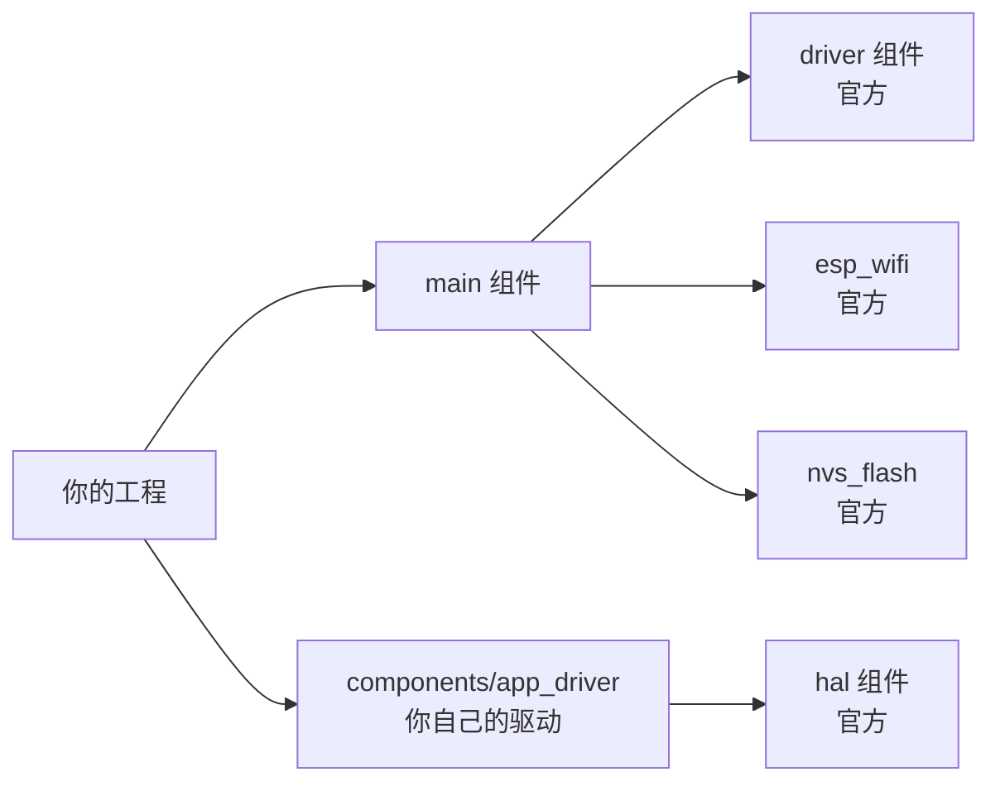

# 组件模型与构建

ESP-IDF 把整个 SDK 拆成若干 **组件（component）**，每个组件有自己的头文件、依赖声明和配置项。你写的应用本质上也是一个组件。

先建立直觉：**组件就是"带说明书的工具箱"**。WiFi 是一个组件、GPIO 驱动是一个组件、你的传感器代码也可以是一个组件。每个工具箱有三样东西——`.h` 头文件是"工具清单"（别人能看见什么）、`.c` 源文件是"工具本体"、`CMakeLists.txt` 是"装箱单"（声明我有哪些货、我需要别的哪个箱子）。

为什么要搞组件制？想象 500 人的 IDF 团队和你共用一份代码：GPIO 驱动组改他们的文件，WiFi 组改他们的，谁也不碰谁——**组件就是"各管各的文件"的边界**。你也享受同样的好处：自己的驱动封装成组件，主程序里一行 `REQUIRES` 就能用，删掉组件主程序照样编译。

本章解决三个实际问题：怎么把自己的代码拆成组件、`REQUIRES` 报错怎么解、怎么用别人发布的组件。

## 1. 组件是什么

### 组件住在哪



三个来源的组件会被构建系统自动收纳：

| 来源 | 位置 | 例 |
| --- | --- | --- |
| **官方组件** | IDF 安装目录 `$IDF_PATH/components/`（200+ 个） | driver、esp_wifi、lwip、nvs_flash |
| **工程组件** | 你工程里的 `components/` 文件夹 | 你自己写的驱动 |
| **第三方组件** | 组件管理器下载到 `managed_components/` | 社区发布的库 |

**构建系统的规矩**：编译时自动扫描这三处的每个组件目录，读各自的 CMakeLists.txt，按依赖关系排好编译顺序。**你把组件文件夹放进 `components/` 就自动生效，不需要在任何地方"注册"**。

### 一个组件的解剖

```text
components/my_driver/
├── CMakeLists.txt       # 装箱单：声明源文件、依赖、编译选项
├── include/
│   └── my_driver.h      # 对外暴露的接口（其他组件只能看这里）
├── src/
│   └── my_driver.c      # 私有实现（别的组件看不见）
├── Kconfig              # 本组件的配置项（menuconfig 里可见）
└── README.md            # 可选：给别人看的说明
```

**`include/` 与 `src/` 的分离是硬性约定，也是组件封装的关键**：别的组件只能 `#include "my_driver.h"`（清单），拿不到 `my_driver.c`（本体）——它们**用你的功能，但看不到你的实现**。你以后随便重构内部实现，只要清单不变，谁也不受影响。这就是"接口与实现分离"，软件工程最核心的一条纪律。

## 2. 写一个自己的组件

### 第一步：装箱单 CMakeLists.txt

```cmake
# components/my_driver/CMakeLists.txt
idf_component_register(
    SRC_DIRS "src"                     # 源文件目录：src/ 下所有 .c 都编译
    INCLUDE_DIRS "include"             # 对外暴露的头文件目录
    REQUIRES driver esp_timer          # 依赖的其它组件（公开依赖）
    PRIV_REQUIRES esp_hw_support       # 私有依赖：只有我自己用，不传给依赖我的组件
)

target_compile_options(${COMPONENT_LIB} PRIVATE -Wall)
```

四个字段逐个讲：

| 字段 | 意思 | 要点 |
| --- | --- | --- |
| `SRC_DIRS` | 递归编译该目录下所有 .c | 也可以用 `SRCS "src/a.c" "src/b.c"` 逐个列 |
| `INCLUDE_DIRS` | **公开**头文件目录，别的组件能 include | 只放 .h，别把 .c 混进去 |
| `REQUIRES` | 公开依赖：我用了它，**并且**依赖我的组件可能间接也需要 | 链接错误先查这里 |
| `PRIV_REQUIRES` | 私有依赖：我内部用，别人用不到 | 头文件里没用到、只在 .c 里用的，都归这类 |

`REQUIRES` 和 `PRIV_REQUIRES` 的区别值得多想一步：依赖是有"传染性"的——A 依赖 B、你依赖 A，那 B 也会自动进入你的搜索路径。**用 PRIV_REQUIRES 声明"不传染"，能保持依赖图干净**。判断标准：我的 `.h` 里 include 了它的头文件 → `REQUIRES`；只在 `.c` 里用 → `PRIV_REQUIRES`。

### 第二步：对外接口头文件

```c
// components/my_driver/include/my_driver.h
#pragma once                    // 防重复包含（include 保护罩的单行版）
#include <stdint.h>
#include "esp_err.h"            // esp_err_t 的定义在这里

typedef struct {
    uint16_t addr;
    uint8_t  value;
} sensor_reg_t;

esp_err_t my_driver_init(void);
esp_err_t my_driver_read(sensor_reg_t *reg);
```

头文件的纪律：**只放"清单"**——类型定义、函数声明、宏。不要在 .h 里写函数实现、不要定义全局变量（会重复定义）。每个 API 前面写两行注释说明用法——三个月后这是你唯一看得懂的文档。

### 第三步：私有实现

```c
// components/my_driver/src/my_driver.c
#include "my_driver.h"
#include "driver/i2c_master.h"      // 内部实现细节，外部看不到

static const char *TAG = "MY_DRV";  // static = 本文件私有（L0 讲过）

esp_err_t my_driver_init(void) {
    // ... I2C 初始化 ...
    return ESP_OK;
}

esp_err_t my_driver_read(sensor_reg_t *reg) {
    if (reg == NULL) return ESP_ERR_INVALID_ARG;   // 守门：指针安全守则
    // ... 读寄存器 ...
    return ESP_OK;
}
```

### 第四步：在 main 里用

```c
// main/app_main.c
#include "my_driver.h"        // 直接 include，构建系统自己找得到

void app_main(void) {
    ESP_ERROR_CHECK(my_driver_init());
}
```

```cmake
# main/CMakeLists.txt 里加依赖
idf_component_register(SRCS "app_main.c"
    INCLUDE_DIRS "."
    REQUIRES my_driver)        # 声明用我自己的组件，和用官方组件写法一样
```

**试着做一遍**：动手把上面四步连起来（新建文件夹、贴四个文件、`idf.py build`）。编译通过的那一刻，"组件"就从概念变成了你的技能。

## 3. `REQUIRES` 与报错的对应关系

这是新手编译失败的头号来源，做成对照表：

```c
#include "driver/gpio.h"      // 编译报错：fatal error: driver/gpio.h: No such file or directory
```

```cmake
idf_component_register(SRCS "x.c" REQUIRES driver)   # 加上即可
```

| 报错 | 出现阶段 | 原因 | 解法 |
| --- | --- | --- | --- |
| `fatal error: driver/gpio.h: No such file` | 编译 | 没声明 `REQUIRES driver`，头文件搜索路径里没有它 | 补 `REQUIRES` |
| `undefined reference to 'gpio_config'` | **链接** | 头文件能找到（声明在），但函数的实现没链接进来 | 同样补 `REQUIRES`——两者的区别见下 |
| `undefined reference to xxx`（自己写的函数） | 链接 | 新 .c 文件没加进 SRCS | 检查 `SRC_DIRS`/`SRCS` |
| build 目录相关的诡异报错 | 任意 | build 缓存与配置不同步 | `idf.py fullclean` |

**编译错误 vs 链接错误的区别**（L0 的"欠条"比喻）：编译阶段发现的是"头文件里没这个声明"（连欠条都没开）；链接阶段发现的是"有欠条但找不到还钱的"（声明在、实现找不到）。**两者的解法几乎都是补 REQUIRES——因为 REQUIRES 同时提供头文件搜索路径和链接库**。

**查官方组件名**：`ls $IDF_PATH/components/`，或者报错信息里搜 "component"。常见对应关系：GPIO/PWM → `driver`，WiFi → `esp_wifi`，事件循环 → `esp_event`，NVS → `nvs_flash`，日志 → `log`（通常自带）。

## 4. 条件编译：同一份代码适配不同芯片

```cmake
# 同一组件针对不同芯片用不同实现
if(CONFIG_IDF_TARGET_ESP32S3)
    target_sources(${COMPONENT_LIB} PRIVATE "src/s3_impl.c")
else()
    target_sources(${COMPONENT_LIB} PRIVATE "src/common_impl.c")
endif()
```

```c
// 代码里按配置开关裁剪
#if CONFIG_IDF_TARGET_ESP32S3
    // S3 才有的能力（如向量指令）
#endif
```

这套机制的价值在跨芯片移植时爆发：你的业务代码一行不改，换芯片只改底层实现文件的编译选择。官方组件内部全是这个写法。

## 5. Kconfig：让配置出现在 menuconfig 里

第 2 节的组件想暴露"可调参数"给用户？写 Kconfig——menuconfig 菜单的"菜谱"：

```kconfig
# components/my_driver/Kconfig
menu "My Driver"

config MY_DRIVER_BAUD_RATE
    int "UART baud rate"
    range 9600 921600
    default 115200
    help
      通信波特率。过高可能不稳。

config MY_DRIVER_DEBUG_LOG
    bool "Enable verbose debug log"
    default n

endmenu
```

写完之后 `idf.py menuconfig` 里就多出 "My Driver" 菜单，用户可以图形化改值。改的值存进 sdkconfig，代码里这样读：

```c
#include "sdkconfig.h"    // 自动生成，包含所有配置项的宏

#if CONFIG_MY_DRIVER_DEBUG_LOG
    ESP_LOGI(TAG, "详细日志开关已打开");
#endif

uart_set_baudrate(port, CONFIG_MY_DRIVER_BAUD_RATE);   // 配置值直接当宏用
```

**命名规范是 `CONFIG_` 前缀 + 组件名 + 参数名，全大写**——IDF 靠这个约定自动生成 `sdkconfig.h`。这就是你在官方代码里满眼 `CONFIG_ESP_WIFI_...` 的来源：**全部是 menuconfig 里能改的开关**。

为什么这么麻烦，不在代码里写死？——同一个固件源码，编译出"调试版/发布版"、"带 WiFi 版/纯传感器版"、"16MB Flash 版/4MB 版"，**全靠配置开关组合，不用改一行代码**。

## 6. 组件管理器：用别人发布的组件

官方和社区维护着一个组件注册表（components.espressif.com），一条命令引入：

```bash
idf.py add-dependency "espressif/esp_modem^1.0.0"   # 拉取并写进依赖清单
idf.py add-dependency "espressif/esp_audio_codec"
```

这些操作写进 `main/idf_component.yml`：

```yaml
dependencies:
  idf: ">=5.5.0"
  espressif/esp_modem: "^1.0.0"
  my_local_lib:
    path: "../components/my_local_lib"   # 也可以依赖本地路径
```

下次 build 时管理器自动下载精确版本。**`dependencies.lock` 一定要提交到 git**——它锁定了每个组件的确切版本，保证别人（和三个月后的你）clone 下来能编出**一模一样**的固件；没有 lock 文件，组件更新后你的代码可能编不过。

搜组件：去 components.espressif.com 按功能搜（"oled"、"mcp4725"……），README 里就有用法。

## 7. 官方组件地图

写代码前先扫一眼这张表——**"这功能官方已经有组件了"能省你几天**：

| 需求 | 组件 |
| --- | --- |
| HTTP / WebSocket | `esp_http_client`、`esp_websocket_client` |
| MQTT | `esp-mqtt` |
| TLS / 证书 | `mbedtls`、`esp-tls` |
| 文件系统 | `fatfs`、`spiffs`、`littlefs`、`wear levelling` |
| NVS 键值存储 | `nvs_flash` |
| BLE | `bt`（选 NimBLE） |
| 音频 | `esp_audio_codec`、esp-adf |
| LVGL 图形 | `lvgl` + `esp_lvgl_port` |
| AI 推理 | `esp-dl`、`esp-tflite-micro` |
| USB | `esp_tinyusb`、usb_host |
| 电源管理 | `esp_pm` |
| 单元测试 | `unity` |

完整清单见 [库与版本对照](../../reference/libraries)。

## 下一步

[分区表与 OTA](./partition-ota)