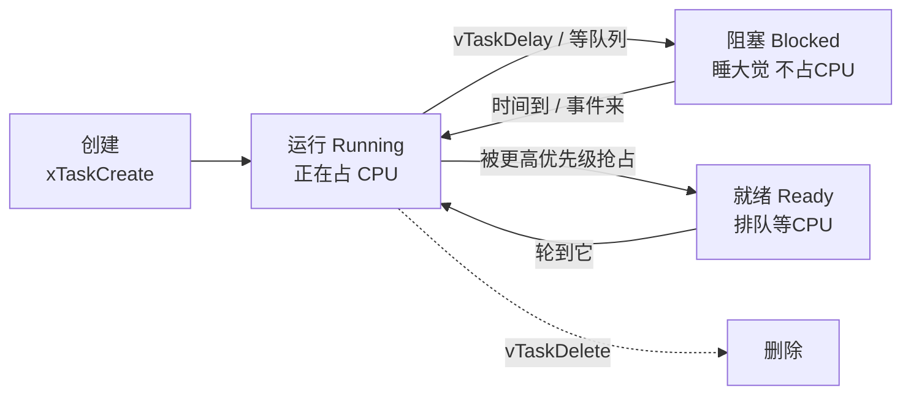

# FreeRTOS 多任务

从这一章开始，你要换一个思维模型。快速上手和 Arduino 的世界里，程序只有一条主线（`loop` / 主循环）；而从这里开始，程序是**几个"小工人"同时干活**——一个读传感器、一个刷屏幕、一个管网络。学会安排这些小工人，你就能写出"一边联网一边采样一边显示"的程序。

先解释名词：

- **FreeRTOS**：一个**实时操作系统（RTOS，Real-Time Operating System）**。它非常小（内核只占几十 KB），只干两件事：让多个任务"看起来同时"运行（第 0 节细讲），以及提供任务之间传数据、等事件的工具。它不是 Windows 那种全功能操作系统——没有窗口、没有文件管理器，就是个"任务调度员"
- **SMP（Symmetric Multiprocessing，对称多处理）**：ESP32-S3 有两个 CPU 核，FreeRTOS 可以把任务分到两个核上真正同时跑。你前期不需要关心核的分配，默认行为已经够好

## 0. 为什么需要"多任务"

回忆 [L0 的 RTOS 一节](../l0-basics/embedded-model)：单个 CPU 靠高速切换制造"同时"的假象。但如果你只有一个主循环，切换这回事就不存在了——循环里的活只能一件件排队：

```text
单主循环的死结：
读传感器(5ms) → 刷屏(50ms) → 连网重试(卡 3 秒) → 读传感器 → 刷屏 ...
                                ↑ 网络一卡，屏幕和传感器全部跟着卡
```

问题不是"慢"，是**一件事卡住，所有事陪葬**。嵌入式设备最常见的翻车现场就是它：网络抽风一下，温度采集停了三秒，屏幕定格三秒，用户以为设备死机了。

多任务就是把三件事拆给三个任务，各转各的循环：

```text
任务 A（传感器）：读 → 读 → 读 → 读 → 读 ...      每 100ms 一圈，雷打不动
任务 B（显示）  ：刷 → 刷 → 刷 → 刷 ...            每 50ms 一圈
任务 C（网络）  ：重连（卡 3 秒）→ 发送 ...        卡它的只有它自己
```

网络任务卡 3 秒，另外两个完全不受影响。**"隔离故障"才是多任务最大的价值**，"并行提速"反而是次要的。

FreeRTOS 在背后干的活：每隔几毫秒把 CPU 从任务 A 身上"抢"下来，看看 B、C 谁该跑，塞给它，过几毫秒再抢……这个"抢"的动作叫**调度（Scheduling）**，做决定的规则只有三条（[L0 讲过](../l0-basics/embedded-model)）：优先级高的先跑；等待中的任务不占 CPU；不许独占。

本章就教你这四样东西：**任务**（小工人怎么造）、**队列**（工人之间传包裹）、**信号量**（工人之间的旗语和门锁）、**软件定时器**（闹钟）。学完就能搭出任何复杂系统的骨架。

## 1. 任务（Task）

**一个任务 = 一个函数 + 一个专属小循环**。你把"这件活怎么反复干"写成一个带 `while(1)` 的函数，交给 `xTaskCreatePinnedToCore` 去创建任务，之后它就独立运转、不再需要你操心：

```c
void sensor_task(void *arg) {         // arg 是创建任务时传进来的参数，用不上就忽略
    sensor_data_t d;
    while (1) {                       // 每个任务自己就是死循环
        read_all(&d);
        process(&d);
        vTaskDelay(pdMS_TO_TICKS(100));   // 让出 CPU 100ms——最关键的一行，见下文
    }
}

void app_main(void) {
    xTaskCreatePinnedToCore(
        sensor_task,       // 函数：这个任务要干的活
        "sensor",          // 名字（调试时能看到，起个看得懂的）
        4096,              // 栈大小，单位 byte（这个任务的"临时工作台"面积）
        NULL,              // 传给任务的参数
        5,                 // 优先级（0~25，越大越急）
        NULL,              // 返回的任务句柄（想以后操控它就传个指针来接）
        0                  // 绑定的核（0/1），tNO_PINNING = 不指定
    );
}
```

### 逐参数解剖

| 参数 | 意思 | 实战要点 |
| --- | --- | --- |
| 函数指针 | 任务的本体 | 签名固定为 `void xxx(void *arg)`；**函数绝不能返回**——想结束就让任务里的循环退不出去 |
| 名字 | 调试时显示 | 起人话名（"sensor"、"net"），崩溃日志里全靠它认人 |
| 栈大小 | 这个任务的"工作台"面积 | 下面单独展开，最重要的参数 |
| 参数指针 | 递给任务的数据 | 常用来传"配置结构体"的地址 |
| 优先级 | 0～25，越大越急 | 下面有对照表 |
| 句柄 | 任务的车钥匙 | 想以后删除/挂起/改优先级就接住它；不要就传 NULL |
| 核心 | 绑到 0 核 / 1 核 / 不绑 | 前期统一 `tNO_PINNING`，让调度器自己安排 |

### `vTaskDelay` 不是可有可无的

它意味着"**我休息 100ms，CPU 拿去干别的**"。这行代码是任务与世界和平共处的契约：

```text
有 vTaskDelay：
  传感器任务 → "我睡 100ms" → CPU 去跑显示、网络 → 100ms 后回来继续 ✓

没有 vTaskDelay（或写成 while(1){} 空转）：
  传感器任务 → 满速空转抢 CPU → 比它优先级低的任务全部饿死
  → 系统空闲任务也跑不到 → 看门狗复位 ✗
```

**规矩：每个任务循环里必须有 vTaskDelay 或某种阻塞等待（等队列/等信号量）。** 这是 FreeRTOS 世界的第一条铁律。

`pdMS_TO_TICKS(100)` 是"把 100 毫秒换算成系统节拍数"的宏——FreeRTOS 的时间单位是 tick（默认 1 秒 100 个 tick = 10ms 一个），不用心算，永远用这个宏换。

### 栈大小：给多少、怎么知道够不够

任务里声明的局部变量、函数调用链都在这份栈里（[L0 内存一节](../l0-basics/embedded-model)讲过栈是什么）。给小了**随机崩溃**（打印 `Stack overflow`）；给大了白白吃掉全局内存。

标准流程：

1. 先给 4096（4KB）起步，复杂的给 8192
2. 跑一段时间（把所有功能都触发一遍）
3. 查"历史最低水位"：

```c
#include "freertos/task.h"
ESP_LOGI(TAG, "栈历史最低剩 %u 字节", uxTaskGetStackHighWaterMark(NULL));
// NULL = 查当前自己；传任务句柄查别人
```

4. 剩余低于 1000 字节 → 加栈；剩余 3000+ → 可以减下来省内存

### 优先级对照表

| 优先级 | 典型用途 | 例 |
| --- | --- | --- |
| 1～4 | 后台任务（日志、统计） | 日志落盘 |
| 5（默认） | 普通应用任务 | 业务主逻辑 |
| 8～12 | 控制、协议栈回调 | WiFi/蓝牙内部 |
| 15～25 | 实时任务（采样、中断后处理） | 音频采集、电机控制 |

FreeRTOS 的规则是**高优先级永远先跑**：只要高优先级任务"想跑"（没在等待），低优先级就干瞪眼。所以**给高优先级是有代价的**——给一个任务 20 级优先级，等于宣布"它想跑时全世界让路"，它若不懂事（不阻塞），全世界都死。原则：**默认给 5，只在"晚一毫秒就出事"的场景（音频、电机）给高优先级**。

### 任务的生死与状态

任务一生在几个状态间流转，知道这张图，调试时看任务列表就不懵：



- **Running**：CPU 正在执行它
- **Ready**：随时能跑，在排队（有更高优先级的在跑）
- **Blocked**：主动睡了（延时中/等数据中）——**不占任何 CPU**
- 调试神器 `vTaskList()` 能把所有任务的名字、优先级、状态、栈水位打成一张表

### 创建任务的两种时机

```c
// 时机一：app_main 里创建（最常见）
void app_main(void) {
    xTaskCreatePinnedToCore(...);
}

// 时机二：任务里创建任务（动态扩张，如"收到命令才启动上传任务"）
void net_task(void *arg) {
    if (收到上传命令) {
        xTaskCreatePinnedToCore(upload_task, "upload", 8192, NULL, 6, NULL, 1);
    }
}
```

反过来，**任务用完要删**（省内存）：`vTaskDelete(句柄);`，或任务在自己函数末尾 `vTaskDelete(NULL);` 自杀。不删的常驻任务无所谓，但"每次事件都创建一个任务"不删会泄漏内存——任务栈也是内存。

## 2. 队列（Queue）——任务间传数据的标准方式

任务各转各的循环之后，马上出现新问题：传感器任务采到的数据，怎么交给网络任务？

最朴素的想法是"用一个全局变量"——**两个任务同时读写同一个变量会撞车**：网络任务正读到一半，传感器任务把值改了，网络任务拿到"半新半旧"的数据。这类问题叫**竞态（Race Condition）**，它阴险在：不是每次都撞，万次撞一次，而且撞了也不报错。

**队列（Queue）**是 FreeRTOS 提供的标准答案。把它想成**传送带**：传感器任务把数据盒子上传送带就走（不等网络任务），网络任务从传送带上取就行（不等传感器任务），两边互不认识、互不等待、**FreeRTOS 保证每次取放都是完整的、不打架的**：

```c
typedef struct {
    uint32_t timestamp;
    float volt;
    uint8_t status;
} sensor_data_t;

static QueueHandle_t data_queue;          // 传送带的"把手"

// 生产者：传感器任务
void sensor_task(void *arg) {
    sensor_data_t d;
    TickType_t last = xTaskGetTickCount();
    while (1) {
        d.volt = read_adc();
        d.timestamp = xTaskGetTickCount();
        if (xQueueSend(data_queue, &d, 0) != pdTRUE) {
            ESP_LOGW(TAG, "队列满，丢弃本帧");   // 非阻塞发送，满了就丢
        }
        vTaskDelayUntil(&last, pdMS_TO_TICKS(1000));  // 精确 1Hz，不累积漂移
    }
}

// 消费者：网络任务
void net_task(void *arg) {
    sensor_data_t d;
    while (1) {
        if (xQueueReceive(data_queue, &d, pdMS_TO_TICKS(5000)) == pdTRUE) {
            mqtt_publish(&d);                       // 拿到数据，发出去
        } else {
            ESP_LOGW(TAG, "5 秒没有数据，检查 sensor_task");  // 超时了
        }
    }
}

void app_main(void) {
    data_queue = xQueueCreate(10, sizeof(sensor_data_t));   // 造传送带：10 个格子，每格装一个 sensor_data_t
    xTaskCreatePinnedToCore(sensor_task, "sensor", 4096, NULL, 5, NULL, 0);
    xTaskCreatePinnedToCore(net_task, "net", 4096, NULL, 5, NULL, 1);
}
```

### 逐行拆解核心 API

**`xQueueCreate(10, sizeof(sensor_data_t))`**——造传送带：10 个格子，每格的尺寸是"一个 sensor_data_t 那么大"。队列会**整体复制**你放进来的数据（不是传地址），所以传什么类型都行。

**`xQueueSend(队列, &数据, 超时)`**——放数据：

- 第三个参数是**格子满了怎么办**：`0` = 立刻放弃（返回失败，调用方决定丢不丢）；`pdMS_TO_TICKS(100)` = 等 100ms 再不行就放弃；`portMAX_DELAY` = 死等到有空位
- 数据通过 `&d` 递进去，队列把整个结构体**复制**进格子——所以放完之后你随便改 `d`，不影响传送带上的那份

**`xQueueReceive(队列, &接收盒, 超时)`**——取数据：

- 格子有货 → 复制进 `&d`，返回 pdTRUE
- 格子空 → **按超时参数等待**：等 5 秒；期间**这个任务睡着不占 CPU**（阻塞，L0 讲的关键概念）；5 秒还没货返回 pdFALSE
- `portMAX_DELAY` = 没数据就一直睡，来了自动醒

**注意消费者任务的优雅之处**：它不用轮询"有数据没"，而是直接睡在队列上等投喂——CPU 一点不浪费。

### 超时参数的哲学：三种策略

| 传什么 | 行为 | 什么时候用 |
| --- | --- | --- |
| `0` | 立刻返回，不等待 | 生产者：满了就丢帧（数据贵新不贵全） |
| 有限超时 | 等一会儿，超时报错 | 消费者：超时正好当"心跳检测"（5 秒没数据=传感器挂了） |
| `portMAX_DELAY` | 死等，等到为止 | 明确知道"等是值得的"且不能放弃（如等配置） |

**队列满的处理是架构决策**：传感器 100ms 一帧、消费者 5 秒才消化一帧，10 格的队列迟早爆。先算账：生产速率 × 最长处理时间 ≤ 队列容量，再决定丢弃策略。

### `vTaskDelay` vs `vTaskDelayUntil`：差之毫厘的漂移

| 函数 | 行为 | 后果 |
| --- | --- | --- |
| `vTaskDelay(ticks)` | 从**现在**开始延迟 ticks | 干活的耗时计入周期：干活 10ms + 延时 1000ms = 周期 1010ms，**逐圈漂移** |
| `vTaskDelayUntil(&last, ticks)` | 从**上次醒来的时刻**算起 | 周期精确 1000ms，不漂 |

采集、打包上传这类**周期性**任务，永远用 `vTaskDelayUntil`（注意要先取一次 `last = xTaskGetTickCount()` 作为起点）。

### 队列的兄弟用法

```c
// 只看不取（偷看下一个包裹但不拿走）
xQueuePeek(data_queue, &d, 超时);

// 队列里传指针（大块数据不整包复制）：
QueueHandle_t p_queue = xQueueCreate(10, sizeof(char *));
char *big_buf = malloc(4096);
xQueueSend(p_queue, &big_buf, 0);        // 只递 4 字节的房间号
// ⚠️ 约定：接收方用完必须 free——内存的归属权随指针移交
```

**试着改一改**（概念题，不用板子）：传感器 100ms 一帧，消费者处理一帧要 300ms。队列开 10 格，多久爆？爆了之后按"满了就丢"策略，消费者实际消化的是全部数据还是滞后数据？（提示：消费速率 < 生产速率，队列永远在涨。这个场景的正确解法是"消费者只取最新值"或加大队列+丢帧。）

## 3. 信号量（Semaphore）——资源计数与互斥

队列传的是"数据"，信号量传的是"信号"（发生没发生）。两种最常用形态：

### 3.1 二值信号量：一面小旗子

只有"举着/放下"两个状态。**中断里"举旗"（Give），任务里"等旗"（Take）**——等旗时任务睡着，不占 CPU，旗一举起来它立刻醒来：

```c
static SemaphoreHandle_t data_ready;

void app_main(void) {
    data_ready = xSemaphoreCreateBinary();     // 造旗子（出生时是放下的）
}

// 中断里（ISR 专用 API，FromISR 后缀）
void IRAM_ATTR isr_handler(void *arg) {
    BaseType_t woken = pdFALSE;
    xSemaphoreGiveFromISR(data_ready, &woken);   // 举旗
    if (woken) portYIELD_FROM_ISR();             // 立刻切换到被唤醒的任务
}

// 任务里
void worker_task(void *arg) {
    while (1) {
        xSemaphoreTake(data_ready, portMAX_DELAY);   // 睡等旗子；举了就往下走
        do_heavy_work();                              // 旗子到了才干的活
    }
}
```

**这个"ISR 举旗、任务干活"的组合是嵌入式架构的万能模板**——中断要短（L0 铁律），但活总得干，分工就是：中断只举旗（几微秒），任务睡到旗子来再慢慢干。

### 3.2 互斥锁（Mutex）：单人卫生间的门锁

**互斥锁（Mutex，"互斥"就是"互相排斥"）**用于保护共享资源。把它想成**单人卫生间的门锁**：进门前上锁（Take），用完开锁（Give）；别人到门口发现锁着，就排队等。这样保证"改共享数据"这件事**同一时刻只有一个任务在做**：

```c
SemaphoreHandle_t mutex = xSemaphoreCreateMutex();

void write_data(data_t *d) {
    xSemaphoreTake(mutex, portMAX_DELAY);    // 上锁（别人抢不到就排队）
    shared_data = *d;                        // 临界区：动共享数据
    xSemaphoreGive(mutex);                   // ★ 开锁（不还锁=所有人永远排队）
}
```

`临界区（Critical Section）`就是"上锁和开锁之间的那段代码"——一次只能一个任务进的房间。

**为什么全局变量还需要锁？** 因为"改一个结构体"实际是多条机器指令：读、算、写……任务可能在指令中间被切换走，另一个任务进来看到了改到一半的数据。锁保证"这一串指令从头到尾没人插队"。

:::caution[锁的四条纪律]
1. **必须成对**：Take 了就要 Give，漏 Give 全系统死锁（所有人都排你后面）
2. **持锁时间越短越好**：锁着的时候别调耗时函数、别打印日志
3. **不要嵌套上两把锁**：A 锁着 B、B 锁着 A = 死锁（两人互等对方手里的筷子）
4. **ISR 里不能用 Mutex**（它是给任务的）——ISR 通知用二值信号量
:::

**二值信号量 vs Mutex 怎么选？** 一句话：**保护资源用 Mutex，事件通知用二值信号量**。技术上 Mutex 还多一个"优先级继承"特性（防止"低优先级任务锁着资源，高优先级任务干等，中优先级却在跑"的优先级反转问题），这也是它比信号量更适合当锁的原因。

## 4. 事件组（Event Group）——多个布尔标志

一个 Mutex 是一把锁、一个二值信号量是一面旗。**如果事情的状态有好几个独立的开关呢？**——"WiFi 连上了没？传感器好了没？配置加载了没？"——**事件组（Event Group）**就是一排旗子（32 个比特位，每比特一面旗）：

```c
static EventGroupHandle_t events;

#define BIT_CONNECTED    BIT(0)      // 第 0 面旗：WiFi 连上了
#define BIT_SENSOR_OK    BIT(1)      // 第 1 面旗：传感器就绪
#define BIT_ALARM        BIT(2)      // 第 2 面旗：报警中

// 各处随手举旗
xEventGroupSetBits(events, BIT_CONNECTED);        // WiFi 任务：我连上了！
xEventGroupSetBits(events, BIT_SENSOR_OK);        // 传感器任务：我好了！

// 主逻辑任务：等"联网且传感器就绪"两件事都齐了再开工（最多等 5 秒）
EventBits_t got = xEventGroupWaitBits(
    events, BIT_CONNECTED | BIT_SENSOR_OK,
    pdFALSE,          // 出来时要不要自动把等过的旗清掉（否）
    pdTRUE,           // pdTRUE = 全部齐了才醒；pdFALSE = 任一齐了就醒
    pdMS_TO_TICKS(5000));

if ((got & (BIT_CONNECTED | BIT_SENSOR_OK)) == (BIT_CONNECTED | BIT_SENSOR_OK)) {
    start_main_logic();          // 万事俱备
} else {
    ESP_LOGW(TAG, "初始化超时，缺的旗子: %x", got);
}
```

**它最适合"等几件事都齐了再开始"的编排逻辑**——启动流程（等 NVS、WiFi、时钟全就绪再干活）的标配工具。轮询写法要写三个 while 加标志变量，事件组一行搞定还自带超时。

## 5. 软件定时器

"每 1 秒做一次某事"的另一种写法——不用专门建任务，注册一个回调，系统到点帮你调：

```c
static void timer_cb(TimerHandle_t t) {
    // 注意：这个函数在系统内部的"定时器服务任务"里执行，不是中断，
    // 但也别放太重的活——它是所有定时器共用的一个任务
    s_poll_flag = true;
}

esp_timer_create_args_t args = {
    .callback = timer_cb,
    .name = "poll_timer",
    .dispatch_method = ESP_TIMER_TASK,   // 放到任务里跑，比放中断安全
    .skip_unhandled_events = true,       // 忙时直接跳过错过的触发，不堆积补跑
};
esp_timer_handle_t timer;
esp_timer_create(&args, &timer);
esp_timer_start_periodic(timer, 1000000);  // 单位是微秒！1000000µs = 1s
```

三种"到点做事"的方案对比，各有所长：

| 方案 | 适合 | 特点 |
| --- | --- | --- |
| 任务里 `vTaskDelay` | 周期性主力活 | 最简单，任务自己掌控节奏 |
| `esp_timer` 软件定时器 | 轻量的周期动作（刷新标志、超时检测） | 不占一个任务名额，回调在公共任务里跑 |
| 硬件定时器 + ISR | 微秒级精确时序（PWM、采样触发） | 最精确，但回调是 ISR，受中断铁律约束 |

⚠️ **单位不一致是常错点**：`esp_timer` 用微秒，FreeRTOS tick 用 tick，`vTaskDelay` 配 `pdMS_TO_TICKS` 用毫秒。粘贴代码时盯紧单位。

## 6. 中断与任务的安全边界

ISR 和任务是两个世界——ISR 是"硬件喊的函数"，运行环境苛刻（L0 讲过：要短、要 IRAM、不能分配内存）。**两边交互时，API 必须用 ISR 专用版**（`FromISR` 后缀）：

| 操作 | 任务里 | ISR 里 |
| --- | --- | --- |
| 队列 | `xQueueSend` | `xQueueSendFromISR` |
| 信号量 | `xSemaphoreGive` | `xSemaphoreGiveFromISR` |
| 任务通知 | `xTaskNotify` | `xTaskNotifyFromISR` |
| 切换任务 | — | `portYIELD_FROM_ISR()` |

为什么必须分两套？普通版 API 内部可能阻塞、可能用任务自己的资源——ISR 里没有"任务身份"，这些操作直接死机。FromISR 版本全部是"非阻塞、纯通知"的设计。

`portYIELD_FROM_ISR(woken)` 的意思：如果刚才的 Give 唤醒了一个正在等的任务，**中断一结束立刻切换到它**（而不是回主程序绕一圈）——保证响应速度。

### 通知任务的更轻量选择：Task Notification

每个任务自带一个 32 位"信箱"，比信号量更轻更快：

```c
// ISR 里：给 task1 的信箱塞个值
vTaskNotifyGiveFromISR(task1_handle, &woken);

// 任务里：等信箱（数值版和信号量 Give 等价，但快 45% 且不占额外内存）
ulTaskNotifyTake(pdTRUE, portMAX_DELAY);
```

简单"通知一个任务"的场景优先用它；需要"广播给多个任务"才用事件组/队列。

## 7. 常见陷阱（症状诊断表）

| 陷阱 | 表现（你看到的） | 根因 | 对策 |
| --- | --- | --- | --- |
| 高优先级任务不阻塞 | 系统慢、日志停、看门狗复位 | 它空转独占 CPU | 循环里必须有 vTaskDelay 或阻塞等待 |
| 任务栈太小 | 随机崩溃、`Stack overflow` | 局部变量/调用链超了工作台 | 加栈；用高水位检查收敛 |
| 在 ISR 里 printf/ESP_LOG | 死机或 panic | 日志内部用锁/内存分配 | ISR 里只置标志/发队列；要用日志只能 `esp_rom_printf` |
| 队列长度太小 | 频繁丢数据 | 生产 > 消费 | 算账定长度；定丢弃策略 |
| 传大结构体按值 | 栈溢出 | 队列整包复制占栈 | 队列传指针（约定归属权） |
| Mutex 忘了 Give | 全部相关任务卡死 | 临界区里有 return/出错路径没开锁 | 每条路径都检查配对；缩小临界区 |
| 优先级反转 | 偶发的高优先级卡顿 | 低优先级持锁、高优先级干等 | 共享资源一律用 Mutex（自带优先级继承） |

## 8. 实战：用三个任务重构传感器项目

把本章所有零件组装起来——"采样、显示、联网"三任务架构，这是大多数物联网项目的主干骨架：

```c
static QueueHandle_t q;                 // 数据传送带
static EventGroupHandle_t flags;        // 状态旗子

#define BIT_CONNECTED   BIT(0)

static void sensor_task(void *arg) {
    sensor_data_t d;
    TickType_t last = xTaskGetTickCount();
    while (1) {
        d.volt = read_adc();
        xQueueSend(q, &d, 0);                       // 满了就丢，不等人
        vTaskDelayUntil(&last, pdMS_TO_TICKS(1000)); // 精确 1Hz
    }
}

static void display_task(void *arg) {
    sensor_data_t d;
    while (1) {
        if (xQueueReceive(q, &d, pdMS_TO_TICKS(2000)) == pdTRUE) {
            render(&d);                              // 有新数据就刷屏
        }
    }
}

static void net_task(void *arg) {
    sensor_data_t d;
    while (1) {
        xEventGroupWaitBits(flags, BIT_CONNECTED, pdFALSE, pdTRUE, portMAX_DELAY);
        if (xQueueReceive(q, &d, portMAX_DELAY) == pdTRUE) {
            mqtt_publish(&d);          // 断网时它阻塞在上面的 WaitBits，不影响别人
        }
    }
}

void app_main(void) {
    q = xQueueCreate(10, sizeof(sensor_data_t));
    flags = xEventGroupCreate();
    xTaskCreatePinnedToCore(sensor_task, "sensor", 4096, NULL, 5, NULL, 0);
    xTaskCreatePinnedToCore(display_task, "disp", 4096, NULL, 4, NULL, 0);
    xTaskCreatePinnedToCore(net_task, "net", 8192, NULL, 4, NULL, 1);
}
```

### 这 40 行里值得抄走的决策

1. **数据流单向**：传感器 → 队列 → 显示/网络。数据只有一个方向、一个来源，谁改了数据一目了然
2. **故障隔离**：net_task 卡在网络重连上时（阻塞在 WaitBits），display 照常每秒刷新——这就是第 0 节承诺的隔离
3. **栈预算差异化**：net 给 8192（TLS 握手很吃栈），其他 4096——按任务的实际负载分配
4. **优先级克制**：全部 4～5 级，没有任何任务需要"抢占世界"
5. **WiFi 事件来了在别处 SetBits(BIT_CONNECTED)**——三个任务通过旗子和传送带协作，互相之间零直接调用

三个任务各干各的：网络重连卡 5 秒，显示照常刷新。这就是 Arduino 里很难、IDF 里很自然的写法。

## 下一步

[组件模型与构建](./component-cmake)