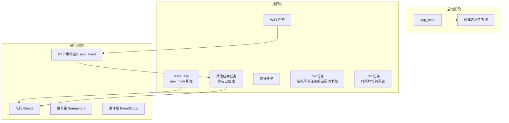

# L2 编程模型

ESP-IDF 与 Arduino 最本质的差距在这里：Arduino 给你一个 `setup` + `loop`，ESP-IDF 给你一整套并发框架。

| 章节 | 内容 | 为什么重要 |
| --- | --- | --- |
| [FreeRTOS 多任务](./freertos) | 任务、队列、信号量、事件组、定时器、中断与任务 | 一切复杂程序的基础 |
| [组件模型与构建](./component-cmake) | 组件、CMake、Kconfig、依赖管理 | 决定你能不能用上官方组件 |
| [分区表与 OTA](./partition-ota) | Flash 分区、三种 OTA 方案 | 决定固件大小上限和升级能力 |
| [日志与崩溃定位](./logging-backtrace) | ESP_LOG、看门狗、backtrace、GDB | 决定你能不能快速定位问题 |

## 从按下复位到 app_main：先建立这条主线

在讲多任务之前，先要知道**程序是怎么起来的**。很多人调不通程序，根本原因是不知道代码跑到哪一步了：

记住这条链的实用价值：**串口在第 ④ 步之前完全没有 printf 输出**。所以"串口一片空白"往往说明问题出在 ①②③，而不是你的 `app_main` 写错了。

## 核心心智模型

三条必须建立的认知：

1. `app_main` 只是启动代码，它返回后程序不会结束，而是进入 FreeRTOS 调度。真正的逻辑要放在你自己创建的任务里
2. 事件驱动优于轮询。ESP-IDF 里 WiFi、蓝牙都以事件形式广播，系统事件循环帮你分发
3. 阻塞等待不消耗 CPU。这是低功耗设计的地基

## 下一步

[FreeRTOS 多任务](./freertos)