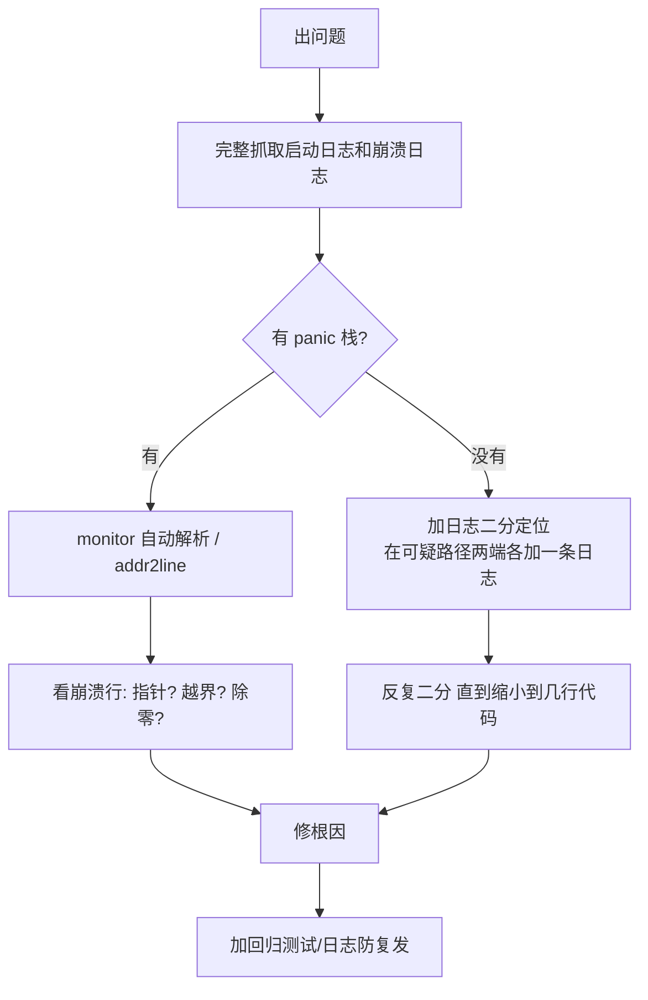

# 日志与崩溃定位

嵌入式设备没有屏幕，程序出问题时你能依靠的只有两样：**日志**（程序自己打印的运行记录）和**崩溃现场**（程序死亡瞬间留下的信息）。这一章教你怎么把这两样东西用好——**"会看日志"和"不会看日志"的排错效率差十倍**。

先解释本章的主角：

- **ESP_LOG**：IDF 的日志系统，按严重程度分五级。它比 `printf` 强在：自动带时间戳和模块名、可以按级别开关
- **看门狗（Watchdog）**：一只"电子狗"，定时检查"程序还活着吗"。你定期"喂狗"，一旦忘记喂（程序卡死），它就让芯片复位。它不是麻烦，是**把"无声卡死"变成"有日志的重启"**的救星
- **backtrace（回溯）**：程序崩溃时打印的一串地址，记录"它是从哪一行代码一步步走到崩溃点的"。配合小工具能把地址翻译成文件名和行号——定位崩溃最有效的手段
- **GDB**：交互式调试器，可以在程序运行中暂停、单步、看变量。功能最强，但需要额外接 JTAG，前期用日志加 backtrace 就够

## 1. ESP_LOG

### 基本用法

```c
#include "esp_log.h"
static const char *TAG = "MY_COMPONENT";     // 模块名：日志前缀，起人话名

ESP_LOGE(TAG, "错误: %s (0x%x)", esp_err_to_name(err), err);   // Error   红色
ESP_LOGW(TAG, "重试第 %d 次", i);                                // Warning 黄色
ESP_LOGI(TAG, "初始化完成, 共 %d 个设备", n);                    // Info    绿色
ESP_LOGD(TAG, "原始值=%d 校准后=%d", raw, cal);                  // Debug   调试用
ESP_LOGV(TAG, "函数入口 arg=%p", arg);                           // Verbose 最啰嗦
```

五个级别的使用纪律（全项目统一，日志才有可读性）：

| 级别 | 什么时候打 | 频率 |
| --- | --- | --- |
| **E** | 发生了错误、不能继续 | 尽量少——出现了就该修 |
| **W** | 出事了但兜住了 | 少——每次出现都值得看一眼 |
| **I** | 关键状态变更 | 极少——启动几步、联网成功，一天几十条 |
| **D** | 排查问题时需要的过程数据 | 随意，发布版关掉 |
| **V** | 啰嗦的现场细节 | 只在深挖时开 |

**"日志满天飞"的病根是滥用 I 级**——循环里每圈打一条 Info，关键信息被淹没。规矩：**I 级日志一天打印量不该超过几十条**。

### 日志长什么样：逐段解读

```text
I (4182) MY_COMPONENT: 初始化完成, 共 3 个设备
│ │      │              │
│ │      │              └─ 你写的消息（printf 同款格式化）
│ │      └─ TAG 模块名
│ └─ (4182) = 上电后第 4182 毫秒打的这条
└─ I = Info 级
```

两个最有诊断价值的字段：**时间戳**（算两个事件间隔）、**TAG**（定位是哪个模块说的）。

### 编译期 vs 运行期控制

**编译期**（决定哪些日志被编进固件）：

```c
#define LOG_LOCAL_LEVEL ESP_LOG_DEBUG     // 放在文件顶部、#include 之前，本文件放宽到 DEBUG
#include "esp_log.h"
```

全局设置在 menuconfig：`Component config → Log output → Default log verbosity`。**发布版把它设为 Info**，`ESP_LOGD/V` 直接被编译掉——省 flash、省 CPU、省功耗（每条日志都是串口字节的搬运）。

**运行期**（不重编译临时开/关某模块）：

```c
esp_log_level_set("*", ESP_LOG_DEBUG);       // 全部模块放宽到 DEBUG
esp_log_level_set("wifi", ESP_LOG_NONE);     // 关掉最吵的模块
```

排错的黄金组合：**全局 Info + 出问题的模块临时 Debug**。`idf.py monitor` 里输入 `esp_log_level_set wifi DEBUG` 也能改（部分版本支持）。

## 2. 看门狗（Watchdog）

### 为什么需要看门狗

程序卡死的形式：任务死循环、死锁、等一个永远不来的信号。卡死的程序**看起来一切正常**——没有日志、没有崩溃，就是没反应。现场设备卡死了，用户只会拔电池。

看门狗的思路：让程序定期"喂狗"（调用喂狗函数），狗饿了（超时没喂）就认为程序死了，**强制复位**——把"无声卡死"变成"有日志的重启"，你才有机会诊断。

### 三类看门狗，各管一段

| 类型 | 监控对象 | 触发后果 |
| --- | --- | --- |
| **Interrupt WDT（中断看门狗）** | 关中断时间过长 | 复位（防止硬件层面跑飞） |
| **Task WDT（任务看门狗）** | 登记在册的任务有没有按时喂 | 打印全部任务栈后复位 |
| **RTC WDT** | bootloader/深度睡眠期间 | 复位 |

你日常打交道的是 **Task WDT**。它最常咬人的场景：

```c
void bad_task(void *arg) {
    while (1) {
        // 一个忙碌的循环，但没有任何延时/阻塞
        poll_something();
    }
    // 这个任务永远不喂狗 → 几秒后 Task WDT 咬人 → 全板复位
}
```

**回忆 L0/L2 的规矩：每个任务循环里必须有 `vTaskDelay` 或阻塞等待**——这条规矩的执法者就是 Task WDT。

### 主动使用 Task WDT（监控关键任务）

```c
#include "esp_task_wdt.h"

esp_task_wdt_config_t twdt_config = {
    .timeout_ms = 5000,              // 5 秒不喂就咬
    .idle_core_mask = 0,             // 不监控 idle 任务
    .trigger_panic = true,           // 咬的时候打印栈并复位
};
esp_task_wdt_init(&twdt_config);
esp_task_wdt_add(NULL);              // 把当前任务加入监控

while (1) {
    do_my_important_work();
    esp_task_wdt_reset();            // 每圈喂狗
    vTaskDelay(pdMS_TO_TICKS(100));
}
```

价值：**关键任务（如安全联锁、通信心跳）卡死时能被自动发现并复位**，而不是无声挂掉。

### 被咬之后怎么读现场

Task WDT 咬人时会打印所有任务的调用栈——**这行信息极其有用**，直接看到是哪个任务、卡在哪一行：

```text
Task watchdog got triggered. The following tasks/users did not reset the watchdog in time:
  - my_task (CPU 0)                        ← 没喂狗的是谁
Tasks currently running:
CPU 0: my_task                           ← 现在占着 CPU 的也是它
Backtrace: 0x400d1234:0x3ffb0000 ...      ← 拿去 addr2line 解析（见下节）
```

## 3. Panic 与 backtrace

### panic：程序当场死亡的两种形态

程序访问了不该访问的内存、除了零、跳到了非法地址——CPU 硬件层面立刻拦截，IDF 打印崩溃现场然后复位（或挂起），这个过程叫 **panic**。

典型 panic 原因与代码病的对照表：

| panic 名 | 人话 | 典型代码病 |
| --- | --- | --- |
| `LoadProhibited` | 读了非法地址 | 空指针解引用（`*p` 而 p 是 NULL）、野指针 |
| `StoreProhibited` | 往非法地址写 | 同上，写的方向 |
| `IllegalInstruction` | 跳到不是代码的地方执行 | 函数指针是垃圾值、栈被冲坏后返回地址坏了 |
| `IntegerDivideByZero` | 除零 | `a / b` 而 b 是 0 |
| `Stack overflow` | 任务栈撑爆 | 局部变量太大、递归、栈配小了 |
| `Interrupt WDT` | 中断里干太久 | ISR 里 delay/printf（中断铁律没守） |

**经验：七成 panic 是指针问题**——回到崩溃点检查所有 `*p`、`p->`、`a[i]`。

### 打开 backtrace（默认开着，确认一下）

```bash
idf.py menuconfig
# Component config → ESP System Settings → Panic handler behavior
#   → Print registers and backtrace（默认）
```

### 一个完整的崩溃现场：逐段解读

程序崩了，串口打印：

```text
Guru Meditation Error: Core  0 panic'ed (LoadProhibited). Exception was unhandled.

Core  0 register dump:
PC      : 0x42034abc  PS      : 0x00060c30    ← PC = 崩溃瞬间正在执行的指令地址
A0      : 0x8203ab34  A1      : 0x3fce2a40    ← A1 是栈指针
...（一堆寄存器）
MTVAL   : 0x00000000                   ← ★ 导致崩溃的非法地址（这里是 NULL！）

Backtrace: 0x42034abc:0x3fce2a40 0x4203ab30:0x3fce2a60 0x4202f100:0x3fce2a80 0x4202e9c4:0x3fce2ab0
ELF file SHA256: 3a7f...
```

| 字段 | 读法 |
| --- | --- |
| `panic'ed (LoadProhibited)` | 死因：读了非法地址 |
| `MTVAL` | 非法地址本身。**`0x0` = 解引用了 NULL 指针**——秒判！如果是个奇怪的大数 = 野指针 |
| `Backtrace` | 调用链：一串"函数地址:栈帧地址"对，从崩溃点一路往回排 |
| `ELF file SHA256` | 固件指纹——确保你解析 backtrace 用的 elf 和板子上跑的是同一份 |

### 解析 Backtrace：两步走

**第 1 步（最快）——monitor 自带解码**：`idf.py monitor` 检测到 backtrace 会**自动**解析并在下方打印：

```text
0x42034abc: sensor_read at /home/me/proj/components/app_driver/app_driver.c:58
0x4203ab30: poll_all at /home/me/proj/main/app_main.c:142
...
```

看到没有：**第 58 行 sensor_read 里解引用了 NULL**。定位完成。

**第 2 步（离线）——addr2line**：如果日志是别人发给你的、你手上有对应的 .elf：

```bash
xtensa-esp32s3-elf-addr2line -pfiaC -e build/my_project.elf 0x42034abc 0x4203ab30
```

输出：

```text
sensor_read() at .../components/app_driver/app_driver.c:58
poll_all() at .../main/app_main.c:142
```

**把这两个命令写进你的调试习惯**：崩溃 → 复制 Backtrace 行 → 解析 → 得到文件行号。整个过程 30 秒。

⚠️ 解析的前提：**elf 和板上的固件是同一次编译的产物**——改过代码没重烧就去解析，行号全是错的。

## 4. GDB 交互调试

日志是"事后取证"，GDB 是"事发现场蹲守"——程序随时暂停、单步、看变量。S3 原生 USB 口就能当 JTAG 用（不用买调试器）：

```bash
idf.py openocd gdb          # 或按官方文档配置 openocd
```

常用操作速查：

```text
break app_main              在函数下断点
break sensor.c:58           在行号下断点
continue                    放行到下一个断点
print x                     打印变量
print *ptr                  顺指针看值
bt                          打印调用栈（GDB 版 backtrace）
step / next / finish        单步（进函数 / 过一行 / 跑完当前函数）
info registers              看寄存器
```

**什么时候值得上 GDB**：日志看不出毛病的"薛定谔 bug"——时好时坏、与时序相关。断点单步会改变时序，有时 bug 反而不出现了（海森堡bug）——那就用 GDB 的硬件断点或回退到日志二分法。

## 5. 其它实用手段

| 工具 | 用途 |
| --- | --- |
| `coredump` 分区 + `espcoredump.py` | 崩溃现场转储到 Flash，事后离线解析——设备在用户手里崩了也能拿到现场 |
| `heap_caps_check_integrity_all(true)` | 检测堆损坏（越界写把堆的管理数据踩坏了） |
| `uxTaskGetStackHighWaterMark()` | 查每个任务的栈剩余（L2 讲过） |
| 逻辑分析仪 | 看总线波形（I2C/SPI/UART），L4 的主力 |
| GPIO 翻转打点 | 在关键路径开头结尾翻转一个 GPIO，逻辑分析仪/示波器量耗时 |

## 6. 一个务实的调试流程



三条经验收尾：

1. **日志先行**：项目一开始就给关键路径布好日志（初始化每步、状态切换、错误码），出事才有得查——平时觉得没用，出事时是救命稻草
2. **二分法万岁**：没有崩溃现场时，在"出问题的路径"上隔几行加一条日志，跑一次缩小一半范围——十几次迭代内必然抓到
3. **修完要复盘**：这次为什么没早点发现？加一条什么样的日志/断言能下次自动抓到？——**每个 bug 都要变成一份保险**

## 下一步

[L3 Arduino 快速通道](../l3-arduino/)