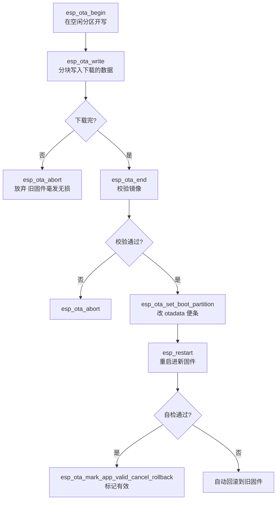

# 分区表与 OTA

ESP32 的 Flash 是一整块连续空间，**必须切分**才能用。切错的表现是：编译通过、烧录成功、运行无输出或反复重启。

先解释两个词：

- **分区（Partition）**：把 Flash 这块"硬盘"切成几间屋子，各住各的——你的程序住 app 分区、WiFi 密码等配置住 NVS 分区、文件系统住 spiffs 分区。和电脑给硬盘分 C 盘 D 盘是同一个思想，只是这里是一张固定写死的表
- **OTA（Over-The-Air）**：不接数据线、通过网络把新固件发给设备完成升级。手机 App 的"系统更新"就是 OTA。做联网产品，OTA 几乎是必备能力——总不能让用户拆开外壳接数据线

分区表怎么切、OTA 怎么安全地升级，就是本章全部内容。

## 1. 两种分区类型

| 类型 | 用途 | 运行时可写 |
| --- | --- | --- |
| `app`（固件） | 存放应用程序镜像 | 否（只读执行） |
| `data`（数据） | NVS、文件系统、OTA 状态 | 是 |

**data 分区还按 SubType 细分**，每种 subtype 对应一种"数据格式"：

| SubType | 装什么 | 谁在用 |
| --- | --- | --- |
| `nvs` | 键值对配置 | nvs_flash 组件 |
| `ota` | OTA 切换状态（otadata） | bootloader |
| `spiffs` / `littlefs` | 文件系统 | 对应文件系统组件 |
| `fat` | FAT 文件系统 | SD 卡/大容量存储 |
| `coredump` | 崩溃现场转储 | espcoredump 工具 |

 subtype 写错 = 挂载失败——文件系统组件按 subtype 找自己的分区。

## 2. 典型分区表：逐列读懂

### 单 factory（无 OTA，最简单）

```csv
# Name,   Type, SubType, Offset,  Size,   Flags
nvs,      data, nvs,     0x9000,  0x4000,
otadata,  data, ota,     0xd000,  0x2000,
app0,     app,  factory, 0x10000, 0x140000,
spiffs,   data, spiffs,  0x150000,0x60000,
coredump, data, coredump,0x1B0000,0x10000,
```

**每一列是什么**：

| 列 | 含义 | 举例解读 |
| --- | --- | --- |
| **Name** | 分区名（自己起，代码里按名引用） | `nvs` |
| **Type** | app 或 data | app = 固件 |
| **SubType** | 细分格式 | factory = "出厂固件" |
| **Offset** | 距 Flash 开头多少字节（住址） | `0x10000` = 64KB 处 |
| **Size** | 分区多大 | `0x140000` = 1.25MB |

**Offset 的规矩**（写错 = 启动不了）：

- `0x0`～`0x8000` 留给 bootloader
- `0x8000` 固定是分区表自己
- `0x9000` 起才能放你的分区（`0x8000~0x9000` 这 4KB 也留给系统）
- app 分区的 offset 要对齐到 `0x10000`（64KB）——所以 factory 从 `0x10000` 开始

**Size 的读法**：`0x4000` = 16384 = 16KB（NVS，IDF 双 OTA 模板的默认大小）；`0x140000` = 1310720 = 1.25MB。**算术都是十六进制乘法，写分区表时先拿计算器换算，别心算**。

### 双 OTA（推荐，联网项目标配）


上图的**宽度就是真实占比**——`app0` 和 `app1` 各吃掉约 1.81MB，几乎占了整个 Flash。这解释了为什么带 WiFi + TLS 的固件很容易写不下：你只有一个 app 分区的空间可用。

```csv
# Name,   Type, SubType, Offset,  Size,     Flags
nvs,      data, nvs,     0x9000,   0x4000,
otadata,  data, ota,     0xd000,   0x2000,
app0,     app,  ota_0,   0x10000,  0x1D0000,
app1,     app,  ota_1,   0x1E0000, 0x1D0000,
spiffs,   data, spiffs,  0x3B0000, 0x40000,
coredump, data, coredump,0x3F0000, 0x10000,
```

**为什么要有两个 app 分区？** OTA 升级的本质矛盾：升级过程中断电，设备不能变砖。双分区的解法极其优雅：

1. 现在运行的是 `ota_0`
2. 升级时新固件**写进 `ota_1`**（ota_0 里正在跑的旧固件完好无损）
3. 写完校验，改一下 `otadata`（"下次从 ota_1 启动"的便条）
4. 重启进新固件；**万一新固件是坏的**，改回 otadata 又能回 ota_0

**任一时刻 Flash 里都有一个能启动的固件**——这是 OTA 可靠性的全部根基。单 factory 分区做不到（升级就是往自己脚下拆砖）。

### 核对尺寸

:::danger[算清楚尺寸，别心算]
`0x1D0000` = 1900544 字节 ≈ 1.81MB。带 WiFi + TLS + BLE 的固件很容易超过这个数。

核对方法：

```bash
idf.py size        # 看 app 实际占用
# Total image size: 1823456 bytes (1.74MB) → 分区 1.81MB，勉强装下
```

**宁可少留文件系统，也别让 app 装不下**——文件系统可以小，固件装不下直接 OTA 失败。留 10% 余量给后续加功能。
:::

### 用工具验证分区表

```bash
python $IDF_PATH/components/partition_table/gen_esp32part.py partitions.csv
# 直接把 CSV 解析成可读表格输出，能立刻发现重叠/越界
```

分区表重叠或越界是最阴险的错误——编译全通过，运行时随机死。**改完分区表必跑一次这个命令**。

## 3. 在 menuconfig 里切换

```bash
idf.py menuconfig
# Partition Table  →  Partition Table  →  "Custom partition table CSV"
#                    Custom partition CSV file → partitions.csv
```

或者命令行覆盖：

```bash
idf.py -D PARTITION_TABLE_FILENAME=partitions.csv build
```

换过分区表后**必须 `idf.py fullclean`**，再 `idf.py erase_flash`（旧固件占着老地址，不清会撞）然后重新烧录——分区表一变，Flash 的"户口本"就全变了。

## 4. OTA 的完整流程

### 手工流程（理解原理用）



每一步失败都**不碰正在运行的旧固件**——这就是双分区买来的从容。

### 实际项目用 esp_https_ota（一行流）

官方把"下载+写入+校验+切换"封装成一个函数：

```bash
idf.py add-dependency "espressif/esp_https_ota"
```

```c
#include "esp_https_ota.h"

esp_https_ota_config_t ota_cfg = {
    .http_config = &(esp_http_client_config_t){
        .url = "https://my-server.com/firmware.bin",
        .crt_bundle_attach = esp_crt_bundle_attach,   // 校验服务器证书
        .timeout_ms = 10000,
    },
};

esp_err_t ret = esp_https_ota(&ota_cfg);
if (ret == ESP_OK) {
    esp_restart();                       // 升级成功，重启进新固件
} else {
    ESP_LOGE(TAG, "OTA 失败: %s", esp_err_to_name(ret));   // 旧固件继续跑
}
```

**实际产品的 OTA 任务 = 版本检查 + esp_https_ota + 回滚自检**三段式：

1. 启动后连服务器问"最新版本号是多少"，比自己的新才升级（不必每次都下 2MB）
2. 调 esp_https_ota
3. 重启后跑自检，通过就标记有效（见下）

### 关键：回滚保护（必须做）

新固件可能"能启动但功能坏了"——比如 WiFi 库改了个参数连不上网。这时设备会**无限重启或变哑巴**，用户手里没有任何办法。回滚机制的解法：

1. 新固件启动后**先不标记有效**，bootloader 给它一次机会
2. 固件跑自检：能连上服务器、关键外设正常
3. 自检通过 → `esp_ota_mark_app_valid_cancel_rollback()`，从此平安
4. **如果直到下次重启都没标记有效** → bootloader 判定新固件废了，自动切回旧固件

启用回滚需要在 menuconfig 打开：

```bash
idf.py menuconfig
# Partition Table → App update rollback → Enable → ON
```

```c
void app_main(void) {
    // ... 基础初始化 ...
    if (self_test_ok()) {                                   // 自检：连网 + 外设
        esp_ota_mark_app_valid_cancel_rollback();           // 自检过了，取消回滚计时
    }
    // 没过就什么都不做——下次重启 bootloader 自动回滚
}
```

:::caution[开了回滚就要想清楚"自检够不够严"]
自检太松（只判"跑到了 app_main"）等于没回滚保护；太严（服务器忙就判失败）会把好固件回滚掉。**标准：只要"能联网 + 核心功能自证"就算过**。
:::

## 5. HTTPS OTA（生产必做）

HTTP 升级 = 任何同一网络里的人都能给你刷固件（甚至伪装成你的服务器）。正式产品必须：

- **HTTPS**：确保连到的是真服务器、数据没被篡改
- **固件签名**：防止"服务器被攻破后推恶意固件"（见 [安全章节](../l6-system/security)）

esp_https_ota 配置里加证书验证即可（上面代码里的 `crt_bundle_attach`——用乐鑫内置的根证书库自动校验常见 CA）。

自建服务器测试时可以先生成自签证书，把证书 pem 塞进固件：

```cmake
target_add_binary_data(${COMPONENT_LIB} "certs/server.pem" PEM)
```

```c
esp_http_client_config_t http_cfg = {
    .url = "https://192.168.1.100:8443/firmware.bin",
    .cert_pem = (const char *)server_cert_pem_start,   // 信任这一张证书
};
```

## 6. 排查

| 症状 | 检查 |
| --- | --- |
| 启动日志报 `Invalid partition table` | 分区表偏移与实际不符；重叠/越界（用 gen_esp32part 验证） |
| `app partition is not bootable` | otadata 指向的分区无效——erase_flash 重烧 |
| 固件装不下 | `idf.py size` 看占用；改大 app 分区或裁剪功能 |
| OTA 写到一半断电 | 正常，旧分区仍可启动；重启后可重试 |
| 升级后反复重启 | 回滚自检没通过——看新固件的自检日志，调整自检标准 |
| OTA 一直失败 `ESP_ERR_OTA_VALIDATE_FAILED` | 下载的文件不完整/不是合法固件——检查 URL 和服务器 |
| 升级时死机 | 升级任务里同时访问了 Flash（NVS/文件系统）——OTA 期间禁止 |

## 下一步

[日志与崩溃定位](./logging-backtrace)