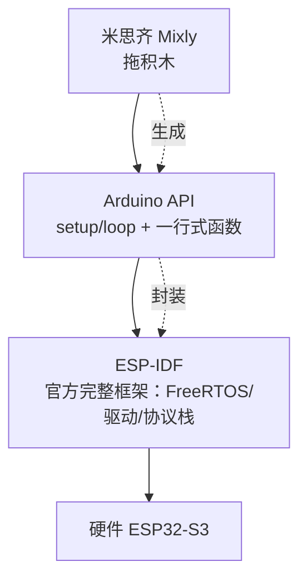
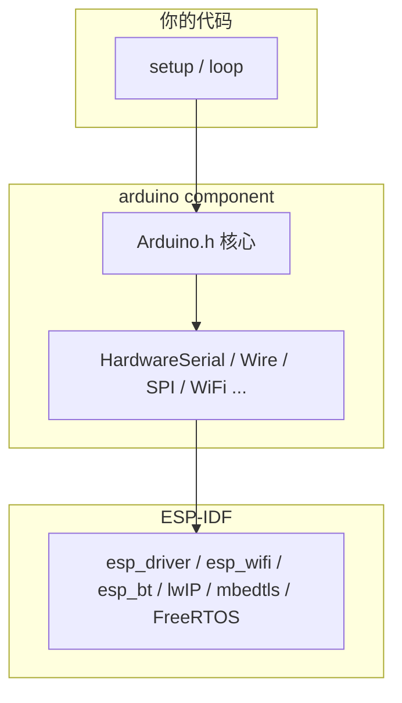
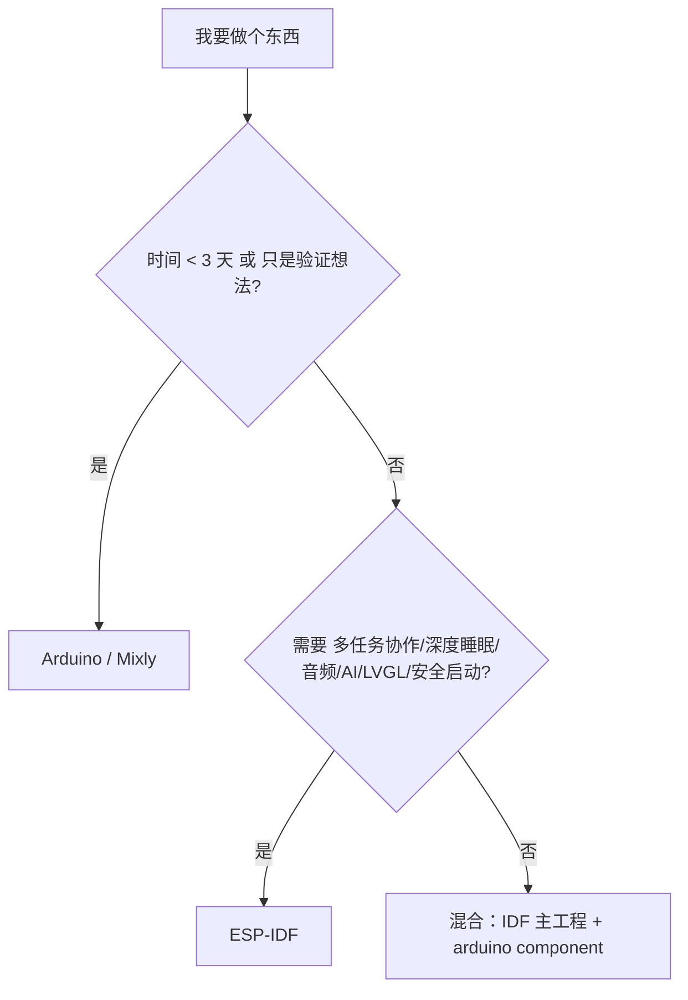

# 框架本质与能力边界

快速上手让你用过米思齐（拖积木）和 Arduino IDE；L1～L2 教了 ESP-IDF。这一章很短，回答一个实际问题：**这几样东西到底是什么关系？我以后该用哪个？**

一句话先行：**Arduino 不是和 ESP-IDF 并列的另一个世界，它只是包在 IDF 外面的一层"便利贴"**——把复杂的 API 包成好记的一行。用了便利贴，你已经用上了底下的完整系统；但便利贴没贴到的地方，你得自己伸手进底层。本章讲清楚便利贴贴了哪些、没贴哪些。

三种工具的关系图：



- 米思齐生成的代码就是 Arduino 风格的 C++
- arduino-esp32 框架是 ESP-IDF 的一个组件（本章核心结论）
- 所有东西最终都变成对同一颗芯片的寄存器操作

## 1. Arduino 跑在 IDF 之上

arduino-esp32 3.x 不是一个独立框架，它**是 ESP-IDF 的一个 component**，通过 Arduino 核心库把 IDF 的 API 包了一层：



证据就藏在代码里：Arduino 的 `digitalWrite(4, HIGH)` 内部实现就是 `gpio_set_level(GPIO_NUM_4, 1)`（IDF 的 API）；Arduino 的 `delay(500)` 就是 `vTaskDelay(pdMS_TO_TICKS(500))`（FreeRTOS 的 API）。**每个便利贴下面都是一条 IDF 调用**——你甚至可以直接打开 arduino-esp32 的源码（GitHub 上有）验证。

这意味着两件事：

1. **你在 Arduino 里能做的事，用 IDF 都能做**——只是 API 名字不一样、写法啰嗦一点
2. **反向不成立**：IDF 的很多能力（精细的电源管理、安全启动、分区控制、官方音频组件）没有便利贴，Arduino 里做不到或做不好

## 2. 能力对照

| 功能 | Arduino | IDF | 备注 |
| --- | --- | --- | --- |
| GPIO / ADC / PWM | ✅ 一行搞定 | ✅ 但 API 复杂 5～10 倍 | IDF 需要开时钟、配衰减、配通道 |
| I2C / SPI / UART | ✅ 库友好 | ✅ 更底层、更强 | 相机/LCD 高带宽场景 IDF 更稳 |
| WiFi / BLE | ✅ `WiFi.h` / `BLEDevice.h` | ✅ 事件驱动 | IDF 能拿到更细的控制粒度 |
| 多任务 | ⚠️ 靠 loop + delay | ✅ 原生 | Arduino 层主要障碍（见下） |
| 深度睡眠 | ⚠️ 只能简单进 | ✅ 完整电源管理 + 唤醒源 | 电池项目差距巨大 |
| 音频 / 摄像头 / LVGL / AI | ⚠️ 库不全或不活跃 | ✅ 官方组件 | 必须 IDF |
| 分区表 / OTA | ⚠️ 选菜单 | ✅ 完全可控 | 复杂分区必须 IDF |
| 安全启动 / Flash 加密 | ❌ 基本没有 | ✅ 一等公民 | 产品必用 |
| USB 设备（HID/MIDI/CDC） | ⚠️ 3.x 部分支持 | ✅ TinyUSB 完整 | |
| 内存规划 | ❌ 基本靠 malloc | ✅ 静态分配 + heap caps | 大项目必用 |

## 3. Arduino 层你不知道的三个事实

### ① `loop()` 是一个任务

Arduino 的 `loop()` 跑在名为 `loopTask` 的 FreeRTOS 任务里，优先级 1（**很低的优先级**），栈通常 8KB。理解这一点，Arduino 的所有怪癖都通了：

- 你写 `delay(5000)` = **整个程序卡 5 秒**——WiFi 协议栈还在别的任务里活着，但你自己的一切逻辑全停
- 你在 `loop()` 里用 `Serial.print` 刷屏，会拖慢一切——loopTask 优先级低，但刷屏占的是它唯一的时间片
- `loop()` 里塞一个大数组 → 栈溢出崩溃（8KB 的工作台没那么大）
- 想要真正的多任务？直接调 FreeRTOS API——**`#include <freertos/FreeRTOS.h>` 在 Arduino 里完全合法**，L2 学的所有东西都能用：

```c
// Arduino 风格的代码里开任务——合法且常见
#include <freertos/FreeRTOS.h>
#include <freertos/task.h>

void sensorTask(void *param) {
    for (;;) {
        int v = analogRead(1);
        vTaskDelay(pdMS_TO_TICKS(100));
    }
}

void setup() {
    xTaskCreatePinnedToCore(sensorTask, "sensor", 4096, NULL, 5, NULL, 0);
}

void loop() { }    // 留空，活都在任务里
```

**所以"Arduino 不能多任务"是误解——它只是默认不教你**。L2 的知识在 Arduino 里原样可用，这是两个世界之间最重要的桥。

### ② 库的质量参差不齐

Arduino 生态的库由社区维护，同名功能能有五六个库，质量差异巨大。装库前按这张表体检：

| 检查项 | 说明 |
| --- | --- |
| 最近更新时间 | 两年没更新的，适配 IDF 5.x 大概率有问题 |
| 依赖的 core 版本 | 要支持 ESP32-S3 就得用 arduino-esp32 3.x |
| issue 区搜 "S3" / "psram" | 有大量相关 issue 说明作者没适配好 |
| 是否用了 `MALLOC_CAP_` | 用了说明作者懂 ESP32 的内存模型（加分项） |
| 是否阻塞式 API | 全程 busy-wait 的库会拖死其他任务 |

**判断标准一句话：优先用官方组件（IDF 的），其次用维护活跃的 Arduino 库，最后才考虑"两年没更新的祖传库"。**

### ③ 大数组自动进 PSRAM，但有坑

arduino-esp32 3.x 默认开了 `CONFIG_SPIRAM_USE_MALLOC`，所以 `int big[100000]` 会自动分配到 PSRAM（8MB 大仓库）。但注意 [L0 讲过的 PSRAM 脾气](../l0-basics/embedded-model)：

- **PSRAM 不能给 DMA 用**——摄像头/I2S 这类外设搬运数据的场景要自己指定内存
- **PSRAM 在中断里访问可能读到脏数据**——ISR 涉及的数据别指望自动进 PSRAM 能救你
- 库里的静态大数组也会占 PSRAM，需要确认就 `heap_caps_get_free_size(MALLOC_CAP_SPIRAM)`

## 4. 在 IDF 工程里混用 Arduino

实用到值得单独学的技巧：IDF 主工程 + arduino 组件，两边 API 随意调用——"IDF 的精细控制 + Arduino 的顺手库"两头占：

```cmake
# main/CMakeLists.txt
idf_component_register(SRCS "main.c"
    INCLUDE_DIRS "."
    REQUIRES arduino driver esp_wifi esp_event nvs_flash)
```

```c
#include <Arduino.h>

void app_main() {
    initArduino();                    // 初始化 Arduino 层（UART 等）
    pinMode(4, OUTPUT);

    // Arduino 写法：顺手
    digitalWrite(4, HIGH);

    // 同时用 IDF 原生能力：精细
    esp_sleep_enable_ext1_wakeup_io(BIT(0), ESP_EXT1_WAKEUP_ANY_LOW);
    esp_deep_sleep_start();
}
```

注意混用模式里**没有 setup()/loop()**——入口还是 app_main，Arduino 只作为"函数库"使用。适合的场景：主逻辑用 IDF 写（多任务、OTA），但某个传感器只有好用的 Arduino 库，借来用用。

## 5. 什么时候必须离开 Arduino

出现下面任何一条，就该转 IDF：

- [ ] 需要多任务并发且任务之间有数据流（其实 L2 之后你在 Arduino 里也能写，但项目骨架还是 IDF 更清爽）
- [ ] 要做深度睡眠 + 电池供电（毫安级续航）
- [ ] 用了摄像头、音频编解码、LVGL 大界面、AI 模型
- [ ] 需要 Flash 加密 / Secure Boot / 固件签名
- [ ] 分区方案比较复杂（多 OTA + 大文件系统 + 资源分区）
- [ ] 要做 OTA + 回滚保护
- [ ] 需要 USB HID / MSC / MIDI 设备
- [ ] 固件太大，Arduino 的默认分区不够用

### 决策树（贴墙上）



一句话总结：**Arduino 的边界不在"能不能做"，而在"要做对的时候有多痛苦"。** 3 天的演示项目用 Arduino 事半功倍；3 个月的产品项目用 IDF 才是正路。而有了 L2 的功底，你两边都写得动——这才是不被工具绑架的自由。

## 下一步

[L4 外设深度](../l4-peripherals/)