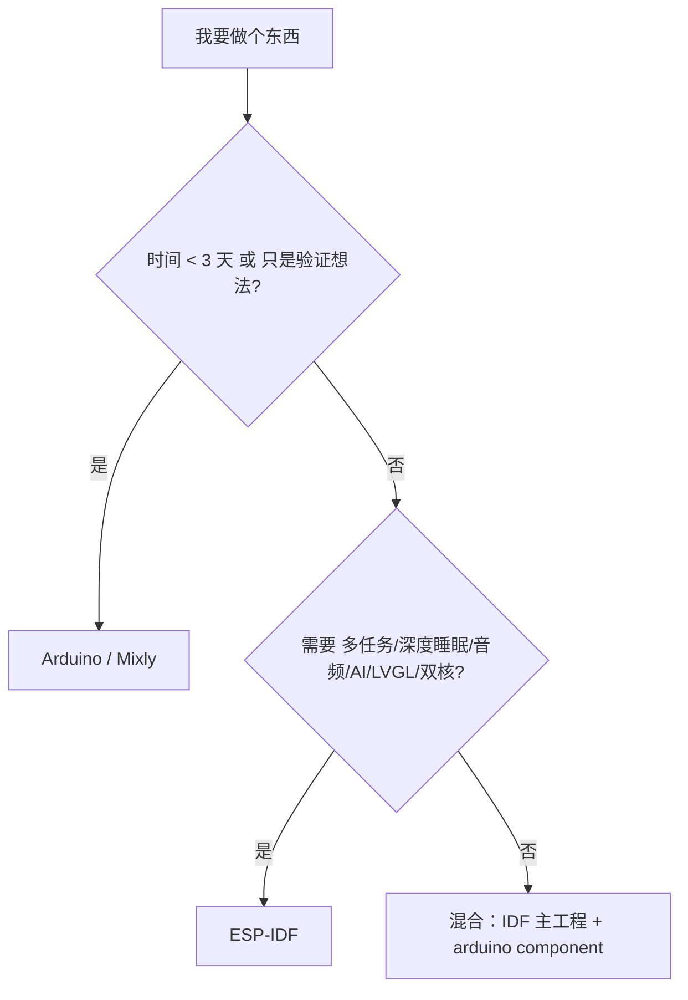

# L3 Arduino 快速通道

如果你已经按 [快速上手](../../quickstart/) 走了一遍，这一章就是给你"知道边界在哪"的。

| 章节 | 内容 |
| --- | --- |
| [框架本质](./framework-nature) | Arduino 是 IDF 的一个 component，能力边界在哪 |

## 核心结论

一句话：Arduino 的边界不在"能不能做"，而在"要做对的时候有多痛苦"。

## 下一步

[框架本质](./framework-nature)