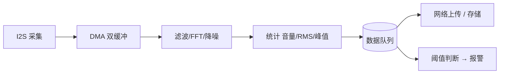

# I2S 与音频

音频是 S3 的看家本领之一：双核 + 8MB PSRAM + 向量指令，让它能做实时录音、降噪和语音识别。

## 0. 数字音频的三个基础概念

先把"声音怎么变成数字"说清楚（[L0 铺垫页](../l0-basics/what-is-computing)讲过采样，这里展开）：

- **采样率（Sample Rate）**：每秒采多少次。人耳听得到 20Hz～20kHz，按"至少 2 倍"规则（[ADC 章](./adc-dac)），44100Hz 能覆盖人耳全频段。语音识别常用 16000Hz（人声主要能量在低频段，够用且省一半数据量）
- **位宽（Bit Width）**：每次采样记多精细。16 位 = 65536 级音量；32 位 = 更大动态范围（数字麦克风常用 24/32 位）
- **声道（Channel）**：单声道（mono）一路，立体声（stereo）两路

**数据量的直觉**：16kHz × 16bit × 单声道 = 每秒 32KB。录一分钟 = 1.9MB——8MB PSRAM 能存四分钟，这就是"音频吃内存"的量级。

## 1. I2S 硬件

**I2S（Inter-IC Sound）**：专门为数字音频设计的接口。数字麦克风和音频芯片不直接输出电压，而是输出一串采样数据，I2S 就是搬运这些数据的专线：

| 线 | 作用 |
| --- | --- |
| BCLK（位时钟） | 节拍器：每个节拍传一位数据 |
| WS（字选择，也叫 LRCLK） | 指挥棒：这一拍是左声道还是右声道 |
| DIN / DOUT | 数据本身（进 / 出） |
| MCLK（可选） | 主时钟，某些 codec 需要 |

- S3 有 2 个 I2S 控制器（I2S0 / I2S1），可当主机或从机
- 支持 PDM（数字麦克风另一种格式）、STD（标准 I2S）
- 通过 GPIO 矩阵映射，BCLK/WS/DIN/DOUT 可以任意分配

**主机 vs 从机**：主机 = ESP32 出时钟（自己掌控采样率，常用）；从机 = 时钟由外部输入（对接专业声卡等场合）。

## 2. 数字麦克风采集（最常见的入门场景）

常见模块：INMP441、ICS-43434、SPH0645、ES8311（带 ADC + 功放的 codec 芯片）。以最常用的 INMP441 为例，四根线：BCLK、WS、DIN、（L/R 脚接地 = 左声道）。

```c
#include "driver/i2s_std.h"

i2s_chan_handle_t rx_chan;

void mic_init(void) {
    // 1. 开通道（方向：只收）
    i2s_chan_config_t chan_cfg = I2S_CHANNEL_DEFAULT_CONFIG(I2S_NUM_0, I2S_ROLE_MASTER);
    chan_cfg.dma_desc_num = 6;                    // 6 个 DMA 缓冲块
    chan_cfg.dma_frame_num = 240;                 // 每块 240 帧
    i2s_new_channel(&chan_cfg, NULL, &rx_chan);

    // 2. 配标准 I2S 格式
    i2s_std_config_t std_cfg = {
        .clk_cfg  = I2S_STD_CLK_DEFAULT_CONFIG(16000),      // 采样率 16kHz
        .slot_cfg = I2S_STD_PHILIPS_SLOT_DEFAULT_CONFIG(I2S_DATA_BIT_WIDTH_32BIT,
                                                        I2S_SLOT_MODE_MONO),
        .gpio_cfg = {
            .mclk = I2S_GPIO_UNUSED,
            .bclk = GPIO_NUM_4,
            .ws   = GPIO_NUM_5,
            .dout = I2S_GPIO_UNUSED,
            .din  = GPIO_NUM_6,
            .invert_flags = { .mclk_inv = false, .bclk_inv = false, .ws_inv = false },
        },
    };
    i2s_channel_init_std_mode(rx_chan, &std_cfg);
    i2s_channel_enable(rx_chan);
}

void mic_read_loop(void *arg) {
    int32_t samples[256];                 // 32 位样本缓冲
    size_t bytes_read = 0;
    while (1) {
        i2s_channel_read(rx_chan, samples, sizeof(samples), &bytes_read, pdMS_TO_TICKS(1000));
        int count = bytes_read / 4;
        // samples 里就是原始音频数据：算音量、做 VAD、送识别……
        int32_t max = 0;
        for (int i = 0; i < count; i++) {
            int32_t v = samples[i] >> 8;   // INMP441 数据在高位
            if (v > max) max = v;
        }
        printf("峰值 %d\n", (int)max);
    }
}
```

### 关键参数：DMA 帧数怎么定

I2S 的数据由 DMA 自动搬进一组环形缓冲块。**缓冲总时长 = 每块帧数 × 块数 ÷ 采样率**：

```text
16kHz、每块 240 帧、6 块：
缓冲总时长 = 240 × 6 ÷ 16000 = 90ms
```

**经验区间 20～100ms**，两头都有病：

- **太小**（小于 20ms）：你读得稍慢一步，缓冲就欠载/溢出——表现为周期性"咔哒"爆音
- **太大**（大于 100ms）：延迟高——语音对讲里回声加重，实时性差

**试着算一算**：44.1kHz、每块 128 帧、4 块，总缓冲多少毫秒？（128×4÷44100 ≈ 11.6ms——偏小，该加块数或帧数。）

## 3. 播放

播放就是反向：把样本数据 `write` 进 I2S 发送通道，芯片按时钟吐给功放/喇叭：

```c
i2s_chan_config_t tx_cfg = I2S_CHANNEL_DEFAULT_CONFIG(I2S_NUM_1, I2S_ROLE_MASTER);
i2s_new_channel(&tx_cfg, &tx_chan, NULL);
// ... std 配置同上（方向换成 TX）...

size_t bytes_written;
i2s_channel_write(tx_chan, samples, sample_bytes, &bytes_written, pdMS_TO_TICKS(1000));
```

**播放链路的选择**：

| 输出方案 | 成本 | 音质 | 场景 |
| --- | --- | --- | --- |
| 内部 DAC | — | — | **S3 没有**（老 ESP32 才有） |
| PWM + 滤波 | 0 | 差（蜂鸣级别） | 提示音 |
| MAX98357A（I2S 功放） | 几块钱 | 好 | 播放 MP3 语音的标准搭档 |

要播放 MP3/AAC 等压缩格式，不要自己解码，用官方 codec 组件：

```bash
idf.py add-dependency "espressif/esp_audio_codec"
```

它提供 MP3/AAC/Opus/FLAC 解码、重采样、EQ——解码后喂给 I2S 通道即可。

## 4. 时钟域：最容易被忽略的坑

```text
主机模式：ESP32 出 BCLK/WS → 采样率完全自己掌控 ✓
从机模式：外部出时钟 → MCLK 频率 = 采样率 × 位宽系数，必须稳定
```

从机模式下外部时钟不稳，会出现**周期性咔哒声**——声音数据没事，是"指挥棒"抖了。排查这类问题先确认谁是主机、时钟质量如何。

## 5. 实时音频处理：核与优先级规划

音频是**硬实时**任务：16kHz 采样下，每 62.5ms 必须消化一批数据，晚一步就爆音（丢数据没法补）。所以音频任务的调度特权最高：



| 任务 | 核 | 优先级 |
| --- | --- | --- |
| I2S 采集/播放 | 0 | 20～22（最高） |
| 音频处理 | 1 | 12～15 |
| 网络上传 | 1 | 6～8 |
| 其它 | 0/1 | 5 |

**音频任务必须绑核并给高优先级**，否则被网络任务抢占就产生爆音——这是 L2 优先级知识最重要的应用场景。**双缓冲 ping-pong** 是标准做法：一半缓冲在采集，另一半在处理，交替切换；`i2s_channel_read` 的阻塞等待天然实现了这个节奏。

## 6. 常见故障

| 现象 | 原因 |
| --- | --- |
| 录音一片噪声/全是 0 | 引脚接错；INMP441 的 L/R 脚没接地；WS 和 BCLK 接反 |
| 播放速度不对（像快放/慢放） | 采样率配置与文件实际不符（文件 16k 播成 44.1k 就是快放 2.7 倍） |
| 周期性咔哒声 | 缓冲太小欠载；从机模式时钟不稳 |
| 波形削顶失真 | 输入超过麦克风量程（离声源太近）；增益设置过高 |
| 播放没声音 | 功放使能脚没拉高；MAX98357A 的 SD 脚悬空；音量为 0 |
| CPU 占用接近 100% | 用了轮询读循环且没阻塞等待；改用 `i2s_channel_read` 带 timeout |
| 读到的数据全在高位 | INMP441 是 32 位样本、有效数据在高 24 位，要右移对齐 |

## 下一步

[触摸与摄像头](./touch-camera)