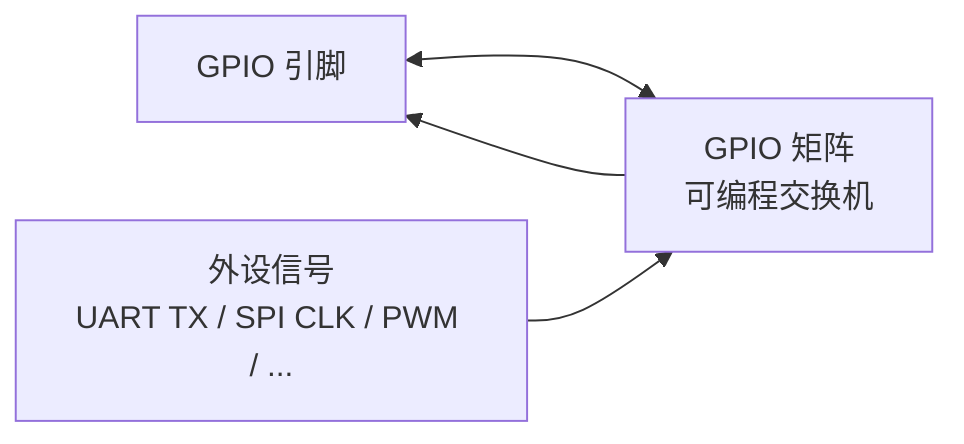

# GPIO 与中断

GPIO（General Purpose Input/Output，通用输入输出口）在 [L0](../l0-basics/what-is-computing) 已经认识了：往引脚送电压就是输出，读引脚电压就是输入。这一章补齐三块进阶内容：S3 引脚的"灵活路由"机制（GPIO 矩阵）、哪些脚不能用、以及"按键一按就来事"的中断怎么正确使用。

它是所有外设的地基——PWM 是"高速开关的 GPIO"，串口是"按协议节奏变化的 GPIO"。把这一章吃透，后面每一章都轻一半。

## 1. GPIO 矩阵：S3 的核心设计

老款单片机（如 51）的每个引脚**焊死**在固定功能上：3 号脚天生是串口 TX，想挪到 5 号脚？做不到。ESP32 系列用了更现代的设计——**信号路由矩阵**：



把矩阵想成一个**可编程的交换机**：UART 的 TX 信号从矩阵的一头进去，你想让它从哪个引脚出去，软件写一行配置就行。这带来三个实际影响：

- **同一外设信号可以映射到任意引脚**（`gpio_matrix_out`）——串口想用 17/18 还是 43/44 随意。PCB 设计自由度大增
- **同一引脚的输入侧几乎无限制**——一个引脚的输入可以同时"喂"给多个外设感知
- **输出侧有冲突规则**：一个引脚同一时刻只能被一个输出信号驱动，两个外设抢同一个脚会打架（表现为信号异常）

代价是路由经过矩阵有几纳秒的额外延迟——对电灯按键毫无影响，对 GHz 级信号才有意义。


**为什么你之前用米思齐时从没操心过这个**？因为积木和 Arduino 库替你调用了路由配置。IDF 里多数驱动也替你做（初始化时传引脚号即可），只有少数场景（自己搭总线、玩 RMT）才直接操作矩阵。

## 2. 引脚复用与限制：一张"哪些脚能碰"的清单

| 类别 | 引脚 | 限制 |
| --- | --- | --- |
| 纯 GPIO | GPIO1～18 | 常规使用，**首选** |
| Flash/PSRAM | GPIO35/36/37 | **禁止使用**（WROOM-1 内部占用，[L1 讲过](../l1-hardware/board)） |
| 模组内部 | GPIO33/34 | 建议避开 |
| USB | GPIO19/20 | 用原生 USB 时被占用 |
| UART0 | GPIO43/44 | 调试口，烧日志用，尽量别动 |
| strapping | GPIO0/3/45/46 | 复位瞬间被采样，外设慎接 |

**引脚规划口诀**：先把"挑食"的外设排进去（摄像头 15+ 脚、PSRAM 占用脚、strapping 脚避开），剩下的才是自由引脚。完整的引脚能力表见 [引脚映射速查](../../reference/pinout)。

:::caution[本表是 S3 的，换型号差异很大]
经典 ESP32 的 GPIO34～39 是**仅输入脚**（连输出都不行）、strapping 多达 5 个脚（0/2/5/12/15）；C3 总共只有 22 个 GPIO。换型号先读[跨型号移植指南](../../reference/porting)的引脚约束表。
:::

### 插播：上拉 / 下拉的本质与原理

`gpio_config_t` 里的 `pull_up_en` / `pull_down_en` 两个字段值得单独展开——它背后有"悬空引脚为什么乱跳""为什么必须用电阻而不是导线"两件本质的事，值得一次讲透。

#### 问题的根源：悬空的输入是一根天线

引脚配置为输入后，它内部是一个**阻抗极高的探测器**（只"偷看"电压、几乎不吃电流——这样才能不影响被测电路）。高阻抗是优点也是隐患：**当它悬空（什么都没接）时，这根引脚就是一根小天线**——手靠近时的静电感应、旁边导线的电磁感应、电源纹波，都能让它电平漂移。读出来的 0/1 完全看运气，像"鬼按按键"。

**解法的思路：不管有没有外部输入，都给引脚一个"默认的、确定的"电平**。用一个阻值较大的电阻，把引脚轻轻拴住：

- **上拉（Pull-up）**：拴到 3.3V。平时读 1，按键按下（接地）读 0
- **下拉（Pull-down）**：拴到 GND。平时读 0，按键按下（接 3.3V）读 1

#### 为什么必须用电阻，不能用导线？

初学者最自然的想法：把引脚**直接**接到 3.3V（导线），再用按键把它接去 GND。**这是短路接法**——按键一按，3.3V 到 GND 之间没有任何阻碍，电流瞬间冲到电源极限，轻则电源跌落重启，重则烧按键、烧电源。

电阻的价值就在这：**它把"短路"变成了"分压"**。用**分压的视角**看按下按键的瞬间（L1 的原理图知识用上了）：

```text
按下时：3.3V ──[上拉电阻 45kΩ]──●── 按键(≈0Ω) ── GND
                               ↑
                          引脚夹在中间

两个电阻串联分压：引脚电压 = 3.3V × 0Ω/(45kΩ+0Ω) ≈ 0V   → 读到 0
松开时：按键断开，回路没有电流 → 电阻上没有压降 → 引脚 = 3.3V → 读到 1
```

**松开时没电流、电阻不降压，所以引脚稳稳是 3.3V；按下时有电流但全降在电阻上，引脚稳稳是 0V**——两个状态都确定，且任何时候电流都被限制在 3.3V/45kΩ ≈ 0.07mA，安全得很。这就是上拉的全部物理。

#### 阻值怎么选：强上拉与弱上拉

| 阻值 | 说法 | 优点 | 缺点 |
| --- | --- | --- | --- |
| 小（1kΩ，"强"上拉） | 拴得紧 | 抗干扰强、电平翻转快 | 常态电流大（3.3mA），费电 |
| 大（100kΩ，"弱"上拉） | 拴得松 | 省 | 容易被噪声拽动，长线上恢复慢 |
| 常用 4.7kΩ～47kΩ | 适中 | 两者平衡 | |

ESP32 的内部上拉约 45kΩ，属于"弱上拉"——**短线的按键、低速场合足够**；线长超过 30cm、或环境干扰大（电机旁），就要外接 10kΩ 强上拉。I2C 总线推荐 4.7kΩ，原因见下一节。

#### 开漏输出：为什么 I2C 必须上拉

上拉还有一种更根本的用法。GPIO 的**开漏输出（Open-Drain，`GPIO_MODE_OUTPUT_OD`）模式**下，输出级**只有"拉到地"的下拉管，没有"推到 3.3V"的上拉管**——它能主动输出 0，输出 1 时只能"松手"，电平靠**外部的上拉电阻**拉回去。

这看似残缺的设计有一个绝妙用途：**多设备共享一根线不会打架**。普通推挽输出（默认模式）A 输出高、B 同时输出低，就是两个电源在"拔河"，大电流硬碰硬；开漏输出则谁都可以把线拉低、没人拉低时上拉电阻让线变高——**"只要有一个 0，结果就是 0"**（线与）。I2C 的 SDA/SCL 就是这么工作的（[下一章](./i2c-spi-uart)），这也是 I2C"必须有上拉电阻"的根本原因：**没有人松手后把线拉回去，总线永远是 0**。

下拉与上拉完全对称（拴 GND、按键接 3.3V），不再展开。

## 3. GPIO 基础操作（IDF）

```c
// 配置：位掩码，一次配置多个
gpio_config_t io_conf = {
    .pin_bit_mask  = (1ULL << 4) | (1ULL << 5),   // 4 号和 5 号脚（注意 1ULL——64 位掩码）
    .mode          = GPIO_MODE_OUTPUT,
    .pull_up_en    = GPIO_PULLUP_DISABLE,
    .pull_down_en  = GPIO_PULLDOWN_DISABLE,
    .intr_type     = GPIO_INTR_DISABLE,
};
ESP_ERROR_CHECK(gpio_config(&io_conf));

gpio_set_level(GPIO_NUM_4, 1);              // 置高（本质是写 GPIO_OUT_REG 的第 4 位）
gpio_set_level(GPIO_NUM_5, 0);
int level = gpio_get_level(GPIO_NUM_4);     // 读回电平
```

逐字段理解 `gpio_config_t`（它是 L0 结构体一节的最佳实战案例）：

| 字段 | 取值 | 说明 |
| --- | --- | --- |
| `pin_bit_mask` | 64 位掩码，第 n 位 = 第 n 号脚 | `(1ULL << 4) \| (1ULL << 5)` 同时配两个脚。**必须 ULL 后缀**——掩码要 64 位装下 GPIO48+ |
| `mode` | OUTPUT / INPUT / INPUT_OUTPUT / OUTPUT_OD | 输出 / 输入 / 双向 / 开漏输出（I2C 用） |
| `pull_up_en` / `pull_down_en` | ENABLE / DISABLE | 内部上下拉（见上一节） |
| `intr_type` | DISABLE / POSEDGE / NEGEDGE / ANYEDGE / LOW_LEVEL / HIGH_LEVEL | 中断触发条件（下一节） |

## 4. 输入实战：一个完整可靠的按键系统

把"输入 + 上拉 + 消抖 + 中断 + 队列"组装成实战模板——**这 40 行值得逐行抄一遍**：

```c
#include "freertos/FreeRTOS.h"
#include "freertos/task.h"
#include "freertos/queue.h"
#include "driver/gpio.h"

#define BUTTON_PIN  GPIO_NUM_5
static QueueHandle_t button_evt;     // 按键事件队列（ISR → 任务）

static void IRAM_ATTR button_isr(void *arg) {
    int pin = (int)arg;
    xQueueSendFromISR(button_evt, &pin, NULL);   // 只发消息，不干活
}

void app_main(void) {
    // 1. 配置：输入 + 内部上拉（按键另一端接地）
    gpio_config_t io = {
        .pin_bit_mask = 1ULL << BUTTON_PIN,
        .mode         = GPIO_MODE_INPUT,
        .pull_up_en   = GPIO_PULLUP_ENABLE,
        .intr_type    = GPIO_INTR_NEGEDGE,       // 下降沿触发（按下瞬间：高→低）
    };
    ESP_ERROR_CHECK(gpio_config(&io));

    // 2. 安装中断服务并注册
    button_evt = xQueueCreate(10, sizeof(int));
    gpio_install_isr_service(0);
    gpio_isr_handler_add(BUTTON_PIN, button_isr, (void *)BUTTON_PIN);

    // 3. 任务里做消抖（慢活全在这）
    int pin;
    TickType_t last = 0;
    while (1) {
        if (xQueueReceive(button_evt, &pin, portMAX_DELAY) == pdTRUE) {
            TickType_t now = xTaskGetTickCount();
            if (now - last < pdMS_TO_TICKS(50)) continue;    // 50ms 内重复触发=抖动，丢弃
            last = now;
            printf("按键按下！电平=%d\n", gpio_get_level(BUTTON_PIN));
        }
    }
}
```


### 为什么需要消抖：机械按键的"弹跳"

机械按键内部的金属片闭合瞬间会**物理弹跳**几次才稳定——一次按下，电路上出现十几个"高→低→高→低"的毛刺，时间跨度几毫秒：

```text
真实按键的电平：
───┐ ┌┐ ┌ ┐┌┐ ┌────────────
   └─┘└─┘ └┘└─┘   ← 按下瞬间弹跳 ~5ms，然后稳定
```

没有消抖：一次按键被程序当成按了十几次。消抖的思路都是"**等它稳定再认**"——上面的代码用时间戳丢弃 50ms 内的重复事件（软件消抖），也可以用 0.1µF 电容并联按键（硬件消抖）。**中断+消抖的组合是嵌入式最经典的工程问题之一**，面试和实战都绕不开。

### 中断触发类型怎么选

| 类型 | 触发时机 | 按键场景 |
| --- | --- | --- |
| `GPIO_INTR_POSEDGE` | 上升沿（低→高） | 按键接地（上拉）时的**松开**瞬间 |
| `GPIO_INTR_NEGEDGE` | 下降沿（高→低） | 按键接地（上拉）时的**按下**瞬间（最常用） |
| `GPIO_INTR_ANYEDGE` | 两个沿都触发 | 需要测按下时长（配合时间戳） |
| `GPIO_INTR_LOW_LEVEL` | 低电平期间持续触发 | 慎用——按住不放会反复进 ISR |

## 5. 中断服务函数（ISR）：五条铁律

```c
// 步骤 1：安装中断服务（整个程序只做一次）
gpio_install_isr_service(0);

// 步骤 2：注册具体引脚的处理函数
gpio_isr_handler_add(BUTTON_PIN, button_isr, (void *)BUTTON_PIN);
```

`gpio_install_isr_service(0)` 的参数：`0` = 中断可分配到任意核心（默认推荐）；`ESP_INTR_FLAG_IRAM` = 允许在 flash cache 关闭时运行（要求 ISR 及其数据都在 IRAM，进阶）。

ISR 的五条铁律（[L0 中断一节](../l0-basics/embedded-model)的展开版），每条都有真实事故背书：

1. **标 `IRAM_ATTR`**——中断时 flash 可能正在 cache miss（甚至 cache 被关），Flash 里的代码取不出来直接崩。症状：平时正常，一写 Flash（NVS/OTA）就死
2. **不用 `delay`**——ISR 里 delay 等于整个系统卡住（中断优先级最高，它睡谁也别想跑）
3. **不用 `printf` / `ESP_LOGx`**——这两个都会用锁、可能分配内存，ISR 里会死锁。要打日志只能 `esp_rom_printf`（专给中断的"裸"版本）
4. **共享变量加 `volatile`，复杂数据走队列/临界区**——L0 讲过的竞态问题
5. **只做最轻的事**：置标志、发信号、发队列消息——处理是任务的事

```c
// ✗ 错误示范（每个错误都有对应铁律）
void IRAM_ATTR bad_isr(void *arg) {
    ESP_LOGI(TAG, "触发了");        // 违反 3：日志用锁
    float avg = calc_average();     // 违反 5：耗时计算
    vTaskDelay(pdMS_TO_TICKS(10));  // 违反 2：延时
}

// ✓ 正确示范
static void IRAM_ATTR good_isr(void *arg) {
    int pin = (int)arg;
    xQueueSendFromISR(button_evt, &pin, NULL);   // 只做这个
}
```

## 6. 常见故障

| 现象 | 原因 |
| --- | --- |
| ISR 里调用 ESP_LOG 后死机 | 日志用了锁/内存分配（铁律 3） |
| 按键一次触发十几次 | 没消抖（弹跳） |
| 快速脉冲漏计数 | 中断被屏蔽太久（其它 ISR 或长临界区）；极高速脉冲改用硬件计数器/RMT |
| 引脚输出高电平只有 ~3.0V 且带负载更矮 | 驱动能力不足（GPIO 单脚约 40mA 上限）——大电流负载要加三极管/MOS 管驱动 |
| 悬空引脚读数随机跳 | 没配上拉/下拉（鬼电平） |
| GPIO46 接外设后启动异常 | 它是 strapping 脚，复位瞬间电平被采样（S3 没有"仅输出脚"，那是 S2） |
| 用了 GPIO35～37 后不启动 | Flash/PSRAM 被破坏，芯片无法启动（L1） |
| 接了外设后启动怪异 | 外设干扰了 strapping 脚（L1） |

## 下一步

[ADC 与模拟信号](./adc-dac)