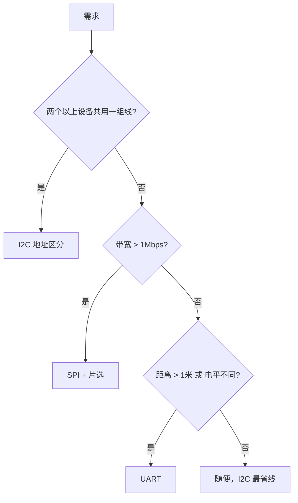
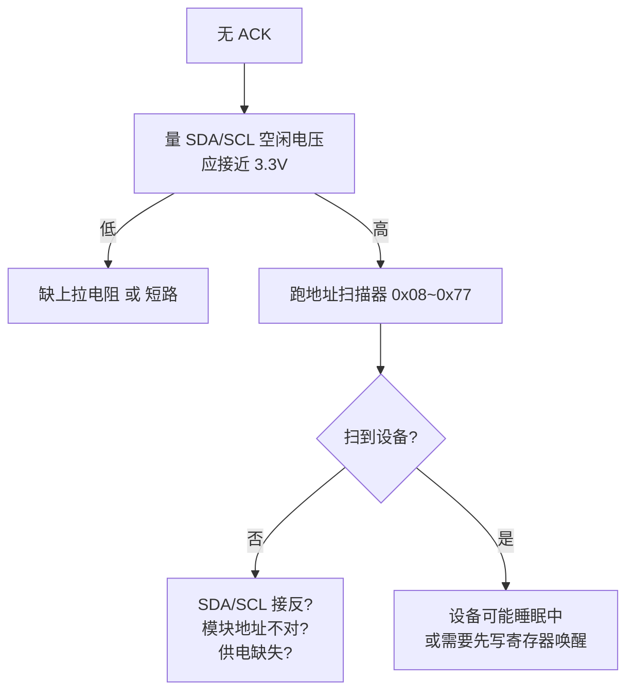

# I2C / SPI / UART

前两章的外设都长在芯片"肚子里"。这一章的三个接口解决另一个问题：**芯片怎么和外面的模块（OLED 屏、传感器、SD 卡）对话**。它们统称"总线（Bus）"——一条线上可以挂多个设备的通信通道。

三种总线一句话分工：

| 总线 | 一句话 | 类比 |
| --- | --- | --- |
| **I2C** | 两根线挂一堆低速设备，靠"门牌号"（地址）区分谁是谁 | 公司广播：报部门名点名 |
| **SPI** | 速度快，每个设备多一根"片选线"单独点名 | 专线电话：一根线对应一个人 |
| **UART** | 点对点两根线（TX 发、RX 收），最简单古老 | 两个人对讲机 |

选型决策放在第 5 节，先把三个都用起来。

## 1. I2C

### 协议原理（三分钟版）

I2C 只有 SDA（数据）、SCL（时钟）两根线。主机（ESP32）带着节奏，每个设备有 7 位**地址**（门牌号）。一次通信的流程：

```text
1. 主机广播：0x3C 号请注意（起始信号 + 地址）
2. 目标设备回应：在！（ACK 应答）
3. 主机发数据 / 收数据（每个字节都要对方 ACK）
4. 结束信号
```

**"每个字节都有应答"是 I2C 调试的宝贵特性**：设备没接好、地址不对、没供电，都会表现为"没有 ACK"——主机能立刻知道通信失败，而不是收一堆乱码。

### 一次"写寄存器"的字节级分解

把 `write_reg(0x00, 0xAB)`（往 0x00 号寄存器写 0xAB）这一行代码在总线上发生的事逐字节摊开（用 [L1 的时刻表读法](../l1-hardware/board)）：

```text
时刻 →        T1       T2        T3       T4        T5       T6        T7
            ┌────────┬─────────┬────────┬─────────┬────────┬─────────┬───────┐
SDA 上的内容 │ START  │ 0x3C+W  │  ACK   │  0x00   │  ACK   │  0xAB   │ STOP  │
            │ 起始信号│ 地址+写  │ 设备应答│ 寄存器号 │ 设备应答│ 数据     │ 结束  │
            └────────┴─────────┴────────┴─────────┴────────┴─────────┴───────┘
               主机发    主机发    设备拉低   主机发    设备拉低   主机发    主机发
```


逐段读：

- **START（起始）**：SCL 高电平期间把 SDA 拉低——一个"违规"的电平变化（正常时 SDA 只能在 SCL 低电平时变化），所有设备瞬间竖起耳朵："要开始了"
- **地址 + 读写位**：7 位地址（0x3C）加 1 位方向（0 = 主机写）。**总线上所有设备都在听这一段**，只有地址对上的那个继续回应，其余装睡
- **ACK（应答）**：每个字节后的第 9 个时钟，接收方把 SDA 拉低表示"收到了"。**应答位由接收方驱动**——这就是为什么"没有 ACK"能精确定位是设备的问题
- **数据**：寄存器号 0x00（告诉设备"我要写你的哪个内部寄存器"），再跟数据 0xAB。**先寄存器号后数据**是几乎所有 I2C 传感器的通用约定
- **STOP（结束）**：SCL 高电平期间释放 SDA（拉高），总线回到空闲

读方向的通信（`read_reg`）多一步"重复起始"：先写寄存器号、不发 STOP 直接重新 START 换成读方向——看懂上面这张表，逻辑分析仪抓到的 I2C 波形你就能逐字节解码了。

### 为什么两根线能挂一堆设备：开漏 + 上拉

I2C 的 SDA/SCL 都工作在**开漏（Open-Drain）**模式（[GPIO 章](./gpio)讲过原理）：每个设备只能把线**拉低**，不能主动推高；线空闲时由上拉电阻拉回 3.3V。这个设计的妙处：**多个设备同时说话也打不起来**——谁拉低线就是低，全都松手线才是高。若用普通推挽输出，A 推高 B 拉低 = 两个电源硬碰硬，一次通信就烧 I/O。这也解释了 I2C 五坑之首"必须有上拉电阻"：**没人拉低时，总得有人把线抬回去**。

### S3 的硬件能力

- 2 个控制器，都支持主机（Master）模式
- 标准模式 100kHz / 快速模式 400kHz / 高速模式（部分外设 3.4Mbps）
- 通过 GPIO 矩阵，SDA/SCL 可以映射到任意引脚

### 新驱动（IDF 5.5）

```c
#include "driver/i2c_master.h"

i2c_master_bus_handle_t bus;     // 总线把手
i2c_master_dev_handle_t dev;     // 挂在总线上的某个设备把手

void i2c_init(void) {
    // 1. 造总线
    i2c_master_bus_config_t bus_cfg = {
        .i2c_port   = I2C_NUM_0,
        .sda_io_num = GPIO_NUM_8,
        .scl_io_num = GPIO_NUM_9,
        .clk_source = I2C_CLK_SRC_DEFAULT,
        .glitch_ignore_cnt = 7,        // 毛刺过滤计数
        .flags.enable_internal_pullup = true,   // 启用内部上拉（弱，短线够用）
    };
    i2c_new_master_bus(&bus_cfg, &bus);

    // 2. 往总线上挂设备（地址 + 速度）
    i2c_device_config_t dev_cfg = {
        .dev_addr_length = I2C_ADDR_BIT_LEN_7,
        .device_address = 0x3C,        // SSD1306 OLED 的地址
        .scl_speed_hz   = 400000,      // 400kHz
    };
    i2c_master_bus_add_device(bus, &dev_cfg, &dev);
}

void write_reg(uint8_t reg, uint8_t val) {
    uint8_t buf[2] = { reg, val };
    i2c_master_transmit(dev, buf, 2, 100);   // 发 2 字节，超时 100ms
}

void read_reg(uint8_t reg, uint8_t *out, size_t len) {
    // 先发寄存器地址（我要读哪），再读 len 字节回来
    i2c_master_transmit_receive(dev, &reg, 1, out, len, 100);
}
```

### ⚠️ 五个必踩的坑

1. **上拉电阻**：I2C 是开漏输出（只能拉低、松手靠电阻拉高），**必须有上拉**（通常 4.7kΩ 到 3.3V）。很多模块没焊上。实测方法：量 SDA/SCL 空闲时是否接近 3.3V——如果是 0.x V 就是缺上拉
2. **一次只有一个任务能操作同一条总线**：多任务并发用要加锁（互斥锁包住"传输"）——总线是共享资源
3. **地址冲突**：同地址设备挂同一条总线就撞车。解法：带地址选择脚的模块（ADDR 脚拉高变另一个地址）、或 I2C 多路复用器（PCA9548A，一变八）
4. **长线降速**：杜邦线超过 30cm 就降到 100kHz——线越长电容越大，边沿越缓，高速读错
5. **设备地址会变**：SSD1306 有 0x3C/0x3D，MPU6050 有 0x68/0x69（AD0 脚决定）。**用扫描器确认，别猜**

### 地址扫描器（I2C 排错第一工具）

```c
for (uint8_t addr = 0x08; addr < 0x78; addr++) {
    esp_err_t err = i2c_master_probe(bus, addr, 50);
    if (err == ESP_OK) ESP_LOGI(TAG, "发现设备 0x%02x", addr);
}
```

跑一遍，扫出来的地址和模块手册对——对上说明硬件活着；一个都扫不到，按下面的排查树走。

## 2. SPI

### 三种 SPI 主机

| 总线 | 说明 |
| --- | --- |
| SPI2（GPSPI2，Arduino 里叫 FSPI） | **通用首选**，可映射任意引脚 |
| SPI3（GPSPI3，Arduino 里叫 HSPI） | 通用，和 SPI2 二选一或并用 |
| SPI0 / SPI1 | **专用于片内 Flash/PSRAM，禁止占用** |

### 四根线的分工

| 线 | 名字 | 干什么 |
| --- | --- | --- |
| SCLK | 时钟 | 主机提供节奏 |
| MOSI | 主出从入 | 主机 → 设备的数据 |
| MISO | 主入从出 | 设备 → 主机的数据 |
| CS | 片选 | 拉低谁，谁才听——多设备各占一根 CS |

I2C 靠地址点名，SPI 靠 CS 线点名——**所以 SPI 快（无地址开销）但每个设备多占一根线**。

### 主机配置

```c
#include "driver/spi_master.h"

spi_device_handle_t spi;
void spi_bus_init(void) {
    // 1. 造总线（四根线）
    spi_bus_config_t bus_cfg = {
        .mosi_io_num     = GPIO_NUM_11,
        .miso_io_num     = GPIO_NUM_13,
        .sclk_io_num     = GPIO_NUM_12,
        .quadwp_io_num   = -1,          // -1 = 不用四线模式
        .quadhd_io_num   = -1,
        .max_transfer_sz = 4096,
    };
    spi_bus_initialize(SPI2_HOST, &bus_cfg, SPI_DMA_CH_AUTO);   // DMA 自动

    // 2. 挂设备（每个设备一份配置）
    spi_device_interface_config_t dev_cfg = {
        .clock_speed_hz = 40000000,     // 40MHz（屏幕/SD 卡常用）
        .mode           = 0,            // 0~3，与从设备时序对应，见下表
        .spics_io_num   = GPIO_NUM_10,
        .queue_size     = 7,
    };
    spi_bus_add_device(SPI2_HOST, &dev_cfg, &spi);
}

// 收发一次
spi_transaction_t t = {
    .length = 8 * 3,                    // 位数（不是字节数！）
    .tx_buffer = tx_data,
    .rx_buffer = rx_data,
};
spi_device_transmit(spi, &t);
```

### SPI 模式（CPOL/CPHA）：为什么设备读出乱码

SPI 没有统一时序，四种模式由两个参数组合：**CPOL**（时钟空闲时是高是低）、**CPHA**（第一个沿采样还是第二个沿采样）：

| mode | CPOL | CPHA | 空闲时 | 采样沿 |
| --- | --- | --- | --- | --- |
| 0 | 0 | 0 | 低 | 第一个上升沿 |
| 1 | 0 | 1 | 低 | 第二个上升沿 |
| 2 | 1 | 0 | 高 | 第一个下降沿 |
| 3 | 1 | 1 | 高 | 第二个下降沿 |

**模式配错 = 数据全对不上位**（能通信但内容乱）。SD 卡是 mode 0，多数 Flash 也是 mode 0，但 LCD 常常是 mode 3。查模块手册的 "SPI timing" 或用逻辑分析仪看一眼时钟空闲状态就能确定。

## 3. UART

```c
#include "driver/uart.h"

uart_config_t cfg = {
    .baud_rate = 115200,
    .data_bits = UART_DATA_8_BITS,
    .parity    = UART_PARITY_DISABLE,
    .stop_bits = UART_STOP_BITS_1,
    .flow_ctrl = UART_HW_FLOWCTRL_DISABLE,
    .source_clk = UART_SCLK_DEFAULT,
};
uart_driver_install(UART_NUM_1, 4096, 4096, 0, NULL, 0);   // 收/发缓冲各 4KB
uart_param_config(UART_NUM_1, &cfg);
uart_set_pin(UART_NUM_1, 17, 16, -1, -1);   // TX=17, RX=16（-1 = 不用流控）

// 用法：就是读写
uart_write_bytes(UART_NUM_1, "hello\n", 6);
int len = uart_read_bytes(UART_NUM_1, buf, sizeof(buf), pdMS_TO_TICKS(100));
```

| UART | 引脚 | 用途 |
| --- | --- | --- |
| UART0 | GPIO43/44 | 调试日志 + 下载，尽量别动 |
| UART1 | GPIO17/18（可改） | 常用外设接口 |
| UART2 | 可任意映射 | 备用 |

:::danger[避开与 ADC2 重叠的默认引脚]
S3 上 UART1 的默认引脚是 GPIO17/18，而这两个脚同时属于 ADC2 通道——WiFi 开着时它们读不了模拟量（见 [ADC 章节](./adc-dac)）。规划引脚的原则：**UART1/2 都支持重映射到任意脚**，先给 ADC 和摄像头这类"挑位置"的外设留好脚，串口随便挪。
:::

**接线交叉**：A 的 TX 接 B 的 RX、A 的 RX 接 B 的 TX——"对讲机不能同嘴同耳"。通信乱码时第一查波特率一致、第二查 TX/RX 有没有接反。

### 环回测试（验证硬件连通）

把 TX 和 RX 用一根线短接，然后自己发自己收——收到的就是自己发的字符。**这是验证串口接线最快的办法**：环回通 = 芯片侧没问题，问题在对面设备；环回不通 = 引脚配置/接线有问题。

## 4. USB-Serial-JTAG（S3 独有）

ESP32-S3 芯片里集成了 USB-Serial-JTAG 控制器，可以直接用原生 USB 口（GPIO19/20）当串口和 JTAG 用，不需要 USB-UART 桥。

好处：设备管理器里直接就能烧录和看日志，不依赖桥接芯片；砖了也有 ROM 下载模式兜底。代价：TinyUSB 设备模式想用时这对脚要出让；USB 供电不足时更容易掉电。

## 5. 三种总线怎么选



| 需求实例 | 选 | 原因 |
| --- | --- | --- |
| OLED + 温湿度 + 气压三个小模块 | I2C | 都低速，两根线全搞定 |
| 320×240 彩屏 | SPI | 每秒几 MB 的数据量，I2C 扛不住 |
| 和 PC / 另一块板子通信 | UART | 点对点、距离远、实现简单 |
| SD 卡 | SPI（或 SDMMC） | 协议要求 |

## 6. 总线调试

| 工具 | 用途 |
| --- | --- |
| 逻辑分析仪（8 路，¥30） | 解码 I2C/SPI/UART，抓时序问题——**总线排错神器** |
| PulseView（免费软件） | 配合上面的分析仪，图形化看波形 |
| 示波器 | 看信号质量、上升沿、噪声 |

I2C 无响应的完整排查树（按顺序走）：



**逻辑分析仪怎么看**：接 SDA/SCL/地三根线，抓一段通信，PulseView 自动解码成十六进制——一眼看到"地址 0x3C 发出去了但没 ACK"，比在代码里猜快十倍。

## 下一步

[I2S 与音频](./audio)