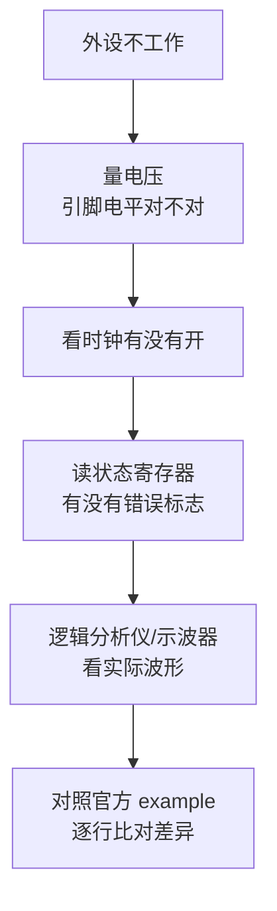

# L4 外设深度

**外设（Peripheral）**就是芯片周围"干具体活的部件"：点灯的引脚、测电压的 ADC、发波形的 PWM、和传感器说话的 I2C……快速上手你已经用积木驱动过它们了，这一章往深一层：每个外设的硬件原理、IDF 原生 API、以及出了错从哪查。

每一节都用同一个结构写：硬件原理 → IDF API → Arduino 对照 → 实战 → 常见故障。这样你既会用，也能解释为什么。

| 章节 | 内容 | 难点 |
| --- | --- | --- |
| [GPIO 与中断](./gpio) | GPIO 矩阵、复用、中断服务 | 中断与任务协作 |
| [ADC / DAC](./adc-dac) | 校准、衰减、S 曲线、DMA 连续采样 | 非线性与精度 |
| [PWM / MCPWM](./pwm) | LEDC、MCPWM、互补输出、死区 | 电机驱动时序 |
| [I2C / SPI / UART](./i2c-spi-uart) | 多总线、超时、USB-Serial-JTAG | 总线冲突与调试 |
| [I2S 与音频](./audio) | 录音/播放、DAC 驱动、ESP-ADF | 时钟与 DMA 缓冲 |
| [触摸与摄像头](./touch-camera) | 电容触摸、OV5642、LCD 输出 | 带宽与内存规划 |

## 通用方法论：外设调不通时按这个顺序查

永远从 example 开始改，不要从零写。官方 example 是外设驱动的事实标准。

## 下一步

[GPIO 与中断](./gpio)