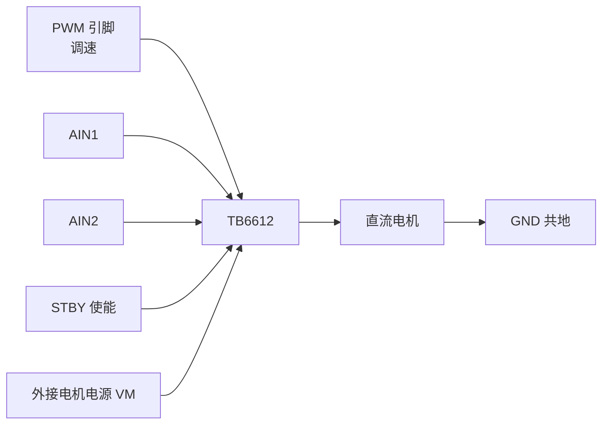

# PWM 与电机控制

快速上手你已经用积木做过"呼吸灯"和舵机。这一章把背后的 **PWM（Pulse Width Modulation，脉宽调制）**讲透，并介绍 S3 上两套专门的 PWM 硬件。

## 0. PWM 到底是什么

数字引脚只会输出 0V 或 3.3V，没有"中间电压"。那灯光怎么调到一半亮？

答案朴素得惊人：**极快地开关**。以 1000 次/秒的频率开关引脚，如果"亮的时间"占 50%，你的眼睛和灯丝来不及分辨每次开关，感受到的就是"一半亮度"。这个"高速开关、靠调整亮暗比例控制效果"的技术就是 PWM。

```text
占空比 25%：  ▔▁▁▁▔▁▁▁▔▁▁▁   ← 大部分时间灭，暗
占空比 50%：  ▔▔▁▁▔▔▁▁▔▔▁▁   ← 一半时间亮，中亮
占空比 75%：  ▔▔▔▁▔▔▔▁▔▔▔▁   ← 大部分时间亮，较亮
```

三个术语，全部要熟：

| 术语 | 意思 | 类比 |
| --- | --- | --- |
| 频率（Hz） | 每秒开关多少个周期 | 划水的节奏 |
| 占空比（Duty Cycle，0～100%） | 一个周期里"高电平"占的比例 | 每个周期里亮的时间占比 |
| 分辨率（bit） | 占空比能分成多少级。12 位 = 4096 级 | 音量旋钮有多少格 |

三者是绑定的（第 2 节细讲）：频率越高、分辨率越大，对硬件时钟的要求越高。

### PWM 的本质：一门"平均"的艺术

PWM 输出的电压永远只有 0V 和 3.3V 两档，但负载感受到的是"平均值"。平均值有精确的公式：

```text
平均电压 = 占空比 × 电源电压
例：50% × 3.3V = 1.65V（等效于持续输出 1.65V 的效果）
```

**为什么"平均"能成立？取决于负载的"惯性"**——用 L1 讲去耦电容时的思想来看：负载对"瞬时的开关"无感，只对"一段时间的累积效果"响应：

| 负载 | 它的"惯性" | 开关快到什么程度它就无感 |
| --- | --- | --- |
| 人眼（+LED） | 视觉暂留约 20ms | 高于 100Hz 就看不出闪 |
| 电机 | 转子的机械惯性（转起来停不下） | 高于几百 Hz 转速就平稳 |
| 加热片 | 热惯性（秒级） | 几乎任何 PWM 频率都行 |

反过来，**没有惯性的负载不能直接用 PWM**——比如给另一个 ADC 当参考电压、给数字芯片供电：它们每一拍都"忠实"地看到了 0V 和 3.3V 的全部细节。

### 频率怎么选：纹波与代价的权衡

| 频率 | 好处 | 坏处 |
| --- | --- | --- |
| 低（几百 Hz） | 开关损耗小 | 肉眼可见闪烁 / 电机低速抖动 |
| 中（1～20kHz，常用） | 不可见不可闻 | —— |
| 高（大于 20kHz） | 滤波容易（纹波极小） | 开关损耗上升、电磁干扰（EMI）变强 |

经验值：调光 1kHz 以上、电机 16～20kHz（顺便避开人耳听觉范围的啸叫）、模拟电压输出配合滤波用几 kHz～几十 kHz。蜂鸣器是唯一例外——**它要的就是频率本身**（频率=音调），不存在"平均"。

### 想要"真·中间电压"：RC 低通滤波

PWM 的平均效果只对"有惯性的负载"成立。想让它对任何负载都成立（比如变成真正的直流电压源），加一个 RC 低通滤波器（电阻 + 电容，[上一章](./adc-dac)讲过）：

```text
引脚 ──[10kΩ]──┬──── 输出
               │
              1µF
               │
              GND
```

原理用 L1 的"水塔"比喻：电容在方波的高电平段被充上电、低电平段慢慢放电，**把波形的"谷"填平**——输出就是平滑的平均电压。滤波器的取值规则：**RC 的时间常数远大于 PWM 周期**（把开关细节滤干净），又远小于你要的信号变化速度（不把有用的变化也滤没）。这一对"矛盾"的平衡就是模拟电路设计的日常。

PWM 的用途远不止调光：电机调速（平均电压）、舵机（靠**脉冲宽度**传角度）、蜂鸣器（频率即音调）、模拟电压输出（上一章讲过）。

## 1. S3 的两套 PWM 硬件：怎么选

| | **LEDC** | **MCPWM** |
| --- | --- | --- |
| 通道数 | 8 个 | 2 个单元，每单元 3 个操作器 × 2 路 = 6 路输出 |
| 定位 | 通用：调光、蜂鸣器、舵机 | 电机专用：互补输出、死区、故障保护 |
| API 复杂度 | 低（两步配好） | 高（定时器/比较器/生成器三层结构） |

**选法一句话：不是驱动电机就 LEDC，是电机（尤其需要正反转/三相）才 MCPWM。** 本章第 2～3 节讲 LEDC，第 4 节讲 MCPWM。

:::caution[LEDC 通道数是按型号变的]
S3 是 8 通道全低速；经典 ESP32 是 16 通道（8 高速 + 8 低速，`LEDC_HIGH_SPEED_MODE` 在 S3 上编译不过）；C3 只有 6 通道。代码里用 `SOC_LEDC_CHANNEL_NUM` 宏查，别写死——详见[跨型号移植指南](../../reference/porting)。
:::

## 2. LEDC：两步配好一路 PWM

LEDC 的模型是"**定时器定频率，通道挂到引脚**"——先配一个定时器（决定频率和分辨率），再把通道绑上去：

```c
#include "driver/ledc.h"

// 第 1 步：配置定时器 0——决定 PWM 的频率和分辨率
ledc_timer_config_t timer = {
    .speed_mode      = LEDC_LOW_SPEED_MODE,   // S3 只有低速模式，固定这么写
    .duty_resolution = LEDC_TIMER_12_BIT,     // 12 位：占空比 0～4095
    .timer_num       = LEDC_TIMER_0,
    .freq_hz         = 5000,                  // 5 kHz
    .clk_cfg         = LEDC_AUTO_CLK,
};
ledc_timer_config(&timer);

// 第 2 步：配置通道 0——把 PWM 输出到引脚 4
ledc_channel_config_t ch = {
    .gpio_num   = GPIO_NUM_4,
    .speed_mode = LEDC_LOW_SPEED_MODE,
    .channel    = LEDC_CHANNEL_0,
    .timer_sel  = LEDC_TIMER_0,               // 用上面那个定时器
    .duty       = 0,                          // 初始占空比
    .hpoint     = 0,
};
ledc_channel_config(&ch);

// 之后随时改亮度：设占空比 + 生效（两步缺一不可）
ledc_set_duty(LEDC_LOW_SPEED_MODE, LEDC_CHANNEL_0, 2048);   // 2048/4096 = 50%
ledc_update_duty(LEDC_LOW_SPEED_MODE, LEDC_CHANNEL_0);
```

**设计逻辑**：定时器是"节拍发生器"（一个定时器一种节奏），通道是"演奏者"（8 个通道可以共用同一个节拍，也可以分属不同节拍）。所以"4 个 LED 同频不同亮度"= 1 个定时器 + 4 个通道；"LED 5kHz + 蜂鸣器 2kHz"= 2 个定时器各管一组。

**为什么占空比是 2048 不是 50**？占空比以"份数"表示，满量程由分辨率决定：12 位 = 4096 份。50% = 2048/4096。换算公式：`duty = 占空比 × (2^分辨率 - 1)`。

### 频率 × 分辨率 ≤ 时钟：一道算术题

PWM 的硬件时钟是有限的（APB 时钟，约 80MHz）。一个周期要被分成 `2^分辨率` 份，所以：

```text
频率 × 2^分辨率 ≤ 80MHz

5 kHz + 12 位：  5000 × 4096  ≈ 20M  < 80M  ✓
20 kHz + 12 位： 20000 × 4096 ≈ 82M  ≈ 80M  勉强 ✓
20 kHz + 13 位： 20000 × 8192 ≈ 164M > 80M  ✗  得降分辨率或降频率
```

**直观理解**：时钟每秒跳 80M 下，一个 5kHz 周期有 16000 拍可分；你非要分 4096 份（12 位），每份约 4 拍，够；要分 8192 份（13 位），每份 2 拍，勉强；16 位每份只有 1 拍多——不够分了。

:::caution[忘了 `ledc_update_duty` 是头号坑]
`ledc_set_duty` 只是"把新值放进准备区"，**必须再调 `ledc_update_duty` 才真正生效**。占空比调了没反应，先查这行。
:::

### 实战：呼吸灯的完整逻辑

```c
void breathing_led(void *arg) {
    int duty = 0;
    int dir = 1;                            // 1 = 渐亮，-1 = 渐暗
    while (1) {
        ledc_set_duty(LEDC_LOW_SPEED_MODE, LEDC_CHANNEL_0, duty);
        ledc_update_duty(LEDC_LOW_SPEED_MODE, LEDC_CHANNEL_0);
        duty += dir * 32;                   // 每次走 32/4096
        if (duty >= 4095) { duty = 4095; dir = -1; }
        if (duty <= 0)    { duty = 0;    dir = 1;  }
        vTaskDelay(pdMS_TO_TICKS(10));      // 10ms 一步，约 1.3 秒一个来回
    }
}
```

**试着改一改**：把步长 32 改成 8（更细腻更慢）、把延时改成 5ms（呼吸更快）。跑通了你对"占空比随时间变化"就有手感了。

## 3. 舵机：靠"脉宽"而不是占空比百分比

舵机的特殊之处：它不看占空比大小，只看**每个周期里高电平持续了多少微秒**（脉宽）。标准是 50Hz（周期 20ms），脉宽 500～2500µs 对应角度 0°～180°：

```text
500µs   ──► 0°
1500µs  ──► 90°（居中）
2500µs  ──► 180°
```

**为什么舵机是这个玩法**：拆开舵机，里面是"小电机 + 减速齿轮 + 电位器 + 一块专用芯片"。芯片收到脉冲后量脉宽、读电位器（当前角度）、算差值、驱动电机转到位闭环停住——**脉宽就是它唯一的"指令输入"**。所以角度精度取决于脉宽的精度，而不是占空比的绝对值。

用 LEDC 实现时要做一次换算——duty 是"份数"不是"微秒"，份数 = 脉宽 ÷ (周期 ÷ 分辨率级数)：

```c
// 50Hz + 14 位分辨率：周期 20000µs 对应 16384 级 → 1µs ≈ 0.82 级
#define PULSE_TO_DUTY(us)  (int)((float)(us) * 16384.0f / 20000.0f)

// 转到 90°：
ledc_set_duty(LEDC_LOW_SPEED_MODE, LEDC_CHANNEL_0, PULSE_TO_DUTY(1500));
ledc_update_duty(LEDC_LOW_SPEED_MODE, LEDC_CHANNEL_0);
```

| 角度 | 脉宽 |
| --- | --- |
| 0° | 500～1000µs |
| 90° | 1500µs |
| 180° | 2000～2500µs |

不同厂商的舵机范围不同，**先从 1500µs 开始往两边小心试，再定实际范围**——直接给满 500/2500 可能顶到机械限位，发出咔咔声甚至烧舵机（堵转电流）。


## 4. MCPWM：电机专用的两个关键能力

驱动电机（尤其无刷电机、需要正反转的半桥电路）时，普通 PWM 缺两个东西：**互补输出**和**死区**。

### 先补背景：半桥和"直通"灾难

**半桥（Half-Bridge）**：用两个开关管（上管/下管）串起来驱动电机一端——上管开 = 该端输出高压，下管开 = 输出低压。正反转靠两端高低组合。

要命的物理事实：**开关管"关断"需要几微秒**（像关水龙头，水流有延迟）。如果上管和下管"同时切换"——上管还没关完，下管已经开了——**电源正极到负极直接短路（直通，shoot-through）**，电流瞬间上百安，管子当场爆炸。

两个对策：

- **互补输出**：两路严格反相的 PWM——上管开的时刻下管必须关。靠软件保证"严格同时翻转"不可靠，MCPWM 用硬件保证
- **死区（Dead Time）**：两管切换的瞬间，硬插入的一小段"两个都关"的时间——给切换留的"安全空档"。典型 1～5µs

### MCPWM 的 API 分层

MCPWM 把功能拆成三层积木：**定时器**（节拍）→ **操作器**（内含比较器和生成器）→ 输出动作。搭一个带死区的互补输出：

```c
#include "driver/mcpwm_prelude.h"

// 1. 定时器：定 PWM 频率
mcpwm_timer_handle_t timer;
mcpwm_timer_config_t tcfg = {
    .group_id      = 0,
    .clk_src       = MCPWM_TIMER_CLK_SRC_DEFAULT,
    .resolution_hz = 1 * 1000 * 1000,   // 计数精度 1MHz：1 tick = 1µs
    .period_ticks  = 20000,             // 20000µs = 50Hz
    .count_mode    = MCPWM_TIMER_COUNT_MODE_UP,
};
mcpwm_new_timer(&tcfg, &timer);

// 2. 操作器：挂到定时器上
mcpwm_oper_handle_t oper;
mcpwm_operator_config_t ocfg = { .group_id = 0 };
mcpwm_new_operator(&ocfg, &oper);
mcpwm_operator_connect_timer(oper, timer);

// 3. 比较器：决定占空比翻转点
mcpwm_cmpr_handle_t cmpr;
mcpwm_comparator_config_t ccfg = {};
mcpwm_new_comparator(oper, &ccfg, &cmpr);
mcpwm_comparator_set_compare_value(cmpr, 8000);   // 8000/20000 = 40% 占空比

// 4. 生成器：把"计数到 0 拉高、到比较值拉低"变成 PWM 波
mcpwm_gen_handle_t gen;
mcpwm_generator_config_t gcfg = { .gen_gpio_num = GPIO_NUM_4 };
mcpwm_new_generator(oper, &gcfg, &gen);
mcpwm_generator_set_action_on_timer_event(gen,
    MCPWM_GEN_TIMER_EVENT_ACTION(MCPWM_TIMER_DIRECTION_UP, MCPWM_TIMER_EVENT_EMPTY, MCPWM_GEN_ACTION_HIGH));
mcpwm_generator_set_action_on_compare_event(gen,
    MCPWM_GEN_COMPARE_EVENT_ACTION(MCPWM_TIMER_DIRECTION_UP, MCPWM_GEN_COMPARE_EVENT_ACTION_MID, MCPWM_GEN_ACTION_LOW));

// 5. 死区：让"另一个互补引脚"自动生成，并强制插入关断空档
mcpwm_gen_handle_t gen_low;
mcpwm_generator_config_t glcfg = { .gen_gpio_num = GPIO_NUM_5 };
mcpwm_new_generator(oper, &glcfg, &gen_low);
mcpwm_dead_time_config_t dtcfg = {
    .posedge_delay_ticks = 100,   // 上升沿延迟 100µs
    .negedge_delay_ticks = 100,   // 下降沿延迟 100µs
    .flags.invert_output = true,  // 互补 = 反相输出
};
mcpwm_generator_set_dead_time(gen, gen_low, &dtcfg);

mcpwm_timer_enable(timer);
mcpwm_timer_start_action(timer, MCPWM_TIMER_START_ACTION_TMZR_START);
```

这套"互补 + 死区"机制是 BLDC 六步换相、FOC（磁场定向控制）的基础。完整可运行版本见官方示例 `examples/peripherals/mcpwm`——MCPWM 的 API 参数较多，**以示例为准，别照抄教程**。

## 5. 直流电机完整方案：TB6612

单看 MCU 的引脚，几十毫安的电流就能让它过载，而一个小电机就要几百毫安到几安——所以中间必须有个"功率放大器"，就是电机驱动芯片。它内部是**H 桥**（四个开关管围成一个 H 形），通过不同的开关组合实现正转/反转/刹车：

```text
   V电机 ──┬────────┬── V电机
           │        │
          S1↓      S4↓
           │        │
           ├──电机──┤        S1+S4 开 = 电流从左向右 = 正转
           │        │        S2+S3 开 = 电流从右向左 = 反转
          S2↓      S3↓        全关 = 滑行；同侧开 = 刹车
           │        │
          GND ─────┴── GND
```

以最常用的 **TB6612FNG** 为例接线：



接线规则：PWM 接 PWMA 调速；AIN1/AIN2 两个方向脚决定正转/反转/停止；STBY 拉高才工作（总开关）；**电机电源（VM）必须外接，和开发板只共地、不共电**——电机启动瞬间的电流冲击能把开发板电源拉垮导致复位（L1 的供电知识）。


```c
#define AIN1    GPIO_NUM_5     // 方向 1
#define AIN2    GPIO_NUM_6     // 方向 2
#define STBY    GPIO_NUM_7     // 使能

void motor_init(void) {
    // GPIO 配置省略（AIN1/AIN2/STBY 输出；PWM 走 LEDC，见第 2 节）
    gpio_set_level(STBY, 1);       // 退出待机
    ledc_set_duty(LEDC_LOW_SPEED_MODE, 0, 0);
    ledc_update_duty(LEDC_LOW_SPEED_MODE, 0);
}

void motor_set(int duty, bool dir) {   // duty: 0～4095
    if (duty == 0) {               // 停止：两个方向脚都拉低（滑行）
        gpio_set_level(AIN1, 0);
        gpio_set_level(AIN2, 0);
        ledc_set_duty(LEDC_LOW_SPEED_MODE, 0, 0);
        ledc_update_duty(LEDC_LOW_SPEED_MODE, 0);
        return;
    }
    gpio_set_level(AIN1, dir ? 1 : 0);
    gpio_set_level(AIN2, dir ? 0 : 1);
    ledc_set_duty(LEDC_LOW_SPEED_MODE, 0, duty);
    ledc_update_duty(LEDC_LOW_SPEED_MODE, 0);
}
```

## 6. 驱动芯片怎么选

| 芯片 | 电流 | 压降 | 适合 |
| --- | --- | --- | --- |
| L298N | 2A | 1.8～2V | ⚠️ **不建议 3.3V 系统用**：压降太大、效率低，发热严重 |
| TB6612FNG | 1.2A | 0.5V | ✅ 推荐，通用首选 |
| DRV8833 | 1.5A | 0.5V | ✅ 双路、小电流 |
| DRV8871 | 3.5A | 0.5V | 大电流单路 |

"压降"（电压降）指电流经过芯片后损失掉的电压——L298N 白白吃掉 2V，电池供电的项目等于直接浪费三分之一电量，还全变成热。**选型先算电机堵转电流**（电机卡死时的最大电流，通常是额定电流的 3～5 倍），驱动芯片要扛得住。

## 7. 常见故障

| 现象 | 原因 |
| --- | --- |
| 电机不转只嗡 | VM 没接外接电源；STBY 还没拉高；占空比太低克服不了静摩擦（起步 duty 通常要 20%+） |
| 占空比调了没反应 | 忘了 `ledc_update_duty()` |
| 电机反转 | AIN1/AIN2 逻辑反了，交换即可（不是 bug，是接反） |
| 开发板一驱动就重启 | 电机启动电流大，**必须独立供电并共地** |
| 换向时"咔咔"响 | 换向太频繁，或 MCPWM 没配死区 |
| 高频有啸叫 | PWM 频率落在人耳听觉范围（2～4kHz 最明显），提到 16～20kHz 以上 |
| 舵机顶到头咔咔响 | 脉宽超出该舵机实际范围，往中间收 |
| 舵机抖动不停 | 供电电压不够（舵机要 5～6V 专用电源）；或 PWM 线太长受干扰 |

## 下一步

[I2C / SPI / UART](./i2c-spi-uart)