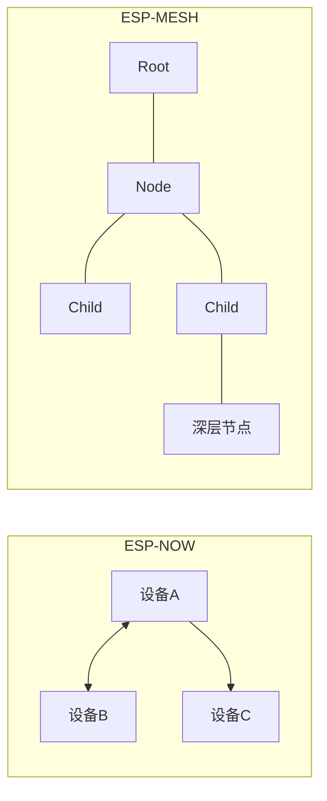

# ESP-MESH 与 ESP-NOW

没有路由器时，设备之间怎么通信？这两个协议是答案。它们都跑在 2.4G 射频上，但用法完全不同：

- **ESP-NOW**：极简的"发一条消息"通道。不需要连路由器、不需要 IP 地址，拿对方 MAC 地址直接发。延迟只有几毫秒，适合遥控器、传感器互发数据这类"点对点快报"
- **ESP-MESH**（新版本叫 **ESP-WIFI-MESH**）：让几十上百台设备**互相接力**组成一张网。离路由器最远的节点，数据由中间节点一跳一跳转发回来。适合覆盖大面积的传感网络

一句话选型：**几台设备互相传消息用 ESP-NOW；一大片设备要覆盖、要中继，用 ESP-MESH。**

## 1. 两者的区别

| | ESP-NOW | ESP-MESH |
| --- | --- | --- |
| 拓扑 | 点对点（一对多广播） | 树形/网状，自动选根 |
| 最大节点 | 加密连接 10 个 / 最多 20 个通道 | 理论上数百 |
| 转发 | 无（收不到就直接丢了） | 中继节点会转发 |
| 复杂度 | 低（几个 API） | 中（要理解树形结构） |
| 适合 | 快速点对点、遥控 | 大范围覆盖、多跳 |



## 2. ESP-NOW

```c
#include "esp_now.h"
#include "esp_wifi.h"

static uint8_t peer_mac[6] = { 0xAA, 0xBB, 0xCC, 0xDD, 0xEE, 0xFF };  // 对方的 MAC

// 收到消息的回调（L0 的回调模式）
void on_recv(const esp_now_recv_info_t *info, const uint8_t *data, int len) {
    // info->src_addr 是发件人 MAC，data 是内容
    printf("收到 %d 字节\n", len);
}

void now_init(void) {
    // 1. WiFi 先初始化到"不连接"状态（ESP-NOW 借用 WiFi 射频但不连路由器）
    esp_wifi_set_mode(WIFI_MODE_STA);
    esp_wifi_start();
    esp_wifi_set_channel(6, WIFI_SECOND_CHAN_NONE);   // 信道必须一致！

    // 2. ESP-NOW 初始化
    esp_now_init();
    esp_now_register_recv_cb(on_recv);

    // 3. 添加对端
    esp_now_peer_info_t peer = {0};
    memcpy(peer.peer_addr, peer_mac, 6);
    peer.channel = 6;
    peer.encrypt = false;                  // 先不加密（调试）
    esp_now_add_peer(&peer);
}

void now_send(void) {
    uint8_t data[] = {1, 2, 3};
    esp_now_send(peer_mac, data, sizeof(data));   // 发完就返回，不管对方收没收到
}
```

### 要点逐条

1. **信道必须一致**：ESP-NOW 不走 WiFi 关联，但要先 `esp_wifi_set_channel()`，所有设备要在同一信道——"对讲机不在一个频道就什么都听不见"
2. **发送是"发射后不管"**：`esp_now_send` 只是把包射出去。要确认送达，需要对方回一条消息（自己实现"回执"），或注册发送回调看状态
3. **单包上限 250 字节**：大数据自己分片
4. **广播地址（FF:FF:FF:FF:FF:FF）**：发给它 = 同信道所有设备都能收到——一对多就是广播地址
5. **加密**：`peer.encrypt = true` 并配置 LMK 密钥可对单个对端加密；广播数据是明文可见的（同信道任何设备都能收到），敏感数据自己在上层加密

**典型应用**：遥控手柄 → 小车（延迟 5ms 级）；温度节点 → 网关（免路由器组网）；一把遥控器控制多个灯（广播）。

## 3. ESP-MESH

MESH 把几十上百台设备组织成一棵树：**Root**（树根，连路由器）→ 一级节点 → 二级节点……数据从叶子往根逐跳汇聚。组网是自动的——新节点上电后自己找最近的父节点加入。

MESH 的 API 围绕一张配置表（`mesh_cfg_t`）展开：填网络 ID、信道、路由器信息（Root 节点才填）、事件回调，然后 `esp_mesh_init` + `esp_mesh_set_config` + `esp_mesh_start`。流程骨架：

```c
#include "esp_mesh.h"

mesh_cfg_t cfg = {
    .channel     = 6,                          // 全网统一信道
    .mesh_id     = /* 全网统一的 6 字节 ID */,
    .router      = /* Root 节点填：路由器 SSID/密码 */,
    .event_cb    = &mesh_event_handler,        // 组网事件（入网/掉线/数据）
};
esp_mesh_init();
esp_mesh_set_config(&cfg);
esp_mesh_start();
```

关键概念：

| 概念 | 含义 |
| --- | --- |
| Root | 连接路由器的节点，承担全网对外的出入口 |
| Child | 直连 Root 或其它节点的子节点 |
| 层数上限 | `CONFIG_ESP_MESH_MAX_LAYER`，默认 6 层 |
| 自组网 | 谁连上路由器谁自动当 Root；Root 掉线时别的节点自动顶上 |

注意：IDF 5.x 里旧的 `esp_mesh` 组件已被标记过时，新项目用 **esp-wifi-mesh** 组件（`idf.py add-dependency "espressif/esp-wifi-mesh"`），API 思想一致、实现更稳。**Mesh 参数组合多、调通门槛高，务必从官方示例 `examples/wifi/esp_wifi_mesh` 改起，不要从零写。**

部署建议：整个区域只让一个节点连路由器，其余全走 Mesh，这样能最大化省电（Mesh 节点常供电）。

## 4. 选型建议

| 需求 | 选择 |
| --- | --- |
| 两个设备之间快速通信 | ESP-NOW |
| 一对多广播（比如手环控制多个灯） | ESP-NOW 广播地址 |
| 家庭/工厂大范围覆盖 | ESP-MESH |
| 节点数 > 20 | ESP-MESH（且要规划信道） |
| 需要跨楼层/室外远距离 | 都不行——电磁波穿墙衰减大，需要中继或 WiFi + 网关 |

:::warning[2.4G 频段拥挤]
ESP-NOW 和 Mesh 都在 2.4G，环境里 WiFi 很多时互相干扰。部署前一定要扫信道，选干扰最小的（通常 1/6/11 中最空的那个）。Mesh 全网必须同信道——**信道规划是 Mesh 组网成败的第一关**。
:::

## 下一步

[L6 系统能力](../l6-system/)