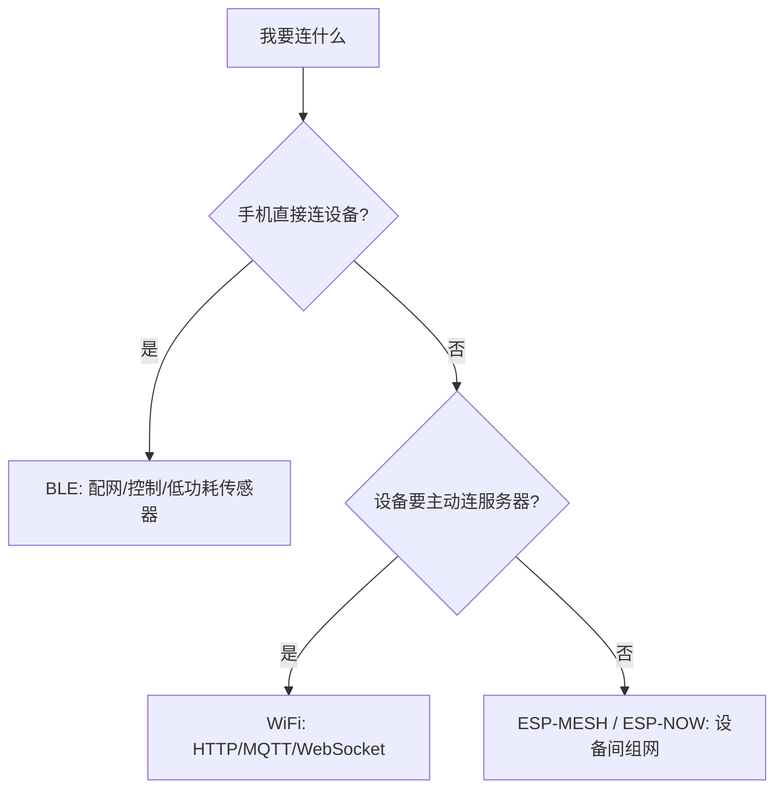

# L5 无线与网络

连上 WiFi 只是起点。连得稳、连得快、省电、能被远程升级，才算产品级。

| 章节 | 内容 |
| --- | --- |
| [WiFi 深度](./wifi) | 省电模式取舍、连接速度优化、信道与信号 |
| [BLE 深度](./ble) | 广播/GATT/Beacon、功耗预算、连接参数 |
| [lwIP 与网络栈](./lwip) | 协议栈调优、socket、多连接 |
| [OTA 升级](./ota) | 三种升级通道、差分升级、安全校验 |
| [ESP-MESH 与 ESP-NOW](./esp-mesh-now) | 组网与点对点传输 |

## 先做一个选择

常见组合：BLE 配网 → WiFi 联网 → MQTT 上下行 → BLE 做近场配置。

## 下一步

[WiFi 深度](./wifi)