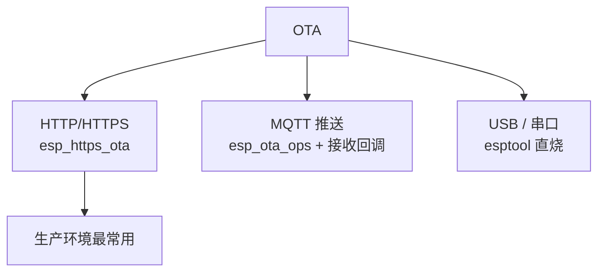
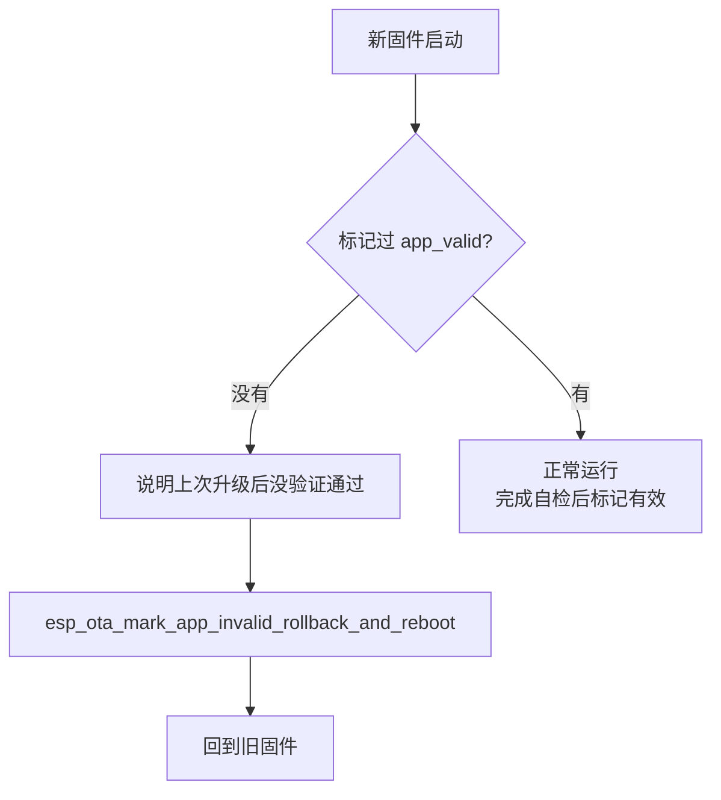
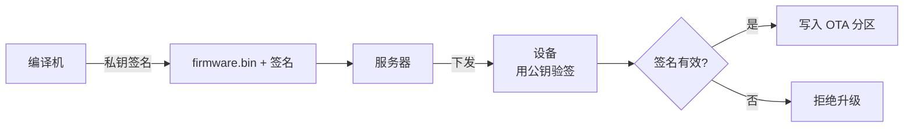

# OTA 升级

分区表原理见 [分区表与 OTA](../l2-programming-model/partition-ota)，本章讲升级通道的设计与实现细节。

先回顾 OTA（Over-The-Air，无线升级）为什么是产品刚需：设备出货后你一定会改 bug、加功能——总不能让用户拆壳接数据线。OTA 让设备像手机一样"收到推送、自己升级"。但它有一套安全逻辑要理解：**升级过程中如果断电、如果新固件本身是坏的，设备还能不能活？** 这正是双 app 分区 + 回滚机制存在的意义，本章反复围绕这个问题展开。

## 1. 三种通道



| 通道 | 怎么工作 | 适合 |
| --- | --- | --- |
| **HTTP/HTTPS** | 设备定期去服务器"问新版本、下载" | 生产环境主流：简单、可靠、可走 CDN |
| **MQTT 推送** | 服务器通过 MQTT 发命令"你有新版了"，设备再走 HTTP 下载 | 设备已经连着云平台的场景（MQTT 只当"门铃"，固件还是走 HTTP） |
| **USB / 串口** | 工厂或售后现场直烧 | 量产烧录、救砖 |

## 2. 回滚保护：必做

（双分区与回滚的原理在 [L2 分区表](../l2-programming-model/partition-ota)讲过，这里讲工程落地。）



```c
void verify_and_mark(void) {
    // 1. 自检：关键外设能工作、能连上服务器
    if (!self_test_ok()) {
        esp_ota_mark_app_invalid_rollback_and_reboot();
        return;
    }
    // 2. 确认有效，取消回滚计时
    esp_ota_mark_app_valid_cancel_rollback();
}
```

### 自检标准：回滚机制的灵魂

自检太松（只判"跑到了 app_main"）等于没保护；太严（服务器忙一次就判失败）会把好固件误杀。推荐的自检清单：

- [ ] WiFi 能连上（等 IP 事件，超时 30 秒）
- [ ] 关键外设初始化成功（屏幕有画面 / 传感器有读数）
- [ ] 能连上云端并拿到时间（SNTP 同步成功）
- [ ] 连续运行 N 分钟无 panic（可以在自检期内埋一个延迟标记）

**前提**：menuconfig 打开 `CONFIG_BOOTLOADER_APP_ROLLBACK_ENABLE`，这段代码才生效。

## 3. 安全：必须校验固件来源

HTTPS 只保护传输过程，服务器被攻破后推恶意固件照样中招。生产环境要做固件签名：



签名流程：

```bash
# 1. 生成签名密钥（私钥务必妥善保管，丢了只能换全部设备）
espsecure.py generate_signing_key --version 2 --keyfile signing_key.pem

# 2. 对固件签名
espsecure.py sign_data --version 2 --input firmware.bin --output signed.bin --keyfile signing_key.pem
```

设备端开 `CONFIG_SECURE_SIGNED_APPS_RSA_SCHEME` 后，`esp_ota_end()` 会自动验签，签名不对直接返回错误——OTA 写入被拒绝。

**不要自己发明签名方案**，用 ESP-IDF 官方的 Secure Boot v2 + espsecure 体系，它和 OTA、Flash 加密是一套完整的机制（详见 [安全章节](../l6-system/security)）。

## 4. 批量升级

设备数量多时，一台台烧不现实。两种方案：

| 方案 | 做法 |
| --- | --- |
| 串口/USB 批量烧录 | `esptool` 脚本遍历 USB 端口批量烧，写入 NVS 分区存设备身份 |
| OTA 批量推送 | 服务器记录设备表（版本号/分组），分批下发新固件，看升级成功率再扩大 |

**分批发布是产品纪律**：新固件先推 1% 的设备（灰度），观察 24 小时崩溃率，没问题再推 10%、50%、100%。一次全推 = 一行坏代码毁掉所有设备。

批量烧录时强烈建议把设备身份、密钥、证书预置进 NVS 分区，出厂烧录和后续 OTA 升级的流程能省掉大量人工。

## 5. 升级时不能做的事

OTA 写 Flash 的那几十秒，系统处于特殊状态——**升级任务是"排他"的**：

| 约束 | 原因 |
| --- | --- |
| 不能访问 Flash（读数据、写 NVS、读文件系统） | OTA 正在写 Flash，并发访问会损坏固件——**Flash 同一时间只有一个主人** |
| 不能长时间阻塞 | 网络事件循环要活着，否则超时后连接断开，升级失败 |
| 内存占用要控制 | 大文件不能整包进 RAM（2MB 固件 > 内存量），必须分块流式写 |
| 看门狗要喂 | 下载+写入可能超过 WDT 超时，升级任务里记得喂 |

流式写的正确写法（esp_https_ota 内部已经这么干了，自己手写时照这个模式）：

```c
uint8_t buf[1024];
esp_ota_handle_t ota;
esp_ota_begin(target, OTA_SIZE_UNKNOWN, &ota);
int len;
while ((len = esp_http_client_read(client, buf, sizeof(buf))) > 0) {
    esp_ota_write(ota, buf, len);      // 边收边写，不全部缓存
}
esp_ota_end(ota);
```

## 6. 常见故障

| 现象 | 原因 |
| --- | --- |
| OTA 中途断电变砖 | 分区表没配双 app 分区（单 factory 没有退路） |
| 升级后反复重启 | 自检没过触发回滚，或新固件分区放不下 |
| `esp_ota_begin` 返回 `ESP_ERR_NOT_ENOUGH_SPACE` | app 分区太小，`idf.py size` 确认 |
| 升级时死机 | 升级任务里访问了 Flash（NVS/文件系统） |
| 签名校验失败 | 公钥没烧进 eFuse，或用了不同的 secure boot 版本 |
| 下载总是不完整 | 网络不稳 + 没做断点续传；或服务器超时太短 |

## 下一步

[ESP-MESH 与 ESP-NOW](./esp-mesh-now)