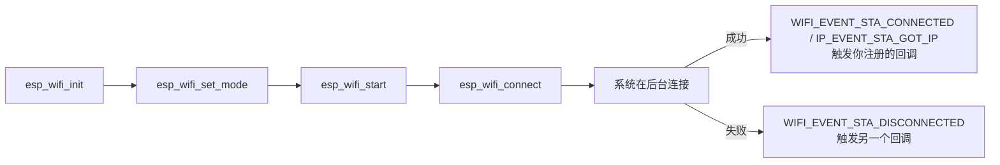

# WiFi 深度

快速上手已经让设备连上了 WiFi 并发了 MQTT。这一章回答"怎么连得**稳**、连得**快**、**省电**"——这三点恰恰是原型和产品的分界线。

## 0. 先懂一点 WiFi 原理（排错的地基）

不用学射频工程，但这几个概念要扎根：

| 概念 | 一句话 | 排错价值 |
| --- | --- | --- |
| **2.4GHz 与信道** | WiFi 在 2.4GHz 频段，划分为 13 个信道（国内），相邻信道互相重叠干扰。**1 / 6 / 11 三个信道互不重叠**，路由器一般固定在这三个之一 | 信号差可能是信道拥挤，换信道 |
| **STA（Station）** | "客户端"模式：像手机一样去连接路由器。绝大多数设备用这个 | |
| **AP（Access Point）** | "热点"模式：自己变身路由器等别人来连（配网时用） | |
| **SSID** | WiFi 的名字（"我家的WiFi"） | |
| **BSSID** | 路由器的 MAC 地址（每台路由器的"身份证号"）。同一个 SSID 可能有多个信号源（Mesh 组网），BSSID 精确指定是哪一台 | 连错台/漫游问题 |
| **DHCP** | 路由器给设备自动分配 IP 地址的机制 | "连上但拿不到 IP"的元凶 |
| **RSSI** | 信号强度（负数，单位 dBm，越接近 0 越强） | **-50 很好，-70 可用，-80 勉强，-90 基本失联** |

RSSI 是最常用的诊断数字——程序里随时能读（`esp_wifi_sta_get_ap_info`），设备"时好时坏"时先看 RSSI 是不是在 -75 以下晃。

## 1. ESP-IDF 的 WiFi 是事件驱动的

**事件驱动（Event-Driven）**是本章最重要的思维转变。你可能会想"发起连接，然后等它连上"——IDF 不这么干。它的工作方式是：你**发起**动作，然后**注册一个回调**（L0 讲过的回调模式），系统在连接成功/失败/断开时**主动通知你**：



**为什么要"IP 事件"才算连上？** WiFi 关联成功只代表"链路通了"，还要等 DHCP 分到 IP 地址才能真正通信。所以**"能上网"的判定标准是收到 `IP_EVENT_STA_GOT_IP` 事件**，不是 WiFi 连接事件——新手常在这里提前发数据导致失败。

完整流程（顺序错了会失败，这几步是固定仪式）：

```c
static esp_netif_t *netif;

void wifi_start(void) {
    // ——固定四步：网络接口初始化（一次性的地基）——
    ESP_ERROR_CHECK(esp_netif_init());                    // 1. 网络接口层
    ESP_ERROR_CHECK(esp_event_loop_create_default());     // 2. 默认事件循环
    netif = esp_netif_create_default_wifi_sta();          // 3. 创建 STA 网卡

    // ——WiFi 驱动初始化——
    wifi_init_config_t cfg = WIFI_INIT_CONFIG_DEFAULT();  // 官方默认参数宏
    ESP_ERROR_CHECK(esp_wifi_init(&cfg));

    // ——注册两个回调：WiFi 事件 + 拿到 IP 事件——
    ESP_ERROR_CHECK(esp_event_handler_instance_register(
        WIFI_EVENT, ESP_EVENT_ANY_ID, &wifi_handler, NULL, NULL));
    ESP_ERROR_CHECK(esp_event_handler_instance_register(
        IP_EVENT, IP_EVENT_STA_GOT_IP, &got_ip_handler, NULL, NULL));

    // ——填配置并启动——
    wifi_config_t wc = { .sta = { .ssid = "xxx", .password = "yyy" } };
    ESP_ERROR_CHECK(esp_wifi_set_mode(WIFI_MODE_STA));
    ESP_ERROR_CHECK(esp_wifi_set_config(WIFI_IF_STA, &wc));
    ESP_ERROR_CHECK(esp_wifi_start());
    ESP_ERROR_CHECK(esp_wifi_connect());       // 发起连接，之后就是等回调
}

// WiFi 层事件：连上/断了都在这
void wifi_handler(void *arg, esp_event_base_t base, int32_t id, void *data) {
    if (id == WIFI_EVENT_STA_DISCONNECTED) {
        // 断了！记下原因码（data 里），通知重连任务
        set_connected(false);
    }
}

// 拿到 IP：这才是"真正能上网"的时刻
void got_ip_handler(void *arg, esp_event_base_t base, int32_t id, void *data) {
    ip_event_got_ip_t *e = (ip_event_got_ip_t *)data;
    ESP_LOGI(TAG, "IP: " IPSTR, IP2STR(&e->ip_info.ip));
    set_connected(true);          // 通知其它任务可以联网了（事件组 SetBits）
}
```

:::danger[忘记 `esp_netif_init()` 或 `esp_event_loop_create_default()`]
表现是"WiFi 起来了但拿不到 IP"或者 `esp_wifi_connect` 返回 `ESP_ERR_WIFI_NOT_INIT`。**这四步固定仪式缺一不可**，官方示例开头都是它们，照抄。
:::

**"通知其它任务"的标准做法**：不要在回调里直接干活（回调在事件循环任务里跑，别拖累它），而是事件组 SetBits——别的任务用 `xEventGroupWaitBits` 等（L2 的知识在这里落地）。

## 2. 三种省电模式：怎么选

| 模式 | 断网/重连速度 | 功耗 | 适用 |
| --- | --- | --- | --- |
| **Modem Sleep**（默认，WiFi 开着） | 不影响（自动醒） | 中高 | 联网常态，最常用 |
| **Light Sleep** | 重连慢 | 中 | 偶尔要响应 |
| **Deep Sleep** | 断网，要重新握手 | µA 级 | 电池项目（周期上报） |

Modem Sleep 的原理：没数据时关掉射频省电，有数据来时（路由器缓存了包再发给它）自动醒来——对你透明，只是收发延迟略增。两个级别：

```c
esp_wifi_set_ps(WIFI_PS_MIN_MODEM);    // 醒得勤，延迟低，略费电
esp_wifi_set_ps(WIFI_PS_MAX_MODEM);    // 睡得深（默认），省电，延迟略高
esp_wifi_set_ps(WIFI_PS_NONE);         // 不省电，延迟最低（低延迟要求高时用）
```

Deep Sleep 就是彻底断电睡觉（见 [L6 功耗管理](../l6-system/power)），代价是每次唤醒要重新走一遍"连接+DHCP+TLS"，几秒到几十秒。

**Deep Sleep 的真实代价**：如果你的场景是"每秒上报一次"，Deep Sleep 完全不合适（醒着的时间比睡着多）；如果是"每 5 分钟上报一次"，Deep Sleep 能把电池寿命从 3 天变成 3 个月。**算 waking duty cycle（醒着占空比）再决定。**

## 3. 连接速度优化

从开机到可通信的耗时拆解——优化前先知道时间花在哪：

| 环节 | 耗时 | 优化手段 |
| --- | --- | --- |
| WiFi 扫描 | 0.5～2s | **配置固定 BSSID**，跳过扫描 |
| 认证关联 | 0.2s | — |
| DHCP | 0.2～2s | 静态 IP / DHCP 快速应答 |
| DNS | 0.1～2s | 直接用 IP，或缓存 DNS 结果 |
| TLS 握手 | 0.3～1s | 会话复用、减少证书链长度 |

```c
// 固定 BSSID：跳过扫描，直接关联指定路由器
wifi_config_t wc = {
    .sta = {
        .ssid     = "myap",
        .password = "pwd",
        .bssid    = { 0xAA, 0xBB, 0xCC, 0xDD, 0xEE, 0xFF },
        .bssid_set = 1,
    },
};
```

定位 BSSID：手机上用 WiFi 分析工具看，或先连上后从日志里读。

静态 IP（跳过 DHCP）：

```c
esp_netif_dhcpc_stop(netif);           // 先停掉自动获取
esp_netif_ip_info_t ip = {
    .ip      = { 192, 168, 1, 200 },   // 固定 IP
    .netmask = { 255, 255, 255, 0 },
    .gw      = { 192, 168, 1, 1 },     // 网关（路由器）
};
esp_netif_set_ip_info(netif, &ip);
```

静态 IP 的代价：**换网络环境要改代码**（不同路由器的网段不一样）——产品化做法是"默认 DHCP + 配置项可覆盖"。

## 4. ⚠️ 为什么一连 WiFi 就重启

这是 ESP32 项目最高频的故障，四个可能原因按概率排：

| 原因 | 表现 | 对策 |
| --- | --- | --- |
| **供电不足**（概率最高） | 启动 WiFi 那一刻掉电重启 | 换粗线/外部电源；3.3V 上并 470µF + 0.1µF（[L1 供电原理](../l1-hardware/board)） |
| BLE 和 WiFi 同时开内存不够 | 初始化 BLE 后 OOM 崩溃 | 用 NimBLE；限制连接数；关不用的功能 |
| RSSI 太低导致反复重连 | 日志刷屏重连 | 改善天线/距离；信号 < -80 别指望稳 |
| 看门狗超时 | `Task watchdog got triggered` | WiFi 初始化放进任务里，别在 app_main 里同步做（它要几百毫秒到几秒） |

**供电问题的排查法**：把 `esp_wifi_set_ps` 关掉、或干脆注释掉 WiFi 初始化——重启消失，基本坐实供电。再做"换粗线/加电容"的对照实验。

## 5. AP + STA 共存模式

先纠正一个常见误解：**一块 ESP32 只能同时当 1 个 STA**（不能同时连两个路由器），但可以**既当 STA 又当 AP**——同时连着家里的路由器、又开放一个热点给别人连。这个组合叫 **AP-STA 共存**，最典型的用途是配网：设备先开热点等手机连，收到 WiFi 账号密码后切回 STA 模式。

```c
// 一个芯片同时跑 STA + AP
esp_wifi_set_mode(WIFI_MODE_APSTA);

// STA 侧：连家里路由器
wifi_config_t sta_cfg = { .sta = { .ssid = "home", .password = "pwd" } };
esp_wifi_set_config(WIFI_IF_STA, &sta_cfg);

// AP 侧：开放自己的热点
wifi_config_t ap_cfg = {
    .ap = { .ssid = "ESP32-Setup", .password = "12345678",
            .max_connection = 2, .authmode = WIFI_AUTH_WPA_WPA2_PSK },
};
esp_wifi_set_config(WIFI_IF_AP, &ap_cfg);

esp_wifi_start();   // 两个接口同时工作
```

注意：两个接口共享同一个射频，带宽和稳定性都比单 STA 差，AP 模式只适合"少量设备的临时配置"，别当正经路由器用。三种配网方案的对比：

| 方案 | 体验 | 适用 |
| --- | --- | --- |
| SoftAP 配网（上面这个） | 用户连设备热点、网页填密码 | 最通用，实现简单 |
| SmartConfig | 手机 App 一键广播 | 体验好但对路由器挑刺，成功率不稳 |
| BLE 配网 | 手机 App 走蓝牙发密码 | 无热点泄漏风险，BLE 设备标配 |

## 6. 断线重连的正确姿势

**WiFi 一定会断**——路由器重启、信号波动、微波炉干扰。产品级的重连不是"掉线了马上重连"，而是一个有节奏的状态机：

```c
void wifi_reconnect_task(void *arg) {
    int backoff = 5;                      // 退避时间，从 5 秒起
    for (;;) {
        if (!connected) {
            ESP_LOGW(TAG, "重连中...");
            esp_wifi_connect();
            vTaskDelay(pdMS_TO_TICKS(backoff * 1000));
            if (backoff < 60) backoff *= 2;   // 5s → 10s → 20s → 40s → 60s 封顶
        } else {
            backoff = 5;                      // 连上了，重置退避
        }
        vTaskDelay(pdMS_TO_TICKS(1000));
    }
}
```

要点逐条说：

1. **重连逻辑放在低优先级任务里**，不要放事件回调（回调别阻塞）
2. **指数退避**：路由器重启要 30 秒，你每 0.5 秒撞一次门毫无意义还添乱——5、10、20、40 秒地拉长间隔
3. **用事件组通知连接状态**：其它任务 `xEventGroupWaitBits` 等"已连接"的旗子，数据任务在断网时自动阻塞，不用到处写 `if (connected)`
4. **区分"暂时断了"和"密码错了"**：看断开原因码（disconnect 事件的 reason 字段），`WIFI_REASON_AUTH_FAIL` 是密码错——重连一万次也不会好，应该告警

## 下一步

[BLE 深度](./ble)