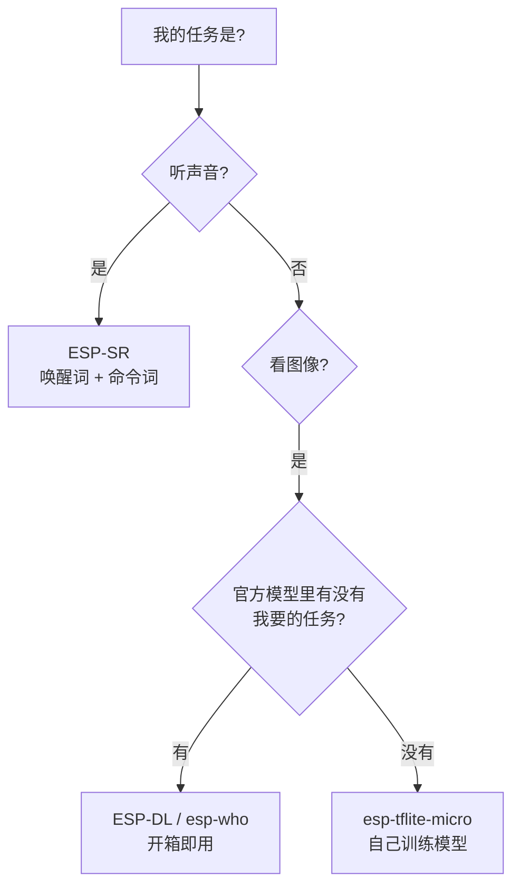
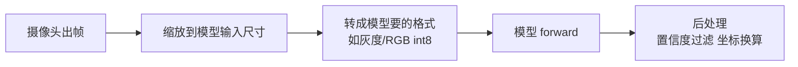
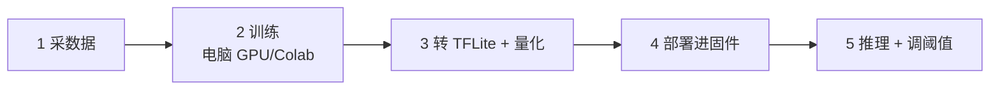
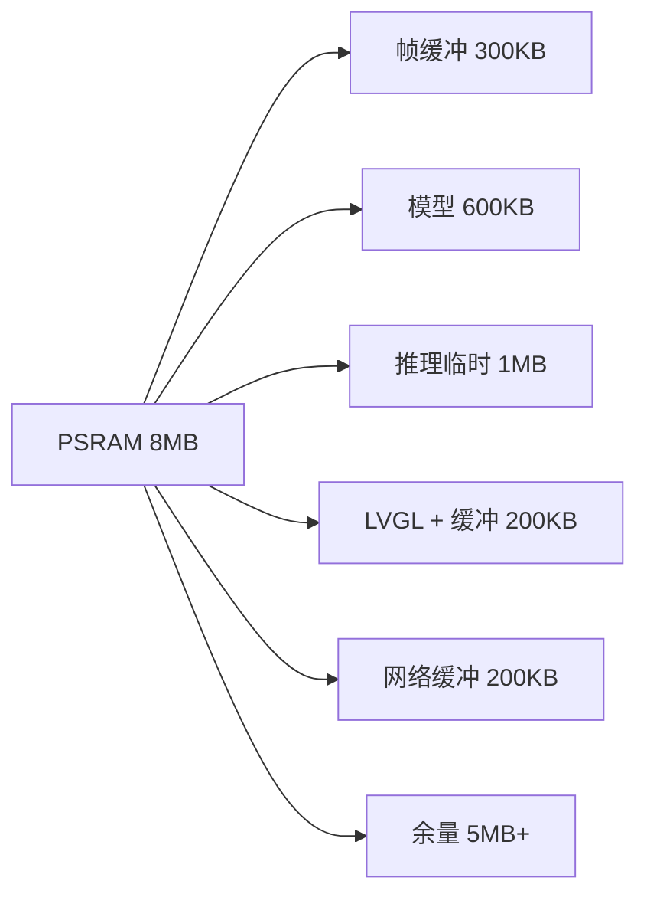

# AI 能力

"在单片机上跑 AI"听起来唬人，拆开看很朴素：把一个**训练好的神经网络模型**（本质是一大堆乘加运算的权重数字）放进芯片，来一帧图像或音频就做一轮乘加，得出"这是猫 / 这不是猫"。

## 0. 先分清两件事

- **训练（Training）**：在电脑/服务器上做，需要大算力（GPU）和海量数据。你的芯片不参与
- **推理（Inference）**：拿训练好的模型判断新数据。**ESP32 干的就是这个**

ESP32 芯片本身不带 NPU（专用 AI 芯片那种），靠的是 S3 的**向量指令（SIMD）**——CPU 一次能对多组数据做同样的运算，乘加密集的神经网络正好受益，官方库会自动启用。所以能跑的都是**小模型**（几百 KB 量级）和**低帧率**任务，指望跑大模型是不现实的。

## 1. 乐鑫 AI 生态总览：这些库都是谁、什么时候用谁

"AI 能力"不是一个大库，而是一组各管一段的组件。先认识全家福，再逐个深入：

| 库 / 组件 | 管什么 | 典型任务 | 你需要训练模型吗 |
| --- | --- | --- | --- |
| **ESP-SR**（Speech Recognition） | 语音：唤醒词、命令词 | "小乐小乐，打开灯" | 不用（唤醒词官方提供；命令词是"注册"不是"训练"） |
| **ESP-DL**（Deep Learning） | 图像推理框架 + 官方模型 | 人脸检测/识别、行人检测 | 不用（官方模型开箱即用）；要自定义才训练 |
| **esp-who** | ESP-DL 的示例仓库 | 人脸门禁、猫脸检测的完整例子 | 同上 |
| **esp-tflite-micro**（TFLM） | 跑你自己训练的 TensorFlow Lite 模型 | 识别自家的猫、判断零件正反 | **要**（这是"自己训练"的通道） |
| **esp-audio-codec** | 音频编解码（MP3/AAC/Opus） | 播放提示音、录音存文件 | 不用（不是 AI，是音频工具，但常和 SR 一起出现） |
| **esp-video** | 摄像头/视频流水线 | 视频采集 + 推理串联 | 不用 |

**选型决策树**（先问自己任务是什么）：



一句话：**语音找 ESP-SR，标准视觉任务找 ESP-DL，自定义识别找 TFLM**。下面逐库深入。

## 2. AI 背后的原理：拟合、卷积与频域（强烈建议读）

后面的库怎么用，前面的章节已经能讲清；这一节补一层"为什么"——**拟合、卷积、频域、量化**四个概念撑起了整个端侧 AI。不看也能照抄代码，看了你才真正知道自己在调什么。

### 2.1 一切从"拟合"开始：找一条最贴合数据的规律

**拟合（Fitting）**是所有 AI 的起点。给你一堆（输入，输出）对——比如（房子面积，房价）——找一条规律函数，让新输入进来也能预测出合理的输出。最简单的规律是直线：

```text
预测房价 = w × 面积 + b        ← w 是斜率，b 是截距，两个"待定参数"
```

**训练（Training）就是调 w 和 b 的过程**，它有一套机械的流程：

1. **预测**：用当前的 w、b 算一遍训练数据，得到预测值
2. **算差距**：预测值和真实值差多少——这个差距的度量叫**损失函数（Loss）**，通常用"差的平方"，差距越大损失越大
3. **微调**：把 w、b 往"让损失变小"的方向挪一点点
4. 回到第 1 步，重复几万次

第 3 步"往哪个方向挪"由**梯度下降（Gradient Descent）**决定。经典比喻：**你蒙着眼在山上，想走到谷底（损失最低点），脚能感觉到哪边是下坡，就朝那边迈一小步**——每一步都不大（步子叫**学习率**），走几万步就到谷底了。步子太大容易跨过谷底来回震荡，太小则走到天黑还没到。

**那神经网络是什么？直线太"硬"，弯不弯只能一条直线。把很多个简单的拟合函数嵌套起来——上一层算完的结果作为下一层的输入，每层之间加一个"弯折函数"（激活函数）——就得到了一个能弯出任意形状的拟合机器。** 每个基本单元叫**神经元**（干的事就是"加权求和再弯折"），一层神经元排成一阵，层与层相连就是神经网络。模型里几百万个参数，就是几百万个 w 和 b——**训练就是用梯度下降把它们全部调好**；推理只是把调好的 w、b 拿来做乘加。这个视角下，"AI 推理"一点都不神秘：**一堆乘加，仅此而已**（这也解释了为什么 S3 的向量指令对它有效——乘加正是 SIMD 最擅长的事）。

### 2.2 卷积：拿小模板在图上滑动找特征

图像 AI 的主力工具是**卷积（Convolution）**。它的操作直观得像盖章：

1. 准备一个小的数字模板，比如 3×3 的"斜线检测器"（每个格子一个权重，就是待训练的 w）
2. 把模板盖在图像左上角的 3×3 区域，对应格子相乘再求和，得到一个数——**分数越高，说明这块图像越像模板**
3. 模板向右滑一格，重复；滑完一行换下一行……直到扫完整张图
4. 输出一张"相似度地图"：每个位置记着"这里有多少像斜线的东西"

换不同的模板，就能检测边缘、斑点、纹理……**实际的卷积层里模板内容（权重）不是人写的，是训练出来的**——网络自己学会"该找什么特征"。

为什么图像 AI 全用卷积？两个理由：

- **参数共享**：同一个模板扫遍全图，几个权重就能检测"任意位置的斜线"——比每个位置单独配参数小几个数量级，模型小才放得进单片机
- **平移不变**：猫在画面左上还是右下，模板照样能找到它

**CNN（卷积神经网络）= 卷积层（找特征）+ 池化层（把图缩小，只留最强响应）交替堆叠**：一层找边缘，二层找眼睛鼻子，三层拼出人脸——层层抽象。你现在知道 ESP-DL 和 TFLM 模型里的 `Conv2D`、`DepthwiseConv2D` 算子在干什么了：就是上面那个"盖章滑动"。

### 2.3 频域与傅里叶变换：把声音拆成音符

**时域（Time Domain）**是声音的原始样子：麦克风电压随时间的起伏波形。但语音 AI 几乎不用原始波形，而是先做**傅里叶变换（Fourier Transform）**，换到**频域（Frequency Domain）**——回答"这段声音由哪些频率的波组成、各占多少"。

一个你每天都在用傅里叶变换的证据：**你的耳朵**。钢琴同时按下 do、mi、so 三个键，空气里只有一条复杂波形，你却能立刻说出"这是三个音"——**人耳就是一个生物傅里叶变换器**，把混合波形拆成了频率成分。

**为什么语音 AI 非要用频域？** 两个原因：

1. **语音的区别主要体现在频率成分上**："啊"和"呜"的波形看起来都乱糟糟，但它们的频率组成（共振峰位置）截然不同——频域里一眼可辨
2. **把无关变化过滤掉**：不同人音高不同、音量不同、环境不同，时域波形千差万别；频域特征把"谁在说、多大声"这些无关因素磨平，只留下"说了什么"——**特征稳定，模型才好训、才好认**

计算机做傅里叶变换的标准算法叫 **FFT（快速傅里叶变换）**。语音识别的流水线（[第 3 节的 ESP-SR](#3-esp-sr语音唤醒与命令词)）里，AFE 处理完的音频就先做 FFT、再提取频谱特征；把"每个时间窗的频谱"按时间排开，得到一张**谱图（Spectrogram）**——横轴时间、纵轴频率、颜色深浅是强度。

:::tip[一个漂亮的收束]
谱图长得像图，于是**可以当图像喂给卷积网络**——语音识别和图像识别在模型层面汇合了，都是第 2.2 节的"盖章找模板"。你以后看到语音模型里也有 Conv2D，原因就在这。
:::

### 2.4 量化的数学：float 怎么缩成 int8

[第 4.4 节](#44-量化为什么单片机能跑神经网络)说了量化的好处，这里补一层原理。量化不是简单四舍五入，而是一次**线性缩放**：

```text
真实值（float） = (整数值 - zero_point) × scale

例：scale = 0.01，zero_point = 0 时
    int8 的 156  ↔  float 的 1.56
    int8 的 -87  ↔  float 的 -0.87
```

- **scale（缩放系数）**：1 个 int8 刻度代表多少真实值——由校准数据（[第 5 节](#5-esp-tflite-microtflm自己训练模型的完整路径)阶段三那"几百张代表性样本"）统计出来的实际数值范围决定
- **zero_point（零点）**：真实值 0 对应的整数刻度——ReLU 之后全是非负数时，int8 的负数半边就浪费了，挪一下零点能把 256 级刻度全用上

推理时芯片做的每次乘加都是 **int8 × int8 → int32 再缩回 int8**——整数运算比浮点快几倍，这正是量化的全部收益来源。你读 TFLM 代码时看到的 `scale` / `zero_point`，就是这两个数（它们存在模型文件里，`interpreter.input(0)` 的参数里能查到）——**第 5.5 节"归一化不一致"的坑，本质就是绕过了这套缩放换算**。

## 3. ESP-SR：语音唤醒与命令词

:::caution[语音方案部署门槛高，先跑官方示例]
ESP-SR 对硬件有硬性要求（特定型号麦克风、PSRAM、专用分区表），API 在不同版本间变动也大。**本节讲清每个部件是什么、怎么组合，代码以 `esp-sr` 仓库自带的示例（如 `cn_speech_commands_recognition`）为准**——直接从示例改，别从零搭。
:::

```bash
idf.py add-dependency "espressif/esp-sr"
```

### 3.1 三个子引擎：一段语音要过三道关卡

ESP-SR 内部不是"一个 AI"，而是三个各司其职的引擎串联：


**① AFE（Audio Front End，音频前端）**——"把声音洗干净"。它不认识任何词，只做信号级处理，内含几个可开关的处理块：

| 处理块 | 全称 | 干什么 | 什么时候要 |
| --- | --- | --- | --- |
| AEC | Acoustic Echo Cancellation（回声消除） | 设备自己正在放音乐时，把喇叭声音从麦克风里减掉 | 会同时"放+听"的设备（音箱） |
| NS | Noise Suppression（噪声抑制） | 压掉稳态背景噪声（风扇、电流声） | 基本都要开 |
| VAD | Voice Activity Detection（人声活动检测） | 判断"现在有人在说话吗" | 省电：没人说话不跑后面的模型 |
| BSS/波束成形 | Blind Source Separation | 双麦阵列定向收音，抑制旁边方向的声音 | 双麦以上才可用 |

**② WakeNet（唤醒词引擎）**——循环监听，听到设定词就"唤醒"。它必须极低功耗、极低误触（24 小时挂着，误唤醒会烦死人）。

**③ MultiNet（命令词识别）**——唤醒后识别具体命令。和"语音助手听懂任何话"不同，MultiNet 是**固定命令词表**匹配：你注册"打开空调""调到二十六度"这些短语，它只认词表内的。好处是离线、快、小；局限是词表外的话它不认识。

### 3.2 硬件要求（不满足免谈）

| 要求 | 说明 |
| --- | --- |
| **PSRAM 必须** | AFE 的处理缓冲要好几 MB，S3 + N16R8 正好 |
| **数字麦克风（I2S/PDM）** | INMP441、ICS-43434 等；模拟麦克风不行 |
| **单麦能跑，双麦更好** | 单麦没有波束成形，抗噪弱一档 |
| **AEC 需要参考通道** | 要回声消除就必须让系统"知道"正在放什么（I2S 回环） |

### 3.3 模型装在哪：model 分区

模型文件（几百 KB～几 MB）**不是编进固件**，而是放在 Flash 里一个专门的 **model 分区**。所以用 ESP-SR 通常要改分区表，加一行：

```csv
# Name,   Type, SubType,  Offset,  Size
model,    data, model,    ,        0x500000,
```

模型文件在构建时由组件管理器按配置自动下载（一堆 `.wn9` / `.mn9` 后缀的模型文件），烧录时多烧一份 model 分区——第一次配 ESP-SR 时看到构建下载一堆模型文件就是它。**模型选型在 menuconfig 里做**：选唤醒词模型（挑词）和 MultiNet 模型（中文/英文、命令词数量档位）。

### 3.4 唤醒词与命令词怎么定制

- **唤醒词**：**不能随便造**——官方提供一批训练好的唤醒词（如"Hi 乐鑫""Hi ESP"等，menuconfig 列表可见），从中挑一个。自定义唤醒词需要把录音数据交给乐鑫的训练服务，或用第 5 节的 TFLM 路线自己训小模型
- **命令词**：**可以随意注册**——MultiNet 用中文拼音串或英文音素定义命令词（例如 `kai deng` 对应"开灯"，按字拆拼音不是整句），一次注册几百条都行。新增命令不用重新训练模型，改配置重新编译即可

### 3.5 能力边界（提前知道，免得白忙）

| 能 | 不能 |
| --- | --- |
| 离线识别固定命令词（中英文） | 听懂任意自然语言（那要联网 + 大模型——下一章的[语音助手实战](./llm-voice)就是干这个的） |
| 3～5 米内的正常音量 | 嘈杂商场里的远场识别 |
| 每次识别响应几百毫秒 | 连续对话流式转写 |

## 4. ESP-DL 与 esp-who：图像任务的官方全家桶

### 4.1 两个仓库的关系

- **esp-dl**：推理框架 + 官方模型库（"引擎和车"）
- **esp-who**：把 esp-dl 的模型串成完整应用的示例仓库（"整车样例"：人脸门禁、猫脸检测）

**学法**：从 esp-who 的示例 clone 下来跑通，再回 esp-dl 看模型怎么被调用。

### 4.2 官方模型动物园（开箱即用的部分）

| 模型 | 任务 | 说明 |
| --- | --- | --- |
| 人脸检测（MSR 系） | 找出画面里的所有人脸框 | 检测模型，只知道"这是张脸" |
| 人脸识别（MFN 系） | 说出这张脸是谁 | **识别 = 检测 + 特征比对**，两步串联 |
| 行人检测 | 找画面里的人形框 | 走廊人流统计 |
| 猫脸检测 | 找猫脸 | 宠物相关项目标配 |
| 手势/动作类 | 分类 | 随官方版本更新 |

**"检测"和"识别"的区别要分清**：检测（detection）回答"画面里有没有 X、在哪"（输出坐标框）；识别（recognition）回答"这个 X 是哪一个"（输出身份）。人脸门禁 = 人脸检测（找到脸）→ 人脸识别（比对是谁）两段流水线，两段各吃一份内存。

### 4.3 通用接入五步（所有视觉模型都这个流程）



第 5 步的"置信度阈值"是实用关键：模型给每个结果一个 0～1 的分数，阈值取 0.5 左右起步——调低漏检少但误报多，调高反之。**安防场景宁可误报，玩具场景宁可漏报**。

### 4.4 量化：为什么单片机能跑神经网络

训练时的模型是 float32（每个权重 4 字节）；部署前**量化成 int8**（1 字节）——体积除以 4、速度翻几倍，精度损失通常 1～2 个百分点。官方模型出厂就是 int8 的，拿来直接用；自己训练的模型必须做量化才能高效部署（第 5 节细讲）。

## 5. esp-tflite-micro（TFLM）：自己训练模型的完整路径

官方模型没覆盖你的需求（识别自家的猫、判断传送带上的零件正反、分辨四种鸟叫）？这条路走 TFLM。**五个阶段，前两个在电脑上，后三个在芯片上**：



### 5.1 阶段一：采数据（最重要也最枯燥）

- 每类至少 **100～300 张**样本，越多越稳
- **多样性决定泛化**：不同光照、角度、背景都拍——只在一个房间拍 300 张，换个房间就翻车
- 用你未来的部署条件采集（同样的摄像头、同样的分辨率）
- **图像分类优先于目标检测**：分类是"判断整张图是什么"（任务简单、模型小、好训），检测是"框出目标在哪"（复杂一个量级）。单片机场景能分类就不检测

### 5.2 阶段二：训练（迁移学习，不需要从零造模型）

从零训练既没数据也没算力，标准做法是**迁移学习**：拿一个现成的小模型（如 MobileNetV2 的精简版）的预训练权重，只重训最后的分类层——它已经"认识"了千万张图的通用纹理，你只需要教它"你的几类东西的区别"。

- 环境：Google Colab（免费 GPU）+ TensorFlow/Keras，TFLM 官方仓库有现成的训练 notebook（person detection 就是这么训的）
- 训练完保存为 SavedModel / Keras 模型，准备进阶段三

### 5.3 阶段三：转 TFLite 并量化

```python
converter = tf.lite.TFLiteConverter.from_keras_model(model)
converter.optimizations = [tf.lite.Optimize.DEFAULT]          # 开启量化
converter.representative_dataset = rep_data_gen                # 用几百张代表性样本校准
converter.target_spec.supported_ops = [tf.lite.OpsSet.TFLITE_BUILTINS_INT8]
tflite_model = converter.convert()                             # 得到 int8 的 .tflite
```

两种量化方式：

- **训练后量化（PTQ）**：训练完拿几百张样本"校准"，快，但精度可能掉几个点
- **量化感知训练（QAT）**：训练时就模拟 int8 的精度损失，精度几乎不掉，但要重训——**图像场景光照变化大，建议直接上 QAT**

:::danger[必须 full integer int8]
TFLM 上实际可用的模型是 **full integer 量化**（权重和激活全是 int8）。导出时检查 `OpsSet.TFLITE_BUILTINS_INT8`——float 模型或"半量化"模型在芯片上要么跑不了、要么慢 10 倍。这是 TFLM 路线第一大坑。
:::

### 5.4 阶段四：部署进固件

```bash
idf.py add-dependency "espressif/esp-tflite-micro"
```

模型文件（.tflite，几百 KB）用 CMake 塞进固件：

```cmake
target_add_binary_data(${COMPONENT_LIB} "model/cat.tflite" BINARY)
```

推理侧的骨架（细节跟着官方 person_detection 示例走）：

```c
#include "tensorflow/lite/micro/micro_interpreter.h"
#include "tensorflow/lite/micro/micro_mutable_op_resolver.h"

constexpr int kArenaSize = 200 * 1024;
static uint8_t arena[kArenaSize] __attribute__((aligned(16)));   // 推理工作内存

// 1. 注册模型用到的算子（模型用了哪些层就注册哪些，缺一个运行时报错）
tflite::MicroMutableOpResolver<4> resolver;
resolver.AddConv2D();
resolver.AddDepthwiseConv2D();
resolver.AddFullyConnected();
resolver.AddSoftmax();

// 2. 建解释器（一次），之后每帧反复 Invoke
tflite::MicroInterpreter interpreter(model, resolver, arena, kArenaSize);
interpreter.AllocateTensors();
```

**arena（推理工作区）**是模型之外另一块大内存——中间计算结果都在这里。不够 `AllocateTensors` 会失败报"arena too small"；自己训的模型从 200KB 起试，不够就加，或换更小的模型。

### 5.5 阶段五：推理循环与阈值

```text
每帧：
1. 摄像头取帧 → 解码/缩放到模型输入尺寸（如 96×96）
2. 像素数据 memcpy 进 input tensor（归一化方式必须和训练时一致！）
3. interpreter.Invoke()           ← 所有乘加在这里发生
4. 读 output tensor 的分类分数
5. 分数 > 阈值 → 判定为该类
```

**归一化不一致**是第二大坑：训练时像素除以 255 变 0～1，推理时忘做，精度直接归零。输入输出张量的缩放参数（scale / zero_point）模型里带着，按官方示例的换算代码来。

## 6. 内存规划实例

以"摄像头 + 人形检测 + WiFi 上报 + LVGL 显示"为例：



建议：帧缓冲用 JPEG 模式（50KB 而不是 300KB），解码时间换取内存。**语音项目的账另算**：AFE + WakeNet + MultiNet 全家桶大约吃 1.5～2MB（含 model 分区里的模型文件），PSRAM 和 Flash 双双吃紧。

## 7. 性能优化

| 手段 | 效果 |
| --- | --- |
| 输入缩放到模型要求尺寸 | 减少计算量数倍（96×96 比 240×240 快 6 倍） |
| 降低推理帧率（10fps 而非 30fps） | CPU 占用减半，人眼无感 |
| 模型量化（int8） | 速度 2～4 倍、体积除以 4 |
| 用 S3 的向量指令 | 官方库自动启用 |
| 只在检测到变化时推理 | 省电（配合帧差判断） |
| 推理放低优先级任务 | 别饿死显示和网络 |
| 灰度图代替彩色 | 图像数据量除以 3（部分模型支持） |

## 8. 常见问题

| 现象 | 原因 |
| --- | --- |
| 推理时死机 | PSRAM 不够；模型/arena 分配到了内部 RAM |
| 帧率上不去 | CPU 被网络/显示占用；输入分辨率太高 |
| 精度差 | 量化损失（换 QAT）；光照域和训练集不匹配；阈值太高 |
| 模型加载失败 | 格式不对（要 full integer quantized）；model 分区没建或没烧 |
| `AllocateTensors` 报 arena 太小 | 加 kArenaSize，或换更小的模型 |
| ESP-SR 构建时下载模型失败 | 模型托管在 GitHub，网络问题——走代理或手动下载放进组件目录 |
| 唤醒词误触发频繁 | 换更"独特"的官方唤醒词；开 VAD；降低灵敏度 |
| MultiNet 认不出命令词 | 拼音串写错（按字拆，不是整句）；离麦太远；噪声盖过 |
| 推理阻塞 WiFi | 没分任务，或优先级设置不当 |
| 人脸识别谁都通过 | 相似度阈值太松（调严）；注册样本太少 |

## 下一步

[L7 工程化](../l7-engineering/)