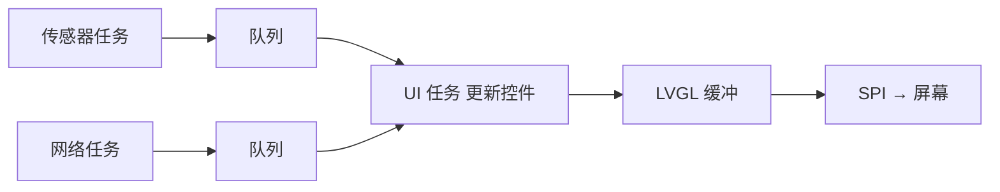

# 图形界面 LVGL

给设备加一块屏，用 **LVGL**——嵌入式界的事实标准 GUI 库。它的思路是：你在代码里搭一棵"控件树"（一个屏幕、几排按钮、几个标签），LVGL 在内存里把它**画**出来，再由你写的底层驱动把画好的像素**刷**到屏幕上。

## 0. 分层架构：谁负责什么

| 层 | 谁负责 | 干什么 |
| --- | --- | --- |
| 控件层 | LVGL | 布局、按钮点击、动画、字体渲染 |
| 缓冲层 | 你（配一次） | 开一块内存当画布 |
| 刷屏层 | 你（写一个回调） | 把画布内容通过 SPI/QSPI 推给屏幕驱动芯片 |

对接 ESP-IDF 推荐用官方封装 `espressif/esp_lvgl_port`（它替你管好 LVGL 任务、锁和 tick），本节用 LVGL v8 的 API 讲原理（社区资料最多）。

```bash
idf.py add-dependency "espressif/esp_lvgl_port" "espressif/lvgl"
```

## 1. 核心概念：对象树与缓冲

LVGL 里一切皆对象（`lv_obj_t`）：屏幕是对象、按钮是对象、按钮上的文字标签也是对象——组成一棵树。改属性就是调函数：

```c
lv_obj_t *btn = lv_btn_create(lv_scr_act());       // 在当前屏幕上建按钮
lv_obj_set_size(btn, 120, 50);                     // 尺寸
lv_obj_center(btn);                                // 居中
lv_obj_add_event_cb(btn, btn_cb, LV_EVENT_CLICKED, NULL);   // 注册点击回调（又是回调模式）

lv_obj_t *label = lv_label_create(btn);            // 按钮上建标签
lv_label_set_text(label, "启动");
```

**刷新机制**：你改了属性，LVGL 只把"变脏的区域"记下来，在自己的任务里重画那一块——**这就是为什么别在别的线程直接碰控件**（见第 6 节）。

## 2. 缓冲模式：一次画多大

LVGL 把画面画进你提供的缓冲块，一次画一块，画完就刷屏：

| 模式 | 内存 | 效果 | 建议 |
| --- | --- | --- | --- |
| 小块缓冲（1/10 屏） | 小 | CPU 分多次画，略慢 | 内存紧张 |
| **1/4～1/2 屏缓冲** | 中 | 流畅与内存的平衡点 | ✅ 默认 |
| 整屏双缓冲 | 大（W×H×2×2） | 最流畅 | 320×240 要 300KB |

320×240 RGB565 一帧 = 320×240×2 = 150KB——整屏双缓冲 300KB，占掉内部 RAM 的一大半，所以中小屏用"分块缓冲"。

## 3. 内存规划（320×240 为例）

| 用途 | 大小 |
| --- | --- |
| 分块缓冲（每块 20 行） | 2 × 320×20×2 = 25.6 KB |
| 界面对象 | 10～50 KB（取决于控件数量） |
| 字体（字库） | 3～20 KB（子集化后） |
| 图片资源 | 不定（放 Flash/PSRAM） |
| 总计（不含资源） | ~100 KB |

**中文字库是内存/flash 杀手**：完整 GB2312 字库要 1MB+。**一定要做子集化**——只把项目里实际用到的几百个字做成字体文件：

```c
// LVGL 官方在线字体转换工具：只勾选你项目用到的汉字
LV_FONT_DECLARE(font_my_14_cn);        // 只含项目用到的那几百个字
lv_obj_set_style_text_font(label, &font_my_14_cn, 0);
```

大图片资源同理：转成 LVGL 的 C 数组放进 Flash 分区，或放 PSRAM。

## 4. 屏幕驱动：flush 回调

LVGL 每画好一块区域，就调你的 `flush` 回调把这块像素推给屏幕。这是移植工作的核心：

```c
// LVGL v8 的 flush 回调签名
void disp_flush(lv_disp_drv_t *drv, const lv_area_t *area, lv_color_t *color_p) {
    lcd_set_window(area->x1, area->y1, area->x2, area->y2);   // 告诉屏幕芯片"往哪个区域写"
    lcd_write_pixels((uint8_t *)color_p, area_size_bytes);    // 推像素
    lv_disp_flush_ready(drv);                                 // 告诉 LVGL"画完了，可以下一块"
}
```

三个要点：

1. **`lv_disp_flush_ready()` 必须在"数据真的交出去"之后调**。如果 `lcd_write_pixels` 是同步函数（写完才返回），像上面这样写就行；如果底层是 DMA 异步传输，函数立刻返回但数据还没发完——**必须等 DMA 传完再调 `flush_ready`**，否则 LVGL 会去改一块还在发送中的画布，画面出现撕裂（上半个画面是旧的、下半个是新的）
2. **SPI 频率直接决定帧率上限**：40MHz 的 SPI 刷一块 320×240 屏，理论极限也就二三十帧，不要指望 60fps
3. 每次都"设窗口 → 写像素"这套时序是 ST7789/ILI9341 这类屏幕驱动芯片的通用协议，所有屏幕库的底层都是它

## 5. 性能优化

| 优化 | 效果 |
| --- | --- |
| 只刷新变化的区域 | 最大的性能杠杆——别没事全屏重画 |
| 提高 SPI LCD 频率（40MHz） | 直接决定帧率上限 |
| 用 DMA 传输 | 释放 CPU |
| 长耗时操作放任务里 | 避免阻塞 LVGL 任务 |
| 减小缓冲块（但别太小） | 平衡 RAM 与性能 |

测量帧率（心里有数才能优化）：

```c
uint32_t start = lv_tick_get();
// ... 一轮刷新 ...
uint32_t ms = lv_tick_elaps(start);
ESP_LOGI(TAG, "本轮 %u ms", (unsigned)ms);
```

## 6. 与其它任务协作：UI 只在一个任务里动

**铁律：所有 UI 更新都在 LVGL 的任务里做，别的任务想改界面就发消息。**



```c
// 传感器任务：不碰控件，发数据
sensor_data_t d = ...;
xQueueOverwrite(ui_queue, &d);        // 只保留最新值

// LVGL 任务（或 lv_timer 定时器）：收数据再更新
void ui_timer_cb(lv_timer_t *t) {
    sensor_data_t d;
    if (xQueueReceive(ui_queue, &d, 0) == pdTRUE) {
        lv_label_set_text_fmt(temp_label, "%.1f C", d.temperature);   // 这才碰控件
    }
}
```

为什么？LVGL 不是线程安全的——两个任务同时改控件树 = 内存错乱 + 随机崩溃。**"队列传数据 + 定时器更新"是 LVGL 的标准协作模式**，esp_lvgl_port 自带的锁机制也是为这个服务的。

## 7. 常见故障

| 现象 | 原因 |
| --- | --- |
| 白屏/黑屏 | 背光没开；MADCTL 方向寄存器没设；flush 回调没被调到 |
| 画面撕裂 | DMA 异步 + 过早调 flush_ready（第 4 节） |
| 花屏斜纹 | SPI 频率太高；数据线太长受干扰 |
| 中文显示方块 | 字库没包含这个字（子集化漏了）或没用自定义字体 |
| 随机崩溃 | 多线程直接碰控件（第 6 节铁律） |
| 帧率低 | SPI 频率、全屏重画、缓冲太小逐个查 |
| 触摸没反应 | 触摸 IC 地址/I2C 没接对；坐标旋转没配 |

## 下一步

[AI 能力](./ai)