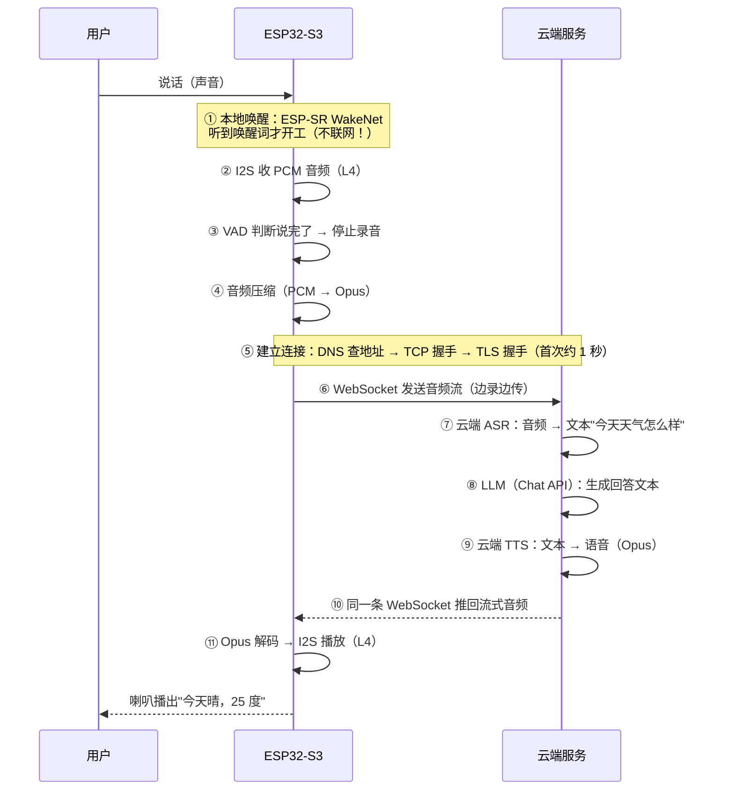
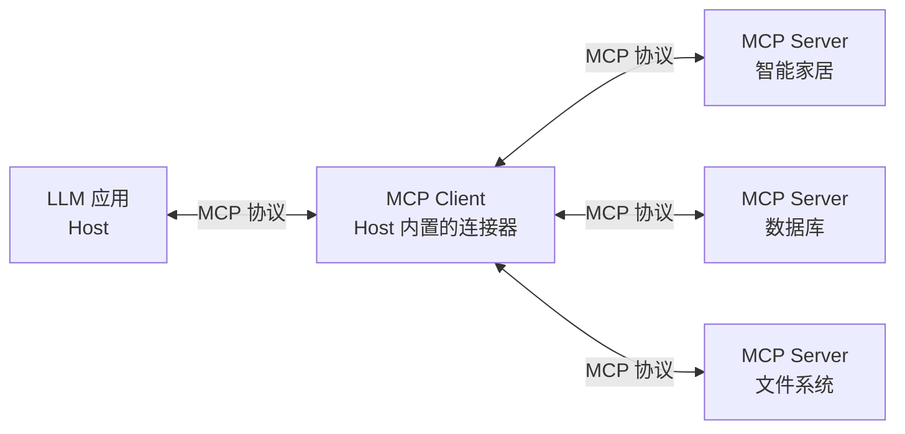
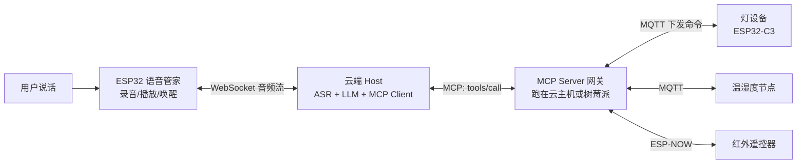
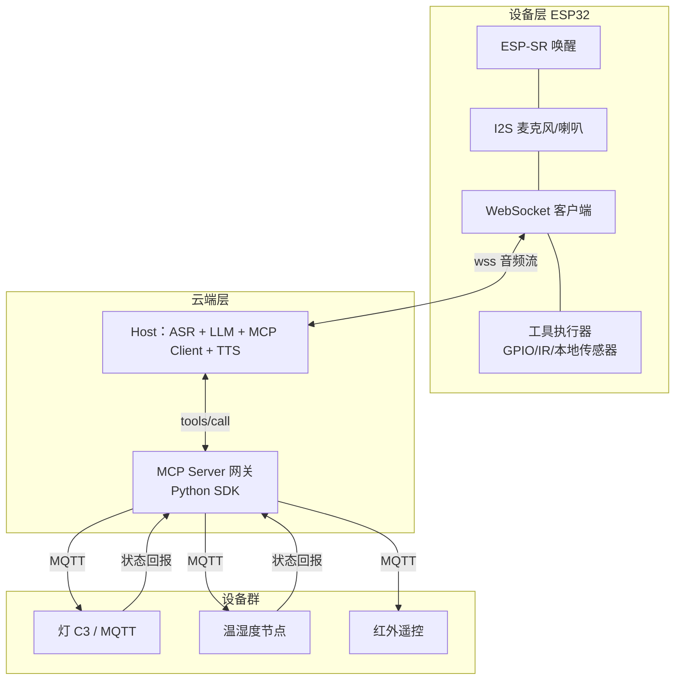

# 大项目实战：AI 语音管家（协议 · LLM · MCP）

前面各章的协议都是"单个单个"学的：lwIP 讲了 socket、esp-mqtt 讲了订阅发布、AI 章讲了 ESP-SR。这一章把它们**串成一台完整设备**，并且不止于"能聊天"——最终形态是一台**管家**：你对它说"把客厅灯调暗一点"，它听懂、思考、**真的去把灯调暗了**。这条路线上会经过所有的主流通信协议、LLM 的工具调用（Function Calling）、以及把"工具"标准化的新协议 **MCP（Model Context Protocol）**。

全章分上下两场：

- **上半场（第 0～7 节）**：协议基础 + 能对话的语音助手——每个协议回答"在这台设备里，它负责哪一段"
- **下半场（第 8～11 节）**：从"能聊"到"能做事"——Function Calling、MCP、全屋架构与实施计划

学完这章你会得到两张地图：**协议分层地图**（每个协议住在哪一层）和**端到端时序图**（一次对话从麦克风到喇叭的完整旅程）。

:::caution[前置知识]
本章假设你已读过：[I2S 与音频](../l4-peripherals/audio)（麦克风怎么进数据）、[lwIP 与网络栈](../l5-wireless/lwip)（socket 和 TCP）、[AI 能力](./ai)（ESP-SR 和推理的概念）。没读的先补，本章直接在这些之上盖楼。
:::

## 0. 协议分层地图：先找到每个协议的"楼层"

网络世界的协议是**分层的**——每层只管一件事，把上一层交给的东西往下递。像寄快递：你写内容（应用层），快递公司分拣（传输层），卡车走公路（物理层）——**每层只关心自己的活，互相不越界**。

```mermaid
flowchart TB
  subgraph 你的设备 ESP32-S3
    A[应用层：HTTP / WebSocket / MQTT<br/>装的是"话"] --> B[安全层：TLS<br/>把话装进保险箱]
  end
  B --> C[传输层：TCP / UDP<br/>保证包裹送到/不保证]
  C --> D[网络层：IP<br/>写清楚收件地址]
  D --> E[链路与物理：WiFi / 以太网<br/>真的把比特飞出去]
  subgraph 麦克风与喇叭专线
    F[I2S<br/>音频数据的专用通道]
  end
```

| 楼层 | 协议 | 一句话职责 | 在本项目里干什么 |
| --- | --- | --- | --- |
| 数据格式 | JSON / PCM / Opus | 装的内容长什么样 | 文本对话用 JSON，声音用音频编码 |
| 应用层 | HTTP / WebSocket / MQTT | 说话的"格式和礼节" | 调 LLM 接口、传音频 |
| 安全层 | TLS | 加密 + 验明对方身份 | 所有云端通信的保险箱 |
| 传输层 | TCP / UDP | 包裹送到不送到 | 对话用 TCP（要可靠） |
| 网络层 | IP / DHCP / DNS | 地址与门牌 | 拿 IP、查"服务器住在哪" |
| 链路/物理 | WiFi | 真正的无线传输 | L5 讲过 |
| 设备专线 | I2S | 麦克风/喇叭的数据通道 | L4 讲过 |

**读协议文档的能力 = 知道自己站在哪一层**。"连不上"可能是 WiFi 层的问题，也可能是 TLS 层的问题——分层定位是排错的第一步（每一层失败的现象不同，后面排查表里教你怎么分）。

## 1. 端到端时序图：一次语音对话的完整旅程

先看全景——用户问"今天天气怎么样"到听见回答，数据走了这一整条路：



**三件值得注意的事**，先标出来，后面每一步都会展开：

1. **唤醒在本地、对话在云端**——24 小时挂着的东西不能把所有声音都传云端（流量、隐私、延迟），所以唤醒词用 ESP-SR 在芯片上跑（[AI 章](./ai)），只有确认被唤醒后才联网
2. **一次对话 = 三个 AI 服务接力**：ASR（语音转文字）→ LLM（想回答）→ TTS（文字转语音）。每个都是一个网络 API 调用
3. **连接建立很贵，连接复用很关键**——第⑤步首次要 1 秒上下，所以整场对话走一条长连接（这就是选 WebSocket 而不是每句话一个 HTTP 请求的原因，第 4 节细讲）

## 2. TCP 与 UDP：为什么对话必须选 TCP

[lwIP 章](../l5-wireless/lwip)给过对比表，这里放到具体场景里检验：

| 需求 | TCP | UDP |
| --- | --- | --- |
| 音频流丢一小段？ | 重传补上（慢一点但完整） | 丢了就丢（咔哒一声） |
| 文本回答错一个字？ | 不可能错 | 可能错 |
| 连接管理 | 有连接、断线可感知 | 无连接、断了都不知道 |

对话场景**一句话错一个字就毁掉体验**，且设备需要"服务端说完了"这个明确信号——**TCP 的可靠和有连接正好匹配**。UDP 的舞台在"丢一点无所谓"的场合（直播、游戏、ESP-NOW 式快报）。**选型不是背表，是问"这段数据丢得起吗"**。

## 3. TLS：HTTPS 里那个 S

云端 API 的地址全是 `https://` 开头。TLS（Transport Layer Security）在 TCP 之上垫了一层，干两件事：

1. **加密**：中间路由器、运营商看到的全是密文——音频和对话内容谁都偷不走
2. **验明正身**：确认对面真是"那个服务器"而不是同一 WiFi 里的伪基站——靠**证书**（服务器出示由权威机构 CA 签名的"身份证"，设备用内置的根证书库验它，[L5 OTA 章](../l5-wireless/ota)配证书就是这套）

**TLS 的代价（必须知道）**：

| 代价 | 数量级 | 对策 |
| --- | --- | --- |
| 握手耗时 | 首次 0.5～2 秒（好几次往返） | 会话复用；**长连接别反复握手** |
| 内存占用 | 约 40KB+ | S3 的 512KB 内部 RAM 要给它留位置 |
| CPU | 加解密有开销 | 硬件加密加速器自动启用 |

**这就是"长连接"最重要的理由**：TLS 握手太贵，一次对话建一条连接、整场复用——协议选型的一半决策都源于这条。

## 4. HTTP、WebSocket、SSE、MQTT：应用层四兄弟

### 4.1 HTTP：一问一答的"自动售货机"

[lwIP 章](../l5-wireless/lwip)讲过 `esp_http_client`。HTTP 的模型：**客户端发请求，服务器给响应，然后（默认）各回各家**。适合"问一次拿一次"的场景——本项目里"把录好的音频发给 ASR"就可以用它。

### 4.2 WebSocket：接通就不挂的"对讲机"

HTTP 的"一问一答"在语音对话里不够用：**服务器想主动把音频推给你**（TTS 生成一段推一段），HTTP 只能靠设备反复去问（轮询，笨且慢）。**WebSocket** 在 HTTP 的基础上"升级"（握手时带个 `Upgrade: websocket` 头）成一条**双向长连接**——之后双方随时互发，没有"谁是发起方"的束缚。

```c
#include "esp_websocket_client.h"

esp_websocket_client_config_t ws_cfg = {
    .uri = "wss://api.example.com/voice",    // wss = WebSocket over TLS
};
esp_websocket_client_handle_t ws = esp_websocket_client_init(&ws_cfg);
esp_websocket_client_start(ws);              // 连上后就是一条双向管道

// 发音频块（对话过程中反复调用）
esp_websocket_client_send(ws, audio_chunk, chunk_len, portMAX_DELAY);

// 收服务端推来的消息：注册事件回调（又是回调模式）
// WEBSOCKET_EVENT_DATA 事件里拿数据，可能是 ASR 中间结果、LLM 回复、TTS 音频
```

**本项目选 WebSocket 的完整理由**：双向（音频上行 + 音频/文本下行）、长连接（TLS 只握手一次）、低延迟（不用每句重建连接）。

### 4.3 SSE：LLM 流式输出的标准答案

用过 ChatGPT 网页的人都知道：回答是**一个字一个字蹦出来的**。背后的协议是 **SSE（Server-Sent Events）**——服务器在一条 HTTP 连接上持续推送一行行的数据。LLM 的 Chat API（OpenAI 兼容格式，几乎所有大模型厂商都兼容）流式模式下，设备收到的是这样的内容：

```text
data: {"choices":[{"delta":{"content":"今天"}}]}

data: {"choices":[{"delta":{"content":"晴天"}}]}

data: {"choices":[{"delta":{"content":"，25 度"}}]}

data: [DONE]
```

每行 `data:` 是一段增量文本，拼起来就是完整回答。**SSE 和 WebSocket 怎么选**：SSE 是"服务器→设备"的单向流（简单，标准 HTTP 就能跑）；WebSocket 是双向流。文字对话用 SSE 就够，**语音对话因为音频要双向，通常整条走 WebSocket**。

### 4.4 MQTT：为什么对话不用它

[OTA 章](../l5-wireless/ota)和快速上手都用了 MQTT——它明明也是"双向"的，为什么对话不用？对比一下：

| | MQTT | WebSocket |
| --- | --- | --- |
| 消息形态 | 离散的小消息（一条条） | 连续字节流 |
| 适合 | 设备管理：状态上报、命令下发 | 媒体流：音频视频这种连续数据 |
| 中间人 | 必须 broker 转发 | 点对点直连 |

语音是**连续的流**（每秒几十个音频块），MQTT"一条条小消息"的模型既费（每条消息都有主题开销）又别扭。**分工惯例：MQTT 管设备生命周期（上线/命令/OTA 通知），WebSocket/HTTP 管数据面（音频、大文件）**。真实产品常常两条连接并存。

## 5. JSON：应用层的"普通话"

打开任何一个云 API 的文档，请求和响应几乎都是 JSON——**键值对组成的文本格式**，人类可读、所有语言都支持：

```json
{
  "model": "glm-4-flash",
  "messages": [
    {"role": "user", "content": "今天天气怎么样"}
  ],
  "stream": false
}
```

服务器的响应：

```json
{
  "choices": [
    {
      "message": {"role": "assistant", "content": "今天晴天，25 度。"},
      "finish_reason": "stop"
    }
  ]
}
```

读 JSON 的三步（L0 的结构体思维直接迁移）：**花括号是结构体、方括号是数组、键值对是字段**。上面请求读作：一个对象，有 model、messages（数组，每项是 role+content 的对象）、stream 三个字段。

固件里处理 JSON 用 IDF 自带的 **cJSON** 组件：

```c
#include "cJSON.h"

// 拼 JSON（发请求）
cJSON *root = cJSON_CreateObject();
cJSON_AddStringToObject(root, "model", "glm-4-flash");
cJSON *msgs = cJSON_AddArrayToObject(root, "messages");
cJSON *m = cJSON_CreateObject();
cJSON_AddStringToObject(m, "role", "user");
cJSON_AddStringToObject(m, "content", asr_text);      // ASR 识别出的文字
cJSON_AddItemToArray(msgs, m);
char *body = cJSON_PrintUnformatted(root);            // 转成可发送的字符串
// ... POST 出去 ...
cJSON_Delete(root);
cJSON_free(body);

// 解 JSON（收响应）
cJSON *resp = cJSON_Parse(recv_buf);
const char *answer = cJSON_GetObjectItem(
        cJSON_GetObjectItem(cJSON_GetArrayItem(
            cJSON_GetObjectItem(resp, "choices"), 0), "message"), "content")->valuestring;
```

嵌套深是 JSON 的常态——**一层一层往下取，每层都判空**（`cJSON_GetObjectItem` 可能返回 NULL，网络数据不可信）。

## 6. 音频编码：PCM 太肥，上 Opus

[L4 音频章](../l4-peripherals/audio)算过账：16kHz × 16bit 单声道 = 每秒 32KB。裸 PCM 直传，一分钟对话 2MB 上行——4G/WiFi 都嫌浪费。**音频编码（压缩）**解决它：

| 格式 | 压缩后码率 | 特点 | 场景 |
| --- | --- | --- | --- |
| PCM（原始） | 256 kbps | 无损、巨大 | 本机处理、短录音 |
| **Opus** | 16～32 kbps | 语音最佳、开源自带 | **语音对话标准选择** |
| AAC / MP3 | 32～128 kbps | 音乐向 | 播放 |
| G.711 | 64 kbps | 古老电话标准 | 兼容老系统 |

Opus 把 256kbps 压到 24kbps 左右，**音质对语音几乎无损**——十倍流量省下来。设备端用 `esp_audio_codec` 组件编解码（[AI 章](./ai)生态表里那个"音频工具"）：

```bash
idf.py add-dependency "espressif/esp_audio_codec"
```

**理解编码的取舍**：压缩率越高，编解码越吃 CPU、延迟越大。语音对话的音频块通常 20～60ms 一块——太小了编码效率低，太大了延迟可感。

## 7. 分阶段实战：怎么把这台设备做出来

一口气做完必挂。按下面的顺序**每阶段独立可验证**：

### 阶段一：录 3 秒 → 传 ASR → 拿到文字（跑通"听"）

- I2S 录 3 秒 PCM（[L4 代码](../l4-peripherals/audio)），存 PSRAM（约 96KB，装得下）
- 不压缩先跑通：直接把 PCM POST 到 ASR 服务的 HTTP 接口（multipart 或裸二进制，看服务文档）
- 解析返回的 JSON 拿到文字，串口打印

**验证标准**：串口能打印出你说的那句话。这一步打通了 TLS、HTTP、JSON、音频采集四大块。

### 阶段二：文字 → LLM → 回答（跑通"想"）

```c
// 阶段一的 asr_text 交给 LLM（OpenAI 兼容 Chat API）
// POST https://xxx/v1/chat/completions
// 请求体就是第 5 节那段 JSON；响应 choices[0].message.content 就是回答
```

- 用 `esp_http_client` POST，`Authorization: Bearer <你的key>` 头带上密钥
- **密钥别硬编码**（[L7 项目规范](../l7-engineering/project-template)）：Kconfig 输入或 NVS
- 多轮对话：把之前的对话也塞进 `messages` 数组（LLM 本身无记忆，靠你每次把历史带上）

**验证标准**：串口打印出 LLM 的回答。

### 阶段三：语音回复 + 流式（跑通"说"）

- 回答文本 → TTS API → 拿回音频（Opus）→ 解码 → I2S 播放
- 进阶：ASR 换成 WebSocket 流式（边说边传边识别）、LLM 开 stream、TTS 分段播——**首字延迟从"整段完成"的 5 秒压到 1 秒级**
- 本地唤醒（ESP-SR WakeNet）接上，按键换成语音唤醒

**内存预算**（S3 上实测量级）：TLS 约 40KB、音频缓冲 100～300KB、Opus 编解码几十 KB、JSON 和业务逻辑几十 KB——**512KB 内部 RAM 要精打细算，大缓冲全推 PSRAM**（[L0 内存模型](../l0-basics/embedded-model)的功力在这里兑现）。

## 8. 从"能聊"到"能做事"：Function Calling

到目前为止，LLM 只会"说话"。管家和聊天的区别是**能动手**——你说"把客厅灯调暗"，它得真的去控制那盏灯。但 LLM 是跑在云端机房的文本机器，**它没有手**。它能动手的唯一方式：**告诉你"帮我执行 XX"，你来执行，再把结果告诉它**。这套约定就是 **Function Calling（函数调用，也叫 Tool Use）**。

### 8.1 一次工具调用的完整回合

分四步（对照下面的真实报文读）：

1. **注册**：请求 LLM 时，随问题一起附上"我这里有哪些工具可调"（名称、用途说明、参数格式）
2. **决策**：LLM 判断"这个问题需要开灯"，**不直接回答**，而是返回一个"调用请求"：请调 `control_light`，参数 `{"room":"客厅","brightness":30}`
3. **执行**：**你的固件**（不是 LLM）收到后，真的去控制灯——MQTT 下发、GPIO 拉低……
4. **回传**：把执行结果（"成功"）作为新消息再发给 LLM，它这才生成给用户听的话："好的，客厅灯已调暗。"

```json
// 第 1 步：请求里带工具清单
{
  "model": "glm-4-flash",
  "messages": [{"role": "user", "content": "把客厅灯调暗一点"}],
  "tools": [{
    "type": "function",
    "function": {
      "name": "control_light",
      "description": "控制家里某盏灯的开关和亮度",
      "parameters": {
        "type": "object",
        "properties": {
          "room":       {"type": "string", "description": "房间名"},
          "on":         {"type": "boolean", "description": "开还是关"},
          "brightness": {"type": "integer", "description": "亮度 0-100"}
        },
        "required": ["room"]
      }
    }
  }]
}
```

```json
// 第 2 步：LLM 返回的"调用请求"（不直接回答）
{
  "choices": [{
    "message": {
      "role": "assistant",
      "tool_calls": [{
        "id": "call_001",
        "type": "function",
        "function": {
          "name": "control_light",
          "arguments": "{\"room\": \"客厅\", \"on\": true, \"brightness\": 30}"
        }
      }]
    },
    "finish_reason": "tool_calls"
  }]
}
```

```json
// 第 4 步：固件执行后，把结果作为对话历史的一部分回传
{
  "messages": [
    {"role": "user", "content": "把客厅灯调暗一点"},
    {"role": "assistant", "tool_calls": [ /* 上面第 2 步原样带回 */ ]},
    {"role": "tool", "tool_call_id": "call_001", "content": "success: 客厅灯亮度已设为 30"}
  ],
  "tools": [ /* 工具清单同样要带上 */ ]
}
// LLM 这次的响应就是给用户听的话："好的，客厅灯已调暗。"
```

**三个关键认知**：

- **工具的"参数格式"用 JSON Schema 描述**——`description` 字段写得越清楚，LLM 用得越准。写工具说明书是"给 AI 看的文档"，值得认真写
- **`arguments` 是个 JSON 字符串**（不是对象）——固件里要二次解析（cJSON_Parse 它）
- **LLM 只出主意，动手的永远是你**——安全边界也在这：设备端必须校验参数范围（brightness 传 9999？夹住），高危操作要二次确认

### 8.2 设备端的执行框架

固件侧用一个"工具注册表"把代码组织干净（又是回调模式的变体）：

```c
typedef struct {
    const char *name;                       // 和注册给 LLM 的名字一致
    esp_err_t (*handler)(cJSON *args, char *out, size_t out_len);  // 执行并产出结果文本
} tool_def_t;

static const tool_def_t s_tools[] = {
    { "control_light",  tool_control_light },
    { "read_sensor",    tool_read_sensor },
    { "play_music",     tool_play_music },
};

// LLM 返回 tool_calls 时：
// 1. cJSON 解析 function.name 和 arguments
// 2. 在 s_tools 里按名字找到 handler，执行
// 3. 把 handler 的输出包成 role:"tool" 消息回传 LLM
```

**新增一个能力 = 写一个 handler + 在请求的 tools 数组里加一项描述**——业务能力和对话能力解耦了。

## 9. MCP：把"工具"变成行业标准

### 9.1 Function Calling 的麻烦，和 MCP 的解法

上一节的方案有个问题：**每家 LLM 的工具调用格式都不完全一样**（参数结构、返回字段有差异），而且你的工具只对"这一个固件"有意义——换一家模型、加一个设备，接入代码全部重写。工具越多，这种"每个应用 × 每个工具"的组合爆炸越难受（老问题：M×N 问题）。

**MCP（Model Context Protocol，模型上下文协议）**是 2024 年底开放的标准协议，思路是把"工具"从具体应用里抽出来，**标准化地挂在一个独立的服务上**：



- **Host**：跑 LLM 的应用（Claude 桌面版、你写的语音管家的云端部分）
- **MCP Server**：一个专门"提供工具"的服务——它可以管智能家居、可以查数据库、可以操作文件。**任何人都可以写一个 Server 接进任何 Host**
- **协议本身**：基于 **JSON-RPC 2.0**（一个极简的"方法名 + 参数 + 结果"调用格式）——你在这章学的 JSON 终于 all-in 了

M×N 变成 M+N：工具开发者只管写 MCP Server（一份），LLM 应用只管实现 MCP Client（一份），两边自由组合。

### 9.2 MCP Server 提供什么：三类能力

| 能力 | 谁来触发 | 例 |
| --- | --- | --- |
| **Tools（工具）** | **LLM 决定调用**（就是 Function Calling 的标准化） | `control_light`、`query_weather` |
| Resources（资源） | 应用读取的上下文数据 | 设备配置文件、传感器历史 |
| Prompts（提示模板） | 用户选择的预设 | "帮我做一份日报" |

对管家项目，**Tools 是主角**。一个 MCP Server 会声明：

```json
{
  "name": "home_control",
  "tools": [{
    "name": "control_light",
    "description": "控制某盏灯的开关和亮度",
    "inputSchema": {
      "type": "object",
      "properties": {
        "room": {"type": "string"},
        "brightness": {"type": "integer"}
      }
    }
  }]
}
```

对比第 8 节 Function Calling 的注册报文——**结构几乎一样**。MCP 做的就是把这套描述标准化，加上"工具谁来执行、执行结果怎么回去"的统一流程。

### 9.3 MCP 的消息长什么样：JSON-RPC 2.0

MCP 走 **JSON-RPC 2.0**：每条消息要么是"请求"（带 id，等回应），要么是"通知"（无 id，发完就算）。管家场景里 Host 和 Server 之间最核心的三段对话：

```text
① 握手（连接建立时）：
→ {"jsonrpc":"2.0","id":1,"method":"initialize",
    "params":{"protocolVersion":"2025-06-18","capabilities":{},"clientInfo":{"name":"voice-butler"}}}
← {"jsonrpc":"2.0","id":1,"result":{"protocolVersion":"2025-06-18",
    "serverInfo":{"name":"home_control"}}}

② 查有哪些工具：
→ {"jsonrpc":"2.0","id":2,"method":"tools/list"}
← {"jsonrpc":"2.0","id":2,"result":{"tools":[
     {"name":"control_light","description":"控制某盏灯","inputSchema":{...}},
     {"name":"read_sensor","description":"读某房间温湿度","inputSchema":{...}} ]}}

③ 调用工具（LLM 决定后由 Host 发起）：
→ {"jsonrpc":"2.0","id":3,"method":"tools/call",
    "params":{"name":"control_light","arguments":{"room":"客厅","brightness":30}}}
← {"jsonrpc":"2.0","id":3,"result":{"content":[{"type":"text","text":"success: 亮度已设为 30"}]}}
```

**读法**：`method` 是要调的动作名，`params` 是参数，`id` 把请求和响应配对，出错时响应里是 `error` 而不是 `result`。整章学的 JSON 功力 + [L0 的结构体思维](../l0-basics/c-language)，读协议报文就是这么直接。

### 9.4 Server 和设备怎么连：传输层与 ESP32 的现实姿势

MCP 规定了传输方式（消息怎么在 Client 和 Server 之间跑）：

| 传输 | 场景 | 说明 |
| --- | --- | --- |
| **stdio（标准输入输出）** | 本机进程 | Claude 桌面版启动本地 Server 子进程，走管道 |
| **Streamable HTTP** | 远程服务 | HTTP 传输 + 可选流式返回，适合云上 Server |

**ESP32 自己要不要直接讲 MCP 协议？** 现实里通常不用——官方 SDK（Python/TypeScript）跑在"有余力"的机器上。管家的标准姿势是加一个**网关层**：



- **MCP Server 跑在网关**（一台云主机或树莓派，用官方 Python SDK 写，几十行）：它对上把 `control_light` 暴露给 LLM，对下把命令翻译成 MQTT 消息发给真正的设备
- **ESP32 设备只讲自己熟悉的协议**（MQTT/ESP-NOW）：收到"亮度 30"就执行，回个状态
- **你的语音管家 ESP32** 也不直接讲 MCP——它和云端 Host 之间还是第 4 节那套 WebSocket 音频流

**层次清晰了**：ESP32 管感知和执行，网关管协议翻译，云端管思考。每层用最顺手的协议，MCP 把"工具"这一层标准化。

### 9.5 MCP 生态与延伸

- 官方维护着一批现成 MCP Server（文件系统、Git、数据库、浏览器……），写你自己的可以用官方 SDK（Python 的 `mcp` 包、TypeScript 的 `@modelcontextprotocol/sdk`）
- 同一套思路的近亲：**Agent（智能体）循环**——LLM 调工具 → 看结果 → 再决定调下一个 → 直到任务完成。管家的进阶玩法（"把卧室弄暖和点"= 查温度 → 开空调 → 等 10 分钟 → 再查）就是这个循环
- 再往后还有 RAG（检索增强：把私有文档喂给 LLM 引用）——超出本项目范围，知道有这东西、知道它也走"应用层协议 + JSON"就够

## 10. 大项目总体架构与分工

把上下两场拼起来，AI 语音管家的完整架构：



| 层 | 职责 | 用到的协议 |
| --- | --- | --- |
| ESP32 语音管家 | 唤醒、录音、播放、执行本地工具 | I2S、WebSocket/TLS |
| 云端 Host | ASR/LLM/TTS、决定调用什么工具 | HTTPS、SSE、MCP Client |
| MCP 网关 | 工具的标准化提供方，翻译命令 | MCP（JSON-RPC over Streamable HTTP） |
| 设备群 | 真正执行动作的各节点 | MQTT / ESP-NOW |

**这个架构里每一层都能独立测试**——网关可以先用 curl 模拟 tools/call；Host 可以先用文字输入代替语音；设备群可以先用一个假节点应答。**大项目的工期 80% 花在"打通"而不是"写功能"上，分层验证就是保命符。**

## 11. 实施计划与验收标准

| 阶段 | 内容 | 验收标准 | 预计 |
| --- | --- | --- | --- |
| 1 | 单件对话（第 7 节的三阶段） | 说话 → 听到 AI 回答，全程 < 5 秒 | 1～2 周 |
| 2 | Function Calling 单机版 | "把灯调暗"→ 本机 LED 真变暗；参数越界被夹住 | 1 周 |
| 3 | MCP 网关 | curl 模拟 tools/call 能控制网关侧的假设备；tools/list 返回完整清单 | 1～2 周 |
| 4 | 接入真实设备群 | 至少 2 种设备（MQTT 灯 + ESP-NOW 红外）经网关被语音控制 | 2 周 |
| 5 | 产品化收尾 | OTA 升级一次成功；断网时语音功能降级但设备可控；连续运行 48 小时 | 1～2 周 |

**最终验收清单**：

- [ ] 说"把客厅灯调暗一点"，灯在 3 秒内变化，且回答播报确认
- [ ] 说"卧室现在多少度"，回答的是真实传感器读数（不是 LLM 编的）
- [ ] 工具参数越界（brightness 传 9999）被设备端校验拦截
- [ ] 拔掉一台子设备，管家提示"设备离线"而不是卡死
- [ ] 整条链路（设备→网关→LLM）重启后自动恢复，无需人工干预
- [ ] 能向别人画完整架构图并解释每一跳用的协议和原因

**这个项目覆盖了全教程的主干**：C 语言与结构体思维（L0）、任务划分（L2）、I2S 音频（L4）、WiFi 与长连接（L5）、JSON 与 TLS（本章）、AI 推理（L6）、工程纪律（L7）。做完它，你就能对"嵌入式 IoT + AI 应用"的完整技术栈拍胸脯了。

## 12. 排错：分层定位法

对话不通时，**先判断死在哪一层**——每层的故障指纹不同：

| 层 | 故障指纹 | 工具/方法 |
| --- | --- | --- |
| WiFi/网络层 | 拿不到 IP；ping 不通 | [L5 WiFi 排查](../l5-wireless/wifi)；看 IP 事件 |
| DNS 层 | `gethostbyname` 失败 | 换 IP 直连试试，通 = DNS 问题 |
| TCP 层 | connect 返回 -1、errno 113/110 | 检查端口、防火墙；服务器起没起 |
| TLS 层 | 握手报证书错误 | 时间没同步（证书有效期校验失败）！先 SNTP 对时 |
| HTTP/WS 层 | 401/403/404 | 密钥头没带对、URL 路径错、API 版本不对 |
| JSON 层 | 解析返回 NULL | `cJSON_GetErrorPtr()` 定位；打印原始响应肉眼看 |
| 工具调用层 | finish_reason 不是 tool_calls 却没回答；arguments 解析失败 | 检查 tools 描述是否清晰（description 是给 LLM 看的）；arguments 是字符串要二次解析 |
| MCP 层 | tools/list 空、tools/call 报 error | initialize 握手没完成就调了；协议版本不匹配；Server 日志 |
| 设备执行层 | 命令下了设备没反应 | MQTT 在线状态/QoS；网关和设备的 topic 对不上；ESP-NOW 信道 |

**最常见的三个坑**提前打预防针：① TLS 握手失败十有八九是**系统时间不对**（证书有效期校验失败）——联网后先 SNTP 对时再 HTTPS；② 服务器返回的 JSON 层级和你猜的不一样——**先把原始响应完整打印出来**再写解析；③ WebSocket 事件回调里做重活——回调里只发队列，[L2 的铁律](../l2-programming-model/freertos)在哪都适用。

## 下一步

本章本身就是一个可以写进简历的大项目（实施计划见第 11 节）。做完后去 [毕业项目](../l7-engineering/capstones)——项目二"智能语音感知终端"正好以这台管家为骨架扩展。