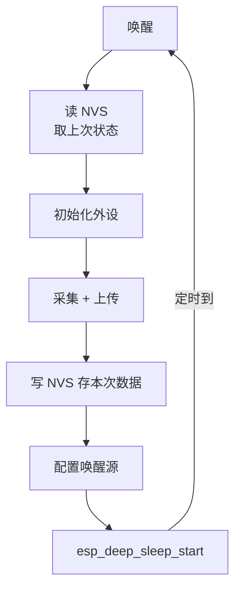

# 功耗管理

设备插着电源时不用管功耗；**电池供电时，功耗就是一切**——它直接决定"多久充一次电"，而"多久充一次电"直接决定产品有没有人愿意用。

先认识单位，本章的计算全靠它们：

| 单位 | 意思 | 类比 |
| --- | --- | --- |
| mA / µA（毫安 / 微安） | 此刻的"耗电速度"。1mA = 1000µA | 水流速度 |
| mAh（毫安时） | 电池的"存水量"。1000mAh = 以 1mA 放 1000 小时 | 水桶容量 |
| 续航 | 水桶容量 ÷ 平均水流速度 | |

**核心公式只有一个**：`续航 = 电池容量 × 0.8 ÷ 平均电流`。0.8 是安全系数（电压转换损耗、电池自放电、老化）。

## 1. 先算账，再优化

做低功耗之前，先算清楚需要多少续航，再倒推"平均电流必须压到多少"：

| 平均电流 | CR2032 纽扣电池（220mAh） | 锂聚合物 500mAh | 18650（2600mAh） |
| --- | --- | --- | --- |
| 50 µA | 约 5 个月 | 约 11 个月 | 约 4.8 年 |
| 200 µA | 约 1.2 个月 | 约 2.8 个月 | 约 14 个月 |
| 5 mA | 约 1.5 天 | 约 3.3 天 | 约 17 天 |
| 50 mA | 约 3.5 小时 | 约 8 小时 | 约 1.7 天 |

（按 `容量 × 0.8 ÷ 平均电流` 计算，未计 WiFi/蓝牙发射的瞬时峰值。）

这张表能告诉你两个残酷事实：

1. **"一直开着"在电池上活不了多久**——哪怕只有 5mA 平均电流，18650 也撑不过三周。想用几个月，平均电流必须压到百微安级，唯一的办法是"深睡眠 + 定时醒来干活"（本章第 3 节）
2. **WiFi/蓝牙的发射瞬间要 100～500mA**，比平均电流高几个数量级。平均电流是"高峰和睡眠加权平均"的结果，所以"睡眠够深、醒着够短"比"醒着的时候省一点"重要得多

**低功耗设计的正确顺序**：定续航目标 → 算允许的平均电流 → 决定睡眠策略 → 测量验证。跳过第一步直接"优化"，往往在错误的层面抠 1µA。

## 2. 运行中的省电：esp_pm

设备"醒着"的阶段也有省电手段——**动态频率 + 自动浅睡**：

```c
#include "esp_pm.h"

#if CONFIG_FREERTOS_USE_TICKLESS_IDLE     // menuconfig 里先开 tickless idle
    esp_pm_config_t pm = {
        .max_freq_mhz       = 240,
        .min_freq_mhz       = 40,           // 没活干时降到 40MHz（省电约 5 倍）
        .light_sleep_enable = true,         // ★ 空闲时自动进 Light Sleep
    };
    ESP_ERROR_CHECK(esp_pm_configure(&pm));
#endif
```

开了 tickless idle 后，CPU 空闲时自动降频甚至进 Light Sleep。代价是唤醒有延迟、外设时序可能受影响——所以叫"免费但有代价的省电"。**联网常态的设备（充电款）开它就够了；电池款还得靠深睡眠。**

其他运行期省电手段：

| 手段 | 效果 |
| --- | --- |
| 关掉 LED（电源指示灯常亮能吃 1mA） | 很大——1mA 就够把 500mAh 电池的续航砍半 |
| 用 GPIO 切断外设电源（load switch） | 传感器常开能吃几 mA |
| 减少日志输出 | 串口每个字节都是电 |
| 降低主频 | 性能换电 |

## 3. 三种睡眠模式

| 模式 | 电流 | 唤醒时间 | 内存保留 | 唤醒源 |
| --- | --- | --- | --- | --- |
| Modem Sleep | mA 级 | 快 | 全保留 | WiFi 活动 |
| Light Sleep | ~100µA | 1ms 以内 | 全保留 | GPIO、UART、定时器 |
| Deep Sleep | ~10µA | ~250ms（唤醒后要重跑初始化） | **只剩 RTC 域** | GPIO（限 RTC 脚）、定时器、触摸 |

**Deep Sleep 的机理**：断掉 CPU、内存、绝大多数外设的电源，只留"RTC 域"（一个小的常电区）维持定时器和少量记忆——相当于设备"假死"，醒来等于重新上电、从头跑 app_main。

**Deep Sleep 只有 RTC 域引脚能唤醒**（S3 上是 GPIO0～21 的一部分）——这是最常踩的坑：把唤醒按键接到 GPIO35 想当然，实际根本唤不醒。**这个范围也是按型号变的**：经典 ESP32 是 0/2/4/12-15/25-27/32-39，C3 只有 GPIO0～5——换型号先查[移植指南](../../reference/porting)。

```c
#include "esp_sleep.h"

// 配置唤醒源（睡前配置）
esp_sleep_enable_ext0_wakeup(GPIO_NUM_0, 0);              // GPIO0 低电平唤醒
esp_sleep_enable_ext1_wakeup(BIT(1) | BIT(5), ESP_EXT1_WAKEUP_ANY_LOW);
esp_sleep_enable_timer_wakeup(60ULL * 1000000ULL);        // 60 秒定时唤醒（单位微秒）
esp_sleep_enable_touch_wakeup();                          // 电容触摸唤醒（L4 的触摸）

// 进睡（这行之后程序不再执行——唤醒后从 app_main 重新开始）
esp_deep_sleep_start();
```

## 4. 数据持久化：深睡眠的关键

深睡眠会丢掉普通 RAM——**"睡前的状态"必须存下来，醒来才接得上**：

⚠️ RTC 内存（`RTC_SLOW_ATTR` 标记的变量）虽然睡后保留，但只有几 KB 且不可靠，只放"唤醒次数"这种小计数：

```c
static RTC_SLOW_ATTR int wake_count = 0;   // 深睡眠后还在（但别放重要数据）
```

**正规做法是进睡眠前把数据写进 NVS**（[上一章](./storage)）：

```c
// 睡眠前
nvs_set_u32(h, "sample_count", count);
nvs_commit(h);
esp_deep_sleep_start();

// 唤醒后（app_main 里）
nvs_get_u32(h, "sample_count", &count);    // 接上睡前的状态
```

## 5. 一个完整的低功耗项目模板

周期上报设备的完整骨架——"醒、干、存、睡"四拍：



```c
void app_main(void) {
    nvs_flash_init();
    nvs_handle_t h; nvs_open("app", NVS_READWRITE, &h);

    // 1. 接上前世
    uint32_t count = 0;
    nvs_get_u32(h, "count", &count);
    ESP_LOGI(TAG, "第 %lu 次唤醒", (unsigned long)count);

    // 2. 干活：采集 + 上传
    init_sensor();
    float v = read_voltage();
    publish_to_cloud(v);              // 连网 + 发送 + 断开

    // 3. 存今生
    count++;
    nvs_set_u32(h, "count", count);
    nvs_commit(h);
    nvs_close(h);

    // 4. 睡
    esp_sleep_enable_timer_wakeup(300ULL * 1000000ULL);    // 5 分钟
    esp_deep_sleep_start();
}
```

**每次唤醒约 3～5 秒**（重连 WiFi + TLS + 发送），5 分钟一次的话，一天 288 次唤醒 × 4 秒 ≈ 19 分钟醒着——占空比 1.3%，平均电流被压到百微安级，电池能撑几个月。**把这段骨架跑通，你就掌握了低功耗设计的核心模式。**

## 6. 测量：不测就是瞎猜

优化前后都要测：

```c
// 软件侧：打印各睡眠状态的时间统计
#include "esp_pm.h"
esp_pm_dump_locks(stdout);       // 看是谁"锁着"不让睡觉（电源锁）
```

外部测量：

| 工具 | 测什么 |
| --- | --- |
| USB 电流表（十几块） | 粗看运行/睡眠的电流档位 |
| 万用表 µA 档串联 | 睡眠电流的精确值（µA 级要四位半表） |
| 电流波形仪 / 功耗分析仪 | 完整的"醒睡波形"——优化利器 |

**常见测量陷阱**：睡眠电流测出来几 mA 而不是 10µA？——逐个排查：LED 没关、某个传感器没断电、上拉电阻在往地漏电、没真正进深睡（某个 esp_pm 锁挂着）。

## 7. 常见陷阱

| 陷阱 | 表现 |
| --- | --- |
| 唤醒源接到非 RTC 引脚 | 永远不唤醒 |
| 深睡眠里没保存数据 | 唤醒后数据全丢、从头再来 |
| 唤醒后立刻又睡 | 没等外设稳定，采集到无效值 |
| 电源指示灯一直亮 | 续航算错一个数量级 |
| RTC_SLOW_ATTR 存太多 | RTC 内存就那么点，链接失败 |
| 忘了 WiFi 的"善后" | 上传完没断开/没关射频，电流降不下去 |
| 电流表测不准 µA | 表的量程/精度不够，或没串进主回路 |

## 下一步

[安全](./security)