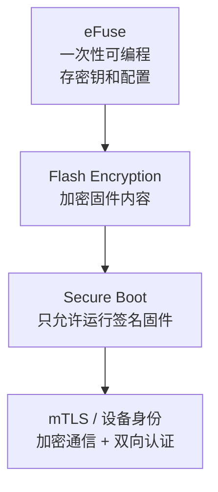

# 安全

IoT 设备被攻破的后果通常很严重：被当作 DDoS 跳板、被刷固件变成后门、用户数据被窃。安全能力在 ESP32 上是硬件级的，这是它相对低成本 MCU 的优势。

**先想清楚你的威胁模型（防谁）**——安全措施都有代价，别无脑全开：

| 你担心 | 该上 | 代价 |
| --- | --- | --- |
| 固件被抄（竞品拆机读固件） | Flash 加密 | 烧写 eFuse，不可逆，调试变麻烦 |
| 设备被刷恶意固件 | Secure Boot | 同上 + 启动变慢 |
| 通信被窃听/伪造 | TLS/mTLS | 握手耗几百毫秒，占内存 |
| 都不担心（比赛原型） | 什么都不用开，本章当知识储备读 | 0 |

**比赛原型一章都不用开**——但这一章的价值在"知道产品化时该做什么、怎么做"，以及"不把比赛习惯（密码硬编码）带进产品"。

## 1. 四层防护



| 层 | 防什么 | 一句话 |
| --- | --- | --- |
| Flash Encryption | 别人读不出你的固件 | 拆机读 Flash 拿到的是密文 |
| Secure Boot | 别人刷不进恶意固件 | 固件必须有你签的名才能启动 |
| 固件签名 | OTA 被推恶意固件 | （上一章讲过，同属这套体系） |
| mTLS | 通信被窃听/伪造 | 每台设备有身份证，双向验证 |

## 2. Flash 加密

把 Flash 里的内容用 AES 加密，芯片上电后由硬件自动解密执行。没有密钥就读不出任何东西——**拆机把 Flash 芯片抠下来接到编程器上，读到的全是密文**。

```bash
idf.py menuconfig
# Security features → Enable flash encryption on boot  → ENABLE
# Security features → Flash encryption mode          → Development（调试）/ Release（量产）
```

注意：

- 启用后 eFuse 会被烧写，**不可逆**
- 开发调试阶段用 Development mode，可以反复烧录不用重烧 eFuse
- 量产前一定要切换到 Release mode（Development 模式下密钥可以明文重烧 = 防君子不防小人）

## 3. Secure Boot v2

Secure Boot 解决"固件真实性"：bootloader 启动 app 前**验签**——固件必须用你的私钥签过，验签不过拒绝启动。别人即使物理接触设备，也刷不进自己的固件。

```bash
idf.py menuconfig
# Security features → Enable Secure Boot on boot  → ENABLE
# Security features → Secure Boot mode            → Release Mode（量产）

# 生成签名密钥
espsecure.py generate_signing_key --version 2 --keyfile secure_boot_signing_key.pem
```

之后每次编译都会自动对 app 和 bootloader 签名。

Secure Boot 的代价：每次启动多花几十毫秒验签，bootloader 增大约 20KB。

⚠️ **一旦在 eFuse 里烧了 Secure Boot，就再也不能烧未签名的固件**。调试阶段务必用 Development mode，量产前再彻底开。

## 4. eFuse：一次性存储

**eFuse（电子熔丝）**是芯片里一组"只能从 0 改成 1、永远改不回去"的开关位。芯片用它永久记住"加密开了没有、Secure Boot 开了没有、我的 MAC 是多少"。

查看当前 eFuse 状态用 `espefuse.py`（读操作随便做）：

```bash
espefuse.py --port COM5 summary        # 列出所有 eFuse 位的状态
```

**写操作（`burn_efuse`）是烧熔丝，不可逆**，本教程不给出具体烧写命令——调试阶段你不需要写任何 eFuse；等真要做量产安全时，照官方文档《Flash Encryption》《Secure Boot v2》的步骤逐条执行。

常用 eFuse 字段（读 summary 时会对上号）：

| 字段 | 用途 |
| --- | --- |
| `MAC_ADDR` | 芯片 MAC（出厂烧） |
| `FLASH_CRYPT_CONFIG` | Flash 加密开关 |
| `SECURE_BOOT_ENABLE` | Secure Boot 永久启用 |
| `CUSTOM_MAC` | 自定义 MAC 地址 |

:::danger[eFuse 操作不可逆]
读操作随便做，**写操作只有一次机会**，写错就是永久损坏。所有 eFuse 写入命令必须逐字对照官方文档确认。
:::

## 5. mTLS：设备身份与双向认证

TLS 是"浏览器验证服务器"（单向）；**mTLS**（mutual TLS）是双向的——服务器也要求设备出示"身份证"。给每台设备签发独立证书，双方互相验证：

```c
extern const uint8_t ca_pem_start[]     asm("_binary_ca_cert_pem_start");
extern const uint8_t client_pem_start[] asm("_binary_client_cert_pem_start");
extern const uint8_t client_key_start[] asm("_binary_client_key_pem_start");

esp_http_client_config_t http = {
    .url            = "https://api.example.com",
    .crt_bundle_attach = esp_crt_bundle_attach,        // 验服务器（内置根证书库）
    .client_cert_pem  = (const char *)client_pem_start, // 设备的身份证
    .client_key_pem   = (const char *)client_key_start, // 对应的私钥
};
```

**为什么每台设备要独立证书（不要一张证书发全家）**：

- 单独吊销某台设备的证书（一台丢了不影响其他）
- 审计日志能追溯到具体设备
- 一台泄露不影响其他设备

**证书私钥是设备最重要的资产**——存哪？答案是配合 Flash 加密：私钥存在加密的 Flash 里，拆机也读不出明文。要求更高的场合用 eFuse 存的密钥做加密（软件永远摸不到密钥）。

## 6. 最容易被忽视的安全基本功

硬件级安全之外，这几点更常出事：

| 项 | 做法 |
| --- | --- |
| 密码/token 不硬编码 | 用 Kconfig 输入或 NVS 存储（比赛作品里"WiFi 密码写在代码里"是常态，产品里是事故） |
| 调试口锁定 | 量产设备关掉日志串口的敏感输出（日志里别打印密码） |
| OTA 域名白名单 | 只允许连特定域名升级 |
| 默认密码必须改 | AP 配网的默认密码、web 界面默认密码——第一次使用强制修改 |
| 敏感数据 | 用 NVS + Flash 加密，或干脆不落盘 |

## 7. 常见问题

| 问题 | 说明 |
| --- | --- |
| 开了 Release mode 后烧不进去 | 正常，需要签名的固件 |
| Flash 加密后固件变大 | 有头部开销（～100 字节/分区） |
| mTLS 握手失败 | 系统时间没校准（证书有效期检查失败）——先 SNTP 对时再连 |
| Secure Boot 启动变慢 | 验签开销，正常 |
| 想重新开始 | eFuse 不可逆，只能换芯片——这就是"调试期用 Development mode"的原因 |

## 下一步

[USB](./usb)