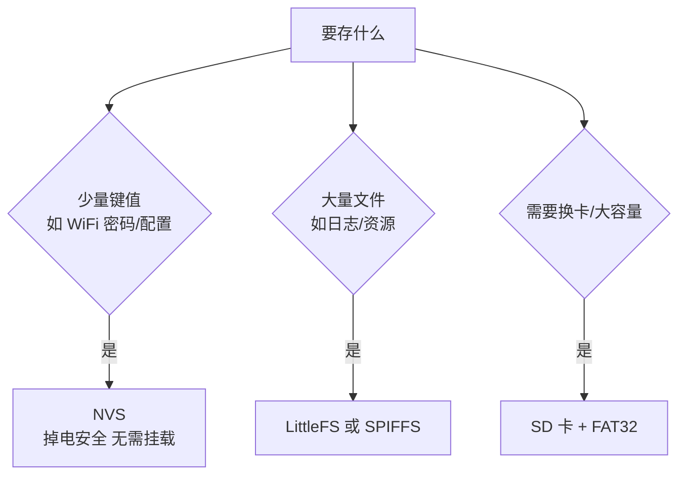

# 存储

这一章回答"数据放哪、断电丢不丢、Flash 会不会被写坏"。

先建立直觉：设备的存储需求其实分两档，对应两套完全不同的工具——

- **几条配置**（WiFi 密码、阈值、上次状态）：用 **NVS**。它是 Flash 上的一个小型键值数据库，掉电安全、写坏一半也能恢复，是"记事贴"
- **成百上千条记录**（日志、缓存、离线数据）：用**文件系统**（LittleFS）或 SD 卡。它是"笔记本"，能按文件组织大量内容

**新手最常见的错误是拿文件系统干 NVS 的活**——存三条配置却挂载一个文件系统，启动慢、代码多、还容易写坏。反过来，拿 NVS 存日志也会很快撑爆它（NVS 不适合存大块、频繁追加的数据）。

## 1. 选型



| 方案 | 位置 | 掉电安全 | 适用 |
| --- | --- | --- | --- |
| NVS | 专用分区 | ✅ 写时双份备份 | 配置、少量键值 |
| **LittleFS** | 分区 | ⚠️ 一般 | 小型文件系统，新项目默认 |
| **SPIFFS** | 分区 | ⚠️ 一般 | 只为兼容老项目 |
| **FATFS** | SD 卡/分区 | ✅ | 大容量、要与 PC 互通 |

## 2. NVS：必用的基础

### 原理一分钟

NVS 把分区切成一页一页（4KB），**写新值 = 追加一条记录，旧值标记作废**——不做"原地修改"。这个设计的两个直接好处：

1. **掉电安全**：写到一半断电，旧记录还在，重启读到旧值——永远不会出现"配置写了一半"的中间态
2. **顺带磨损均衡**：追加写天然把损耗摊开

代价：空间要用两份（新的 + 作废的），所以 NVS 不适合存大块数据，也**不该一秒一次地高频写**（页会写满，擦写次数激增）。

### 用法

```c
#include "nvs_flash.h"
#include "nvs.h"

// 1. 初始化（app_main 最开始）
esp_err_t ret = nvs_flash_init();
if (ret == ESP_ERR_NVS_NO_FREE_PAGES || ret == ESP_ERR_NVS_NEW_VERSION_FOUND) {
    ESP_ERROR_CHECK(nvs_flash_erase());      // 分区废了：擦掉重来
    ESP_ERROR_CHECK(nvs_flash_init());
}

// 2. 写（三个固定动作：open → set → commit）
nvs_handle_t h;
nvs_open("myapp", NVS_READWRITE, &h);        // "myapp" 是命名空间（相当于一个表名）
nvs_set_str(h, "wifi_ssid", "myap");         // 键值对：字符串
nvs_set_u32(h, "sample_rate", 100);          // 无符号 32 位整数
nvs_commit(h);                               // ★ 不 commit 不落盘！
nvs_close(h);

// 3. 读
char ssid[32] = {0};
size_t len = sizeof(ssid);
nvs_open("myapp", NVS_READONLY, &h);
esp_err_t err = nvs_get_str(h, "wifi_ssid", ssid, &len);
if (err == ESP_ERR_NVS_NOT_FOUND) {
    strcpy(ssid, "default");                 // ★ 第一次启动没有这个键——必须有默认值！
}
nvs_close(h);
```

支持的类型：`u8/u16/u32/u64/i8/.../str/blob`。**写和读的类型必须一致**（`nvs_set_u32` 写的用 `nvs_get_u16` 读会报类型错误）。

三个容易忽略的坑：

1. **`nvs_commit()` 才是真正落盘**——只 set 不 commit，重启就丢
2. **第一次启动所有键都不存在**——每个读取都要有 `NOT_FOUND` 的默认值分支
3. **键名和命名空间有长度限制**（键 15 字符内），起短名字

## 3. 文件系统（LittleFS）

```c
#include "esp_littlefs.h"

esp_vfs_littlefs_conf_t fs_conf = {
    .base_path = "/data",               // 挂载后文件都出现在 /data/ 目录下
    .partition_label = "storage",       // 用分区表里哪个分区（见分区表章节）
    .max_files = 4,                     // 同时最多打开几个文件
    .format_if_mount_failed = true,     // ★ 挂载失败就格式化，省去手工处理
};
ESP_ERROR_CHECK(esp_vfs_littlefs_register(&fs_conf));

// 挂载成功后就是标准 C 文件操作（L0 学过的 fopen/fprintf 家族）
FILE *f = fopen("/data/log.txt", "w");
if (f) {
    fprintf(f, "hello %d\n", 42);
    fclose(f);                         // ★ 不 fclose 数据不会落盘
}

char buf[64];
f = fopen("/data/log.txt", "r");
if (f) {
    while (fgets(buf, sizeof(buf), f)) printf("%s", buf);
    fclose(f);
}
```

LittleFS vs SPIFFS：

| | LittleFS | SPIFFS |
| --- | --- | --- |
| 掉电恢复 | 更好（有块校验） | 较差 |
| 目录支持 | 完整 | 有限（平铺） |
| 大文件 | 好 | **单文件不能超 1/2 分区大小** |
| 速度 | 快 | 慢 |
| 建议 | ✅ 新项目默认 | 只为兼容老项目 |

## 4. 掉电安全的写入

**文件系统在写过程中断电 = 该文件损坏**（LittleFS 只保证"文件系统不瘫"，不保证"每个文件都完好"）。日志类应用要这样做：

```c
// 追加写 + 每条落盘
FILE *f = fopen("/data/log.txt", "a");   // "a" = 追加模式
if (f) {
    fprintf(f, "%.3f,%u\n", ts, value);
    fflush(f);          // 刷缓冲到 Flash
    fclose(f);          // 关闭才算真正写完
}
```

更稳的做法（重要日志）：

- **写新文件 → 成功后改名为正式名**（"原子替换"：rename 在 LittleFS 上是原子的）。断电要么是旧文件要么是旧文件+完整的新文件，不会出现半个
- 日志按天/按大小滚动分文件，单个文件坏了损失有限

## 5. 磨损均衡（Flash 寿命的算术）

Flash 有个物理极限：**每个块的擦写寿命约 10 万次**——超过后块开始出错。磨损均衡（Wear Levelling）就是"把擦写均匀摊到所有块上"，避免某一块被写死。

**算一笔账**（这是嵌入式工程师的基本功）：

```text
NVS 分区 24KB，每写一条配置触发约 4KB 擦写：
10 万次 × 4KB = 400MB 总写入量

每天写 100 条配置 → 400MB ÷ (100 × 4KB) ≈ 1000 天 ≈ 2.7 年 ✓ 够用

如果每秒写一条日志到 1MB 文件分区：
1MB × 10 万次 ÷ 1MB/秒 = 10 万秒 ≈ 1.2 天 ✗ 一天多就写死了！
```

**结论：高频写的数据要有专门的策略**——攒一批再写（内存里缓冲 60 秒的量一次落盘）、只写变化的字段、或者牺牲"立刻持久"改用 NVS 的键覆盖。`idf.py menuconfig` 里 FATFS 的 Wear Levelling 选项就是干这个的。

## 6. SD 卡

```c
#include "driver/sdmmc_host.h"
#include "esp_vfs_fat.h"

sdmmc_host_t host = SDMMC_HOST_DEFAULT();
sdmmc_slot_config_t slot = SDMMC_SLOT_CONFIG_DEFAULT();
esp_vfs_fat_sdmmc_mount_config_t mount = {
    .format_if_mount_failed = true,
    .max_files = 8,
};
sdmmc_card_t *card;
ESP_ERROR_CHECK(esp_vfs_fat_sdmmc_mount("/sdcard", &host, &slot, &mount, &card));
// 之后 /sdcard/ 下就是标准文件操作
```

（SPI 模式接 SD 卡用 `esp_vfs_fat_sdspi_mount`，引脚更省但慢。）

SD 卡必配（和快速上手里说的一样，在 IDF 里同样适用）：

1. FAT32 格式（大卡用电脑格式化时选对）
2. 电源上并联 100µF～1000µF 大电容（SD 卡写入瞬间电流尖峰很大）
3. 3.3V 供电（不要 5V！）
4. 用 SPI 模式时 MISO 线串 100Ω 电阻（保护 IO）

## 7. 常见故障

| 现象 | 原因 |
| --- | --- |
| `nvs_flash_init` 报 no free pages | 分区损坏，erase 重来（代码里的标准分支就是干这个的） |
| 挂载失败 | 分区不存在或 subtype/label 写错；`format_if_mount_failed` 没开 |
| 文件写进去是空的 | 忘了 `fclose`/`fflush` |
| 写到一半断电文件损坏 | 没做"写新文件+改名"的原子替换 |
| 长时间后写入变慢/失败 | 磨损均衡没开，或超出 Flash 寿命（算上面的账） |
| SPIFFS 单文件写不进去 | 超过分区一半大小，换 LittleFS |
| NVS 写了重启就丢 | 忘了 `nvs_commit()` |
| 读配置拿到垃圾值 | 没处理 `ESP_ERR_NVS_NOT_FOUND`（第一次启动） |

## 下一步

[功耗管理](./power)