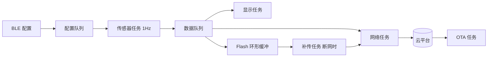
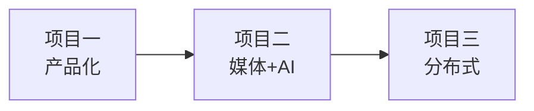

# 毕业项目

教程至此，知识都是"一节一节"学的；毕业项目的意义是把它们**串成一台完整设备**——而且给你真实的交付压力：验收标准写在这里，做没做到一目了然。

三个项目分别考察**产品化**、**媒体处理**和**分布式**三种能力面。做法建议：先读一遍全部需求，**自己画任务划分和内存规划草图，再动手**；卡住时回来翻对应章节，而不是直接抄答案。

## 项目一：家庭环境监测节点（产品化）

**考察**：完整产品流程——从传感器到云、从电池到 OTA。

| 需求 | 涉及能力 | 对应章节 |
| --- | --- | --- |
| 采集温湿度 / PM2.5 / 噪声 | I2C 传感器、ADC 采样 | L4 |
| 本地显示 | OLED 或 LCD + LVGL | L4 / L6 |
| 数据本地留存 | LittleFS 环形缓冲 | L6 存储 |
| 云端上报 | WiFi + MQTT + TLS | L5 |
| 手机远程配置 | BLE GATT（改采样率、阈值） | L5 BLE |
| 断网续传 | 队列 + 补传 | L2 / L5 |
| 电池工作 | 深度睡眠 + 定时唤醒 | L6 功耗 |
| 远程升级 | OTA + 回滚 | L2 / L5 |

**进阶要求**：

- 统计并上报设备在线率
- 实现多设备组网（MESH）
- 用 secure boot + flash encryption

**架构草图**（先自己画，再对照）：

**验收标准**：

- [ ] 连续运行 7 天无崩溃
- [ ] 断网 24 小时后自动补传（一条不丢）
- [ ] 电池模式续航 > 30 天
- [ ] OTA 升级一次成功且升级失败能自动回滚

## 项目二：智能语音/图像感知终端（媒体 + AI）

**考察**：I2S/摄像头 + 推理 + 实时性——S3 的看家本领。

| 需求 | 涉及能力 |
| --- | --- |
| 麦克风阵列拾音 | I2S、AEC |
| 唤醒词检测 | ESP-SR |
| 摄像头人脸/人体检测 | 摄像头 + ESP-DL |
| 本地显示识别结果 | LCD + LVGL |
| 事件上报与录像 | SD 卡存储 |
| 高性能推理不掉帧 | 双核任务划分、优先级、内存规划 |

**进阶要求**：

- 实现自训练模型（PyTorch → TFLite → int8 量化）
- 实现双缓冲视频采集与显示

**验收标准**：

- [ ] 唤醒词识别率 > 90%
- [ ] 人形检测帧率 > 10fps 且显示无撕裂
- [ ] 连续运行 2 小时无内存泄漏（剩余量稳定）

## 项目三：多节点分布式传感网络（分布式）

**考察**：组网、分布式一致性、可靠性——最难的一个。

| 需求 | 涉及能力 |
| --- | --- |
| 10+ 节点组网 | ESP-MESH 或 WiFi AP 模式 |
| 节点自动发现与加入 | mDNS / 广播 |
| 数据聚合到网关 | 自定义协议或 MQTT |
| 节点掉线检测与重连 | 心跳 + 超时状态机 |
| 固件批量升级 | 集中 OTA |
| 低功耗节点 | Deep Sleep + 长睡眠间隔 |
| 时钟同步 | SNTP 或自实现时间同步 |

**进阶要求**：

- 实现节点级的 OTA 批量升级和版本管理
- 处理节点掉线/重连时的数据补传

**验收标准**：

- [ ] 10 节点同时在线稳定运行 24 小时
- [ ] 单节点掉线 5 分钟内自动恢复
- [ ] 网关重启后全网自动恢复

## 建议顺序

**先做项目一**，它覆盖 80% 的工程能力，是工作落地的基础。项目二和三可以并行。

## 毕业标准

三个项目至少完成两个，且项目一必须完成。你需要能回答——**这些问题的答案比项目本身更重要**：

- [ ] 为什么这样划分任务？优先级怎么定的？（答不出 = 抄的架构）
- [ ] 内存怎么规划的？为什么这样分配？
- [ ] 遇到的最大问题是什么？怎么定位的？（测试/剖析/日志，用了哪把刀）
- [ ] 如果重新做一遍，哪里会改？（复盘能力是工程师成长的引擎）

## 下一步

回到 [快速上手](../../quickstart/) 巩固基础，或去 [速查表](../../reference/) 查具体 API。