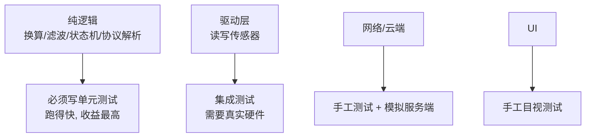

# 测试

嵌入式测试不是可选项。没有测试，改一行 WiFi 代码都不知道会不会弄坏 ADC 采集。

## 1. 单元测试（IDF 内置 Unity）

```c
// test/test_math.c
#include "unity.h"
#include "app_math.h"

void test_clamp_clamps_high(void) {
    TEST_ASSERT_EQUAL_INT(100, app_clamp(200, 0, 100));
}

void test_clamp_clamps_low(void) {
    TEST_ASSERT_EQUAL_INT(0, app_clamp(-50, 0, 100));
}

int app_math_run_unit_tests(void) {
    UNITY_BEGIN();
    RUN_TEST(test_clamp_clamps_high);
    RUN_TEST(test_clamp_clamps_low);
    return UNITY_END();
}
```

```bash
# 在真机上跑（最快的方式）
idf.py build
idf.py -p COM5 flash monitor    # 测试输出会打印到串口

# 或者用 QEMU 模拟，不用硬件
idf.py qemu build
idf.py qemu monitor
```

```cmake
# test/CMakeLists.txt
get_property(dirs DIRECTORY PROPERTY test_included_dirs)
idf_component_register(SRCS "test_math.c"
                       INCLUDE_DIRS "."
                       REQUIRES unity app_math)

target_link_libraries(${COMPONENT_LIB} unity)
```

## 2. 什么该测



**优先测纯逻辑**：传感器值到物理量的换算、滤波算法、状态机跳转、协议编解码。这些不需要硬件，能在 CI 里跑。

## 3. 集成测试：连真实硬件

```c
// 真机跑一遍外设，输出结果供人工判断
void run_hw_test(void) {
    printf("=== 外设自检 ===\n");

    // ADC
    int raw = adc_read(ADC_PIN);
    printf("[%s] ADC raw=%d\n", raw > 0 ? "PASS" : "FAIL", raw);

    // I2C 扫描
    int found = i2c_scan_all();
    printf("[%s] I2C 找到 %d 个设备\n", found > 0 ? "PASS" : "FAIL", found);

    // Flash
    printf("[%s] Flash 剩余 %d 字节\n",
           spi_flash_get_size() > 0 ? "PASS" : "FAIL",
           (int)spi_flash_get_size());
}
```

**这套自检代码做成一个独立的编译目标**，出厂测试和现场排障都用它。

```bash
idf.py -DAPP_BUILD_TYPE=hwtest build
```

## 4. 模拟服务端

WiFi/MQTT/HTTP 相关的功能，用本地模拟服务测：

```bash
# 起一个假的 MQTT broker
docker run -d -p 1883:1883 -p 18083:18083 emqx/emqx

# 起一个假的 HTTP 服务，返回固定数据
python3 -m http.server 8000
```

设备的 IP 用 `netif` 改成指向本机，测试时不用真的部署到云端。

## 5. CI 集成

```yaml
# .github/workflows/build.yml
name: build
on: [push, pull_request]
jobs:
  test:
    runs-on: ubuntu-latest
    steps:
      - uses: actions/checkout@v4
      - uses: espressif/idf@v5.5
      - run: idf.py set-target esp32s3
      - run: idf.py build
      - run: idf.py qemu monitor        # 在 QEMU 里跑单元测试
```

**关键是 QEMU**：不用硬件也能在 CI 里验证编译和基础逻辑。

## 6. 测试的卫生习惯

- 每次修 bug，先写一个能复现这个 bug 的测试，再修
- 测试要覆盖边界值（0、最大值、负数、空指针）
- 测试失败信息要能直接看出问题（`TEST_ASSERT_EQUAL_INT(100, 200)` 就够了）
- 不要在单元测试里访问真实硬件

## 下一步

[性能剖析](./profiling)