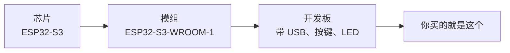

# 01 ESP32 是什么

**本课目标**：搞清"ESP32"这个词到底指什么，别被芯片/模组/开发板搞晕。不用动手。

## 一句话

**ESP32 是一颗"带 WiFi 和蓝牙的单芯片计算机"。**

它里面集成了：

- **CPU**（双核，主频 240 MHz）
- **内存**（SRAM 约 520 KB）
- **Flash 存储器**（外部，通常 4~16 MB）
- **WiFi + 蓝牙**（2.4 GHz）
- **各种外设**（GPIO、ADC、I2C、SPI、UART、PWM…）

**一颗芯片就能联网**——这是它最大的价值。

## 三个容易混的概念

| 层级 | 是什么 | 例子 | 你自己能焊吗 |
| --- | --- | --- | --- |
| **芯片** | 裸 die，需要外围电路 | ESP32-S3 | ❌ 需要专业设备 |
| **模组** | 芯片 + Flash + 天线 + 屏蔽罩 | ESP32-S3-WROOM-1 | ⚠️ 需要回流焊 |
| **开发板** | 模组 + USB + 稳压 + 引脚排针 | 各种"开发板" | ✅ **直接买来用** |

:::tip[你该买的是开发板]
**初学者一律买"开发板"**——已经把 USB 转串口、5V→3.3V 稳压、复位按键、LED 都做好了。

说"我买了 ESP32"通常就是指开发板。
:::

## ESP32 里面到底有什么

以 ESP32-S3 为例：

| 部件 | 规格 | 作用 |
| --- | --- | --- |
| CPU | 双核 Xtensa LX7 @ 240MHz | 跑你的程序 |
| SRAM | 512 KB | 程序运行时内存 |
| Flash | 4~16 MB（外部） | 存固件和数据 |
| WiFi | 802.11 b/g/n 2.4GHz | 联网 |
| 蓝牙 | BLE 5.0 + 经典蓝牙 | 近距通信 |
| GPIO | 约 45 个 | 接外设 |
| ADC | 12 位 | 读模拟量 |
| 定时器 | 多个 | 精确定时 |
| USB | S3 有原生 USB OTG | 免串口芯片 |

:::info[Flash 和 SRAM 的区别]
| | SRAM | Flash |
| --- | --- | --- |
| 掉电 | **丢失** | **保留** |
| 速度 | 快 | 慢（需要缓存） |
| 容量 | 512 KB | 4~16 MB |
| 存什么 | 运行时的变量 | 固件、文件、配置 |

**这点和电脑一样**：SRAM 相当于内存条，Flash 相当于硬盘。
:::

## 和电脑、Arduino 的对比

| | 电脑 | Arduino Uno | **ESP32** |
| --- | --- | --- | --- |
| CPU 主频 | 3~5 GHz | 16 MHz | 240 MHz |
| 内存 | 8~32 GB | 2 KB | 512 KB |
| 存储 | TB 级 | 32 KB | 4~16 MB |
| 操作系统 | Windows/Linux | 无（裸机） | **FreeRTOS** |
| 联网 | 自带 | 需扩展板 | **自带 WiFi/BLE** |
| 价格 | 几千 | 几十 | **二三十** |

:::danger[别用电脑的思维写单片机程序]
**内存只有 512 KB**，在电脑上随手 `new` 一个 10 MB 数组，在这里直接崩。

**规矩**：

- 别开大数组（尤其局部数组，栈很小）
- 别做深递归
- 别频繁 `malloc`/`free`（会碎片化）
:::

## 它能做什么

| 类别 | 例子 |
| --- | --- |
| **智能家居** | WiFi 控制灯、温湿度上报、窗帘电机 |
| **传感器采集** | 空气检测、水位监测、土壤湿度 |
| **可穿戴** | 蓝牙手环、心率监测 |
| **显示设备** | 接 OLED/TFT 显示数据 |
| **工业采集** | Modbus 网关、数据上传 |
| **玩具/创意** | 遥控车、灯效、互动装置 |

:::tip[新手第一个项目的推荐顺序]
1. **点灯**（证明环境通了）
2. **按键控制灯**（输入+输出）
3. **串口打印传感器值**（学会调试）
4. **连 WiFi 打印 IP**（证明联网通了）
5. **温湿度上云**（第一个完整项目）

**每一步都要能看见现象**——这是保持动力的关键。
:::

## ESP32 的局限

:::warning[不是万能的]
| 局限 | 说明 |
| --- | --- |
| **没有硬盘** | Flash 有限，不能存大量数据 |
| **ADC 精度一般** | 非线性，不适合精密测量 |
| **实时性有限** | 有 FreeRTOS 但不是硬实时 |
| **功耗** | 全速运行约 100~240 mA |
| **5V 不兼容** | **引脚是 3.3V，接 5V 会烧** |

**要做高精度 ADC 或硬实时控制，STM32 更合适。**
:::

## 本课自检

- [ ] 知道芯片、模组、开发板三者的区别
- [ ] **知道自己该买"开发板"**
- [ ] 知道 ESP32 内部有 CPU/SRAM/Flash/WiFi/蓝牙/外设
- [ ] **知道 SRAM 掉电丢失、Flash 保留**
- [ ] 知道 ESP32 内存只有几百 KB（不能像电脑那样用）
- [ ] 能说出 ESP32 适合做什么
- [ ] **知道引脚是 3.3V，接 5V 会烧**
- [ ] 知道 ESP32 的局限（ADC 精度、实时性）

## 下一步

[02 型号怎么选](./02-choose-board) —— ESP32/S3/C3 到底差在哪，买哪个。
