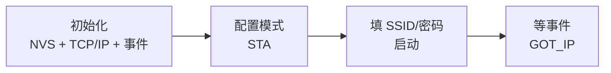

# 14 WiFi 连接

**本课目标**：让板子连上路由器并拿到 IP。

## 联网要走的四步



:::danger[最常见错误：启动后立刻发请求]
```c
esp_wifi_start();
esp_wifi_connect();
http_get("http://api.xxx.com");     /* ❌ 此时还没 IP！ */
```

**`esp_wifi_connect()` 只是"开始连接"，不是"已连接"。**

真正的标志是收到 **`WIFI_EVENT_STA_GOT_IP`** 或 **`IP_EVENT_STA_GOT_IP`** 事件。

**必须等这个事件，才能发网络请求。**
:::

## 完整代码

```c
#include <string.h>
#include "freertos/FreeRTOS.h"
#include "freertos/task.h"
#include "freertos/event_groups.h"
#include "esp_wifi.h"
#include "esp_event.h"
#include "esp_log.h"
#include "nvs_flash.h"

static const char *TAG = "wifi";

#define WIFI_SSID      "你的WiFi名"
#define WIFI_PASSWORD  "你的密码"

/* 用事件组通知"已连上" */
static EventGroupHandle_t s_wifi_events;
#define WIFI_CONNECTED_BIT  BIT0

static void wifi_event_handler(void *arg, esp_event_base_t base,
                               int32_t id, void *data)
{
    if (base == WIFI_EVENT && id == WIFI_EVENT_STA_START) {
        ESP_LOGI(TAG, "STA 启动，开始连接");
        esp_wifi_connect();

    } else if (base == WIFI_EVENT && id == WIFI_EVENT_STA_DISCONNECTED) {
        wifi_event_sta_disconnected_t *d = (wifi_event_sta_disconnected_t *)data;
        ESP_LOGW(TAG, "断开，原因码 %d，5 秒后重连", d->reason);
        vTaskDelay(pdMS_TO_TICKS(5000));
        esp_wifi_connect();

    } else if (base == IP_EVENT && id == IP_EVENT_STA_GOT_IP) {
        ip_event_got_ip_t *e = (ip_event_got_ip_t *)data;
        ESP_LOGI(TAG, "拿到 IP: " IPSTR, IP2STR(&e->ip_info.ip));
        xEventGroupSetBits(s_wifi_events, WIFI_CONNECTED_BIT);
    }
}

static void wifi_init_sta(void)
{
    /* ① NVS：WiFi 驱动要用它存校准数据 */
    esp_err_t ret = nvs_flash_init();
    if (ret == ESP_ERR_NVS_NO_FREE_PAGES || ret == ESP_ERR_NVS_NEW_VERSION_FOUND) {
        ESP_ERROR_CHECK(nvs_flash_erase());
        ret = nvs_flash_init();
    }
    ESP_ERROR_CHECK(ret);

    s_wifi_events = xEventGroupCreate();

    /* ② 初始化网络接口 + 事件循环 */
    ESP_ERROR_CHECK(esp_netif_init());
    ESP_ERROR_CHECK(esp_event_loop_create_default());
    esp_netif_create_default_wifi_sta();

    /* ③ 注册事件回调 */
    ESP_ERROR_CHECK(esp_event_handler_register(WIFI_EVENT, ESP_EVENT_ANY_ID,
                                               wifi_event_handler, NULL));
    ESP_ERROR_CHECK(esp_event_handler_register(IP_EVENT, IP_EVENT_STA_GOT_IP,
                                               wifi_event_handler, NULL));

    /* ④ 初始化 WiFi */
    wifi_init_config_t cfg = WIFI_INIT_CONFIG_DEFAULT();
    ESP_ERROR_CHECK(esp_wifi_init(&cfg));

    /* ⑤ 配置 SSID/密码 */
    wifi_config_t wc = {
        .sta = {
            .ssid     = WIFI_SSID,
            .password = WIFI_PASSWORD,
            .threshold.authmode = WIFI_AUTH_WPA2_PSK,
        },
    };
    ESP_ERROR_CHECK(esp_wifi_set_mode(WIFI_MODE_STA));
    ESP_ERROR_CHECK(esp_wifi_set_config(WIFI_IF_STA, &wc));
    ESP_ERROR_CHECK(esp_wifi_start());
}

void app_main(void)
{
    wifi_init_sta();

    /* ⑥ 最多等 20 秒 */
    EventBits_t bits = xEventGroupWaitBits(s_wifi_events, WIFI_CONNECTED_BIT,
                                          pdFALSE, pdFALSE,
                                          pdMS_TO_TICKS(20000));
    if (bits & WIFI_CONNECTED_BIT) {
        ESP_LOGI(TAG, "联网成功，可以开始干活了");
    } else {
        ESP_LOGE(TAG, "20 秒还没连上，检查 SSID/密码/信号");
    }

    while (1) {
        vTaskDelay(pdMS_TO_TICKS(10000));
    }
}
```

:::tip[`IPSTR` / `IP2STR` 是哪来的]
ESP-IDF 提供的宏，把 `esp_ip4_addr_t` 格式化成点分十进制。

```c
ESP_LOGI(TAG, "IP: " IPSTR, IP2STR(&ip));
```

**不用自己拆四个字节。**
:::

## 为什么必须 `nvs_flash_init`

:::danger[WiFi 驱动依赖 NVS]
ESP32 的 WiFi 校准数据（射频参数）存在 **NVS（非易失存储）** 里。

**不初始化 NVS 会导致 WiFi 初始化失败**：

```text
ESP_ERR_NVS_NOT_INITIALIZED
```

**这是新手最常见的 WiFi 报错。**
:::

```c
esp_err_t ret = nvs_flash_init();
if (ret == ESP_ERR_NVS_NO_FREE_PAGES || ret == ESP_ERR_NVS_NEW_VERSION_FOUND) {
    nvs_flash_erase();        /* 分区满了或版本变了 → 擦掉重来 */
    ret = nvs_flash_init();
}
ESP_ERROR_CHECK(ret);
```

## 断线重连

:::warning[WiFi 会自己断]
原因很多：信号弱、路由器重启、休眠策略、DHCP 租约到期。

**不断线重连，设备就成了"砖"——必须手动重启。**
:::

```c
} else if (base == WIFI_EVENT && id == WIFI_EVENT_STA_DISCONNECTED) {
    ESP_LOGW(TAG, "断开，原因码 %d", ((wifi_event_sta_disconnected_t*)data)->reason);
    xEventGroupClearBits(s_wifi_events, WIFI_CONNECTED_BIT);   /* 清掉标志 */
    vTaskDelay(pdMS_TO_TICKS(5000));                            /* 等一会儿 */
    esp_wifi_connect();                                         /* 重连 */
}
```

:::tip[为什么要先清 BIT 再等]
如果不清，上层代码会**以为还连着**，继续发请求（必然失败）。

**清掉标志 = 告诉上层"我现在没网"。**
:::

### 常用断开原因码

| reason | 含义 |
| --- | --- |
| 2 | 认证过期/密码错 |
| 15 | 四次握手超时（多半密码错） |
| 200 | 信标超时（信号太弱或路由器关了） |
| 201 | 路由器主动断开（常见，正常现象） |
| 204 | 握手超时 |

:::warning[密码错时 reason 是 15 或 2]
```text
WIFI_EVENT_STA_DISCONNECTED, reason = 15
```

**看到 15 先怀疑密码错了或 authmode 不匹配**（比如路由器是 WPA3 而你写 WPA2）。
:::

## 连不上怎么查

| 现象 | 原因 | 解决 |
| --- | --- | --- |
| 一直连不上，reason=15 | 密码错 | 核对密码 |
| 一直连不上，reason=201 | 路由器拒绝 | 检查 MAC 过滤/黑名单 |
| 一直连不上，reason=200 | 信号弱 | 靠近路由器；**只支持 2.4GHz** |
| `ESP_ERR_NVS_NOT_INITIALIZED` | 没初始化 NVS | 加 `nvs_flash_init()` |
| 连上但拿不到 IP | DHCP 问题 | 试静态 IP |
| 名字带中文/特殊字符 | 编码问题 | 改 SSID 为英文测试 |

:::danger[ESP32 只支持 2.4GHz WiFi]
**不支持 5GHz。**

如果你的路由器是双频合一（2.4G 和 5G 同一个名字），ESP32 会去连 2.4G——通常能成。

**但有些路由器的"双频合一"优化会干扰连接**。**排查时把 2.4G 和 5G 分成两个名字**，明确连 2.4G 那个。
:::

:::warning[SSID 最长 32 字节]
```c
wifi_config_t wc = {
    .sta = { .ssid = "很长的名字..." }
};
```

`ssid` 字段是 `uint8_t[32]`，**超长会截断**导致连错。

**另外隐藏 SSID 需要额外设置**（`scan_method`），新手别用隐藏 SSID。
:::

## 看信号强度

```c
wifi_ap_record_t ap;
esp_wifi_sta_get_ap_info(&ap);
ESP_LOGI(TAG, "RSSI = %d dBm", ap.rssi);
```

| RSSI | 质量 |
| --- | --- |
| -30 ~ -50 | 很强 |
| -60 ~ -70 | 良好 |
| -80 | 勉强 |
| < -85 | 很不稳定 |

## 本课自检

- [ ] 知道联网四步（NVS → 初始化 → 配置 → 等 IP）
- [ ] **知道 `esp_wifi_connect()` 不等于已连接**
- [ ] **知道必须等 `IP_EVENT_STA_GOT_IP` 才能发请求**
- [ ] **知道必须先 `nvs_flash_init()`**
- [ ] 会注册 `esp_event_handler_register` 回调
- [ ] 实现了断线重连
- [ ] 知道要清 `WIFI_CONNECTED_BIT`
- [ ] 知道 reason=15 多半是密码错
- [ ] **知道 ESP32 只支持 2.4GHz**
- [ ] 会用 `esp_wifi_sta_get_ap_info` 看 RSSI

## 下一步

[15 HTTP 请求](./15-http) —— 联网之后，去调接口拿数据。
