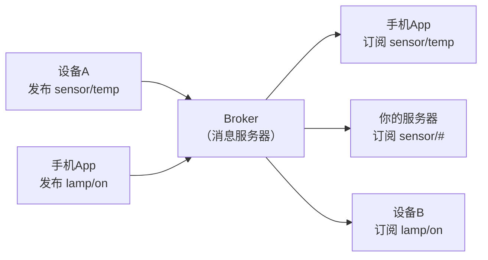

# 16 MQTT 上云

**本课目标**：让设备持续上报数据并能被远程控制。

## 为什么设备用 MQTT 而不是 HTTP

| | HTTP | MQTT |
| --- | --- | --- |
| 模型 | **请求-响应**（客户端主动问） | **发布-订阅**（谁订阅谁收到） |
| 连接 | 每次新建 | **长连接** |
| 开销 | 头部长、TLS 握手慢 | 头部最小 2 字节 |
| 服务器推消息 | ❌ 要轮询 | ✅ **天然支持** |
| 功耗 | 高 | 低 |

:::tip[关键差别：服务器能主动通知设备]
**HTTP**：设备必须不停地问"有新命令吗？"（轮询，费电费流量）

**MQTT**：设备订阅一个主题，**有消息服务器立刻推给它**——不用问。

**这就是智能家居能"秒响应"的原因。**
:::

## 发布-订阅模型



三个角色：

| 角色 | 作用 |
| --- | --- |
| **Broker** | 消息中转站（如 Mosquitto、EMQX、云厂商 IoT 平台） |
| **Publisher** | 发消息的一方 |
| **Subscriber** | 收消息的一方 |

**设备和 App 互相不认识，都只跟 Broker 打交道。**

## 主题（Topic）

主题是**用斜杠分层的字符串**：

```text
home/livingroom/temp
home/bedroom/temp
home/bedroom/humidity
device/abc123/status
```

:::tip[通配符只有订阅方能用]
| 通配符 | 含义 | 例子 |
| --- | --- | --- |
| `+` | 匹配**一层** | `home/+/temp` → 匹配 `home/a/temp`、`home/b/temp` |
| `#` | 匹配**后面所有层** | `home/#` → 匹配 `home/a/temp`、`home/b/c/d` |

**发布时不能用通配符**——只能往具体主题发。
:::

:::danger[主题设计的三条经验]
1. **层级从大到小**：`家/房间/设备/指标`
2. **别用中文和空格**（兼容性差）
3. **别把设备 ID 放最前面**（不利于批量订阅）

```text
✅ home/livingroom/temp
✅ device/abc123/status
❌ 家里的/客厅/温度
❌ abc123/home/livingroom/temp    （想订阅"所有温度"就难了）
```
:::

## QoS：消息送达保证

| QoS | 含义 | 开销 |
| --- | --- | --- |
| **0** | 最多一次（可能丢） | 最小 |
| **1** | 至少一次（可能重复） | 中 |
| **2** | 恰好一次 | 最大 |

:::tip[怎么选]
- **传感器数据、周期性上报** → **QoS 0**（丢一个无所谓，下一秒还有）
- **控制命令** → **QoS 1**（不能丢，重复了要能容忍）
- **计费/关键操作** → QoS 2

**新手用 QoS 0 或 1 就够了。**
:::

## 遗嘱消息（LWT）：设备掉线通知

:::danger[这是 MQTT 最贴心的特性]
设备**突然断电/断网**时，它自己没法发"我掉线了"。

**遗嘱消息（Last Will and Testament）** 让 Broker 代替宣告：

```c
.will_topic  = "device/abc123/status",
.will_msg    = "offline",
.will_qos    = 1,
.will_retain = true,
```

**设备异常断开 → Broker 自动往这个主题发 "offline"。**

**手机 App 一订阅就知道设备是否在线——这是产品必备功能。**
:::

## ESP-IDF 的 MQTT 客户端

本机 ESP-IDF v5.3.5 有 `examples/protocols/mqtt` 和 `mqtt5` 示例。

```c
#include "mqtt_client.h"
#include "esp_log.h"

static const char *TAG = "mqtt";

static void mqtt_event_handler(void *arg, esp_event_base_t base,
                               int32_t id, void *data)
{
    esp_mqtt_event_handle_t e = (esp_mqtt_event_handle_t)data;

    switch ((esp_mqtt_event_id_t)id) {
    case MQTT_EVENT_CONNECTED:
        ESP_LOGI(TAG, "已连接");
        /* 订阅控制主题 */
        esp_mqtt_client_subscribe(e->client, "home/lamp/set", 1);
        break;

    case MQTT_EVENT_DATA:
        /* 注意：topic 和 data 都不是以 \0 结尾的！ */
        ESP_LOGI(TAG, "收到: %.*s -> %.*s",
                 e->topic_len, e->topic,
                 e->data_len,  e->data);
        break;

    case MQTT_EVENT_DISCONNECTED:
        ESP_LOGW(TAG, "断开（会自动重连）");
        break;

    default:
        break;
    }
}

void mqtt_start(void)
{
    esp_mqtt_client_config_t cfg = {
        .broker.address.uri = "mqtt://broker.emqx.io:1883",
        .credentials.client_id = "esp32_demo_001",

        /* 遗嘱：掉线时由 Broker 代发 */
        .session.last_will.topic  = "device/esp32_demo_001/status",
        .session.last_will.msg    = "offline",
        .session.last_will.msg_len = 7,
        .session.last_will.qos    = 1,
        .session.last_will.retain = true,
    };

    esp_mqtt_client_handle_t c = esp_mqtt_client_init(&cfg);
    esp_mqtt_client_register_event(c, ESP_EVENT_ANY_ID, mqtt_event_handler, NULL);
    esp_mqtt_client_start(c);
}

/* 发布数据 */
void publish_temp(esp_mqtt_client_handle_t c, float t)
{
    char buf[32];
    int n = snprintf(buf, sizeof(buf), "%.1f", t);
    esp_mqtt_client_publish(c, "home/livingroom/temp", buf, n, 0, 1);
    /*                                                ↑  ↑
                                                    QoS retain */
}
```

:::danger[MQTT 事件里 `topic` 和 `data` 都没有 `\0`]
```c
ESP_LOGI(TAG, "%s", e->data);        /* ❌ 越界 */
ESP_LOGI(TAG, "%.*s", e->data_len, e->data);   /* ✅ */
```

**和 HTTP 回调一样的坑**（[第 15 课](./15-http)）。

**`topic` 也一样要用 `topic_len`。**
:::

:::info[`retain` 是干什么的]
```c
esp_mqtt_client_publish(c, topic, data, len, qos, /* retain = */ 1);
```

`retain = true` 表示：**Broker 保存这条消息，之后任何新订阅者立刻收到它**。

**用途**：状态类消息（灯的开关状态、温度）。

- 新 App 一连上就立刻知道"灯现在是开的"
- 不用等下一次上报

**传感器周期性数据一般不用 retain，状态类用 retain。**
:::

## 免费的公共 Broker

```c
.broker.address.uri = "mqtt://broker.emqx.io:1883",
```

:::warning[公共 Broker 只是用来测试]
**任何人都能连、都能看到你的消息。**

**千万别传敏感数据**，也别用它做真实产品。

产品要用：自建 Mosquitto/EMQX，或用云厂商 IoT 平台（阿里云/腾讯云/AWS IoT）。
:::

## 用命令行测试

装了 `mosquitto-clients` 后：

```bash
# 订阅
mosquitto_sub -h broker.emqx.io -t "home/livingroom/temp" -v

# 发布
mosquitto_pub -h broker.emqx.io -t "home/lamp/set" -m "on"
```

:::tip[开发时一定要有命令行工具]
**先确认 Broker 和主题都对，再写 ESP32 代码。**

否则你分不清是"网络问题"还是"代码问题"。
:::

## 完整数据流示例

```text
① ESP32 启动 → 连 WiFi → 连 Broker
② 发布 home/livingroom/temp = "22.5"（retain=1）
③ 手机 App 连上 Broker，订阅同一主题
④ App 立刻收到 "22.5"（因为 retain）
⑤ 用户在 App 上点"开灯" → 发布 home/lamp/set = "on"
⑥ ESP32 收到（它订阅了这个主题）→ 开灯
⑦ 设备掉线 → Broker 发 device/xxx/status = "offline"（遗嘱）
```

## 常见错误

| 错误 | 现象 | 原因 | 解决 |
| --- | --- | --- | --- |
| `%s` 打 `e->data` | 乱码/崩溃 | 没有 `\0` | `%.*s` + len |
| 主题名拼错 | 收不到消息 | 大小写/斜杠不一致 | 两边对比字符串 |
| 连公共 Broker 传敏感数据 | 泄露 | 无访问控制 | 用自建/云平台 |
| 不用 retain | App 要等下次上报 | 状态类消息应 retain | `retain=1` |
| 不设遗嘱 | 无法判断掉线 | 没配 LWT | 配 `last_will` |
| QoS 全用 2 | 变慢 | 过度保证 | 传感器用 0 |
| client_id 重复 | 互相踢下线 | 两个设备同 ID | 每个设备唯一 |

:::danger[`client_id` 必须唯一]
两个设备用同一个 `client_id` 连同一个 Broker，**会互相把对方踢下线**——表现是"疯狂断线重连"。

**用 MAC 地址或芯片 ID 生成唯一 client_id**：

```c
uint8_t mac[6];
esp_efuse_mac_get_default(mac);
snprintf(client_id, sizeof(client_id), "esp32_%02x%02x%02x%02x%02x%02x",
         mac[0], mac[1], mac[2], mac[3], mac[4], mac[5]);
```
:::

## 本课自检

- [ ] **理解 MQTT 的发布-订阅比 HTTP 请求-响应强在哪**
- [ ] 知道 Broker / Publisher / Subscriber 三个角色
- [ ] 会设计主题（层级、无中文、避免 ID 打头）
- [ ] 知道 `+` 和 `#` 通配符只能订阅用
- [ ] 知道 QoS 0/1/2 的区别和怎么选
- [ ] **理解遗嘱消息，知道它解决"突然掉线"**
- [ ] 会用 `esp_mqtt_client_init` / `register_event` / `start`
- [ ] **知道 `MQTT_EVENT_DATA` 的 topic/data 没有 `\0`**
- [ ] 理解 `retain` 的用途
- [ ] **知道 `client_id` 必须唯一**
- [ ] 知道公共 Broker 只能测试

## 下一步

[17 蓝牙 BLE](./17-ble) —— 不用路由器也能和手机通信。
