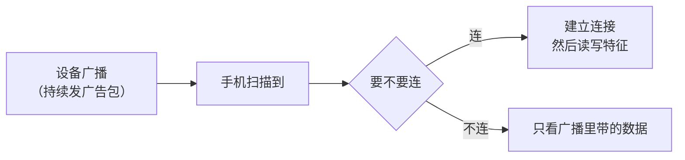

# 17 蓝牙 BLE

**本课目标**：知道 BLE 能做什么、核心概念是什么、什么时候该用它。

## BLE 和经典蓝牙的区别

| | 经典蓝牙（BR/EDR） | **BLE**（低功耗） |
| --- | --- | --- |
| 用途 | 音频、文件传输 | **小数据、传感器** |
| 功耗 | 高 | **极低** |
| 吞吐 | 高（1~2 Mbps） | 低（几十 kbps） |
| 连接方式 | 配对后连接 | **广播 + 连接** |
| iPhone 支持 | 需 MFi | **原生支持** |

:::tip[ESP32 两种都支持]
ESP32 经典款和 S3 都支持**经典蓝牙 + BLE**。

**新项目一律用 BLE**——省电、手机原生支持、生态更活跃。
:::

## BLE 的层级结构

:::warning[这是 BLE 最绕的地方]
```text
设备（Device）
└── 服务（Service）        例如「电池服务」「温度服务」
    └── 特征（Characteristic）  服务里的具体数据项
        └── 描述符（Descriptor）  特征的元信息
```

**记忆法：「服务是分类，特征是具体数据项」。**
:::

| 概念 | 说明 | 例子 |
| --- | --- | --- |
| **Service** | 一组相关功能，用 UUID 标识 | 电池服务 `0x180F` |
| **Characteristic** | 一个数据点 | 电量百分比 `0x2A19` |
| **Descriptor** | 特征的解释信息 | 单位、格式 |
| **UUID** | 唯一标识 | 标准 16 位 / 自定义 128 位 |

:::info[标准 UUID vs 自定义 UUID]
**标准服务**用 16 位短 UUID（蓝牙联盟定义）：

```text
0x180F  电池服务
0x2A19  电池电量
0x1809  温度服务
```

**你自己定义的服务**必须用 **128 位 UUID**（避免冲突）：

```text
12345678-1234-1234-1234-123456789abc
```

生成方法：随便找个 UUID 生成器，或 `uuidgen` 命令。
:::

## 广播 vs 连接



:::tip[很多场景根本不用连接]
**广播包里能塞**约 **31 字节** 自定义数据。

比如只上报温度：

```text
广播包 = 22.5°C + 设备ID
```

**手机扫一下就拿到，不用建立连接——这是最省电的方式。**

**要双向通信才需要连接。**
:::

## 特征的操作权限

每个特征可以支持这几种操作：

| 属性 | 含义 |
| --- | --- |
| **Read** | 手机能读 |
| **Write** | 手机能写 |
| **Notify** | 设备主动推送（不用手机问） |
| **Indicate** | 同 Notify，但有确认 |

:::tip[`Notify` 是 BLE 最常用的机制]
**手机订阅了某个特征的 Notify，设备一改值，手机立刻收到。**

**比"手机不停来读"省电得多**——这就是心率带、温湿度计的工作方式。
:::

## 一个实用场景：BLE 配网

**问题**：新买的设备不知道家里 WiFi 密码，怎么告诉它？

**方案**：手机通过 BLE 把 SSID 和密码发给设备。

```text
① 设备开 BLE 广播，名叫 "MyDevice-XXXX"
② 用户手机 App 连上它
③ App 往「配网特征」写入 WiFi 名称和密码
④ 设备收到后去连 WiFi
⑤ 连成功后关闭 BLE 广播
```

:::danger[这是 ESP32 产品最常见的配网方式]
比"硬编码 WiFi 密码"灵活，比"AP 热点配网"手机体验好。

**代价**：BLE 协议栈本身占 **约 100 KB Flash 和 几十 KB RAM**。
:::

## ESP-IDF 的 BLE 开发

本机 ESP-IDF v5.3.5 的 `examples/bluetooth` 下有多类示例。

**核心 API 是 NimBLE 协议栈**：

```c
#include "nimble/nimble_port.h"
#include "host/ble_hs.h"
```

:::warning[BLE 代码量很大，不适合零基础直接手写]
一个能用的 BLE 服务，**初始化代码通常 300~500 行**（注册 GAP/GATT 回调、定义属性表、处理各种事件）。

**建议**：

1. **先用官方示例跑通**（`examples/bluetooth/nimble/bleprph`）
2. 用手机 App（如 **nRF Connect**）验证服务和特征
3. **在自己项目里只改必要部分**

**别从零手写 BLE 协议栈代码。**
:::

### 官方示例的用法

```bash
cd $IDF_PATH/examples/bluetooth/nimble/bleprph
idf.py set-target esp32s3
idf.py build flash monitor
```

烧完后用手机 **nRF Connect** 扫描，能看到一个叫 `bleprph` 的设备，连上后能看到服务和特征。

:::tip[nRF Connect 是 BLE 调试必备]
- Android / iOS 都有
- 能扫描、连接、浏览服务/特征
- 能读写特征、订阅 Notify

**调 BLE 一定先用它确认设备端正常**，再写自己的 App。
:::

## BLE 的几个硬限制

| 限制 | 数值 |
| --- | --- |
| 同时连接数 | 理论 7~20，**实际 3~7** |
| 单包数据 | 默认 20 字节（可协商到 200+） |
| 传输速率 | 实测几十 kbps |
| 距离 | 10~30 米（室内） |

:::danger[默认每包只有 20 字节]
```text
BLE 默认 MTU = 23 字节，减去 3 字节头 → 有效 20 字节
```

**所以要传 1 KB 数据要拆成 50 多个包。**

可以协商更大的 MTU（`ble_att_set_preferred_mtu(512)`），但**手机端也要支持**。

**传大量数据别用 BLE，用 WiFi。**
:::

## 什么时候该用 BLE

:::tip[BLE vs WiFi 选择表]
| 场景 | 选哪个 |
| --- | --- |
| 传感器偶尔上报几十字节 | **BLE** |
| 用电池要跑几个月 | **BLE** |
| 手机直连、不经路由器 | **BLE** |
| 设备配网 | **BLE** |
| 要传图片/音频 | **WiFi** |
| 要连互联网 | **WiFi** |
| 要低延迟实时控制 | WiFi（BLE 延迟反而大） |
:::

## 本课自检

- [ ] 知道 BLE 和经典蓝牙的区别
- [ ] **知道 BLE 是"广播 + 连接"两种模式**
- [ ] **理解 Service / Characteristic / Descriptor 的层级**
- [ ] 知道标准 UUID 和自定义 128 位 UUID 的区别
- [ ] 知道 `Notify` 是设备主动推送，最常用
- [ ] **理解 BLE 配网的流程**
- [ ] 知道 BLE 协议栈占约 100KB Flash
- [ ] **知道别从零手写 BLE，先跑官方示例**
- [ ] 会用 nRF Connect 调试
- [ ] **知道默认每包只有 20 字节**
- [ ] 能判断什么时候该用 BLE、什么时候该用 WiFi

## 下一步

[18 NTP 对时](./18-ntp) —— 让设备知道准确时间。
