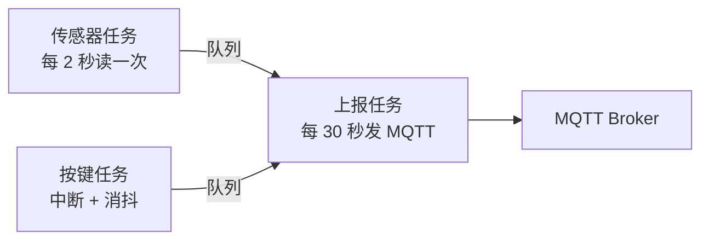

# 26 项目：温湿度上云

**本课目标**：把前 25 课学的所有东西串成一个能演示的完整设备。

## 要做什么

一台温湿度监测设备：

| 功能 | 用到第几课 |
| --- | --- |
| 读温湿度传感器 | 12（I2C）/ 10（ADC） |
| 连 WiFi | 14 |
| 上报数据到 MQTT | 16 |
| 每秒本地显示 | 07（串口） |
| 按键手动上报 | 09（按键消抖） |
| 断网自动重连 | 14 |
| 断电记住上报间隔 | 22（NVS） |
| 配置错误时不崩溃 | 21（任务/队列） |

## 架构：三个任务



:::tip[为什么这样拆任务]
**传感器任务**：稳定周期采样，不受网络影响

**上报任务**：只在有网时才发，网络慢也不拖累采样

**按键任务**：立即响应，不受其他任务阻塞

**任务之间用队列通信**（[第 21 课](./21-queue)），不共享变量。
:::

## 第一步：数据结构

```c
#include "freertos/FreeRTOS.h"
#include "freertos/queue.h"

typedef struct {
    float temp;          /* 温度 °C */
    float humi;          /* 湿度 % */
    int64_t ts;          /* Unix 时间戳 */
} sensor_data_t;

typedef enum {
    EVT_SENSOR_READY,    /* 有新数据 */
    EVT_BTN_PRESS,       /* 用户按下按键 */
    EVT_NET_UP,          /* 网络就绪 */
    EVT_NET_DOWN,        /* 网络断开 */
} app_evt_t;

typedef struct {
    app_evt_t type;
    union {
        sensor_data_t data;
    };
} app_msg_t;

static QueueHandle_t s_evt_q;      /* 事件队列 */
static sensor_data_t s_last;        /* 最近一次读数（只在上报任务里改） */
static bool          s_net_up = false;
```

## 第二步：传感器任务

```c
static void sensor_task(void *arg)
{
    TickType_t last = xTaskGetTickCount();

    while (1) {
        sensor_data_t d;
        esp_err_t err = sht3x_read(&d.temp, &d.humi);   /* 你的读传感器函数 */

        if (err == ESP_OK) {
            time(&d.ts);
            app_msg_t m = { .type = EVT_SENSOR_READY, .data = d };
            xQueueSend(s_evt_q, &m, 0);

            ESP_LOGI(TAG, "采集: %.1f°C %.1f%%", d.temp, d.humi);
        } else {
            ESP_LOGW(TAG, "传感器读取失败: %s", esp_err_to_name(err));
            /* 不退出！继续下一轮 */
        }

        /* 固定 2 秒周期（不累积误差） */
        vTaskDelayUntil(&last, pdMS_TO_TICKS(2000));
    }
}
```

:::danger[传感器失败不能让任务退出]
```c
if (err != ESP_OK) return;        /* ❌ 任务结束 → 再也没有采集 */
```

**I2C 偶发失败是正常的**（干扰、总线忙）。

**正确做法：打日志，继续下一轮**——这就是"健壮性"。
:::

## 第三步：按键任务

```c
static void IRAM_ATTR btn_isr(void *arg)
{
    /* ISR 里只发信号（第 11、21 课） */
    uint32_t dummy = 0;
    xQueueSendFromISR(s_evt_q, &(app_msg_t){ .type = EVT_BTN_PRESS }, NULL);
    (void)dummy;
}

static void btn_task(void *arg)
{
    while (1) {
        gpio_set_level(LED_GPIO, 1);      /* 按下亮灯反馈 */
        vTaskDelay(pdMS_TO_TICKS(100));
        gpio_set_level(LED_GPIO, 0);
        vTaskDelay(pdMS_TO_TICKS(1000));
    }
}
```

## 第四步：上报任务（核心）

```c
static void report_task(void *arg)
{
    while (1) {
        app_msg_t m;
        /* 阻塞等事件，最多等 30 秒（到时自动上报一次） */
        if (xQueueReceive(s_evt_q, &m, pdMS_TO_TICKS(30000)) == pdTRUE) {

            if (m.type == EVT_SENSOR_READY) {
                s_last = m.data;              /* 记住最新值 */

            } else if (m.type == EVT_BTN_PRESS) {
                ESP_LOGI(TAG, "用户要求立即上报");
                do_report();                   /* 按键触发立刻发 */

            } else if (m.type == EVT_NET_UP) {
                s_net_up = true;
                ESP_LOGI(TAG, "网络就绪");

            } else if (m.type == EVT_NET_DOWN) {
                s_net_up = false;
                ESP_LOGW(TAG, "网络断开，暂停上报");
            }
        } else {
            /* 30 秒超时 → 周期上报 */
            do_report();
        }
    }
}

static void do_report(void)
{
    if (!s_net_up) {
        ESP_LOGW(TAG, "没网，跳过本次上报");
        return;
    }

    char payload[128];
    snprintf(payload, sizeof(payload),
             "{\"t\":%.1f,\"h\":%.1f,\"ts\":%lld}",
             s_last.temp, s_last.humi, (long long)s_last.ts);

    int msg_id = esp_mqtt_client_publish(s_mqtt, "home/sensor/data",
                                         payload, 0, 0, 0);
    if (msg_id >= 0) {
        ESP_LOGI(TAG, "上报成功: %s", payload);
    } else {
        ESP_LOGE(TAG, "上报失败");
    }
}
```

:::tip[这个设计的三个优点]
1. **一个任务处理所有事件**（队列统一入口）——不会有并发问题
2. **超时也能触发上报**——保证周期性，不依赖外部事件
3. **没网就跳过，不阻塞**——恢复网络后自动继续
:::

## 第五步：主函数组装

```c
void app_main(void)
{
    /* ① NVS（WiFi 和配置都要） */
    esp_err_t ret = nvs_flash_init();
    if (ret == ESP_ERR_NVS_NO_FREE_PAGES || ret == ESP_ERR_NVS_NEW_VERSION_FOUND) {
        ESP_ERROR_CHECK(nvs_flash_erase());
        ret = nvs_flash_init();
    }
    ESP_ERROR_CHECK(ret);

    /* ② 队列 */
    s_evt_q = xQueueCreate(10, sizeof(app_msg_t));

    /* ③ GPIO */
    gpio_reset_pin(LED_GPIO);
    gpio_set_direction(LED_GPIO, GPIO_MODE_OUTPUT);
    gpio_config_t btn = {
        .pin_bit_mask = (1ULL << BTN_GPIO),
        .mode         = GPIO_MODE_INPUT,
        .pull_up_en   = GPIO_PULLUP_ENABLE,
        .intr_type    = GPIO_INTR_NEGEDGE,
    };
    gpio_config(&btn);
    gpio_install_isr_service(0);
    gpio_isr_handler_add(BTN_GPIO, btn_isr, NULL);

    /* ④ I2C 传感器 */
    ESP_ERROR_CHECK(sht3x_init());

    /* ⑤ 任务 */
    xTaskCreate(sensor_task, "sensor", 3072, NULL, 5, NULL);
    xTaskCreate(btn_task,    "btn",    2048, NULL, 6, NULL);
    xTaskCreate(report_task, "report", 8192, NULL, 4, NULL);   /* MQTT 吃栈 */

    /* ⑥ WiFi + MQTT（内部会发 EVT_NET_UP） */
    wifi_init_sta();
    mqtt_start();

    ESP_LOGI(TAG, "系统启动完成");
}
```

:::danger[`report_task` 的栈要给够]
```c
xTaskCreate(report_task, "report", 4096, ...);    /* ⚠️ 可能不够 */
xTaskCreate(report_task, "report", 8192, ...);    /* ✅ MQTT + snprintf */
```

**`esp_mqtt_client_publish` + `snprintf` 组合很吃栈。**

**栈不够的表现**：随机崩溃、`stack overflow` 报错。**遇到就加倍。**
:::

## 完整现象

烧录后串口应该看到：

```text
I (1200) app: 系统启动完成
I (2100) wifi: 拿到 IP: 192.168.1.50
I (2200) mqtt: 已连接
I (2300) app: 网络就绪
I (3000) app: 采集: 23.4°C 55.2%
I (5000) app: 采集: 23.5°C 55.0%
I (30000) app: 上报成功: {"t":23.5,"h":55.0,"ts":1729232585}
```

**按下按键** → 立即多一条上报 + LED 闪两下。

## 想自己加的改进

| 改进 | 提示 |
| --- | --- |
| 加 OLED 显示 | 第 12 课，在 `sensor_task` 里刷新 |
| 断网时缓存数据 | 环形缓冲区，恢复后补传 |
| 上报间隔可配 | 存 NVS，按键长按改 |
| 加 OTA | 第 25 课 |
| 低功耗 | 第 23 课，改成"醒 5 秒上报后睡 5 分钟" |
| 加本地 Web 页面 | 第 19 课，显示当前值 |
| 数据加设备 ID | 多台设备时区分 |

:::tip[这个项目的价值]
**它不是玩具**——真实产品就是这些模块的组合：

```text
采集 → 处理 → 上报 → 响应命令 → 异常恢复 → 远程升级
```

**把这个项目做扎实，你已经具备做物联网产品的基础能力。**
:::

## 常见错误

| 错误 | 现象 | 原因 | 解决 |
| --- | --- | --- | --- |
| 传感器失败就 return | 再也不采集 | 任务退出 | 打日志继续 |
| 上报任务栈太小 | 随机崩溃 | MQTT 吃栈 | 给 8192 |
| 没网时阻塞等待 | 网络恢复后卡住 | 同步发送 | 检查 `s_net_up` |
| 多个任务改同一变量 | 数据错乱 | 数据竞争 | 用队列 |
| 打印密码 | 安全风险 | 日志泄露 | 只打 SSID |
| 忘了 `vTaskDelayUntil` | 采样周期漂移 | 累积误差 | 改用它 |

## 本课自检

- [ ] 能把项目拆成三个任务并说明各自职责
- [ ] 用队列在任务间传数据（不共享变量）
- [ ] **传感器失败时打日志继续，不退出任务**
- [ ] 上报任务用"队列 + 超时"同时支持事件和周期
- [ ] **知道 MQTT 上报任务要给 8192 栈**
- [ ] 没网时跳过上报而不是阻塞
- [ ] 用 `vTaskDelayUntil` 保证采样周期准确
- [ ] 主函数按正确顺序初始化（NVS → 队列 → GPIO → 传感器 → 任务 → 网络）
- [ ] 能在串口看到完整的数据流

## 下一步

[27 常见故障排查](./27-troubleshoot) —— 遇到问题按这张表查。
