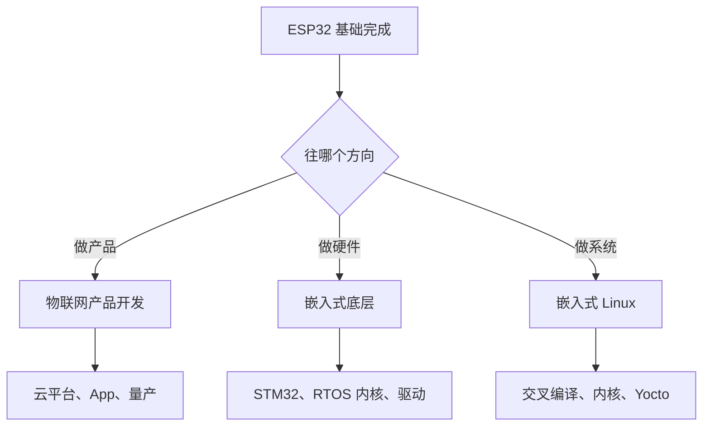

# 30 下一步

**本课目标**：知道自己现在在什么位置，接下来该往哪走。

## 你现在会什么

30 节课走完，你掌握了：

| 能力 | 说明 |
| --- | --- |
| **硬件基础** | 面包板、限流电阻、3.3V 雷区、万用表 |
| **开发环境** | 驱动、串口、米思齐/Arduino/ESP-IDF |
| **基础外设** | GPIO、PWM、ADC、定时器、中断 |
| **总线** | I2C、SPI、UART |
| **联网** | WiFi、HTTP、MQTT、BLE、SNTP |
| **Web 服务** | 在设备上跑 HTTP 服务器 |
| **系统能力** | FreeRTOS 任务、队列、互斥锁、NVS、深睡、文件系统、OTA |
| **工程能力** | 内存管理、故障排查、从积木过渡 |

**这份能力已经能做出一台真正的物联网设备。**

## 三条深入路线



### 路线 A：物联网产品开发

**适合**：想做出能卖的东西。

| 要学 | 说明 |
| --- | --- |
| **云平台** | 阿里云/腾讯云 IoT、AWS IoT、自建 EMQX |
| **配网方案** | BLE 配网、SmartConfig、AP 配网、二维码 |
| **设备管理** | 一机一密、设备影子、OTA 灰度 |
| **低功耗设计** | 深睡 + 传感器功耗预算 |
| **结构/外壳** | 3D 打印、PCB 设计（嘉立创等） |
| **量产考虑** | 认证（CE/FCC/SRRC）、测试工装 |

**起步项目**：把[第 26 课](./26-project-sensor)的温湿度设备做成能连续跑一个月的成品。

:::tip[产品化的关键不是功能，是"稳定"]
- 断网能自己恢复吗？
- 连续跑 30 天内存不涨吗？
- 现场断电重启后能自己起来吗？
- 出问题能远程看到日志吗？

**这四条比"多加十个功能"重要得多。**
:::

### 路线 B：嵌入式底层

**适合**：想搞懂"为什么能跑"。

| 要学 | 说明 |
| --- | --- |
| **STM32** | 硬实时、精密 ADC、工业主流 |
| **RTOS 内核** | 调度算法、上下文切换、内存管理 |
| **寄存器级编程** | 不用 HAL，直接操作寄存器 |
| **通信协议栈** | 自己实现 Modbus、CAN |
| **PCB 设计** | 自己画板子 |

**起步项目**：买一块 STM32 最小系统板，用寄存器点亮 LED（不调库）。

（本站有 [STM 系列](../../hardware/stm/) 教程。）

### 路线 C：嵌入式 Linux

**适合**：想做带屏幕、多任务、复杂的设备。

| 要学 | 说明 |
| --- | --- |
| **交叉编译** | 在 x86 上编译 ARM 程序 |
| **Buildroot / Yocto** | 构建整个系统镜像 |
| **启动链** | BootROM → U-Boot → Kernel → rootfs |
| **内核驱动** | 字符设备、设备树 |
| **用户态硬件访问** | `/sys/class/gpio`、spidev、i2c-dev |

**起步项目**：树莓派/香橙派上交叉编译一个程序，做成开机自启服务。

（本站有 [Linux 零基础](../../hardware/linux-basics/) 和 [Linux 进阶](../../hardware/linux/)。）

## 该补的基础

:::tip[想深入一定要补 C]
ESP-IDF 全是 C。**指针、内存、结构体不扎实，读源码会很痛苦。**

本站有 [C 零基础完整教程](../../software/c-basics/)（31 课）和 [C++ 零基础](../../software/cpp-basics/)（30 课）。

**嵌入式 C 特别要注意的**：

- `volatile`（中断共享变量、寄存器）
- 位运算（寄存器操作）
- 指针与内存布局
- 结构体内存对齐
:::

## 值得深入的具体主题

| 主题 | 为什么值得 |
| --- | --- |
| **ESP-IDF 组件机制** | 理解 `idf_component_register` 和依赖管理 |
| **Kconfig / menuconfig** | 做可配置的产品 |
| **分区表设计** | OTA、文件系统、多应用 |
| **FreeRTOS 内核原理** | 知道调度器怎么工作 |
| **低功耗预算** | 电池产品的核心竞争力 |
| **EMC / 电源设计** | 产品能不能过认证 |

## 推荐的进阶项目

按难度递增：

| 项目 | 练什么 |
| --- | --- |
| 带 OLED 显示的温湿度计 | I2C + 定时刷新 |
| 手机 BLE 控制的灯 | BLE 服务定义 |
| 断网缓存的记录仪 | 文件系统 + 环形缓冲 |
| 支持 OTA 的完整设备 | 分区表 + 版本管理 + 回滚 |
| 电池供电 6 个月的传感器 | 深睡 + 功耗预算 |
| 自己画 PCB 的成品 | 硬件设计 |
| 多设备 + 网关架构 | ESP-NOW / MQTT 组网 |

:::tip[选一个"你真想用"的]
**给自己做工具，动力最足。**

比如：鱼缸水质监测、花盆自动浇水、门窗开关记录、电表读数……
:::

## 一份持续学习清单

| 资源 | 用途 |
| --- | --- |
| **ESP-IDF 编程指南**（官方文档） | 最权威，API 全在这 |
| **`examples/` 目录**（20 类示例） | **最快的参考** |
| ESP32 技术参考手册 | 寄存器级细节 |
| esp32.com 论坛 / GitHub Issues | 查具体问题 |
| [ESP 系列教程 L0~L7](../../course/) | 本站更系统的一条线 |

:::tip[`examples/` 是最值钱的资源]
遇到不知道怎么写的外设，**先找对应示例复制一份改**：

```bash
cp -r $IDF_PATH/examples/peripherals/i2c/... ~/my_i2c
```

**比看文档快得多，而且保证能跑。**
:::

## 几个避坑提醒

:::danger[五条经验]
**① 别在没有保护的情况下接电机、继电器**

感性负载断电时产生反向高压，**烧芯片**。用光耦/驱动模块隔离。

**② 别用 5V 接 GPIO**

ESP32 是 3.3V 系统。5V 会烧引脚。

**③ 量产前一定要做老化测试**

连续跑 72 小时，看内存、看温度、看稳定性。

**④ 一定要留串口调试口**

产品封壳后出问题，只有串口能救你。

**⑤ 版本号和 OTA 从第一天就做**

不要等"以后再加"——后期加要改分区表，几乎等于重做。
:::

## 回到学习站

| 想做什么 | 去哪 |
| --- | --- |
| 系统学 ESP-IDF 深层机制 | [ESP 系列教程 L0~L7](../../course/) |
| 学 STM32（硬实时） | [STM 系列](../../hardware/stm/) |
| 学嵌入式 Linux | [Linux 零基础](../../hardware/linux-basics/) |
| 补 C 语言 | [C 零基础](../../software/c-basics/) |
| 补 C++ | [C++ 零基础](../../software/cpp-basics/) |
| 学 Python（写上位机/数据处理） | [Python 零基础](../../software/python-basics/) |
| 查 API 速查 | [速查表](../../reference/) |

## 最后一句话

**嵌入式最反直觉的一点：硬件不会说谎。**

代码可以编译通过、逻辑看起来正确，但只要**接线错一根、电压差 0.5V、少一个上拉电阻**，就是不工作。

**所以你学到的最重要的能力不是写代码，是"分层排查"**：

```text
有电吗 → 接线对吗 → 引脚配置对吗 → 通信通吗 → 数据对吗 → 逻辑对吗
```

**从这个顺序查，几乎不会走弯路。**

:::tip[保持动手]
嵌入式是**手艺活**，看十篇教程不如焊一次线。

**每周做出一个能看到现象的小东西**——这是唯一真正有效的进步方式。
:::

## 本课自检

- [ ] 能列出自己已掌握的 ESP32 能力
- [ ] 知道自己该走产品/底层/Linux 哪条路线
- [ ] **知道产品化的关键是"稳定"而不是功能多**
- [ ] 知道要深入必须补 C
- [ ] 知道五个值得深入的具体主题
- [ ] 有一份具体的进阶项目计划
- [ ] 收藏了官方文档和 `examples/` 目录
- [ ] **记住五条避坑提醒（尤其别用 5V 接 GPIO）**
- [ ] **记住分层排查顺序：有电→接线→配置→通信→数据→逻辑**

---

**回到**：[ESP32 零基础教程目录](./) · [硬件开发总览](../)
