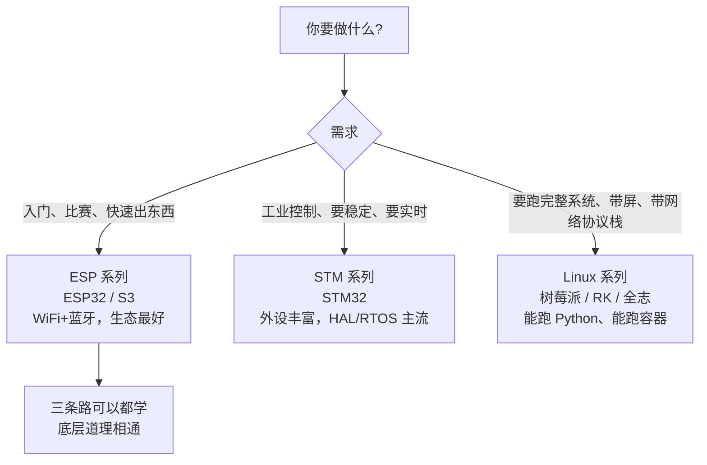

# 硬件开发

**这里解决一个问题：让代码真正控制物理世界。**

软件写错了重新运行就行，硬件写错了可能烧芯片、可能变砖、可能要等一周才能重新焊板子。所以这个板块格外强调**原理**——你得知道电流走哪、寄存器怎么被改、启动时芯片按什么顺序执行。

## 三大方向怎么选



| 方向 | 代表芯片/平台 | 擅长什么 | 什么时候选它 |
| --- | --- | --- | --- |
| [**ESP 系列**](./esp/) | ESP32、ESP32-S3、ESP32-C3 | 自带 WiFi+蓝牙，便宜，生态极好 | 物联网、比赛、需要联网的小设备 |
| [**STM 系列**](./stm/) | STM32F1/F4/H7 等 | 外设齐全，实时性强，工业界用量大 | 电机控制、精密采集、产品化 |
| [**Linux 系列**](./linux/) | 树莓派、RK3568、全志 H 系列 | 能跑完整操作系统，软件生态无限 | 带界面、带视觉、需要复杂网络协议的设备 |

:::tip[三者的本质区别]
一句话概括：

- **ESP/STM 跑的是裸机或 RTOS**，你的程序就是整个系统，从上电第一条指令开始全归你管
- **Linux 板子跑的是操作系统**，你的程序只是众多进程之一，靠内核帮你管内存、管外设、管调度

后者的开发效率高得多，但对实时性和启动时间的控制力弱得多。**不是谁更高级，是取舍不同。**
:::

## 每个方向都覆盖这四层

不管学哪条线，内容都按同一套纵深排列：

| 层 | 内容 | 为什么不能跳 |
| --- | --- | --- |
| **1. 硬件与最小系统** | 供电、时钟、复位、引脚、下载 | 90% 的「板子坏了」其实是这一层的问题 |
| **2. 外设原理** | GPIO、ADC、PWM、I2C、SPI、UART、定时器 | 会用 API 不等于会用外设，时序错了就是调不通 |
| **3. 系统能力** | 中断、内存、RTOS、文件系统、网络 | 功能一复杂就必须有系统观，否则代码会糊成一团 |
| **4. 工程化** | 调试、测试、功耗、量产、排错体系 | 让东西**持续能用**，而不只是能演示一次 |

## 学习路径建议

如果你是零基础：

```
快速上手（拖积木点灯，2~3 天有成果）
    ↓ 想知道为什么
硬件开发 → ESP 系列（完整教程 L0~L7）
    ↓ 想要更硬核
硬件开发 → STM 系列
    ↓ 想做带屏幕带AI的设备
硬件开发 → Linux 系列
```

:::info[「快速上手」和这里是什么关系]
- [快速上手](../quickstart/)：**只教怎么用**，全程积木，目标是三天内做出能演示的东西。不讲原理是刻意的设计
- **硬件开发**（本板块）：**讲清楚为什么**，从寄存器到系统架构，目标是做出能维护、能量产的东西

两者不冲突，是同一个人的两个阶段。先做出东西建立信心，再回头补原理——反过来大部分人会放弃。
:::

## 动手之前必备的三件事

| 项 | 说明 |
| --- | --- |
| **一块开发板 + 数据线** | 线必须能传数据，充电线不行（区分方法见[装驱动页](../quickstart/driver-setup)） |
| **串口工具** | 板子不会说话，所有信息都靠串口吐出来。这是最重要的调试手段，没有之一 |
| **万用表** | 怀疑供电时测电压，比瞎换线快一百倍 |

:::danger[新手最贵的三个错误]
1. **拿 5V 接到 3.3V 的引脚上** —— 芯片当场报废。接线前确认电压
2. **把电源正负极接反** —— 同上。上电前用万用表量一下
3. **带电插拔杜邦线** —— 容易短路，也容易打坏 IO。**改接线先断电**

这三条在 ESP32 的 [QS-0](../quickstart/board) 里有更细的说明，不管玩哪种板子都适用。
:::

## 下一步

- 玩 ESP32（推荐入门）→ [ESP 系列](./esp/)
- 学 STM32 → [STM 系列](./stm/)
- 上 Linux 板子 → [Linux 系列](./linux/)
- 只想先点个灯 → [快速上手](../quickstart/)

---

**其他板块**：[软件编程](../software/) · [快速上手](../quickstart/) · [AI 辅助开发](../ai-coding/) · [速查表](../reference/)
