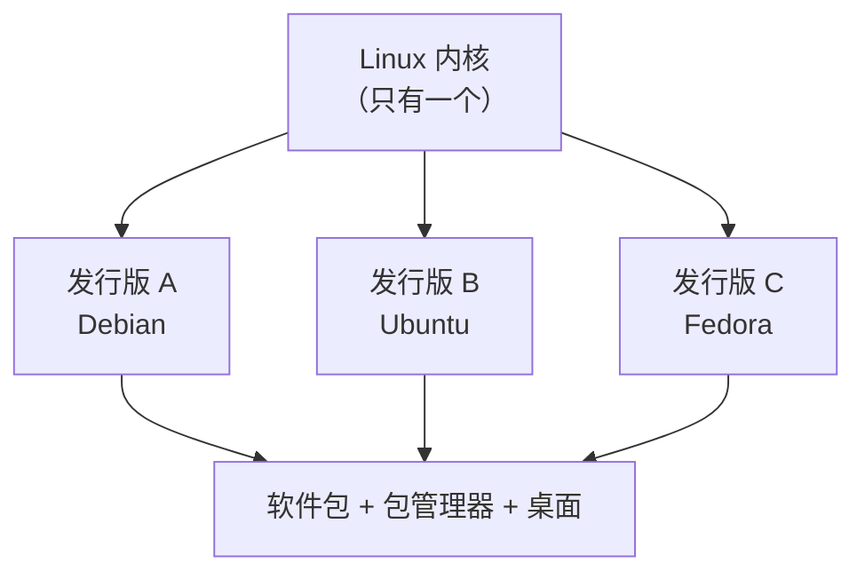

# 01 Linux 是什么

**本课目标**：搞清 Linux 到底是什么，和 Windows 有什么不同。不用动手。

## 一个常被搞混的概念

:::danger[Linux 严格来说只是内核]
**Linux = 内核（kernel）**，负责管内存、调度进程、驱动硬件。

**你用的"Linux 系统"** = 内核 + 一堆软件（shell、命令、桌面……），这整包叫**发行版（distribution）**。

平常说"我装了 Linux"，实际是"装了个 Linux 发行版"。
:::



**同一个内核，加上不同的软件组合和包管理器，就是不同的发行版。**

## 常见发行版

| 发行版 | 基于 | 特点 | 适合 |
| --- | --- | --- | --- |
| **Debian** | —— | 稳定、保守 | **服务器首选** |
| **Ubuntu** | Debian | 易用、资料多 | 新手、桌面 |
| **Fedora** | 独立 | 激进、新技术 | 想尝鲜 |
| **Arch** | 独立 | 极简、全手动 | 折腾爱好者 |
| **Alpine** | 独立 | 极小（几 MB） | 容器 |

:::tip[选发行版别纠结]
**新手选 Ubuntu**（资料最多、遇到问题好搜）。

**服务器选 Debian**（稳定、省心）。

**它们俩的命令几乎一样**（都用 `apt`），学会一个另一个不用重学。
:::

## 和 Windows 的本质区别

| 维度 | Windows | Linux |
| --- | --- | --- |
| **界面** | 图形界面是主体 | **命令行是主体**，图形可选 |
| **软件来源** | 各网站下载 exe | **包管理器统一安装** |
| **文件系统** | C: D: 盘符 | **单一树形结构**，从 `/` 开始 |
| **权限** | 用户账户控制 | **细粒度的 rwx 权限** |
| **配置** | 注册表 + 图形界面 | **纯文本配置文件** |
| **开源** | 闭源 | 大部分开源 |
| **价格** | 收费 | 免费 |

:::danger[最重要的差异：一切皆文件]
Linux 里**几乎所有东西都是文件**：

- 硬盘 → `/dev/sda`
- 串口 → `/dev/ttyUSB0`
- 进程信息 → `/proc/1234/`
- 硬件状态 → `/sys/class/`

**这意味着：读写文件的那套命令，也能用来操作硬件。**

嵌入式 Linux 开发全靠这个特性。
:::

## 为什么服务器都用 Linux

| 原因 | 说明 |
| --- | --- |
| **免费** | 几百台服务器省下的授权费很可观 |
| **稳定** | 跑几年不用重启是常态 |
| **资源占用低** | 最小安装几十 MB 内存就够 |
| **可远程管理** | SSH 一条命令搞定，不用图形界面 |
| **可脚本化** | 一切配置都是文本，能版本控制 |
| **生态** | 大部分服务端软件先支持 Linux |

## 命令行是不是很难

:::tip[其实比图形界面更"简单"]
命令行看起来吓人，但它有个巨大优势：**可重复、可自动化**。

图形界面："点这里→点那里→勾选这个"，**下次还得再点一遍**。

命令行：

```bash
apt install nginx
```

**一行，能写进脚本来执行一千遍。**

而且**命令的规则是统一的**：`命令 -选项 参数`。学会几个就懂套路了。
:::

## 你需要准备什么

**不需要装双系统**。三种方式选一个：

| 方式 | 优点 | 缺点 |
| --- | --- | --- |
| **虚拟机**（VMware/VirtualBox） | 完全隔离，随便折腾 | 占内存 |
| **WSL**（Windows 自带） | 最轻量，和 Windows 互通 | 不是"完整" Linux |
| **云主机** | 真实服务器环境 | 要花钱（有免费额度） |

**下一课详细讲怎么选、怎么装。**

## 本课自检

- [ ] 知道 Linux 严格来说只是内核
- [ ] 知道"发行版" = 内核 + 软件 + 包管理器
- [ ] 记得住 Debian / Ubuntu / Fedora / Arch 的定位
- [ ] **理解"一切皆文件"的含义**
- [ ] 能说出服务器为什么用 Linux
- [ ] 知道命令行相比图形界面的优势
- [ ] 知道有三种方式可以体验 Linux

## 下一步

[02 怎么开始用](./02-get-started) —— 选一种方式把环境跑起来。
