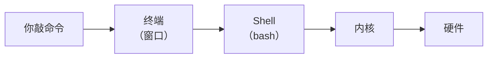

# 03 终端与 Shell

**本课目标**：搞清"终端 / Shell / 命令"三者关系，看懂命令提示符。

## 三个概念别混

| 概念 | 是什么 | 例子 |
| --- | --- | --- |
| **终端**（terminal） | 你敲字的那个**窗口** | GNOME Terminal、Windows Terminal |
| **Shell** | **解释命令的程序** | bash、zsh、dash |
| **命令** | 你敲的东西 | `ls`、`cd`、`grep` |



:::tip[打个比方]
**终端 = 电话机**，**Shell = 接线员**，**内核 = 真正干活的人**。

你对着电话说"我要查文件"（敲命令），接线员听懂后转达给执行者（Shell 调内核），结果再传回来显示在屏幕上。
:::

## 怎么确认自己在用哪个 Shell

```bash
echo $SHELL
```

输出示例：

```text
/bin/bash
```

**bash** 是最常见的 Shell。其他还有 `zsh`（功能更多）、`dash`（更轻更快）。

:::info[`/bin/sh` 通常指向别的 shell]
本站服务器的实测：

```bash
ls -l /bin/sh
# lrwxrwxrwx 1 root root 4 ... /bin/sh -> dash
```

`/bin/sh` 是个**符号链接**，在 Debian/Ubuntu 上指向 `dash`。

**为什么重要**：写脚本时 `#!/bin/sh` 用的是 dash（更严格、更小），`#!/bin/bash` 才是 bash（支持数组等扩展）。
:::

## 命令提示符长什么样

```text
root@debian:~#
```

拆开看：

| 部分 | 含义 |
| --- | --- |
| `root` | 当前用户名 |
| `@` | 分隔符 |
| `debian` | 主机名 |
| `:` | 分隔符 |
| `~` | 当前目录（`~` = 家目录） |
| `#` | **root 用户**（超级管理员） |
| `$` | **普通用户** |

:::danger[`#` 和 `$` 是重要提示]
- **`#` 结尾 = 你是 root**（有全部权限，**能删掉整个系统**）
- **`$` 结尾 = 普通用户**（受权限限制）

**看到 `#` 就要格外小心**——没有"确认删除"这回事。
:::

## 命令的通用格式

```text
命令  [选项]  [参数]
 ↓       ↓       ↓
ls      -l      /home
```

| 部分 | 说明 | 例子 |
| --- | --- | --- |
| **命令** | 程序名 | `ls`、`cp`、`grep` |
| **选项** | 调整行为，以 `-` 开头 | `-l`、`-a`、`--help` |
| **参数** | 操作对象 | `/home`、`file.txt` |

### 短选项和长选项

```bash
ls -l                    # 短选项，一个减号
ls -lh                   # 可以合并写（等于 -l -h）
ls --all                 # 长选项，两个减号
ls --help                # 查看帮助
```

:::tip[合并短选项的顺序随便]
```bash
ls -lh
ls -hl                  # 完全等价
```

**但长选项不能合并**（`--all` 和 `--human-readable` 必须分开写）。
:::

### 选项和参数可以混排

```bash
ls -l /home              # 选项在前
ls /home -l              # 也行，但习惯上选项在前
```

## 内建命令 vs 外部命令

:::info[`cd` 为什么特殊]
```bash
which ls
# /usr/bin/ls           ← 是个程序文件

type cd
# cd 是 shell 内建        ← 不是程序，是 shell 自己的功能
```

**内建命令（builtin）**是 Shell 自己实现的，没有对应文件。

**为什么 `cd` 必须是内建**：改变当前目录只影响 Shell 自己。如果 `cd` 是个独立程序，它改的是"自己那个进程"的目录，Shell 完全不受影响——就白改了。
:::

### 用 `type` 判断

```bash
type ls          # ls is /usr/bin/ls
type cd          # cd is a shell builtin
type echo        # echo is a shell builtin（虽然也有 /bin/echo）
```

常见内建命令：`cd`、`echo`、`pwd`、`export`、`alias`、`source`、`read`

常见外部命令：`ls`、`cp`、`mv`、`grep`、`find`、`ps`

## 命令执行时发生了什么

```bash
ls -l /home
```

1. **Shell 找到 `ls` 这个程序**（在 `PATH` 里搜，[第 18 课](./18-env)讲）
2. **创建子进程**运行它，把 `-l /home` 作为参数传进去
3. **程序的输出**显示在终端
4. **程序结束**，Shell 拿回控制权

:::tip[这就是为什么 `cd` 不能是外部程序]
如果 `cd` 是子进程，它改变的是子进程的工作目录。**子进程退出后，Shell 的目录根本没变。**

（第 17 课会讲子进程的概念。）
:::

## 获取帮助的四种方式

```bash
# ① --help（最快，大部分命令支持）
ls --help

# ② man（最详细，有完整手册）
man ls

# ③ info（GNU 项目常用，比 man 更详细）
info ls

# ④ 看命令在哪、是什么
type ls
```

:::tip[`man` 的使用技巧]
```bash
man ls           # 打开手册
```

在 `man` 页面里：

| 按键 | 作用 |
| --- | --- |
| `空格` / `PageDown` | 下一页 |
| `b` | 上一页 |
| `/关键词` | 搜索 |
| `n` | 跳到下一个匹配 |
| `q` | 退出 |
:::

:::warning[有些精简系统没装 man]
最小安装的 Linux（比如容器镜像）可能没有 `man`。

```bash
command -v man || echo "man 未安装"
apt install man-db           # Debian/Ubuntu 装它
```
:::

## 一次执行多条命令

```bash
# 顺序执行（不管前面成功与否）
cmd1 ; cmd2

# 前面成功才执行后面
cmd1 && cmd2

# 前面失败才执行后面
cmd1 || cmd2

# 组合：失败就报错退出
cd /somewhere && ls && echo "完成"
```

:::danger[`;` 和 `&&` 的区别很重要]
```bash
cd /not/exist ; rm -rf /tmp/x        # 即使 cd 失败，rm 照样执行
cd /not/exist && rm -rf /tmp/x       # cd 失败就停，更安全
```

**写脚本时优先用 `&&`**——出错就别往下走了。
:::

## 完整示例

```bash
# 看清楚自己在哪、用的是什么
echo "当前用户: $(whoami)"
echo "主机名:   $(hostname)"
echo "当前目录: $(pwd)"
echo "Shell:    $SHELL"
echo "内核:     $(uname -r)"

# 看命令类型
type ls
type cd
```

输出示例（本站实测）：

```text
当前用户: root
主机名:   debian
当前目录: /tmp/lx
Shell:    /bin/bash
内核:     6.12.94+deb13-amd64
```

## 常见错误

| 错误 | 现象 | 原因 | 解决 |
| --- | --- | --- | --- |
| 命令打错 | `command not found` | 拼写/未安装 | 检查拼写、装软件包 |
| 选项写错 | `invalid option` | 命令不支持 | `--help` 看支持的选项 |
| 路径含空格没引号 | 参数被拆成多个 | shell 按空格分词 | 加引号 `"my file"` |
| 用 `#` 但以为是普通用户 | 误删系统文件 | 实际是 root | 看提示符、`whoami` |
| 忘了 `cd` 是内建 | —— | 没有 `/usr/bin/cd` | 用 `type` 查 |

## 本课自检

- [ ] 分清终端、Shell、命令三个概念
- [ ] 会用 `echo $SHELL` 看当前 Shell
- [ ] 能看懂提示符（用户名@主机:目录#/$）
- [ ] **知道 `#` 是 root、`$` 是普通用户**
- [ ] 掌握命令格式：`命令 [选项] [参数]`
- [ ] 会用 `--help` 和 `man`
- [ ] 会用 `type` 判断内建还是外部命令
- [ ] 知道 `cd` 为什么必须是内建
- [ ] 分清 `;` 和 `&&` 的区别

## 下一步

[04 目录结构](./04-filesystem) —— 搞清楚 `/etc`、`/var`、`/home` 都是干什么的。
