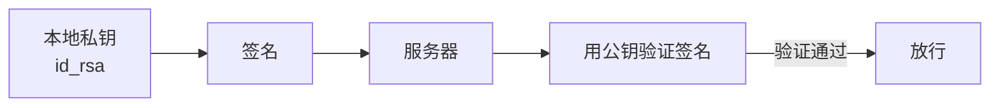

# 15 远程登录与传文件

**本课目标**：会用密钥免密登录，会在本地和服务器之间传文件。

## `ssh`：远程登录

```bash
ssh user@192.168.1.100
ssh user@example.com
ssh user@host -p 2222        # 指定端口（默认 22）
```

第一次连接会问：

```text
The authenticity of host 'example.com' can be established.
ED25519 key fingerprint is SHA256:xxxxx.
Are you sure you want to continue connecting (yes/no)?
```

:::tip[为什么第一次要确认指纹]
SSH 无法证明"这个主机真的是 example.com"（没有权威证书体系），所以**第一次靠你人工确认**。

确认后指纹会存到 `~/.ssh/known_hosts`，下次自动比对。

**这能防止中间人攻击**——如果指纹突然变了，SSH 会警告你。
:::

:::danger[指纹变了要警惕]
```text
WARNING: REMOTE HOST IDENTIFICATION HAS CHANGED!
```

**两种可能**：

1. 服务器**重装了系统**（合法）
2. **有人在中间人攻击**（危险）

**不要盲目删 `known_hosts`**，先确认服务器是否真的重装过。

确认没问题后清理旧记录：

```bash
ssh-keygen -R 192.168.1.100
```
:::

## 密钥认证：免密码登录

:::tip[为什么比密码好]
| | 密码 | 密钥 |
| --- | --- | --- |
| 安全性 | 弱密码可被爆破 | **几乎无法爆破** |
| 便利性 | 每次要输 | **免密** |
| 自动化 | 难（要交互） | **脚本可直接用** |

**这也是自动化部署的基础**——脚本里没法输密码。
:::

### 原理



**私钥永远不出本地**，服务器只存公钥。

### 生成密钥对

```bash
ssh-keygen -t ed25519 -C "your@email.com"
```

会问保存位置（默认 `~/.ssh/id_ed25519`）和密码短语（可留空）。

:::danger[私钥文件权限必须是 600]
```bash
ls -l ~/.ssh/id_ed25519
# -rw------- ... id_ed25519     ✅ 600
```

**权限太松（比如 644）SSH 会拒绝使用**：

```text
WARNING: UNPROTECTED PRIVATE KEY FILE!
Permissions 0644 are too open.
```

```bash
chmod 600 ~/.ssh/id_ed25519
```
:::

### 把公钥传到服务器

```bash
ssh-copy-id user@192.168.1.100
```

它会自动把 `~/.ssh/id_ed25519.pub` 追加到服务器的 `~/.ssh/authorized_keys`，并设好权限。

:::tip[手动方式（`ssh-copy-id` 不可用时）]
```bash
cat ~/.ssh/id_ed25519.pub | ssh user@host \
  "mkdir -p ~/.ssh && chmod 700 ~/.ssh && \
   cat >> ~/.ssh/authorized_keys && chmod 600 ~/.ssh/authorized_keys"
```
:::

### 验证免密

```bash
ssh user@192.168.1.100
```

**不再问密码就成功了。**

:::tip[`BatchMode=yes` 用于脚本]
```bash
ssh -o BatchMode=yes user@host 'echo ok'
```

`BatchMode=yes` 表示**禁止任何交互**（不问密码、不确认指纹）。

**好处**：如果密钥没配好，它会立刻失败而不是卡住等输入——脚本里必备。
:::

## `~/.ssh/config`：简化连接

:::tip[不用每次敲完整地址]
```text
# ~/.ssh/config
Host myserver
    HostName 192.168.1.100
    User root
    Port 22
    IdentityFile ~/.ssh/id_ed25519
    ServerAliveInterval 60
```

之后只需：

```bash
ssh myserver
scp file.txt myserver:/tmp/
```

**配置一次，到处好用。**

| 选项 | 作用 |
| --- | --- |
| `HostName` | 真实地址 |
| `User` | 默认用户 |
| `Port` | 端口 |
| `IdentityFile` | 用哪个私钥 |
| `ServerAliveInterval` | 每 60 秒发心跳（防超时断开） |
:::

:::warning[`config` 文件权限]
```bash
chmod 600 ~/.ssh/config
```

有些 SSH 版本会检查这个。
:::

## `scp`：传文件

```bash
# 本地 → 远程
scp file.txt user@host:/tmp/
scp -r mydir user@host:/tmp/            # 目录加 -r

# 远程 → 本地
scp user@host:/var/log/app.log ./
scp -r user@host:/var/www ./

# 指定端口
scp -P 2222 file.txt user@host:/tmp/    # 注意是大写 P
```

:::danger[`scp` 的端口参数是大写 `-P`]
```bash
scp -P 2222 file host:/tmp/     # ✅ scp 用大写
ssh host -p 2222                # ✅ ssh 用小写
```

**`scp` 用小写 `-p` 是"保留时间戳"，不是端口。** 这个不一致很坑。
:::

## `rsync`：更适合大量文件

```bash
rsync -avz mydir/ user@host:/backup/        # 同步目录
rsync -avz --delete src/ host:/dst/         # 删除目标多余文件
rsync -avz --progress bigfile host:/tmp/    # 显示进度
```

| 选项 | 作用 |
| --- | --- |
| `-a` | 归档（保留权限、时间、符号链接） |
| `-v` | 显示详情 |
| `-z` | 传输时压缩 |
| `--delete` | **目标多余的文件删掉**（真正"同步"） |

:::danger[源路径末尾的 `/` 含义完全不同]
```bash
rsync -av mydir  host:/backup/     # → /backup/mydir/
rsync -av mydir/ host:/backup/     # → /backup/ 里直接是 mydir 的内容
```

**加 `/` = 复制"目录里的内容"**
**不加 `/` = 复制"目录本身"**

**这是 rsync 最容易出错的地方。**
:::

:::tip[为什么用 `rsync` 而不是 `scp`]
| | `scp` | `rsync` |
| --- | --- | --- |
| 增量传输 | ❌ 每次全传 | ✅ **只传变化部分** |
| 断点续传 | ❌ | ✅ `--partial` |
| 排除文件 | ❌ | ✅ `--exclude` |
| 速度（重复传输） | 慢 | **快得多** |

**传大目录、反复同步时用 `rsync`。**
:::

## 免交互执行命令

```bash
ssh host 'uptime'                       # 执行单条命令
ssh host 'cd /var/log && ls -lh'        # 多条用引号包起来
ssh host 'df -h' > local_report.txt     # 结果存本地
```

:::warning[引号决定命令在哪端展开]
```bash
ssh host "ls $HOME"         # ⚠️ $HOME 在本地展开，传到远端的是 /home/you
ssh host 'ls $HOME'         # ✅ 在远端展开，得到远端的 HOME
```

**单引号 = 完全交给远端**，双引号 = 本地先展开。

**需要远端变量时用单引号。**
:::

## 端口转发（了解）

```bash
# 把远端 8080 映射到本地 8080
ssh -L 8080:localhost:8080 user@host
```

之后本地访问 `http://localhost:8080` 就等于访问服务器的 8080。

**常用于访问服务器上只监听 127.0.0.1 的服务**（[第 14 课](./14-network)讲过这个问题）。

## 连不上怎么查

| 现象 | 原因 | 排查 |
| --- | --- | --- |
| `Connection refused` | SSH 服务没起/端口不对 | 服务器上 `ss -tlnp \| grep 22` |
| `Connection timed out` | 网络不通/防火墙 | 先 `ping`，再 `nc -zv host 22` |
| `Permission denied (publickey)` | 密钥没配对 | 检查 `authorized_keys` 和权限 |
| `Permission denied (password)` | 密码错/禁用了密码登录 | 确认密码、看 `sshd_config` |
| `Host key verification failed` | 指纹变了 | 确认后 `ssh-keygen -R host` |
| 一直卡着不动 | 网络丢包/没配密钥 | 加 `-v` 看卡在哪 |
| 登录后马上断开 | shell 配置有问题 | 看 `/etc/passwd` 的 shell |

:::tip[加 `-v` 看详细过程]
```bash
ssh -v user@host          # 详细
ssh -vvv user@host        # 最详细
```

**能看到卡在"TCP 连接"还是"密钥交换"还是"认证"**——定位问题的关键。

（这点和 [第 14 课](./14-network)的 `curl -v` 思路一样。）
:::

:::danger[服务器上的三个权限必须对]
```bash
chmod 700 ~/.ssh
chmod 600 ~/.ssh/authorized_keys
chmod 700 ~                       # 家目录不能是 777
```

**SSH 会检查这些权限，太松会直接拒绝密钥登录**（防止别人篡改你的授权文件）。

**这是"密钥配了但登不上"最常见的原因。**
:::

## 完整示例

```bash
# ① 生成密钥（一路回车，密码短语可留空）
ssh-keygen -t ed25519 -C "me@example.com"

# ② 检查权限
chmod 700 ~/.ssh
chmod 600 ~/.ssh/id_ed25519

# ③ 传到服务器
ssh-copy-id user@192.168.1.100

# ④ 免密验证
ssh user@192.168.1.100 'echo "免密成功"'

# ⑤ 配 config 简化
cat >> ~/.ssh/config << 'EOF'
Host srv
    HostName 192.168.1.100
    User user
    IdentityFile ~/.ssh/id_ed25519
EOF
chmod 600 ~/.ssh/config

# ⑥ 之后就能这样用
ssh srv 'uptime'
scp file.txt srv:/tmp/

# ⑦ rsync 同步目录
rsync -avz ./site/ srv:/var/www/site/
```

## 常见错误

| 错误 | 现象 | 原因 | 解决 |
| --- | --- | --- | --- |
| 私钥 644 | UNPROTECTED PRIVATE KEY | 权限太松 | `chmod 600` |
| `.ssh` 是 777 | 密钥登录被拒 | 权限检查 | `chmod 700` |
| `scp -p 2222` | 端口没生效 | 那是保留时间戳 | 用 `-P` |
| rsync 源末尾加 `/` | 目录结构不对 | 含义不同 | 按需选择 |
| 双引号里用 `$HOME` | 展开成本地的 | 本地先展开 | 改单引号 |
| 盲目删 `known_hosts` | 失去中间人防护 | 没确认原因 | 先确认再 `-R` |

## 本课自检

- [ ] 会用 `ssh user@host` 和 `-p` 指定端口
- [ ] **理解密钥认证原理（私钥不出本地）**
- [ ] 会用 `ssh-keygen -t ed25519` 生成密钥
- [ ] **知道私钥必须 `chmod 600`**
- [ ] 会用 `ssh-copy-id` 部署公钥
- [ ] **知道 `BatchMode=yes` 用于脚本**
- [ ] 会配 `~/.ssh/config` 简化连接
- [ ] 会用 `scp`，**知道端口是 `-P`（大写）**
- [ ] **知道 `rsync` 源路径末尾 `/` 的含义差异**
- [ ] 知道 `rsync` 比 `scp` 快在哪
- [ ] 知道单引号让命令在远端展开
- [ ] **知道服务器上 `.ssh` 权限（700/600）必须对**
- [ ] 会用 `ssh -v` 排查连接问题

## 下一步

[16 文本处理三剑客](./16-grep-sed-awk) —— `grep`、`sed`、`awk` 能省下大量手工活。
