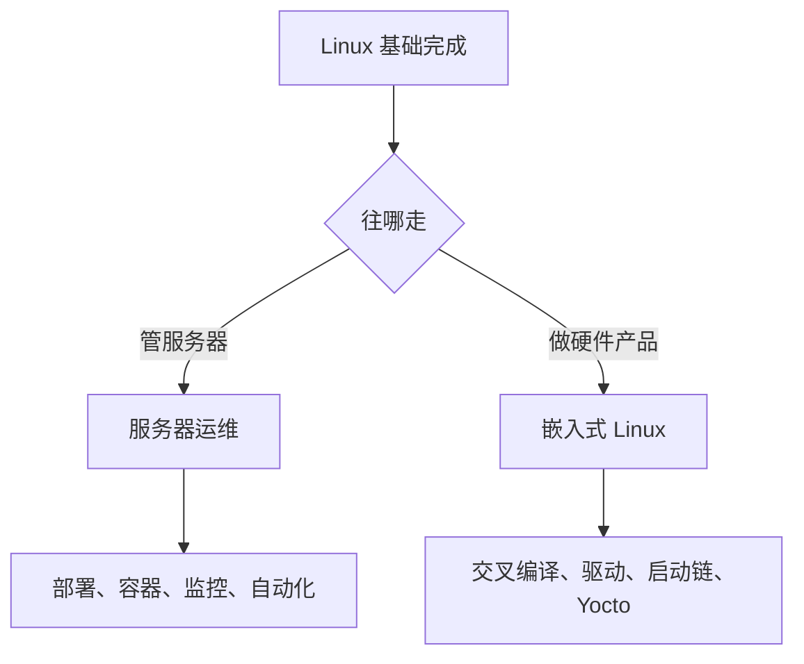

# 21 下一步

**本课目标**：知道自己现在在什么位置，以及接下来该学什么。

## 你现在会什么

20 节课走完，你掌握了：

| 能力 | 说明 |
| --- | --- |
| **命令行** | 终端、Shell、命令格式 |
| **文件系统** | 目录结构、增删改查、查找 |
| **权限** | `rwx`、`chmod`、`umask`、特殊位 |
| **进程** | `ps`、`top`、`kill`、前后台 |
| **软件** | `apt` 及各家包管理器 |
| **用户** | `useradd`、`sudo` |
| **磁盘** | `df`、`du`、挂载 |
| **网络** | `ip`、`ping`、`curl`、`ss` |
| **远程** | `ssh` 密钥登录、`scp`、`rsync` |
| **文本处理** | `grep`、`sed`、`awk` |
| **脚本** | 变量、条件、循环、函数、`set -euo pipefail` |
| **系统管理** | `systemd`、`journalctl` 排错 |

**这已经是一份能用的 Linux 基本功。日常使用和基础运维都够了。**

## 两条路线



### 路线 A：服务器运维

**适合**：想做后端、DevOps、SRE。

| 要学 | 为什么 |
| --- | --- |
| **Docker** | 现在几乎所有部署都用容器 |
| **Nginx / 反向代理** | 网站入口 |
| **数据库运维** | 备份、主从、慢查询 |
| **监控** | Prometheus + Grafana |
| **CI/CD** | GitHub Actions、GitLab CI |
| **配置管理** | Ansible |
| **防火墙** | `nftables` / `ufw` |

**起步项目**：用一台云主机，把本站（如果你有自己的站）完整部署起来——域名、HTTPS、Nginx、自动续期证书。

:::tip[运维的核心不是背命令]
是**"保证服务稳定可用"**的思维方式：

- 出问题能快速定位（你已经学了排错流程）
- 变更可控（配置进 git、能回滚）
- 有监控（出问题前就能发现）
:::

### 路线 B：嵌入式 Linux

**适合**：想做硬件产品、驱动、物联网设备。

| 要学 | 说明 |
| --- | --- |
| **交叉编译** | 在 x86 上编译 ARM 程序 |
| **Buildroot / Yocto** | 构建整个系统镜像 |
| **启动链** | BootROM → U-Boot → Kernel → rootfs |
| **内核驱动** | 字符设备、设备树 |
| **GPIO / I2C / SPI** | 从用户态操作硬件 |
| **systemd 裁剪** | 嵌入式里也要最小化 |

**起步项目**：买一块树莓派或香橙派，交叉编译一个程序，做成开机自启的服务。

:::tip[嵌入式 Linux 和单片机的区别]
| | 单片机（ESP32/STM32） | 嵌入式 Linux |
| --- | --- | --- |
| 内存 | KB 级 | MB ~ GB 级 |
| 有无 MMU | 无 | **有**（能跑多进程） |
| 实时性 | **强** | 弱（除非 RT 补丁） |
| 开发难度 | 中 | **高** |

**想做电机控制、硬实时 → 单片机；想做带屏幕、联网、多任务的设备 → 嵌入式 Linux。**
:::

## 值得补的底层知识

:::tip[Linux 学深了绕不开这几块]
| 主题 | 什么时候需要 |
| --- | --- |
| **C 语言** | 系统编程的基础（[C 零基础](../../software/c-basics/)） |
| **系统调用** | `open`/`read`/`write`/`fork`/`exec` |
| **文件描述符** | 一切 IO 的抽象 |
| **信号** | 进程间通信 |
| **管道/socket** | 进程通信 |
| **/proc 文件系统** | 查内核状态 |
:::

:::danger[不学 C 学不好 Linux 底层]
shell 之上再往下，全是 C。

**想深入（写驱动、看内核源码、做嵌入式）必须会 C。**

本站有 [C 零基础完整教程](../../software/c-basics/) 和 [C++ 零基础](../../software/cpp-basics/)。
:::

## 推荐的练习

| 练习 | 练什么 |
| --- | --- |
| 写一个备份脚本（打包 + 保留 N 份） | 脚本、`tar`、`find`、错误处理 |
| 部署一个静态网站 | Nginx、DNS、HTTPS |
| 写一个 systemd 服务让脚本常驻 | systemd、日志 |
| 用 `awk` 分析一份真实日志 | 文本处理 |
| 配 SSH 免密 + 禁止密码登录 | 安全加固 |
| 写一个磁盘/内存监控脚本 | `df`/`free` + 告警 |
| 在树莓派上交叉编译一个程序 | 嵌入式入门 |

:::tip[选一个"你真的需要"的]
**给自己做工具，动力最足。**

比如：自动备份照片、批量重命名、日志告警、定时抓取数据……
:::

## 安全习惯（重要）

:::danger[这些习惯能避免大部分事故]
1. **`rm -rf` 前先 `ls`**（尤其带变量时用 `${VAR:?}`）
2. **改配置前先备份**（`cp x x.bak`）
3. **改 `sudoers` 用 `visudo`**
4. **不用 root 跑业务服务**
5. **SSH 用密钥，禁用密码登录**
6. **防火墙默认拒绝，按需开放**
7. **重要操作前确认自己在哪台机器**（别在生产机上做实验）
:::

:::warning[一条实用建议]
```bash
# 在 root 提示符下，先看一眼主机名
hostname
```

**很多人有过"以为在测试机、结果在生产机上 `rm -rf`"的经历。**

把提示符里加上主机名（`PS1`）能显著降低这个风险。
:::

## 一份持续学习清单

| 资源 | 用途 |
| --- | --- |
| `man 命令` | **最权威**，永远先查它 |
| `tldr 命令` | 精简示例（装 `tldr` 包） |
| `explainshell.com` | 拆解一条命令每个参数的含义 |
| `/usr/share/doc/` | 软件自带文档 |

:::tip[`tldr` 和 `explainshell` 特别值钱]
**`tldr`**：`man` 太长时，它只给几个最常用例子。

```bash
tldr tar
```

**`explainshell.com`**：把 `tar -czf a.tgz dir` 每个参数的作用标出来——**学命令的最快方式**。
:::

## 回到学习站

| 想做什么 | 去哪 |
| --- | --- |
| 学 C（Linux 底层必备） | [C 零基础](../../software/c-basics/) |
| 学 C++ | [C++ 零基础](../../software/cpp-basics/) |
| 学 Python（写运维脚本更快） | [Python 零基础](../../software/python-basics/) |
| 学嵌入式 Linux 深入 | [Linux 进阶](../linux/) |
| 玩单片机 | [ESP 系列](../../hardware/esp/) · [STM 系列](../../hardware/stm/) |
| 查命令速查 | [速查表](../../reference/) |

## 最后一句话

**Linux 的"难"不在知识量，在于它不隐藏任何东西。**

图形界面会帮你挡住细节；Linux 把一切摊开——你能改任何配置，也能删掉任何文件。

**这份自由既是能力，也是风险。**

:::tip[但你已经有了一套可靠的判断方法]
**"看状态 → 看日志 → 找原因 → 改 → 验证"**

这套流程能解决你在 Linux 上遇到的绝大多数问题。

**剩下的就是多用。**
:::

## 本课自检

- [ ] 能列出自己已掌握的 Linux 能力
- [ ] 知道自己该走服务器运维还是嵌入式 Linux
- [ ] 知道运维的核心是"保证稳定可用"而非背命令
- [ ] 知道嵌入式 Linux 和单片机的区别（MMU、实时性）
- [ ] 知道要深入必须学 C
- [ ] 有一份具体的练习计划
- [ ] 记住七条安全习惯
- [ ] 收藏了 `man`、`tldr`、`explainshell`

---

**回到**：[Linux 零基础教程目录](./) · [硬件开发总览](../)
