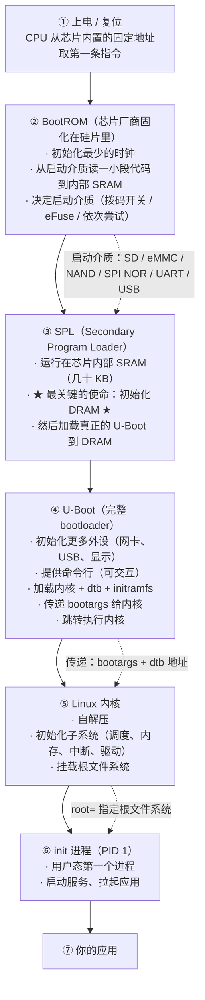
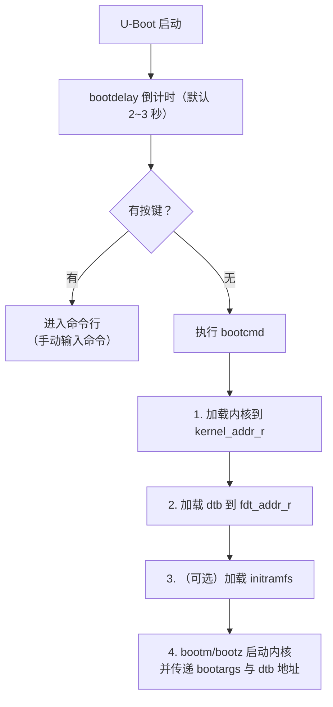

# 01 本页学什么
嵌入式 Linux 最折磨人的时刻是：**板子上电，串口什么都没有，或者卡在某句话不动了**。

要排查，你必须知道整条链路上**每一环负责什么、失败时长什么样**。这一页给出：

- 从上电到 shell 的完整链路，五个阶段各自的职责
- **BootROM 是什么**（芯片里固化的一段代码，你改不了）
- **SPL 为什么存在**（因为 DRAM 还没初始化！）
- U-Boot 的定位、常用命令与环境变量
- 内核启动的三个里程碑（解压、init、挂载 rootfs）
- initramfs 的作用
- **启动日志停在哪就说明问题在哪**的对照表

:::info[实测说明]
本服务器是 **x86_64 + GRUB + systemd** 的 PC 架构，**没有 U-Boot 和 BootROM**（那是 ARM 板子的东西）。

所以本页分两类：
- **✅ 实测**：内核启动阶段、`/boot` 内容、initramfs 结构、`systemd-analyze` 耗时分析、内核启动参数、根文件系统挂载事件——这些在 x86 上完全可见，已实测
- **📋 讲解**：BootROM / SPL / U-Boot 部分是**原理与标准命令**，无法在本机验证
:::

## 1. 完整链路总览




### 为什么分这么多层？

**因为每一层都受限于它运行时可用的资源**：

| 阶段 | 可用的内存 | 能做的事 |
| --- | --- | --- |
| BootROM | **无 DRAM**（只有内部 SRAM，几 KB~几十 KB） | 只能读一小块代码 |
| SPL | 内部 SRAM（几十 KB） | **只能初始化 DRAM**，装不下完整 U-Boot |
| U-Boot | **DRAM（几百 MB）** | 什么都能干：网卡、USB、文件系统、命令行 |

:::tip[核心洞察：SPL 存在的唯一理由]
**SPL 的唯一使命就是初始化 DRAM。**

原因是个鸡生蛋问题：**DRAM 需要初始化才能用，但初始化 DRAM 的代码需要内存才能运行**。

解法就是先在**芯片内部 SRAM**（上电即可用，无需初始化）里跑一小段代码（SPL），它把 DRAM 配好，然后才能把大的 U-Boot 加载进 DRAM 运行。

这就是为什么 SPL 的代码被压缩到极致（有些 SoC 的 SPL 必须小于 32KB）。
:::

## 2. 阶段一：BootROM

### 2.1 它是什么

**BootROM 是芯片出厂时固化在硅片里的一段代码，你无法修改它。**

它的职责：

1. CPU 一复位就从固定地址（通常是 `0x00000000` 或 `0xFFFF0000`）执行它
2. 初始化最基本的时钟
3. **检测启动介质**并从中读取一段代码到内部 SRAM
4. 跳转到那段代码

### 2.2 启动介质的选择

不同 SoC 策略不同：

| SoC | 启动介质选择方式 |
| --- | --- |
| 全志（Allwinner） | 依次尝试：SD 卡 → NAND → SPI NOR → USB（**FEL 模式**，用于救砖） |
| 瑞芯微（Rockchip） | 同上有多种顺序，也有 MaskROM/loader 模式 |
| NXP i.MX | **拨码开关**（boot mode pins）或 eFuse 熔丝决定 |
| 树莓派（BCM） | 先读 SD 卡上的 `bootcode.bin`（较新型号已改为片内 BootROM + EEPROM） |
| TI AM335x（BeagleBone） | 启动引脚顺序 |

**BootROM 只知道从"某个固定的物理偏移"读多少字节**：

- SD 卡：通常从第 8KB（扇区 16）偏移处读
- SPI NOR：通常从 0 地址读
- eMMC：从 boot 分区读

:::danger[这是"完全无输出"故障的主要排查点]
BootROM 阶段失败时，**串口完全没有任何输出**——因为它还没初始化串口。

排查清单：

1. **供电**：电压够吗？电流够吗？（板子峰值电流可能 1A+）
2. **串口接线**：TX/RX 是否**交叉**接（板子 TX → PC RX）？波特率对吗？
3. **启动介质**：SD 卡烧录正确吗？烧的是**整卡镜像**（`.img`）还是只拷了文件？
4. **拨码开关**：启动模式选对了吗？
5. **焊接**：SoC 虚焊（自己焊的板子常见问题）

如果确认以上都 OK 且**有厂商工具**（如全志的 FEL、Rockchip 的 rkdeveloptool），可以用 USB 方式强制进入下载模式验证芯片是否活着。
:::

## 3. 阶段二与三：SPL 与 U-Boot

### 3.1 U-Boot 是什么

**U-Boot（Das U-Boot）是嵌入式领域事实标准的 bootloader**，等价于 PC 上的 GRUB/BIOS，但功能更强（有命令行、网络、脚本）。

源码 `https://www.denx.de/wiki/U-Boot/` 或 GitHub 上的 `u-boot/u-boot` 仓库

### 3.2 U-Boot 常用命令（📋 标准命令，本机无 U-Boot）

```bash
# === 信息类 ===
printenv                  # 打印所有环境变量（最常用）
printenv bootargs         # 只看某一个
version                   # U-Boot 版本
bdinfo                    # 板子信息（DRAM 大小、波特率）
dm tree                   # 设备模型树（新版本）

# === 环境变量操作 ===
setenv bootargs 'console=ttyS0,115200 root=/dev/mmcblk0p2 rootwait'
setenv ipaddr 192.168.1.100
saveenv                   # ★ 保存到持久存储（不执行的话重启就丢）
env default -a            # 恢复默认

# === 存储访问 ===
mmc list                  # 列出 MMC/SD 设备
mmc dev 0                 # 切换到设备 0
mmc part                  # 列出分区
fatls mmc 0:1             # 列出 FAT 分区内容（通常是 boot 分区）
ext4ls mmc 0:2            # 列出 ext4 分区内容
fatload mmc 0:1 0x42000000 zImage    # 从 FAT 分区加载内核到内存地址
ext4load mmc 0:2 0x43000000 /boot/dtb

# === 网络（开发期极其方便）===
setenv serverip 192.168.1.10
tftpboot 0x42000000 zImage           # 从 TFTP 服务器下载内核
dhcp                                 # 自动获取 IP

# === 启动 ===
bootm 0x42000000 - 0x43000000        # 启动内核（地址 - dtb地址）
bootz 0x42000000 - 0x43000000        # 启动 zImage
run bootcmd                          # 执行 bootcmd 变量定义的启动流程
boot                                 # 同上

# === 内存与调试 ===
md 0x42000000 10          # 显示内存内容（memory display）
mw 0x42000000 0x1234      # 写内存
reset                     # 重启
```

### 3.3 关键环境变量

| 变量 | 作用 |
| --- | --- |
| **`bootcmd`** | **自动执行的启动命令**。倒计时内不按键就跑它 |
| **`bootargs`** | **传给内核的命令行参数**（最重要，见下节） |
| `bootargs` 里的 `console=` | 内核控制台用哪个串口、什么波特率 |
| `bootargs` 里的 `root=` | 根文件系统在哪 |
| `bootargs` 里的 `rootwait` | 等待存储设备就绪（SD 卡必需） |
| `bootargs` 里的 `init=` | 指定 init 程序（默认是 `/sbin/init`） |
| `bootargs` 里的 `rw` / `ro` | 根文件系统读写/只读 |
| `ipaddr` / `serverip` | 网络下载用 |
| `bootdelay` | 倒计时秒数（设为 -1 禁止打断） |
| `fdt_addr` / `fdt_addr_r` | 设备树加载地址 |
| `kernel_addr_r` | 内核加载地址 |

### 3.4 bootargs 详解（重点）

`bootargs` 是 **bootloader 与内核之间的契约**。实测本机的内核命令行：

```bash
$ cat /proc/cmdline
BOOT_IMAGE=/boot/vmlinuz-6.12.94+deb13-amd64 root=UUID=d45532a8-f577-4a6a-80a2-7bf9cbc61058 ro quiet
$ tr ' ' '\n' < /proc/cmdline
BOOT_IMAGE=/boot/vmlinuz-6.12.94+deb13-amd64
root=UUID=d45532a8-f577-4a6a-80a2-7bf9cbc61058
ro
quiet
```

嵌入式板子上典型的 `bootargs`：

```
console=ttyS0,115200 root=/dev/mmcblk0p2 rootwait rw earlyprintk
```

| 参数 | 作用 |
| --- | --- |
| `console=ttyS0,115200` | **内核日志与登录终端**走串口 0，波特率 115200 |
| `root=/dev/mmcblk0p2` | 根文件系统在 SD 卡第 2 分区 |
| `root=UUID=xxx` | 或用 UUID（更稳，PC 上常见） |
| `root=PARTUUID=xxx` | 或按分区 UUID（U-Boot 常用） |
| **`rootwait`** | **等待存储设备就绪**。SD 卡/eMMC 异步初始化时**不加就会挂载失败** |
| `ro` / `rw` | 只读 / 读写挂载 |
| `init=/bin/sh` | **救援用**：直接进 shell，不跑 init 系统 |
| `earlyprintk` | **尽早**输出内核日志（排查早期崩溃必备） |
| `quiet` | 减少控制台输出（实测本机有这个） |
| `panic=N` | 内核 panic 后 N 秒自动重启 |
| `mem=512M` | 限制内核可见内存（调试用） |
| `nfsroot=..., nfs` | 从 NFS 挂载根文件系统（**开发神器**） |

:::tip[开发期强烈推荐 NFS 根文件系统]
```bash
setenv bootargs 'console=ttyS0,115200 root=/dev/nfs nfsroot=192.168.1.10:/srv/nfs/rootfs,tcp,v3 rw ip=dhcp'
```

好处：**改了 rootfs 不用重新烧卡**，板子直接挂载 PC 上的目录。开发迭代速度提升一个数量级。

代价：需要网络，且内核必须编入网卡驱动（不能是模块）。
:::

### 3.5 U-Boot 的启动流程（自动模式）



一个典型的 `bootcmd`：

```
bootcmd=load mmc 0:1 ${kernel_addr_r} zImage;
        load mmc 0:1 ${fdt_addr_r} ${fdtfile};
        bootz ${kernel_addr_r} - ${fdt_addr_r}
```

**或更现代的 `extlinux.conf` / `boot.scr` 方式**：把启动配置放文件里，U-Boot 读取执行（类似 GRUB 的配置）。

---

**翻页**：[下一页 →](./boot-02) · [返回目录](./)
