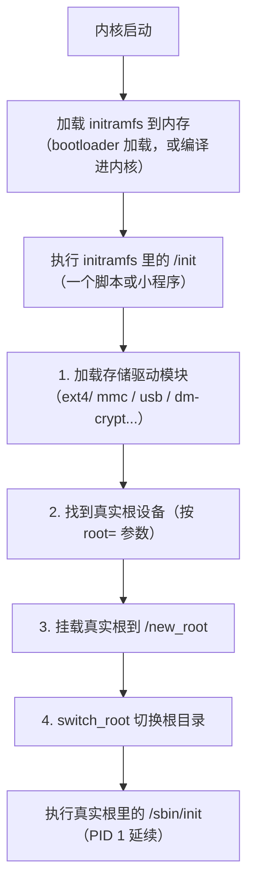
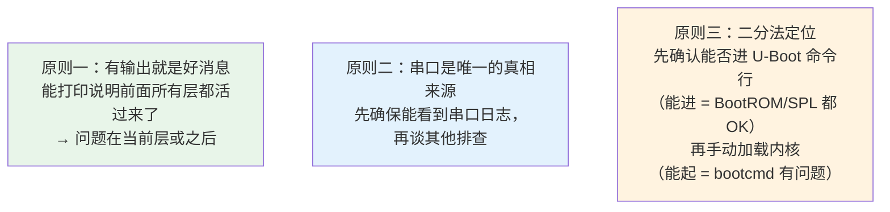

# 02 阶段四：内核启动
### 4.1 内核镜像的形态

PC 上：

```bash
$ file /boot/vmlinuz-6.12.94+deb13-amd64
/boot/vmlinuz-6.12.94+deb13-amd64: Linux kernel x86 boot executable, bzImage, version 6.12.94+deb13-amd64
$ ls -lh /boot/vmlinuz-$(uname -r) /boot/initrd.img-$(uname -r)
-rw-r--r-- 1 root root 50M Sep 19 23:03 /boot/initrd.img-6.12.94+deb13-amd64
-rw-r--r-- 1 root root 12M Jun 20 15:03 /boot/vmlinuz-6.12.94+deb13-amd64
```

**注意 vmlinuz 是压缩过的**（名字里的 `z` = zImage/compressed）。内核会**自解压**。

嵌入式上的几种镜像格式：

| 格式 | 说明 |
| --- | --- |
| **`zImage`** | ARM 上的**自解压**压缩内核（老式，ARM32 常用） |
| **`uImage`** | zImage + **64 字节 U-Boot 头**（含校验和、加载地址）。老教程里 `mkimage` 生成 |
| **`Image`** | **未压缩**的内核（ARM64 常用，因为现在的存储够大且启动更快） |
| **`Image.gz` / `Image.lz4`** | 压缩的 ARM64 内核 |
| **`bzImage`** | x86 的压缩内核（big zImage） |

:::info[uImage 与 zImage 的选择]
现代 U-Boot 可以直接启动 zImage/Image（`bootz`/`booti` 命令），**不需要** uImage 的那层包装了。但老教程和某些 BSP 还在用 `mkimage`。

ARM64 上用 `booti` 命令启动 `Image`，ARM32 上用 `bootz` 启动 `zImage`。
:::

### 4.2 内核启动的三个里程碑

实测本机 dmesg 里的关键事件：

```
[    0.000000] Kernel command line: BOOT_IMAGE=/boot/vmlinuz-6.12.94+deb13-amd64 root=UUID=... ro quiet
[    1.686094] Run /init as init process
[    4.580146] EXT4-fs (sda1): mounted filesystem d45532a8-... ro with ordered data mode.
[    6.951342] EXT4-fs (sda1): re-mounted d45532a8-... r/w.
```



```mermaid
gantt
    title 内核启动时间线（本机实测时间）
    dateFormat X
    axisFormat %Ss
    section 内核
    自解压与早期初始化 :0, 1590
    子系统初始化与驱动 probe :1590, 1686
    启动 /init (PID 1) :1686, 4577
    section 用户态
    initramfs 阶段挂载根 :1686, 4580
    切换到真实根文件系统 :4580, 6951
    systemd 服务启动 :4580, 44750
```

**里程碑解读**：

| 时间戳（本机） | 事件 | 含义 |
| --- | --- | --- |
| `0.000000` | `Kernel command line` | 内核开始跑，打印启动参数 |
| `1.595168` | `Freeing unused kernel image (initmem)` | 内核初始化完成，释放 init 段内存 |
| **`1.686094`** | **`Run /init as init process`** | **★ 进入用户态 ★**，PID 1 启动 |
| `4.580146` | `EXT4-fs (sda1): mounted filesystem ... ro` | 根文件系统挂载（**只读**） |
| `6.951342` | `re-mounted ... r/w` | 重新挂载为**读写**（因为 cmdline 里有 `ro`，initramfs 阶段处理） |

:::tip[这三个时间戳是排查的黄金坐标]
- **日志停在自解压之后、没有任何输出** → 内核崩溃在最早期（`earlyprintk` 可以救）
- **日志到 `Run /init` 之前** → 内核问题（驱动、时钟、内存）
- **日志过了 `Run /init` 但之后卡住** → **用户态问题**（init 不存在、rootfs 缺库、fstab 错）
- **日志停在 "Waiting for root device"** → 根文件系统设备没找到（存储驱动是模块但没进 initramfs，或 `root=` 写错）
:::

### 4.3 initramfs / initrd：为什么要它

**问题**：内核要挂载根文件系统才能跑 init，但根文件系统在 SD 卡上，而**SD 卡驱动可能被编译成了模块（.ko），模块又在根文件系统里**——死锁。

**解法：initramfs**——一个**临时的内存根文件系统**，里面装着挂载真实根所必需的驱动模块和工具。



实测本机的 initramfs 结构：

```bash
$ lsinitramfs /boot/initrd.img-6.12.94+deb13-amd64 | head -10
kernel
kernel/x86
kernel/x86/microcode
kernel/x86/microcode/.enuineIntel.align.0123456789abc
kernel/x86/microcode/GenuineIntel.bin
.
usr
usr/lib
usr/lib/modules
usr/lib/modules/6.12.94+deb13-amd64
```

注意开头是 CPU 微码（microcode），然后是完整的目录结构 —— **initramfs 本身就是一个小的根文件系统**。

:::warning[initrd 与 initramfs 不是一回事]
| | initrd（老） | initramfs（新） |
| --- | --- | --- |
| 本质 | **块设备镜像**（需要 ext2 等文件系统 + ramdisk 驱动） | **cpio 归档**，直接解压到 page cache |
| 大小 | 固定（浪费内存） | **动态**（按需） |
| 现状 | 已废弃 | **现代标准** |

虽然大家还习惯说 "initrd"，但 Debian 现在的 `/boot/initrd.img-*` 实际是 **initramfs**。
:::

**嵌入式上**：很多板子**不用 initramfs**，因为驱动全部编译进内核（`=y` 而不是 `=m`），内核直接就能挂载根。这更简单也更快。

### 4.4 内核启动参数里那些"安静"的选项

实测本机 cmdline 里有 `quiet`。

**`quiet` 会压低 console_loglevel，导致大量内核信息不显示**。在开发板上排查问题时，务必把它去掉，并加上：

```
earlyprintk          # 尽早输出（在串口初始化前用，排查早期崩溃）
ignore_loglevel      # 忽略级别限制，全部输出
initcall_debug       # 打印每个 initcall 的耗时（★★ 排查启动卡住的神器）
```

:::tip[initcall_debug 是排查启动卡住的终极武器]
启动时加 `initcall_debug`，内核会打印**每一个子系统初始化函数的耗时**：

```
[    1.234567] calling  spi_init+0x0/0x100 @ 1
[    1.240000] initcall spi_init+0x0/0x100 returned 0 after 5000 usecs
```

如果启动卡住，**最后打印的那一行就是卡住的那个驱动**——直接定位到具体模块。
:::

## 5. 阶段五：init 与用户态

### 5.1 PID 1

实测：

```bash
$ ps -p 1 -o pid,ppid,comm= | cat
    PID    PPID 
      1       0 systemd
$ readlink /proc/1/exe
/usr/lib/systemd/systemd
```

内核启动的第一个用户态程序（PID 1），按这个顺序找：

1. `init=` 内核参数指定的程序（最高优先）
2. `/sbin/init`
3. `/etc/init`
4. `/bin/init`
5. `/bin/sh`（最后的兜底）

**找不到就 panic**：`Kernel panic - not syncing: No working init found.`

### 5.2 initramfs 的 /init vs 真实 init

注意实测日志里是 `Run /init as init process`——**先跑 initramfs 里的 `/init`**，它完成挂载真实根后调用 `switch_root`，最终执行真实根里的 `/sbin/init`。

**整个过程 PID 一直是 1**（`switch_root` 是在同一个进程里 exec 到新根中的 init，不是新创建一个进程）。

### 5.3 systemd 启动分析（实测）

```bash
$ systemd-analyze
Startup finished in 4.982s (kernel) + 39.768s (userspace) = 44.750s 
graphical.target reached after 39.763s in userspace.
```

**这个命令对优化启动时间极有价值**：

- `kernel` 部分 = 内核从启动到 PID 1 的时间
- `userspace` 部分 = init 系统把所有服务拉起来的时间

找出最慢的服务：

```bash
$ systemd-analyze blame | head -6
14min 28.372s cf-youxuan.service
      27.290s docker.service
      23.554s r2-backup.service
       7.215s networking.service
       6.616s cloudflared.service
       2.621s dev-sda1.device
```

（这台服务器上有个服务耗时 14 分钟，明显是卡住过的——**这正是 `blame` 要发现的异常**）

```bash
$ systemctl get-default
graphical.target
```

:::tip[嵌入式启动时间优化]
产品要求启动 `< 3` 秒时，`systemd-analyze blame` 是第一步。常见优化：

1. **删掉不需要的服务**（`systemctl disable xxx`）
2. 关闭 `systemd-udev-settle`、`NetworkManager-wait-online` 这类"等待型"服务
3. 用 `systemd-analyze critical-path` 看关键路径
4. 实在不行就**不用 systemd，改用 BusyBox init**（见 [根文件系统](./rootfs)）

另外内核侧：关掉不用的驱动、减少 `initcall_debug` 开销、用压缩率/速度更合适的内核压缩算法（lz4 比 gzip 快很多）。
:::

## 6. 启动失败排查对照表

**这是本页最实用的一节。按串口上最后一条日志定位问题。**

| 串口最后的日志 | 问题在哪一层 | 排查方向 |
| --- | --- | --- |
| **完全没有任何输出** | BootROM 之前 | 供电、串口接线（TX/RX 交叉）、波特率、启动介质、拨码开关 |
| 乱码 | 串口 | **波特率不对**（115200 最常见，但有 1.5M 的板子） |
| U-Boot 的 `Hit any key to stop autoboot` 后卡住 | U-Boot 的 bootcmd | bootcmd 里的文件不存在/路径错 |
| `** Unable to read file zImage **` | U-Boot 加载阶段 | 内核文件不在 boot 分区；分区号错；FAT/ext4 驱动未编入 U-Boot |
| `Wrong Image Format for bootm command` | U-Boot | 镜像格式不匹配（`bootm` vs `bootz` vs `booti` 用错） |
| `Bad Linux ARM zImage magic!` | U-Boot | 用了 `bootz` 启动非 zImage（ARM64 该用 `booti`） |
| **`Starting kernel ...` 之后无任何输出** | **内核最早期** | 内核没配 console；`bootargs` 的 `console=` 错；**内核崩溃在极早期**（加 `earlyprintk`） |
| `Uncompressing Linux... done, booting the kernel.` 后无输出 | 内核早期 | 同上；也可能是 **dtb 不对**导致串口驱动没匹配 |
| `Kernel panic - not syncing: VFS: Unable to mount root fs` | **根文件系统** | `root=` 参数错；存储驱动没编进内核/没进 initramfs；rootfs 镜像没烧 |
| `Waiting for root device /dev/mmcblk0p2...`（反复） | 存储 | SD 卡/eMMC 驱动缺失（`rootwait` 没加？驱动是模块？） |
| `Kernel panic - not syncing: No working init found` | init | rootfs 里没有 init 程序，或 `init=` 指向的文件不存在 |
| `-/bin/sh: can't access tty; job control turned off` | init/终端 | 控制台设备节点不存在（rootfs 里缺 `/dev/console`、`/dev/ttyS0`） |
| 进了 shell 但缺一堆命令 | rootfs | BusyBox 没装全，或 `PATH` 不对 |
| 服务起来但应用没启动 | 用户态 | init 脚本/systemd unit 配置问题 |
| 卡在某个驱动 probe（日志停在某行） | 内核驱动 | 加 `initcall_debug` 定位到具体 initcall |

### 6.1 排查心法：三条原则



**具体做法**：卡在自动启动时，**按任意键进 U-Boot 命令行**，然后手动一步步执行：

```bash
# 1. 先看存储能不能访问
mmc list
mmc dev 0
fatls mmc 0:1

# 2. 手动加载内核（看是不是文件不存在）
fatload mmc 0:1 0x42000000 zImage

# 3. 手动加载 dtb
fatload mmc 0:1 0x43000000 sun8i-h3-nanopi-neo.dtb

# 4. 手动启动（加上更详细的参数）
setenv bootargs 'console=ttyS0,115200 root=/dev/mmcblk0p2 rootwait rw earlyprintk ignore_loglevel'
bootz 0x42000000 - 0x43000000
```

**每一步都能验证一层**，卡在哪一步就知道问题在哪。

---

**翻页**：[← 上一页](./boot-01) · [下一页 →](./boot-03) · [返回目录](./)
