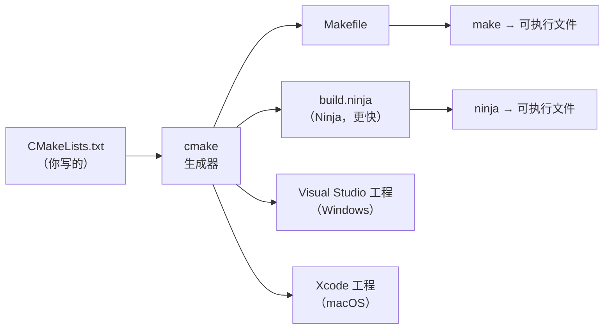

# 02 Makefile 变量与函数
### 3.1 两种赋值：`:=` 与 `=`（重点）

| 写法 | 名称 | 何时求值 | 特点 |
| --- | --- | --- | --- |
| `VAR = value` | **递归展开** | **每次使用时**才展开 | 可以引用后面才定义的变量，但**可能无限递归** |
| `VAR := value` | **简单展开** | **定义时**立即展开 | 快、可预测 |
| `VAR ?= value` | 条件赋值 | 若未定义才赋值 | 用于"可被覆盖的默认值" |
| `VAR += value` | 追加 | — | 追加到原值后面 |

**为什么推荐默认用 `:=`**：

```makefile
# 递归展开的坑
CFLAGS = $(INCLUDES) -O2
INCLUDES = -Iinclude
# 上面没问题，因为 CFLAGS 用到时才展开，此时 INCLUDES 已定义

# 但这样会无限递归：
CFLAGS = $(CFLAGS) -O2      # 报错：Recursive variable references itself

# 简单展开可避免：
CFLAGS := $(CFLAGS) -O2     # 先取旧值再追加，安全
```

:::tip[实战建议]
- **默认用 `:=`**，行为可预测
- 需要"引用后面定义的变量"时才用 `=`（很少见）
- `CFLAGS ?= -O2` 让使用者可以从命令行覆盖：`make CFLAGS="-O0 -g"`
:::

### 3.2 自动变量（必须记住）

| 变量 | 含义 |
| --- | --- |
| `$@` | **目标**文件名 |
| `$<` | **第一个**依赖文件名 |
| `$^` | **所有**依赖（去重） |
| `$+` | 所有依赖（**不去重**，保持顺序） |
| `$?` | 比目标**新**的那些依赖 |
| `$*` | 模式规则中 `%` 匹配的部分 |

对照上面的实例：

```makefile
$(TARGET): $(OBJS)
	$(CC) $(CFLAGS) -o $@ $^ $(LDFLAGS)
#                     ↑  ↑
#                    app  build/main.o build/util.o

$(OBJDIR)/%.o: $(SRCDIR)/%.c | $(OBJDIR)
	$(CC) $(CFLAGS) -MMD -MP -c $< -o $@
#                                 ↑     ↑
#                            src/main.c  build/main.o
```

### 3.3 常用内置函数

| 函数 | 作用 | 例子 |
| --- | --- | --- |
| `$(wildcard pattern)` | 展开通配符 | `$(wildcard src/*.c)` |
| `$(patsubst from,to,list)` | 模式替换 | `$(patsubst src/%.c,build/%.o,$(SRCS))` |
| `$(notdir list)` | 去掉目录部分 | `$(notdir src/a.c)` → `a.c` |
| `$(dir list)` | 取目录部分 | `$(dir src/a.c)` → `src/` |
| `$(basename list)` | 去后缀 | `$(basename a.c)` → `a` |
| `$(addprefix pre,list)` | 加前缀 | `$(addprefix -I,$(INCS))` |
| `$(addsuffix suf,list)` | 加后缀 | — |
| `$(foreach v,list,body)` | 循环 | `$(foreach d,$(DIRS),$(wildcard $(d)/*.c))` |
| `$(shell cmd)` | 执行 shell 命令 | `$(shell git describe --tags)` |
| `$(subst a,b,text)` | 文本替换 | — |

**变量替换的简写**：`$(OBJS:.o=.d)` 等价于 `$(patsubst %.o,%.d,$(OBJS))`。

### 3.4 模式规则与 Order-only 前置条件

```makefile
$(OBJDIR)/%.o: $(SRCDIR)/%.c | $(OBJDIR)
	$(CC) $(CFLAGS) -MMD -MP -c $< -o $@
```

**`| $(OBJDIR)` 里的竖线是 order-only 前置条件**：

- 竖线**左边**的依赖：参与时间戳比较（依赖更新则重建目标）
- 竖线**右边**的依赖：**只要求它先存在**，不参与时间戳比较

为什么 `build/` 目录需要 order-only？因为**目录的 mtime 会在每次往里放文件时变化**。如果用普通依赖，每次编译后 `build/` 变新，会导致下一轮所有 `.o` 都被误判为"过时"。

### 3.5 .PHONY：伪目标

```makefile
.PHONY: all clean install
```

**作用**：告诉 make，`all`、`clean` 这些**不是真实文件名**。

如果不加 `.PHONY`，而目录里恰好有一个叫 `clean` 的文件，那么：

```bash
$ make clean
make: 'clean' is up to date.      # 什么都不做！
```

因为 make 认为目标 `clean` 已存在且没有依赖，所以"最新"。

**规则：所有不产生同名文件的目标都要加 `.PHONY`**。

### 3.6 依赖文件的引入

```makefile
-include $(DEPS)
```

前面的**减号**表示"文件不存在也别报错"。第一次构建时 `.d` 文件还没有，没有减号就会报错。

`include` 的语义是"把那个文件的内容插到这里"，所以 `.d` 里写的 `build/main.o: src/main.c include/util.h` 就变成了 Makefile 的一部分。

### 3.7 实测：查看 make 的内置变量

```bash
$ make -p 2>/dev/null | grep -E '^(CC|RM|MAKE|CXX)\s*='
MAKE = $(MAKE_COMMAND)
RM = rm -f
CXX = g++
```

`make -p` 打印**所有**规则和变量（包括内置的），是排查"这个变量默认值是什么"的终极手段。注意 `CC` 没在这几行里出现是因为 grep 模式的原因，实际上 `CC` 默认是 `cc`。

:::warning[CC 的默认值不是 gcc]
`make` 内置的 `CC` 默认值是 **`cc`**（一个通常指向 gcc 的符号链接），不是 `gcc`。交叉编译时你必须显式指定：

```bash
make CC=arm-linux-gnueabihf-gcc
```

或在 Makefile 里 `CC := arm-linux-gnueabihf-gcc`。
:::

## 4. 递归 make vs 单一 Makefile

| 方案 | 做法 | 优点 | 缺点 |
| --- | --- | --- | --- |
| **递归 make** | 每个子目录一个 Makefile，顶层 `$(MAKE) -C subdir` | 结构清晰、模块独立 | **依赖关系跨目录不可见**，可能编错顺序；改头文件传播困难 |
| **单一 Makefile** | 一个顶层 Makefile 管所有 | 依赖关系完整、增量准确 | 单文件可能很大 |

**业界共识（Peter Miller 的经典论文 "Recursive Make Considered Harmful"）**：递归 make 是有害的，因为**它破坏了依赖图的完整性**——子目录 A 不知道子目录 B 的变化，导致该重编的没重编，产生难以排查的"幽灵 bug"。

**务实做法**：中等项目用单一 Makefile（配合 `wildcard` 自动收集源文件），大型项目用 CMake 生成构建文件（CMake 生成的 Ninja/Make 是完整的全局依赖图）。

## 5. CMake

### 5.1 CMake 解决什么问题

CMake **不是编译器，也不是构建系统**，它是**构建文件的生成器**：



价值：**一份 CMakeLists.txt，在 Linux/Windows/macOS 上都能生成对应的原生构建文件**。

### 5.2 最小 CMakeLists.txt

```cmake
cmake_minimum_required(VERSION 3.16)
project(myapp C)

set(CMAKE_C_STANDARD 11)

add_executable(myapp
    src/main.c
    src/util.c
)

target_include_directories(myapp PRIVATE include)

target_link_libraries(myapp PRIVATE m pthread)
```

核心命令：

| 命令 | 作用 |
| --- | --- |
| `cmake_minimum_required()` | 声明最低版本（**通常放在第一行**） |
| `project(name LANGUAGES)` | 项目名与语言 |
| `add_executable(target srcs)` | 定义可执行文件 |
| `add_library(name STATIC/SHARED srcs)` | 定义库 |
| `target_include_directories()` | 头文件搜索路径 |
| `target_link_libraries()` | 链接的库 |
| `target_compile_definitions()` | 宏定义（如 `-DDEBUG`） |
| `add_subdirectory()` | 加入子目录 |
| `find_package()` / `find_library()` | 查找外部依赖 |

### 5.3 out-of-source build（重要）

```bash
mkdir -p build && cd build
cmake ..
cmake --build .
```

**永远不要在源码目录里直接 `cmake .`**。因为 cmake 会生成大量中间文件（`CMakeCache.txt`、`CMakeFiles/`），污染源码树，且**切换编译器时必须清干净**。

:::tip[为什么交叉编译时尤其要注意]
`CMakeCache.txt` 会**缓存** `CMAKE_C_COMPILER` 等设置。如果你第一次用本机 gcc 配置过，再切到交叉编译器，**必须删除 build 目录重新来**，否则 CMake 会警告编译器已改变并要求你清空缓存。
:::

### 5.4 交叉编译：toolchain file（嵌入式核心）

这是 CMake 在嵌入式 Linux 上**最重要的用途**。

```cmake
# toolchain-aarch64.cmake
set(CMAKE_SYSTEM_NAME Linux)
set(CMAKE_SYSTEM_PROCESSOR aarch64)

# 交叉编译器
set(CMAKE_C_COMPILER   aarch64-linux-gnu-gcc)
set(CMAKE_CXX_COMPILER aarch64-linux-gnu-g++)

# sysroot：目标板的根目录（头文件和库从这里找）
set(CMAKE_SYSROOT /opt/sysroot/aarch64)

# 只在 sysroot 里找依赖，不要找宿主机的
set(CMAKE_FIND_ROOT_PATH ${CMAKE_SYSROOT})
set(CMAKE_FIND_ROOT_PATH_MODE_PROGRAM NEVER)   # 工具程序用宿主机的（如 pkg-config）
set(CMAKE_FIND_ROOT_PATH_MODE_LIBRARY ONLY)    # 库只在 sysroot 找
set(CMAKE_FIND_ROOT_PATH_MODE_INCLUDE ONLY)    # 头文件只在 sysroot 找
set(CMAKE_FIND_ROOT_PATH_MODE_PACKAGE ONLY)
```

使用：

```bash
cmake -DCMAKE_TOOLCHAIN_FILE=toolchain-aarch64.cmake ..
```

**`CMAKE_FIND_ROOT_PATH_MODE_*` 这几个设置是交叉编译成败的关键**：不设的话，CMake 会在宿主机的 `/usr/lib` 找到 x86 的库，链接时才发现架构不对。

:::warning[本节 CMake 命令未经实测]
**本服务器没有安装 cmake**（`command -v cmake` 无输出），所以上面的 CMakeLists.txt 和 toolchain file 是**标准写法示例**，我**没有**实际运行验证。

**CMake 在不同版本间语法有差异**（尤其是 `cmake_minimum_required` 的策略行为）。使用前请对照你实际的 CMake 版本和官方文档 `https://cmake.org/cmake/help/latest/`
:::

---

**翻页**：[← 上一页](./build-system-01) · [下一页 →](./build-system-03) · [返回目录](./)
