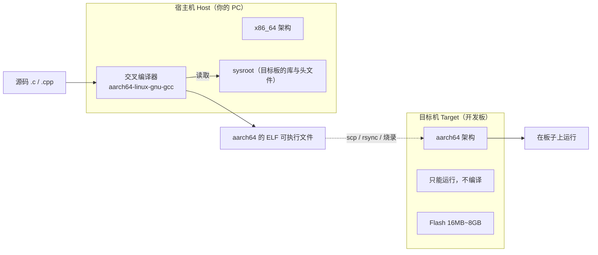
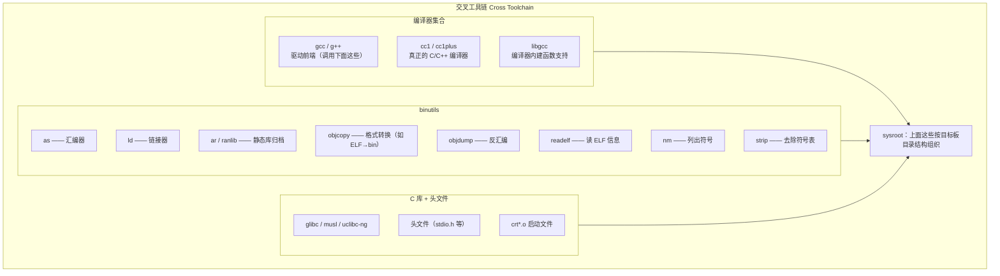

# 01 本页学什么
**这是整个嵌入式 Linux 主线中最"嵌入式"的一页**——前面的知识在服务器运维里也用得上，而这一页几乎只属于嵌入式。

- 为什么不能在板子上直接编译？
- `arm-linux-gnueabihf-gcc` 这一长串名字每个部分是什么意思？
- **`arm-none-eabi` 和 `arm-linux-gnueabihf` 有什么区别**（最高频的混淆）
- 工具链里除了 gcc 还有谁？binutils 各个工具的职责
- **sysroot 是什么**，为什么交叉编译必须有它
- 硬浮点 `hf` 与软浮点，ABI 不匹配会怎样
- **静态链接 vs 动态链接**的取舍与 glibc 静态链接的陷阱
- **动态库查找的完整顺序**（RPATH / LD_LIBRARY_PATH / RUNPATH / ld.so.cache）
- 第三方库交叉编译的标准流程

:::warning[本页的实测边界，请先看清楚]
本服务器**没有安装任何交叉编译器**（已确认 `/usr/bin` 下无 `arm-*`/`aarch64-*` gcc）。

因此本页分两类内容：

- **✅ 实测部分**：所有关于**本机动态链接**的机制（ldd、readelf、ldconfig、RPATH/RUNPATH、静态链接体积与警告）——这些在 x86_64 上完全成立，已实测，会贴上真实输出。
- **📋 示例部分**：交叉编译器的具体命令（如 `aarch64-linux-gnu-gcc ...`）——这些是**标准做法示例**，我**没有**实际运行，不会伪造输出。

我不会把没跑过的东西说成"实测"。
:::

:::info[实测环境]
Debian 13 (trixie) / 内核 6.12.94 / gcc (Debian 14.2.0-19) 14.2.0 / glibc 2.41 / binutils 2.40 / `gcc -dumpmachine` = `x86_64-linux-gnu`
:::

## 1. 为什么需要交叉编译

### 1.1 三个理由

| 理由 | 说明 |
| --- | --- |
| **架构不同** | PC 是 x86_64，板子是 ARM/RISC-V/MIPS。**指令集不同，二进制无法通用** |
| **性能太弱** | 典型开发板 1GHz 4 核 + 512MB 内存，编译一个大型项目可能要几小时（PC 上几十秒） |
| **存储太小** | 板子 Flash 可能只有 16MB，装不下编译器和头文件 |



### 1.2 关键术语

| 术语 | 含义 |
| --- | --- |
| **Host（宿主机）** | **运行编译器**的机器 → 你的 PC（x86_64） |
| **Target（目标机）** | **运行编译产物**的机器 → 开发板（aarch64） |
| **Build（构建机）** | 编译**编译器本身**的机器（只在制作工具链时才关心） |
| **Canadian Cross** | 三者和（build/host/target）都不同的极端情况 |

**交叉编译的定义就是 `host != target`**。

## 2. 工具链命名规则（三元组 / 四元组）

### 2.1 拆解 `arm-linux-gnueabihf-gcc`

```
arm    -  linux  -  gnueabihf  -  gcc
  │         │          │          │
  │         │          │          └── 工具名
  │         │          └── ABI（应用二进制接口）
  │         └── 操作系统/内核（有的话）
  └── 架构
```

四个字段：

| 字段 | 含义 | 常见值 |
| --- | --- | --- |
| **arch（架构）** | CPU 架构 | `arm`、`aarch64`、`riscv64`、`mips`、`x86_64`、`i686` |
| **vendor（厂商）** | 通常是 `none` 或省略 | `none`、`unknown`、`poky` |
| **os（操作系统）** | 目标有 OS 吗 | `linux`（有 Linux）、**`none`（裸机，无 OS）** |
| **abi（二进制接口）** | 调用约定 + 浮点规则 | `gnu`、`gnueabi`、`gnueabihf`、`musl`、`uclibc` |

### 2.2 最高频的混淆：`arm-none-eabi` vs `arm-linux-gnueabihf`

| 工具链 | os 字段 | 用途 | 能链接 glibc 吗 |
| --- | --- | --- | --- |
| **`arm-none-eabi-gcc`** | **`none`** = 无操作系统 | **裸机开发**：STM32 等 MCU、bootloader、RTOS | ❌ **不能**，用 newlib 等专为裸机的库 |
| **`arm-linux-gnueabihf-gcc`** | **`linux`** = 有 Linux | **嵌入式 Linux 应用**：开发板上的程序 | ✅ 能，链接 glibc/musl |

:::danger[用错工具链的症状]
- 用 `arm-none-eabi-gcc` 编译 Linux 程序 → 找不到 `stdio.h` 里的 Linux 相关定义，或链接时缺 `start`、`_sbrk` 等符号
- 用 `arm-linux-gnueabihf-gcc` 编译 STM32 裸机程序 → 链接时会依赖 glibc 和 Linux 系统调用，生成的固件无法运行

**判断标准只有一个**：你的目标板**跑 Linux 吗**？
- 跑 → 用 `*-linux-*`
- 不跑（裸机/RTOS）→ 用 `*-none-eabi`

本站的 [STM32 教程](../../hardware/stm/) 用的是裸机工具链，而本页讲的是 Linux 工具链。
:::

### 2.3 ABI 字段里的浮点问题（ARM 专有）

ARM 的 ABI 字段特别复杂，因为历史上有两套浮点约定：

| ABI | 含义 | 浮点参数传递 |
| --- | --- | --- |
| `gnueabi`（**softfp**） | 软浮点 ABI，但**编译器可用硬件浮点指令** | 通过**整数寄存器**传浮点参数 |
| `gnueabihf`（**hard**） | 硬浮点 ABI | 通过 **FPU 寄存器**传浮点参数 |
| `eabi`（不带 gnu） | 不带 GNU 扩展的 EABI（`arm-none-eabi` 裸机工具链即此类） | 由 `-mfloat-abi` 决定，软浮点时完全软件模拟 |

**为什么重要**：如果你用 `gnueabi` 编译的程序，去链接 `gnueabihf` 编译的库，**浮点参数会被错误解读**，结果是数值完全错误——**而且不报错，静默出错**。这是最难排查的一类 bug。

:::warning[判断板子该用哪个]
```bash
# 在板子上看
gcc -dumpmachine                 # 或
readelf -A /bin/ls | grep -i float
```

带 FPU 的 Cortex-A 系列（A7/A53/A72 等）通常用 `gnueabihf`。

**发行版差异**：Debian/Ubuntu 的 armhf port 是 `arm-linux-gnueabihf`。如果你的 rootfs 是 armhf，工具链就必须带 `hf`。
:::

### 2.4 获取工具链的途径

| 途径 | 说明 | 适用 |
| --- | --- | --- |
| **发行版包** | Debian: `apt install gcc-aarch64-linux-gnu` | 快速开始，**推荐初学者** |
| **Linaro / ARM 官方** | 预编译工具链，优化较好 | 生产常用 |
| **crosstool-NG** | 自己从源码构建工具链 | 需要特定 glibc 版本/配置 |
| **Buildroot / Yocto** | **构建整个系统时自动生成**工具链 | 产品化项目，**保证与 rootfs 完全匹配** |
| **SoC 厂商 SDK** | 全志/瑞芯微/NXP 提供的 SDK | 需要与厂商 BSP 配套时 |

:::tip[工具链必须与 rootfs 匹配]
这是**最容易埋雷**的地方：你的工具链的 glibc 版本，**不能高于** rootfs 里的 glibc 版本。

因为 glibc 是**向后兼容**的：用旧 glibc 编的程序能在新 glibc 上跑，**反过来不行**。

```
工具链 glibc 2.31 编的程序 → rootfs 有 glibc 2.35  → ✅ 能跑
工具链 glibc 2.35 编的程序 → rootfs 有 glibc 2.31  → ❌ 报错：
    ./app: /lib/libc.so.6: version `GLIBC_2.34' not found
```

**最佳实践**：用 **Buildroot/Yocto 生成的那一套工具链**，它和你的 rootfs 是同源的，天然匹配。
:::

## 3. 工具链的组成

"工具链（toolchain）"不只是 gcc，它至少包含三大部分：



### 3.1 binutils 各工具的职责（实测工具都在）

```bash
$ command -v objcopy nm readelf objdump strip ar ranlib | tr '\n' ' '; echo
/usr/bin/objcopy /usr/bin/nm /usr/bin/readelf /usr/bin/objdump /usr/bin/strip /usr/bin/ar /usr/bin/ranlib 
$ ld --version | head -1
GNU ld (GNU Binutils for Debian) 2.40
$ as --version | head -1
GNU assembler (GNU Binutils for Debian) 2.40
```

| 工具 | 嵌入式开发中的典型用途 |
| --- | --- |
| `readelf -h` | **看 ELF 的架构**（确认有没有交叉编译成功） |
| `readelf -d` | 看 **NEEDED**（依赖哪些动态库）和 RPATH/RUNPATH |
| `readelf -l` | 看段（segment）和 INTERP（动态链接器路径） |
| `nm` | 查符号（**定位 undefined symbol**） |
| `objdump -d` | **反汇编**（崩溃时定位指令） |
| `objdump -h` | 看各 section 大小（分析体积） |
| `strip` | 删除符号表，**大幅减小体积**（产品必备） |
| `objcopy -O binary` | 从 ELF 提取裸二进制（**生成 bootloader/固件镜像时用**） |
| `ar` | 打包静态库（`.a`） |

### 3.2 C 库的选择（嵌入式关键）

| C 库 | 体积 | 特点 | 适用 |
| --- | --- | --- | --- |
| **glibc** | **大**（几 MB） | 功能最全，兼容性最好，桌面 Linux 标准 | 存储充足（`>64MB`）的板子、需要跑 Debian/Ubuntu |
| **musl** | **小** | 轻量、静态链接友好、启动快 | Alpine Linux、存储紧张、需要静态链接 |
| **uclibc-ng** | 小 | 可配置性强，但兼容性差 | 老项目，新项目建议 musl |

**对嵌入式的影响**：选 glibc 还是 musl，直接决定 rootfs 的大小和你能跑什么软件。Buildroot 默认用 glibc 但可切换成 musl。

## 4. sysroot：交叉编译的地基

### 4.1 什么是 sysroot

**sysroot 是目标板根文件系统的一份拷贝**（至少包含 `/lib`、`/usr/lib`、`/usr/include`）。

它的作用是：告诉交叉编译器**"去这里找头文件和库，不要去宿主机的 /usr/include"**。

```
/opt/sysroot/aarch64/
├── lib/
│   └── aarch64-linux-gnu/
│       ├── libc.so.6
│       └── ld-linux-aarch64.so.1
├── usr/
│   ├── include/          ← 目标板的头文件
│   │   └── stdio.h
│   └── lib/
│       └── aarch64-linux-gnu/
│           ├── libc.so
│           └── libm.so
```

### 4.2 实测：本机编译时 sysroot 是空的

```bash
$ echo "sysroot=[$(gcc -print-sysroot)]"
sysroot=[]
$ gcc -dumpmachine
x86_64-linux-gnu
```

**本机编译时不需要 sysroot**，因为 gcc 默认就去 `/usr/include` 和 `/usr/lib` 找，那些本来就是本机的。

交叉编译时，`--sysroot` 会把搜索路径**整体重定向**：

```bash
# 📋 示例（本机无交叉编译器，未实测）
aarch64-linux-gnu-gcc --sysroot=/opt/sysroot/aarch64 -o app app.c
```

有了 `--sysroot`，编译器会去 `/opt/sysroot/aarch64/usr/include` 找头文件，去 `/opt/sysroot/aarch64/usr/lib` 找库。

:::tip[sysroot 从哪来]
1. **从板子上拷**——最真实：
   ```bash
   rsync -avz root@board:/lib /opt/sysroot/aarch64/
   rsync -avz root@board:/usr /opt/sysroot/aarch64/
   ```
2. **从 rootfs 镜像里提取**（你的构建产物目录）
3. **工具链自带**（有些预编译工具链包含一个 sysroot）

**注意**拷贝时要用 `rsync -a` 或 `cp -a`，**保留符号链接**。sysroot 里 `libc.so` 是指向 `libc.so.6` 的符号链接，如果拷贝时把它变成实体文件，链接会出问题。
:::

---

**翻页**：[下一页 →](./cross-compile-02) · [返回目录](./)
