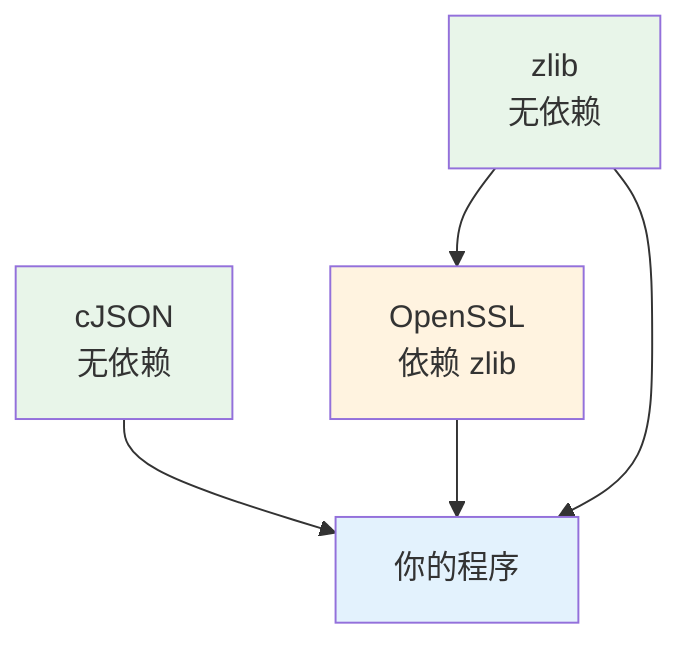

# 03 第三方库交叉编译流程
### 7.1 三种构建系统各自的写法

假设 sysroot 在 `/opt/sysroot/aarch64`，工具链前缀 `aarch64-linux-gnu-`。

#### Autotools（configure 脚本）

```bash
# 📋 示例（本机无交叉编译器，未实测）
export CROSS_COMPILE=aarch64-linux-gnu-
export CC=${CROSS_COMPILE}gcc
export CXX=${CROSS_COMPILE}g++
export AR=${CROSS_COMPILE}ar
export STRIP=${CROSS_COMPILE}strip
export PKG_CONFIG_LIBDIR=/opt/sysroot/aarch64/usr/lib/pkgconfig
export PKG_CONFIG_SYSROOT_DIR=/opt/sysroot/aarch64

./configure \
    --host=aarch64-linux-gnu \
    --build=x86_64-linux-gnu \
    --prefix=/usr \
    --sysconfdir=/etc \
    CFLAGS="--sysroot=/opt/sysroot/aarch64" \
    LDFLAGS="--sysroot=/opt/sysroot/aarch64"

make -j$(nproc)
make install DESTDIR=/opt/sysroot/aarch64
```

**三个关键参数**：

| 参数 | 含义 |
| --- | --- |
| `--host` | **程序将来跑在什么机器上** ← 交叉编译的核心开关 |
| `--build` | **程序现在在什么机器上编译**（通常可省略，脚本会猜） |
| `--prefix=/usr` + `DESTDIR=` | `prefix` 是**目标板上的**安装路径；`DESTDIR` 是**临时落地目录** |

:::warning[prefix 与 DESTDIR 是最容易搞混的一对]
- `--prefix=/usr` 会被**编译进程序**（程序运行时去 `/usr/share/xxx` 找数据）
- `DESTDIR=/opt/sysroot/aarch64` **不进程序**，只是让 `make install` 把文件装到 `DESTDIR + prefix` = `/opt/sysroot/aarch64/usr/`

**错误示范**：把 `--prefix` 设成宿主机的绝对路径 → 程序到板子上会去找那个宿主机路径，找不到就崩。
:::

#### CMake

```bash
cmake -DCMAKE_TOOLCHAIN_FILE=toolchain-aarch64.cmake \
      -DCMAKE_INSTALL_PREFIX=/usr \
      ..
cmake --build . -- -j$(nproc)
cmake --install . --prefix /opt/sysroot/aarch64
```

（toolchain file 内容见 [构建系统](./build-system)）

#### 手写 Makefile

```bash
make CC=aarch64-linux-gnu-gcc \
     AR=aarch64-linux-gnu-ar \
     CFLAGS="--sysroot=/opt/sysroot/aarch64 -I/opt/sysroot/aarch64/usr/include" \
     LDFLAGS="--sysroot=/opt/sysroot/aarch64 -L/opt/sysroot/aarch64/usr/lib"
```

### 7.2 依赖传递：一个真实场景

假设你要交叉编译一个用到 **OpenSSL + zlib + cJSON** 的程序：



**必须按依赖顺序编译**：先 zlib → 再 OpenSSL → 最后你的程序。

每编译完一个库，它的 `.so`、`.a` 和 `.pc` 文件都要进 sysroot，这样下一个库才能找到它。

:::tip[这就是为什么要用 Buildroot / Yocto]
手工处理依赖链在有 3 个依赖时还能应付，到 20 个（一个带 GUI 的应用可能依赖 GTK → cairo → pixman → freetype → libpng → zlib ……）就完全不可行了。

**Buildroot 和 Yocto 本质上就是"自动化依赖链 + 交叉编译 + 生成 rootfs"的框架**。当你开始移植第 5 个库时，就应该考虑它们了。
:::

### 7.3 部署到板子

```bash
# 只拷贝需要的库（不要整个 sysroot 拷过去，太大）
aarch64-linux-gnu-readelf -d ./app | grep NEEDED
# 逐个把对应的 .so 拷到板子

# 或用 rsync 同步 sysroot 里新增的部分
rsync -av /opt/sysroot/aarch64/usr/lib/ root@board:/usr/lib/

# 板子上刷新缓存
ssh root@board "ldconfig"
```

## 8. 验证（可在本机实操的部分）

```bash
# 1. 确认本机没有交叉编译器（本服务器实际状态）
ls /usr/bin/ | grep -E '^(arm|aarch64|riscv64).*-(gcc|g\+\+)' || echo "无交叉编译器"
dpkg -l | grep -i crossbuild || echo "无 crossbuild 包"
gcc -dumpmachine                      # x86_64-linux-gnu

# 2. 静态 vs 动态（实测过）
gcc -o hello_dyn hello.c && gcc -static -o hello_static hello.c
ls -l hello_dyn hello_static
ldd hello_dyn; ldd hello_static

# 3. RPATH vs RUNPATH（实测过）
gcc -o a.out prog.c -L./lib -lfoo -Wl,-rpath,./lib -Wl,--enable-new-dtags
readelf -d a.out | grep -E 'RPATH|RUNPATH'

# 4. 动态库查找链（实测过）
ldconfig -p | grep libc.so.6
cat /etc/ld.so.conf
ls /etc/ld.so.conf.d/

# 5. 交叉编译产物检查（拿到板子前必做）📋
file ./app                            # 确认 Machine 是 ARM/aarch64
readelf -d ./app | grep NEEDED        # 确认依赖的库
<toolchain>-readelf -h ./app | grep Machine
```

## 常见坑

| 症状 | 病根 |
| --- | --- |
| `Exec format error` / `Syntax error: "(" unexpected` | **架构不对**——拿 x86 的二进制放 ARM 上跑。用 `file` 确认 |
| `-bash: ./app: No such file or directory` 但文件存在 | **INTERP 里的 ld.so 路径在板子上不存在**。用 `file` 看 interpreter |
| `libfoo.so.0: cannot open shared object file` | 库没拷到板子，或拷了没跑 `ldconfig` |
| `version 'GLIBC_2.34' not found` | **工具链的 glibc 版本高于 rootfs 的**。换低版本工具链或升级 rootfs |
| 浮点计算结果完全错误，不报错 | **ABI 不匹配**（`gnueabi` 与 `gnueabihf` 混用） |
| `arm-none-eabi-gcc` 编译 Linux 程序找不到 `stdio.h` | 用错工具链了。跑 Linux 要用 `*-linux-*` |
| 静态链接出现 `getpwnam ... requires shared libraries` 警告 | glibc NSS 不支持纯静态。改用 musl |
| 设了 `LD_LIBRARY_PATH` 但不生效 | 程序用的是 **RPATH**（优先级更高）。改用 `-Wl,--enable-new-dtags` 重编 |
| 程序编译过了，板子上跑起来就段错误 | 可能是 ABI 不匹配、glibc 版本不对、或依赖库是 x86 的 |
| `pkg-config` 返回宿主机路径 | 没设 `PKG_CONFIG_LIBDIR` / `PKG_CONFIG_SYSROOT_DIR` |
| `--prefix` 设成宿主机绝对路径 | prefix 是**目标板上**的路径，应该是 `/usr` 之类 |
| 拷贝 sysroot 后链接失败 | 拷贝时**符号链接被展平**了。用 `rsync -a` 或 `cp -a` |
| 交叉编译器找不到头文件 | 没传 `--sysroot`，或 sysroot 路径不对 |
| `make` 用的是系统 gcc 而不是交叉 gcc | 没设 `CC`。make 内置默认是 `cc` |
| 程序体积远超预期 | 静态链接了整个 glibc。改用动态链接或 musl |
| 板子上 `ldd` 显示 `not a dynamic executable` | 是静态链接的（或架构不对），用 `file` 确认 |

## 自检清单

- [ ] 说出 host 和 target 的定义，以及交叉编译的判定条件
- [ ] 拆解 `arm-linux-gnueabihf` 的四个字段
- [ ] 说出 `arm-none-eabi` 与 `arm-linux-gnueabihf` 的**根本区别**及各自用途
- [ ] 解释 `gnueabi` 与 `gnueabihf` 的差异，以及混用的后果
- [ ] 说出工具链包含哪三大部分（编译器/binutils/C库）
- [ ] 说出 `readelf`、`nm`、`objcopy`、`strip` 各自的用途
- [ ] 解释 sysroot 是什么、为什么交叉编译需要它
- [ ] 说出 glibc 与 musl 的取舍
- [ ] 说出静态链接的优缺点，以及体积差异的量级
- [ ] 解释 glibc 静态链接 NSS 警告的含义和解决办法
- [ ] **按顺序**说出动态库的 5 级查找路径
- [ ] 说出 RPATH 与 RUNPATH 的优先级差异
- [ ] 说出"文件存在却报 No such file or directory"的真正原因
- [ ] 说出 `--host` 与 `--build` 的区别
- [ ] 说出 `--prefix` 与 `DESTDIR` 的区别
- [ ] 说出往板子装新库后必须执行的命令（`ldconfig`）
- [ ] 说出"工具链 glibc 不能高于 rootfs glibc"的原因

## 下一步

- [内核与驱动入门](./kernel)——开始进入板子软件栈的深层：内核分层与设备树
- [启动流程全链](./boot)——你编译的内核和 rootfs 是怎么被加载起来的

---

**翻页**：[← 上一页](./cross-compile-02) · [返回目录](./)
