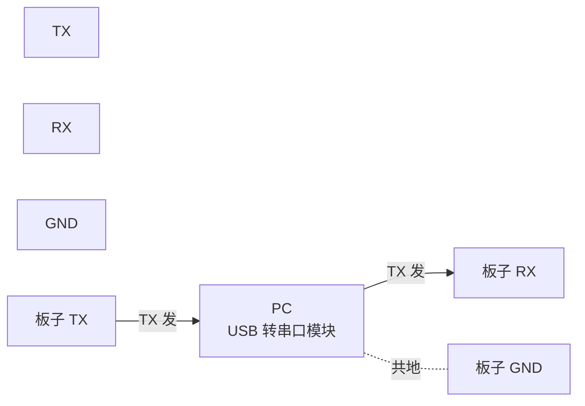

# 01 本页学什么
这是 Linux 主线的**收尾页**，也是你在板子上遇到问题时最该回来翻的一页。

- **串口控制台**：嵌入式唯一的交互通道，怎么配怎么用
- **gdb 与 core dump**：本机调试（实测演示）
- **gdbserver 远程调试**：板子上跑、PC 上调试（嵌入式的标准姿势）
- **dmesg 与 printk 等级**
- **性能工具**：哪些装了、哪些没装、没装时用什么替代
- **系统卡死排查**：一套固定的排查顺序
- **本主线的常见坑全集**

:::info[实测环境]
Debian 13 / 内核 6.12.94 / gdb 16.3。
实测工具可用性：`gdb` ✅、`top` ✅、`vmstat` ✅、`slabtop` ✅、`ss` ✅、`ip` ✅、**ASan** ✅。
**未安装**：`perf`、`strace`、`ltrace`、`iostat`、`htop`、`tcpdump`、`gdbserver`。我会给出替代方案。
:::

## 1. 串口控制台

### 1.1 为什么串口是嵌入式的命脉

开发板通常**没有显示器和键盘**，串口是唯一的：

1. **bootloader 命令行**（U-Boot）
2. **内核启动日志**（printk 输出）
3. **登录 shell**（getty）



**接线铁律**：

| 连接 | 说明 |
| --- | --- |
| 模块 TX → 板子 RX | **交叉** |
| 模块 RX → 板子 TX | **交叉** |
| 模块 GND → 板子 GND | **必须共地**，否则通信不可靠 |

:::danger[最常见的两个低级错误]
1. **TX/RX 没交叉**——接成 TX→TX、RX→RX，完全无输出
2. **没接 GND**——可能出现乱码或时断时续

另外注意**电平**：开发板串口通常是 **TTL 3.3V**（部分老板子 5V），**不要直接接 RS232 的 ±12V**，会烧芯片。USB 转串口模块要选 TTL 电平的（CH340/CP2102/FT232）。
:::

### 1.2 串口参数

**115200-8-N-1** 是最常见的配置：

| 参数 | 常见值 |
| --- | --- |
| 波特率 | **115200**（最常见），但 RK/全志部分板子是 **1500000** |
| 数据位 | 8 |
| 校验 | None（无） |
| 停止位 | 1 |
| 流控 | **None**（务必关闭 RTS/CTS） |

PC 端工具：

| 平台 | 工具 |
| --- | --- |
| Windows | PuTTY、SecureCRT、MobaXterm、串口调试助手 |
| Linux | `minicom`、`screen /dev/ttyUSB0 115200`、`picocom`、`tio` |
| macOS | `screen /dev/cu.usbserial-xxx 115200` |

```bash
# Linux 上最简单的方式
screen /dev/ttyUSB0 115200
# 退出：Ctrl+A 然后按 K 再按 Y

# picocom（更好用）
picocom -b 115200 /dev/ttyUSB0
# 退出：Ctrl+A 然后 Ctrl+X
```

:::tip[让内核也用串口做控制台]
内核启动参数里必须有 `console=ttyS0,115200`（设备名因板而异，可能是 `ttyS0`、`ttyAMA0`、`ttySAC0`）。

没有这个参数，内核日志不会从串口输出——你会看到 U-Boot 的输出但内核起来后就没动静了。
:::

## 2. gdb 本地调试与 core dump

### 2.1 实测：gdb 断点调试

```c
/* t.c */
#include <stdio.h>
int add(int a,int b){return a+b;}
int main(void){int r=add(2,3); printf("r=%d\n",r); return 0;}
```

```bash
$ gcc -g -O0 -o /tmp/t /tmp/t.c
$ cat > /tmp/g.txt <<'EOF'
set pagination off
break add
run
print a
print b
backtrace
continue
quit
EOF
$ gdb -q -batch -x /tmp/g.txt /tmp/t
Breakpoint 1 at 0x1143: file /tmp/t.c, line 2.
Breakpoint 1, add (a=2, b=3) at /tmp/t.c:2
#0  add (a=2, b=3) at /tmp/t.c:2
r=5
```

**要点**：

- **编译必须加 `-g`**（生成调试信息）
- **调试时用 `-O0`**——优化后变量可能被优化掉，单步执行会"跳来跳去"
- `-batch -x cmdfile` 是**非交互模式**，适合脚本化/在没有终端的环境（如 SSH 里）使用

### 2.2 core dump：崩溃后现场还原

**core dump 是进程崩溃时的内存快照**，可以事后分析。

实测本机的配置：

```bash
$ cat /proc/sys/kernel/core_pattern
core
$ ulimit -c
0
```

**`ulimit -c` 是 0 意味着不生成 core 文件**。这是 Debian 的默认设置，调试时必须打开：

```bash
ulimit -c unlimited          # 当前 shell 生效
# 永久生效：写入 /etc/security/limits.conf 或用 systemd 的 LimitCORE
```

`core_pattern` 是**生成路径的模板**：

| 值 | 含义 |
| --- | --- |
| `core` | 当前目录下生成 `core.<pid>` |
| `core.%e.%p.%t` | 按 程序名.PID.时间戳 命名 |
| `\|/usr/lib/systemd/systemd-coredump %P` | **管道给 systemd-coredump**（现代发行版常见） |

常用占位符：`%e` 程序名、`%p` PID、`%t` 时间戳、`%s` 信号号。

```bash
# 分析 core 文件
gdb ./myapp core.12345
(gdb) bt              # 看崩溃时的调用栈
(gdb) frame 0
(gdb) print variable
```

:::warning[嵌入式板子上 core dump 的两个问题]
1. **存储空间**：core 文件可能几十 MB，板子 Flash 装不下 → 写到 tmpfs 或 NFS 目录
2. **落盘慢**：崩溃时写大文件可能很慢

替代方案：让程序自己捕获 `SIGSEGV` 打印回溯（用 `backtrace()` / `backtrace_symbols()`），或者直接看内核打印的 oops 信息。
:::

## 3. gdbserver 远程调试（嵌入式标准姿势）

### 3.1 为什么

板子上跑 gdb 太重（gdb 二进制几十 MB），而且板子可能没有足够的存储空间和终端。

**标准做法**：


- **板子上**：跑 `gdbserver`（几百 KB，轻量）
- **PC 上**：跑**交叉编译版 gdb**，加载带调试信息的程序副本和源码

### 3.2 操作步骤（📋 示例，本机无 gdbserver）

```bash
# ===== 板子上 =====
gdbserver :2345 ./myapp
# 或附加到已运行的进程
gdbserver :2345 --attach $(pidof myapp)

# ===== PC 上 =====
aarch64-linux-gnu-gdb ./myapp        # 注意：这份 myapp 要有 -g 调试信息
(gdb) set sysroot /opt/sysroot/aarch64
(gdb) target remote 192.168.1.100:2345
(gdb) break main
(gdb) continue
```

:::warning[两端程序的版本必须一致]
PC 上 gdb 加载的程序，**必须和板子上跑的是同一次编译的产物**（或至少符号完全对应）。

**常见错误**：板子上跑了 strip 过的版本，PC 上却加载未 strip 的——这通常没问题（因为 strip 只删符号表不影响代码）。但**反过来**（代码不同）就会看到错乱的栈。

更稳妥的做法：**板子上也部署带 `-g` 的版本**（不 strip），调试完再换 strip 版。
:::

实测：本机没有 gdbserver

```bash
$ command -v gdbserver
gdbserver MISSING
```

安装方式：`apt install gdbserver`（板子上）或 `apt install gdb-multiarch`（PC 上，多架构 gdb）。

## 4. dmesg 与 printk 等级

（详见 [内核与驱动入门](./kernel)，这里只列排查时的操作要点）

```bash
# 实时跟踪内核日志（最常用）
dmesg -w

# 显示可读时间戳
dmesg -T

# 只看错误级别
dmesg -l err
dmesg -l err,warn

# 打开所有级别的输出（调试必备）
dmesg -n 8
# 或
echo 8 > /proc/sys/kernel/printk
```

实测（本机的 err/warn 级别日志）：

```bash
$ dmesg -l err,warn 2>/dev/null | tail -5
[    6.194267] systemd[1]: /etc/systemd/system/1panel-core.service:12: Unknown key 'StartLimitIntervalSec' in
[    6.196456] systemd[1]: /etc/systemd/system/1panel-agent.service:12: Unknown key 'StartLimitIntervalSec' in
[    9.146944] at24 0-0051: supply vcc not found, using dummy regulator
[   22.728139] kauditd_printk_skb: 95 callbacks suppressed
[ 5581.389356] hrtimer: interrupt took 532452 ns
```

**注意最后一条**：`hrtimer: interrupt took 532452 ns`——这是一个**中断处理耗时过长**的警告（532 微秒），在实时性要求高的场景下要关注。这类信息**只在 warn 级别出现**，用默认级别（4）也能看到，但用 `dmesg -l` 过滤能快速聚焦。

:::tip[printk 等级与排查]
`/proc/sys/kernel/printk` 的第一个数字是 **console_loglevel**，实测本机是 4。

**只有级别数字小于 4 的消息才会在控制台显示**——也就是说 `KERN_INFO`(6) 和 `KERN_DEBUG`(7) **不会显示**。

**板子上调试时第一件事**：`dmesg -n 8`。
:::

---

**翻页**：[下一页 →](./debug-02) · [返回目录](./)
